# BTCUSDT / UTC, holdout primary

- Pair: BTCUSDT
- Session: UTC (00:00–24:00 UTC, weekdays [0, 1, 2, 3, 4, 5, 6], Mon = 0)
- Period: 2026-01-01 to 2026-10-20 (holdout)
- Variant id: `0b7965b66511a24c67ea0b69f5f9dfb600fcb245827843cc87e036274b1f7332`
- Code version: `c3c05e53c0f38a9e57d65b716a78ddfb198004a84dd66fde28cf145808135dc5`
- Seed: 20260926 (generators per purpose: trade_bootstrap, day_bootstrap, sharpe_bootstrap, bh_sharpe_bootstrap, bh_diff_bootstrap, baseline_a, baseline_b)
- Role: primary; member of heatmap_1, heatmap_2, heatmap_3
- Costs: maker 0.02%, taker 0.05%, slippage 0.02%; risk 1.0% per trade; 1m resolution on

## Funnel

Every impulse that did not become a trade is counted by the first reason that stopped it (spec overview §6). Orders exclude intents skipped by the leverage cap.

| Stage | Count |
|---|---|
| impulses | 1748 |
| blocks seen | 1391 |
| skipped: no_candidate | 357 |
| skipped: ineligible | 50 |
| skipped: degenerate | 0 |
| skipped: no_displacement | 49 |
| skipped: mitigated | 150 |
| skipped: entry_above_price | 0 |
| skipped: trend | 0 |
| skipped: session_used | 856 |
| intents | 286 |
| skipped: leverage cap | 4 |
| orders placed | 282 |
| orders filled | 248 |
| fill rate | 87.9% |
| trades | 248 |
| trades in the R subset | 248 |
| trades open at the data end | 0 |

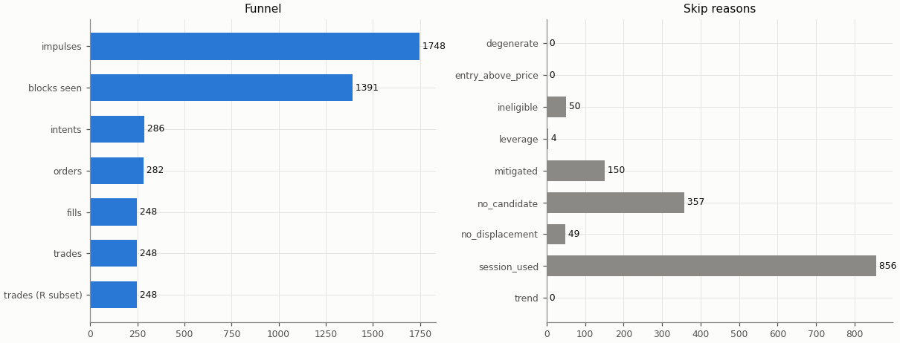

## Headline

Trade statistics use the R subset: trades closed by a stop, target or time exit (`exit_reason != data_end`); trades still open at the end of the data are left out.

| Headline | Value |
|---|---|
| trades (R subset) | 248 |
| win rate | 30.6% |
| mean gross R | -0.081 |
| mean net R | -0.504 |
| mean net R, 95% CI (trade bootstrap) | -0.694 to -0.311 |
| mean net R, 95% CI (day-block bootstrap) | -0.696 to -0.310 |
| median net R | -1.304 |
| std of net R | 1.544 |
| profit factor | 0.52 |
| mean cost (R) | 0.423 |
| mean funding (R) | 0.002 |
| mean hold (minutes) | 78.8 |
| Sharpe (annualised, daily) | -5.67 |
| Sharpe, 95% CI (10-day block bootstrap) | -7.85 to -3.75 |
| max drawdown | 73.1% |
| total return | -72.3% |
| exposure (share of candles in a trade) | 5.5% |
| mean notional / equity at the daily marks | 0.036 |
| max concurrent positions | 1 |

## Baselines

| Baseline | Observed mean net R | Runs: mean | Runs: std | p (one-sided) | z | p (Holm) | Runs |
|---|---|---|---|---|---|---|---|
| A: random entry time in the strategy's own sessions | -0.504 | -0.402 | 0.095 | 0.862 | -1.08 | 1 | 5000 |
| B: random sessions and entry times | -0.504 | -0.414 | 0.101 | 0.813 | -0.89 | 1 | 5000 |

| Table A | Value |
|---|---|
| trades covered | 248 |
| trades left out | 0 |
| baseline B: mean trades per run | 247.9 |

Holm adjustment over the holdout family of 9 primary cells (tested: A 9, B 9, buy-and-hold 9) at α = 0.05.

Baseline design (judgment calls, overview risk 13): a baseline trade enters at the open of a uniformly drawn in-session candle with the maker fee, keeps the real trade's stop distance in ATR and the variant's target and hold rule, and pays actual funding; baseline trades that reach the data end are left out of their run's mean.

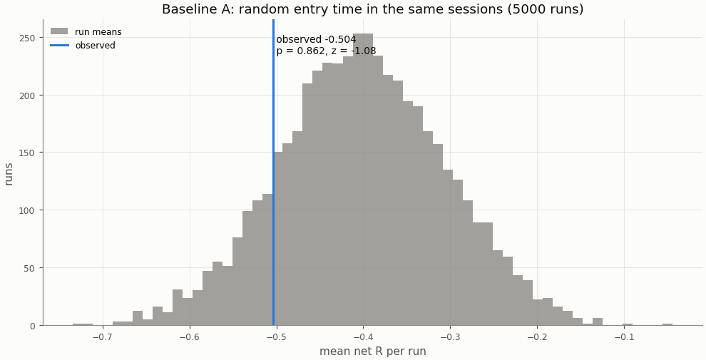

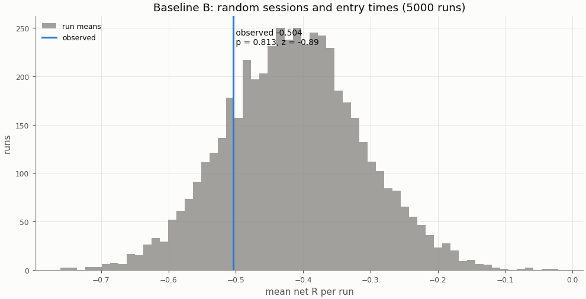

## Buy-and-hold

A constant 1× long in the perpetual with funding, scaled to the strategy's in-sample daily volatility; Sharpe is scale-invariant, the scaling matters for return and drawdown.

| Buy-and-hold | Value |
|---|---|
| days | 293 |
| buy-and-hold Sharpe | 0.01 |
| buy-and-hold Sharpe, 95% CI | -2.32 to 2.20 |
| strategy Sharpe | -5.67 |
| Sharpe difference (strategy − buy-and-hold) | -5.68 |
| Sharpe difference, 95% CI (paired block bootstrap) | -8.68 to -2.66 |
| p_BH (one-sided) | 1 |
| p_BH (Holm) | 1 |
| buy-and-hold total return (1×) | -7.5% |
| vol scale (σ strategy / σ buy-and-hold) | 0.437 |
| σ strategy (daily, in-sample) | 0.01420 |
| σ buy-and-hold (daily, in-sample) | 0.03246 |
| vol-scaled buy-and-hold total return | -1.4% |
| vol-scaled buy-and-hold max drawdown | 18.7% |

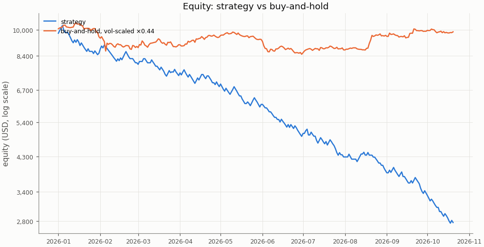

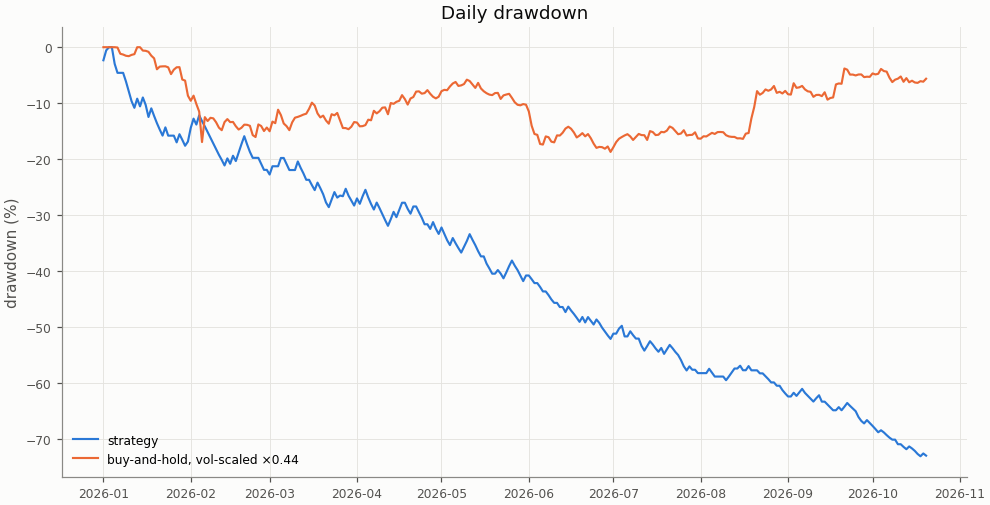

## Costs

Cost in R is fees, slippage and funding divided by the stop distance; a trade whose cost exceeds 1 R loses even when it reaches a 1 R target.

| Cost | Value |
|---|---|
| share of trades with cost above 1 R | 4.8% |

| Cost distribution | min | p05 | p25 | p50 | p75 | p95 | max | mean |
|---|---|---|---|---|---|---|---|---|
| cost per trade (R) | 0.030 | 0.112 | 0.215 | 0.343 | 0.513 | 0.988 | 2.021 | 0.423 |
| stop distance (% of entry) | 0.045 | 0.081 | 0.146 | 0.210 | 0.308 | 0.510 | 1.491 | 0.256 |
| stop distance (ATR14) | 0.226 | 0.503 | 0.695 | 0.850 | 1.099 | 1.674 | 3.872 | 0.937 |
| implied leverage (×) | 0.67 | 1.96 | 3.24 | 4.75 | 6.87 | 12.29 | 22.47 | 5.66 |
| funding (R) | -0.0428 | 0.0000 | 0.0000 | 0.0000 | 0.0000 | 0.0095 | 0.0796 | 0.0016 |

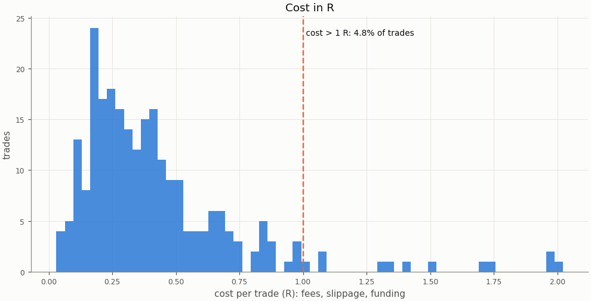

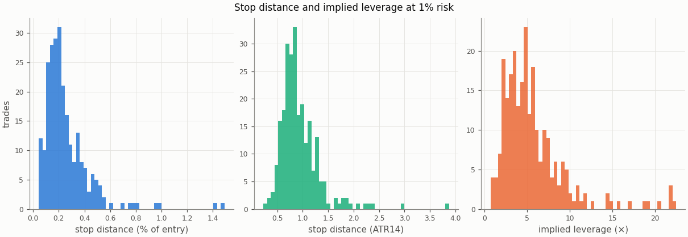

### Re-pricing (D13)

The same trades and baseline runs re-priced at other costs, without re-simulation; descriptive only, the verdict uses the registered costs.

| Slippage | Maker fee | Taker fee | n | Mean net R | 95% CI | Win rate | p_A | p_B | Costs |
|---|---|---|---|---|---|---|---|---|---|
| 0.00% | 0.00% | 0.05% | 248 | -0.278 | -0.465 to -0.087 | 30.6% | 0.833 | 0.793 |  |
| 0.00% | 0.02% | 0.05% | 248 | -0.426 | -0.607 to -0.241 | 30.6% | 0.85 | 0.803 |  |
| 0.02% | 0.00% | 0.05% | 248 | -0.356 | -0.550 to -0.158 | 30.6% | 0.845 | 0.801 |  |
| 0.02% | 0.02% | 0.05% | 248 | -0.504 | -0.694 to -0.311 | 30.6% | 0.862 | 0.813 | registered |
| 0.05% | 0.00% | 0.05% | 248 | -0.473 | -0.679 to -0.264 | 30.6% | 0.859 | 0.813 |  |
| 0.05% | 0.02% | 0.05% | 248 | -0.621 | -0.824 to -0.416 | 30.6% | 0.873 | 0.822 |  |
| 0.10% | 0.00% | 0.05% | 248 | -0.668 | -0.896 to -0.441 | 30.6% | 0.877 | 0.828 |  |
| 0.10% | 0.02% | 0.05% | 248 | -0.816 | -1.041 to -0.593 | 30.6% | 0.889 | 0.837 |  |

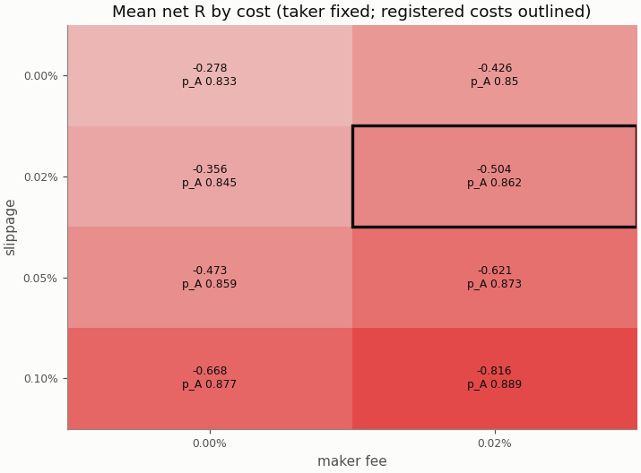

## Robustness

The grid is in-sample only; the heatmaps are in the in-sample primary report.

## Alpha decay

Per calendar year (max drawdown starts from the previous year-end equity; fill rate is filled / placed entry orders by placement year).

| Year | n | Win rate | Mean net R | Sharpe | Max DD | Fill rate |
|---|---|---|---|---|---|---|
| 2026 | 248 | 30.6% | -0.504 | -5.67 | 73.1% | 87.9% |

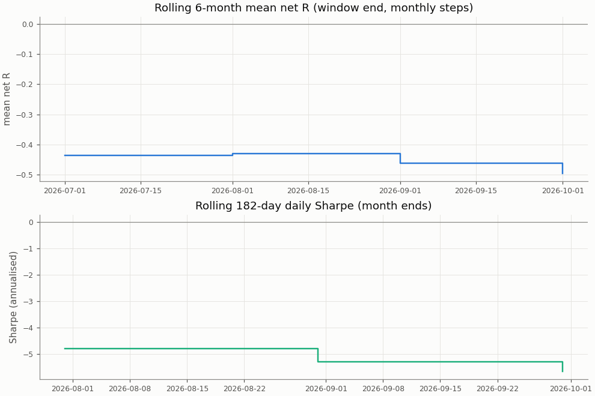

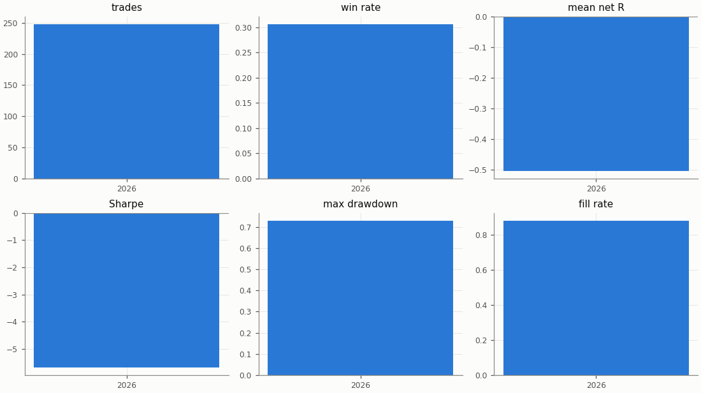

## Regimes and calendar

Trend: daily ADX(14) above 25 as of the day before entry. Volatility: 30-day realised vol of daily log returns as of the day before entry, above (`high`) or below (`low`) the in-sample median 0.02804; trades before the indicators are defined are unlabelled.

| Regime | n | Win rate | Mean net R |
|---|---|---|---|
| trend: no_trend | 95 | 35.8% | -0.377 |
| trend: trend | 153 | 27.5% | -0.582 |
| vol: high | 27 | 29.6% | -0.365 |
| vol: low | 221 | 30.8% | -0.521 |

| Day of week (UTC) | n | Win rate | Mean net R |
|---|---|---|---|
| Monday | 35 | 37.1% | -0.237 |
| Tuesday | 39 | 41.0% | -0.058 |
| Wednesday | 35 | 28.6% | -0.478 |
| Thursday | 35 | 25.7% | -0.570 |
| Friday | 35 | 22.9% | -0.680 |
| Saturday | 35 | 34.3% | -0.637 |
| Sunday | 34 | 23.5% | -0.930 |

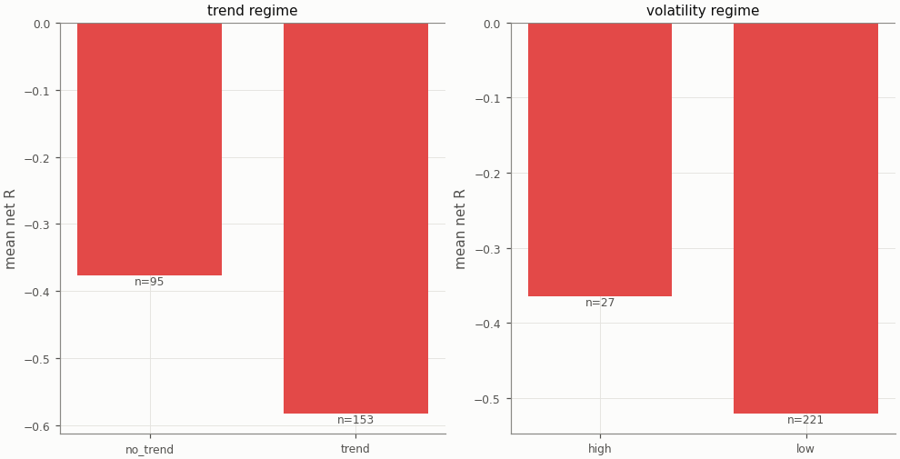

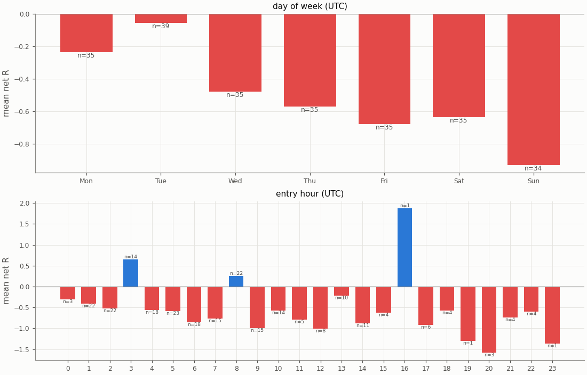

## Diagnostics

| Count | Value |
|---|---|
| trades open at the data end (left out of the R subset) | 0 |
| ambiguous candles resolved without full 1m data | 0 |
| max concurrent positions | 1 |
| funding paid in total (USD) | 19.41 |

| Fill resolution | Fills |
|---|---|
| 15m_unambiguous | 385 |
| 1m | 96 |
| 1m_pessimistic | 15 |

| Exit reason | n | Win rate | Mean net R |
|---|---|---|---|
| stop | 172 | 0.0% | -1.508 |
| target | 76 | 100.0% | 1.769 |

| Trade distribution | min | p05 | p25 | p50 | p75 | p95 | max | mean |
|---|---|---|---|---|---|---|---|---|
| hold (minutes) | 0.0 | 1.0 | 15.0 | 39.5 | 90.0 | 270.0 | 1035.0 | 78.8 |
| MAE (R) | -5.377 | -2.430 | -1.519 | -1.199 | -0.790 | -0.139 | -0.005 | -1.203 |
| MFE (R) | 0.047 | 0.274 | 0.664 | 1.248 | 2.098 | 2.982 | 7.229 | 1.442 |

Share of this variant's trades whose candidate candle is also traded by the other session variants (computed at report time from their trade tables): London 13.7%, NY 4.0%; any of them 16.9%. The session variants are not independent tests.

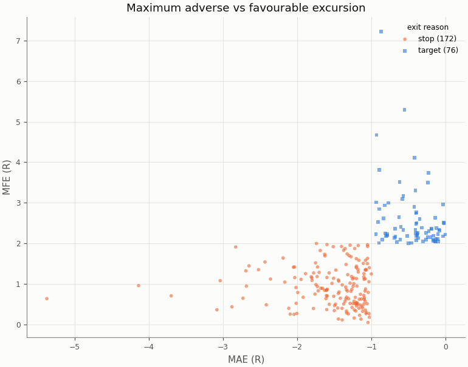

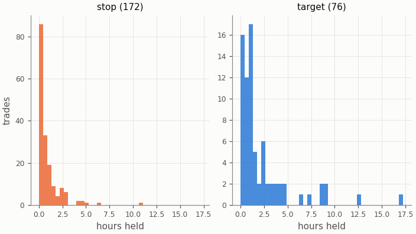

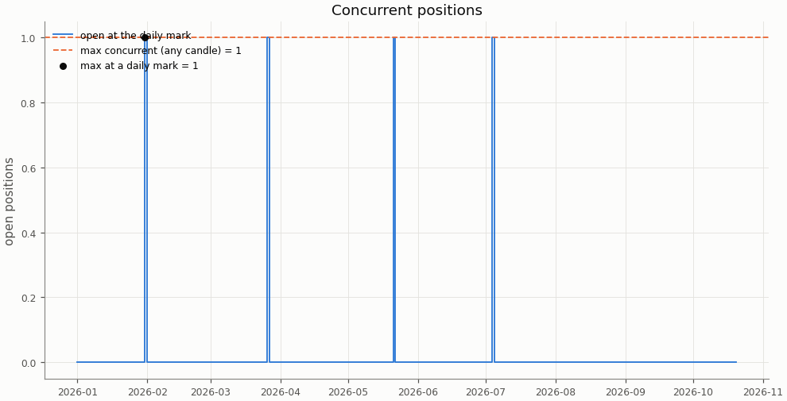

## Deflated Sharpe ratio

| Daily returns | Value |
|---|---|
| daily Sharpe (not annualised) | -0.2969 |
| days T | 293 |
| skew | 0.558 |
| kurtosis (non-excess) | 1.965 |

| Trials | N | V (variance of daily Sharpe) | SR* | DSR |
|---|---|---|---|---|
| this pair × session's grid | n/a | n/a | n/a | n/a |
| all grid variants | n/a | n/a | n/a | n/a |

The DSR is computed for the in-sample grid only; the holdout tests one pre-registered configuration per cell.

Caveat: the grid cells share most of their trades, so the effective number of independent trials is far below N and the DSR is conservative.

## Notes

- `15m_pessimistic_missing_1m`: 0 fills and 0 ambiguous (candle, order) pairs were resolved by the pessimistic 15m rule because 1m data was incomplete.
- Data gaps overlapping a trade (computed at report time from the candle manifests): 15m: 0 trades over 0 gaps; 1m: 0 trades over 0 gaps.
