# ETHUSDT / NY, in-sample primary

- Pair: ETHUSDT
- Session: NY (09:30–16:00 America/New_York, weekdays [0, 1, 2, 3, 4], Mon = 0)
- Period: 2020-01-01 to 2025-12-31 (in-sample)
- Variant id: `0c136a7ec06ff5c271961cd7ffe2c197df9723a3151027567a77b071b2a5c996`
- Code version: `c3c05e53c0f38a9e57d65b716a78ddfb198004a84dd66fde28cf145808135dc5`
- Seed: 20260926 (generators per purpose: trade_bootstrap, day_bootstrap, sharpe_bootstrap, bh_sharpe_bootstrap, bh_diff_bootstrap, baseline_a, baseline_b)
- Role: primary; member of heatmap_1, heatmap_2, heatmap_3
- Costs: maker 0.02%, taker 0.05%, slippage 0.02%; risk 1.0% per trade; 1m resolution on

## Funnel

Every impulse that did not become a trade is counted by the first reason that stopped it (spec overview §6). Orders exclude intents skipped by the leverage cap.

| Stage | Count |
|---|---|
| impulses | 13521 |
| blocks seen | 10592 |
| skipped: no_candidate | 2929 |
| skipped: ineligible | 8971 |
| skipped: degenerate | 0 |
| skipped: no_displacement | 82 |
| skipped: mitigated | 216 |
| skipped: entry_above_price | 0 |
| skipped: trend | 0 |
| skipped: session_used | 452 |
| intents | 871 |
| skipped: leverage cap | 0 |
| orders placed | 871 |
| orders filled | 572 |
| fill rate | 65.7% |
| trades | 572 |
| trades in the R subset | 572 |
| trades open at the data end | 0 |

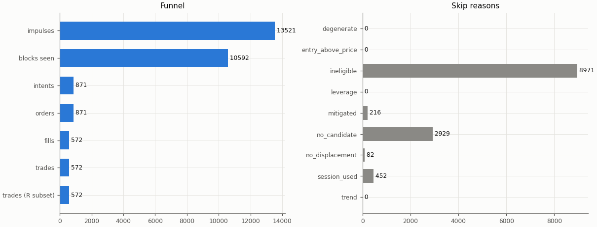

## Headline

Trade statistics use the R subset: trades closed by a stop, target or time exit (`exit_reason != data_end`); trades still open at the end of the data are left out.

| Headline | Value |
|---|---|
| trades (R subset) | 572 |
| win rate | 33.7% |
| mean gross R | 0.012 |
| mean net R | -0.140 |
| mean net R, 95% CI (trade bootstrap) | -0.259 to -0.018 |
| mean net R, 95% CI (day-block bootstrap) | -0.257 to -0.022 |
| median net R | -1.117 |
| std of net R | 1.469 |
| profit factor | 0.82 |
| mean cost (R) | 0.152 |
| mean funding (R) | 0.004 |
| mean hold (minutes) | 150.7 |
| Sharpe (annualised, daily) | -0.94 |
| Sharpe, 95% CI (10-day block bootstrap) | -1.74 to -0.11 |
| max drawdown | 59.8% |
| total return | -57.8% |
| exposure (share of candles in a trade) | 3.0% |
| mean notional / equity at the daily marks | 0.032 |
| max concurrent positions | 1 |

## Baselines

| Baseline | Observed mean net R | Runs: mean | Runs: std | p (one-sided) | z | p (Holm) | Runs |
|---|---|---|---|---|---|---|---|
| A: random entry time in the strategy's own sessions | -0.140 | -0.071 | 0.055 | 0.898 | -1.26 | 1 | 5000 |
| B: random sessions and entry times | -0.140 | -0.134 | 0.061 | 0.54 | -0.10 | 1 | 5000 |

| Table A | Value |
|---|---|
| trades covered | 572 |
| trades left out | 0 |
| baseline B: mean trades per run | 571.9 |

Holm adjustment over the in-sample family of 9 primary cells (tested: A 9, B 9, buy-and-hold 9) at α = 0.05.

Baseline design (judgment calls, overview risk 13): a baseline trade enters at the open of a uniformly drawn in-session candle with the maker fee, keeps the real trade's stop distance in ATR and the variant's target and hold rule, and pays actual funding; baseline trades that reach the data end are left out of their run's mean.

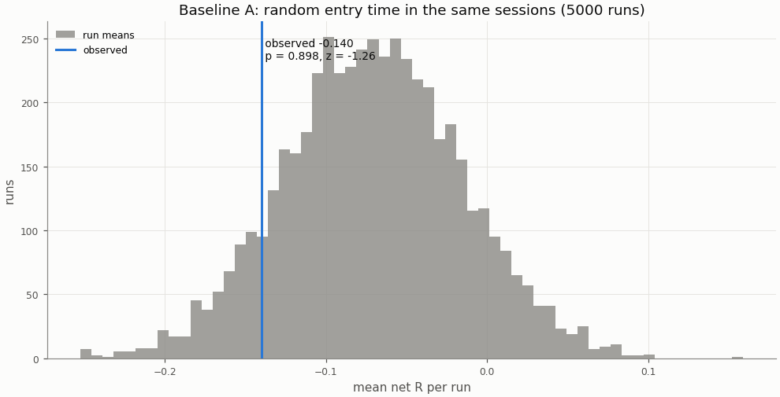

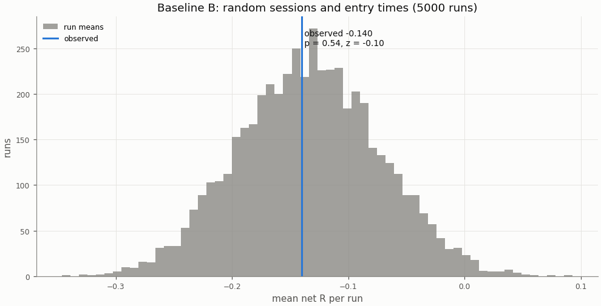

## Buy-and-hold

A constant 1× long in the perpetual with funding, scaled to the strategy's in-sample daily volatility; Sharpe is scale-invariant, the scaling matters for return and drawdown.

| Buy-and-hold | Value |
|---|---|
| days | 2192 |
| buy-and-hold Sharpe | 0.87 |
| buy-and-hold Sharpe, 95% CI | 0.10 to 1.65 |
| strategy Sharpe | -0.94 |
| Sharpe difference (strategy − buy-and-hold) | -1.81 |
| Sharpe difference, 95% CI (paired block bootstrap) | -2.87 to -0.75 |
| p_BH (one-sided) | 1 |
| p_BH (Holm) | 1 |
| buy-and-hold total return (1×) | 822.4% |
| vol scale (σ strategy / σ buy-and-hold) | 0.171 |
| σ strategy (daily, in-sample) | 0.00742 |
| σ buy-and-hold (daily, in-sample) | 0.04346 |
| vol-scaled buy-and-hold total return | 97.2% |
| vol-scaled buy-and-hold max drawdown | 21.6% |

The figures continue into the holdout run (shaded), chained onto the in-sample end.

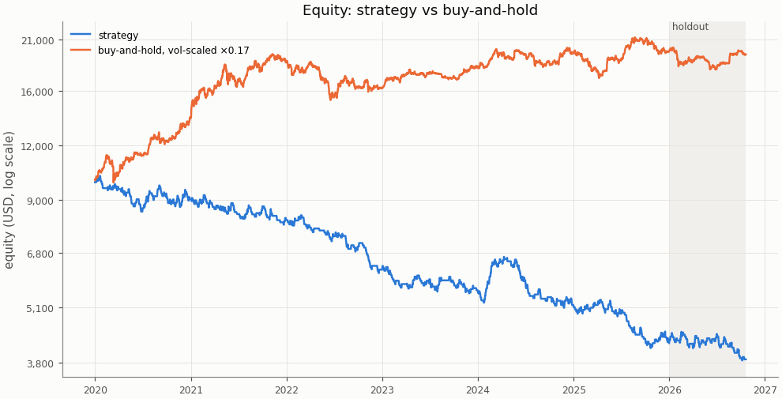

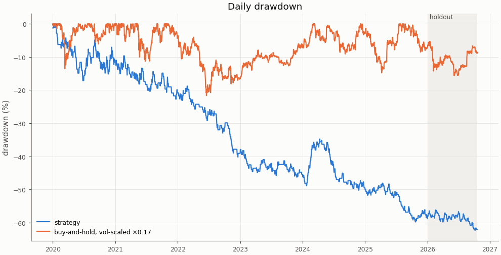

## Costs

Cost in R is fees, slippage and funding divided by the stop distance; a trade whose cost exceeds 1 R loses even when it reaches a 1 R target.

| Cost | Value |
|---|---|
| share of trades with cost above 1 R | 0.0% |

| Cost distribution | min | p05 | p25 | p50 | p75 | p95 | max | mean |
|---|---|---|---|---|---|---|---|---|
| cost per trade (R) | 0.016 | 0.042 | 0.084 | 0.129 | 0.194 | 0.348 | 0.797 | 0.152 |
| stop distance (% of entry) | 0.113 | 0.247 | 0.400 | 0.557 | 0.785 | 1.441 | 5.531 | 0.667 |
| stop distance (ATR14) | 0.375 | 0.577 | 0.744 | 0.947 | 1.192 | 1.770 | 4.253 | 1.032 |
| implied leverage (×) | 0.18 | 0.69 | 1.27 | 1.79 | 2.50 | 4.05 | 8.87 | 2.04 |
| funding (R) | -0.0226 | 0.0000 | 0.0000 | 0.0000 | 0.0000 | 0.0222 | 0.1910 | 0.0038 |

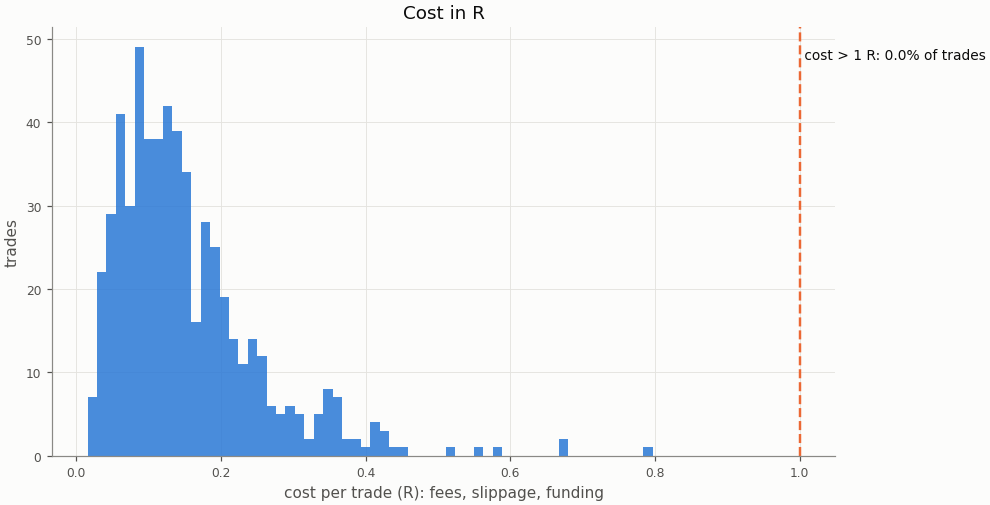

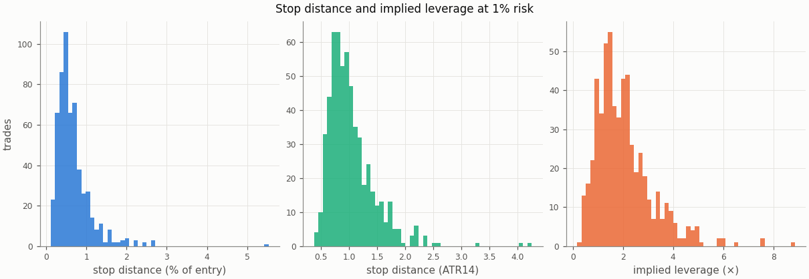

### Re-pricing (D13)

The same trades and baseline runs re-priced at other costs, without re-simulation; descriptive only, the verdict uses the registered costs.

| Slippage | Maker fee | Taker fee | n | Mean net R | 95% CI | Win rate | p_A | p_B | Costs |
|---|---|---|---|---|---|---|---|---|---|
| 0.00% | 0.00% | 0.05% | 572 | -0.059 | -0.177 to 0.063 | 33.7% | 0.895 | 0.539 |  |
| 0.00% | 0.02% | 0.05% | 572 | -0.113 | -0.230 to 0.007 | 33.7% | 0.896 | 0.539 |  |
| 0.02% | 0.00% | 0.05% | 572 | -0.086 | -0.206 to 0.037 | 33.7% | 0.896 | 0.539 |  |
| 0.02% | 0.02% | 0.05% | 572 | -0.140 | -0.259 to -0.018 | 33.7% | 0.898 | 0.54 | registered |
| 0.05% | 0.00% | 0.05% | 572 | -0.126 | -0.249 to -0.001 | 33.7% | 0.898 | 0.541 |  |
| 0.05% | 0.02% | 0.05% | 572 | -0.181 | -0.302 to -0.056 | 33.7% | 0.9 | 0.541 |  |
| 0.10% | 0.00% | 0.05% | 572 | -0.193 | -0.320 to -0.063 | 33.7% | 0.901 | 0.54 |  |
| 0.10% | 0.02% | 0.05% | 572 | -0.248 | -0.373 to -0.119 | 33.7% | 0.903 | 0.541 |  |

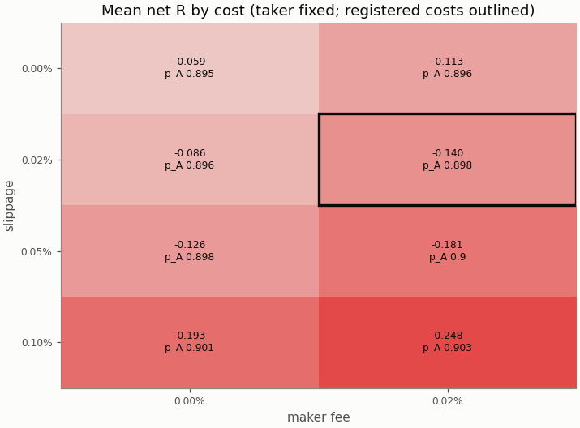

## Robustness

### Heatmap 1: r_target × entry_level

8 of 8 cells have run; the primary is outlined.

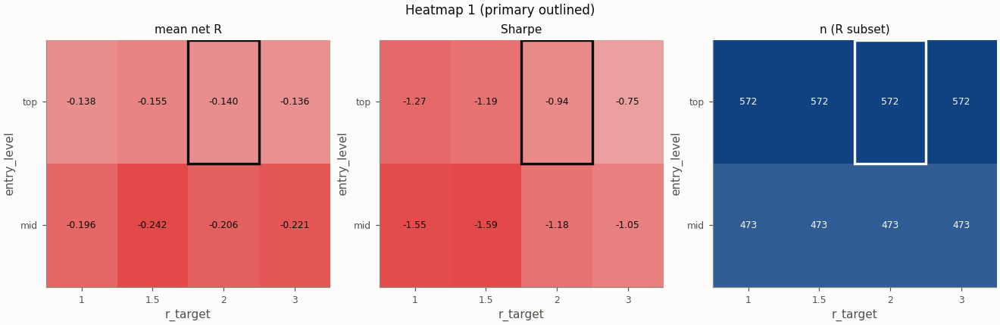

### Heatmap 2: swing_k × confirm_n

9 of 9 cells have run; the primary is outlined.

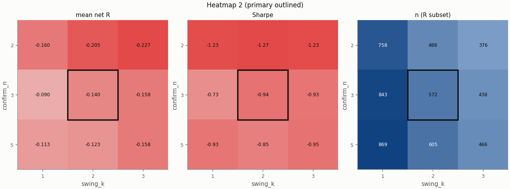

### Heatmap 3: stop_buffer × hold_rule

16 of 16 cells have run; the primary is outlined.

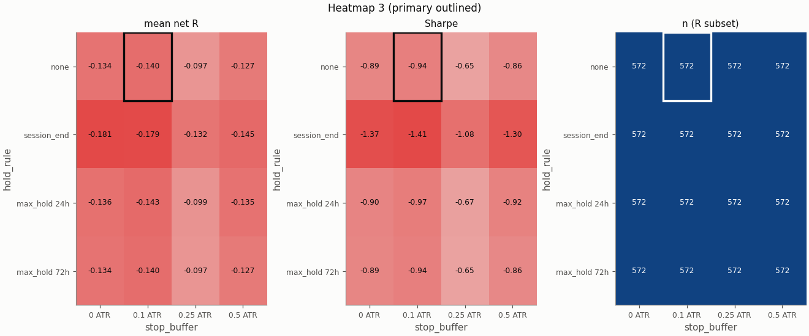

Grid variants of this pair × session:

- heatmap_1: entry_level=mid ([report](../06d05a40d3f683017fc8fba1d535211ab2959f5327ff0950859b9abeb7cb1922/report.md))
- heatmap_2: confirm_n=2, swing_k=3 ([report](../15d028b89dc9c0eb63ec4463d55b87616578ed675527719d51532b50b4aab382/report.md))
- heatmap_3: stop_buffer=0.25 ATR ([report](../2149f037ae825636d40efbc57038e1328c49198d354681dbead6880af4d2e81b/report.md))
- single_5: stop_buffer=0.25% ([report](../235f2024b5950d2b31c75a98d556aa014e2a97896f653904e48742f3e4dea4cc/report.md))
- heatmap_2: confirm_n=5, swing_k=1 ([report](../25e8a6dda6b5691f84f903dad2a6f0923687f60b241b4b0f315a2652a2c437e7/report.md))
- single_4: stop_buffer=0.1% ([report](../27b02866d22525221d74aafd48ac65692c9c2fc52a196ba1d7844105b3a067d2/report.md))
- heatmap_3: hold_rule=max_hold 24h, stop_buffer=0.5 ATR ([report](../2f7d3ba3ea9f7b745b590f965707bf62f0cf375a62a8642456d73edbd1fa9051/report.md))
- heatmap_3: stop_buffer=0 ATR ([report](../385d83e670f7e62bda4e8f5ebd78e0acd39ef49ee0afc10ffbe77acc92987bae/report.md))
- heatmap_3: hold_rule=max_hold 72h, stop_buffer=0 ATR ([report](../3b9d9eee4ce95c2ec2b4646f4e61650ec2e324e5747e85576ddbcb5213990042/report.md))
- single_2: pierce=0.0005 ([report](../40bfd609d1b268c608c8d92ee83b432e8ee4f4cc76c19cc63770ee4c2a969a35/report.md))
- heatmap_1: r_target=1.5 ([report](../500878d8c49950ae79def75b1a6ab9a9006350b55a7f44d40e828f5727cce226/report.md))
- heatmap_1: entry_level=mid, r_target=3 ([report](../50d2d799cdb738fe6aab011f41cbebeed59f7e1a5250e49f2655772cdc4e259b/report.md))
- heatmap_1: r_target=3 ([report](../541bd7957e4c4bc6ec5d932c9ca8a57c0c4f5fe5a7e7d5956b6b128c617ae0bb/report.md))
- single_1: zone=body ([report](../61cdb5d6da7d93943df14db53a2ddb4c9da850112a6d759a163d478d9adaf338/report.md))
- heatmap_3: hold_rule=session_end ([report](../63ef8951690d399b3d1356c53c1c568c47b3ba569fd85624b24d86cc0db209b6/report.md))
- heatmap_3: stop_buffer=0.5 ATR ([report](../6770fb0a1956d5e9acf8d8ed6f6e167ebc731c61a2cfb177e868b56657206b7c/report.md))
- heatmap_3: hold_rule=session_end, stop_buffer=0 ATR ([report](../76ff8ad066af3b4f2ee6428536673971f8cd88d208224c1d9789fc7371cb65fc/report.md))
- heatmap_2: confirm_n=2, swing_k=1 ([report](../7759306cfc425cba5644c1ab4f671ea601ba4e99ac9b8f639398fe324122c8df/report.md))
- single_3: trend_filter=on ([report](../787b41daa474ae107f2174bbed3cb10080157597608c69810522dfc3ff0ae6cf/report.md))
- heatmap_3: hold_rule=max_hold 72h ([report](../7a1534448e16e20ce44d23c78146703015540659056fb0b830f5512f188e120b/report.md))
- heatmap_3: hold_rule=max_hold 72h, stop_buffer=0.25 ATR ([report](../81571c23ca80eb6006b113e1b192e12ce18215cb4fd0e3dbd189997d108be5af/report.md))
- heatmap_3: hold_rule=max_hold 24h, stop_buffer=0.25 ATR ([report](../8dc7c4deca31c7d3bf97bcaec0d9f278f5d64ce39d6909b2dcfe40d49c6e773b/report.md))
- heatmap_2: confirm_n=2 ([report](../8e5e835fdaaa2d2f142fd806dfdef127d9f983a4b3b339ec59745b0dad099374/report.md))
- heatmap_2: swing_k=1 ([report](../8f2f8b7b8e8db2a2c248ac2122b927315369dc1bb9d9d99c37018a9c05d64040/report.md))
- heatmap_3: hold_rule=session_end, stop_buffer=0.25 ATR ([report](../9b88c92d0dd985bf7453a6c8e45aa93fe02aa1cb12ac2a0e6fb5b65e27541871/report.md))
- heatmap_3: hold_rule=session_end, stop_buffer=0.5 ATR ([report](../9e947a8f040f5f590a45600b2f0e845c3579d8b70e06ea25ea0f6543412c34dc/report.md))
- heatmap_3: hold_rule=max_hold 72h, stop_buffer=0.5 ATR ([report](../aabfbd7b7a1943ddb48bee3966f7c49b55d1510dcdf6c99711004996b834a081/report.md))
- heatmap_3: hold_rule=max_hold 24h, stop_buffer=0 ATR ([report](../b2fa09ccd63f987dbdea33720ad96eb3cf791fdb3c4fcc727fb4a6b8d5a2c0ac/report.md))
- heatmap_1: entry_level=mid, r_target=1.5 ([report](../b4c2d023663962d2220aca44b3ce4f21dfe0902d6710643eea77e3c690c4d75a/report.md))
- heatmap_2: confirm_n=5, swing_k=3 ([report](../b978c4157598f81e6c1f4567db831ed92ff5a5c0b02ddaf36622aeead00e84dc/report.md))
- heatmap_2: swing_k=3 ([report](../bedb4dbb6a016273dfd5da63db8c76da84f46718d9ef8be0a7d71d6dc7d5e698/report.md))
- heatmap_1: entry_level=mid, r_target=1 ([report](../d2e5b3767eca7a6043ea67db743dc9800f1fa24ac4620448af31e0fda3d478e3/report.md))
- heatmap_1: r_target=1 ([report](../f154a5ba08e0eb8117ea4c7010a4d40d29b15cc7b7cd51a524e43b478993704b/report.md))
- heatmap_2: confirm_n=5 ([report](../f2ddc0728f4f31d1f82dfe27cc87fd8a1dcdbfd902e24b94f4f78707ac46719b/report.md))
- heatmap_3: hold_rule=max_hold 24h ([report](../ff1ff4c6578b975d3c0b1927d0d93e17bb6794ac862d63d7e4447538d2a19cb3/report.md))

## Alpha decay

Per calendar year (max drawdown starts from the previous year-end equity; fill rate is filled / placed entry orders by placement year).

| Year | n | Win rate | Mean net R | Sharpe | Max DD | Fill rate |
|---|---|---|---|---|---|---|
| 2020 | 113 | 36.3% | -0.079 | -0.57 | 17.2% | 67.7% |
| 2021 | 95 | 33.7% | -0.106 | -0.73 | 14.5% | 61.3% |
| 2022 | 76 | 26.3% | -0.335 | -2.09 | 26.4% | 63.3% |
| 2023 | 82 | 36.6% | -0.121 | -0.73 | 13.5% | 59.4% |
| 2024 | 106 | 36.8% | -0.062 | -0.45 | 23.7% | 73.6% |
| 2025 | 100 | 31.0% | -0.192 | -1.32 | 22.6% | 68.0% |

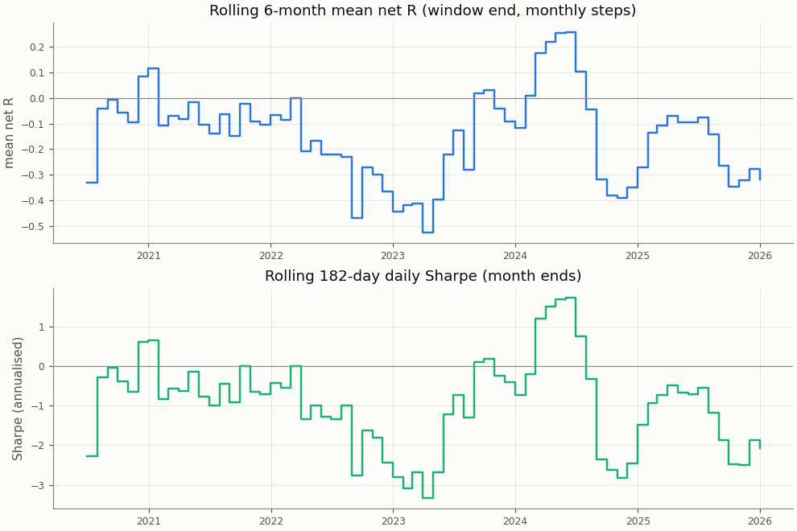

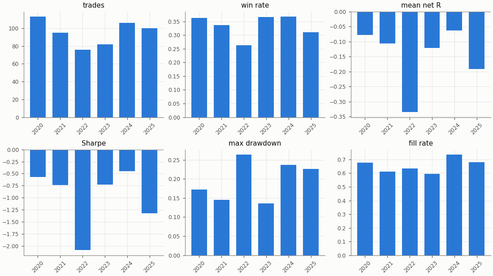

## Regimes and calendar

Trend: daily ADX(14) above 25 as of the day before entry. Volatility: 30-day realised vol of daily log returns as of the day before entry, above (`high`) or below (`low`) the in-sample median 0.03757; trades before the indicators are defined are unlabelled.

| Regime | n | Win rate | Mean net R |
|---|---|---|---|
| trend: no_trend | 227 | 37.4% | -0.047 |
| trend: trend | 345 | 31.3% | -0.201 |
| vol: high | 289 | 32.5% | -0.153 |
| vol: low | 283 | 35.0% | -0.127 |

| Day of week (UTC) | n | Win rate | Mean net R |
|---|---|---|---|
| Monday | 117 | 42.7% | 0.138 |
| Tuesday | 95 | 27.4% | -0.338 |
| Wednesday | 134 | 31.3% | -0.223 |
| Thursday | 115 | 30.4% | -0.241 |
| Friday | 111 | 36.0% | -0.060 |

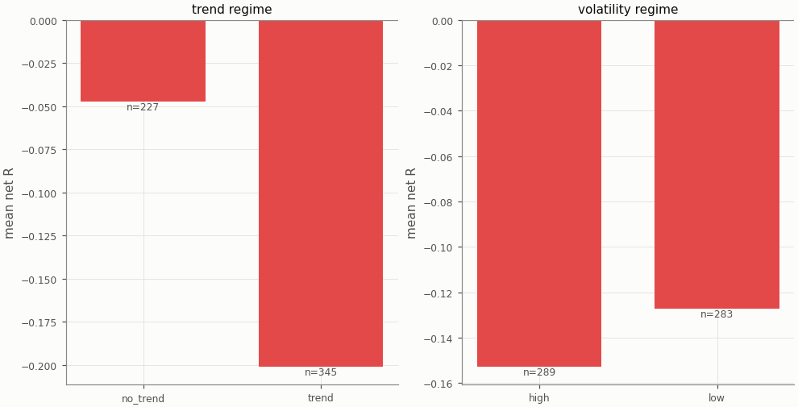

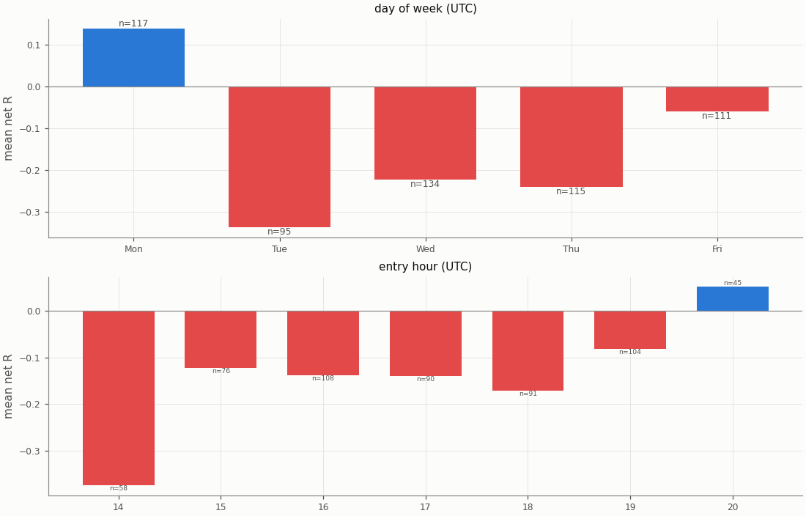

## Diagnostics

| Count | Value |
|---|---|
| trades open at the data end (left out of the R subset) | 0 |
| ambiguous candles resolved without full 1m data | 0 |
| max concurrent positions | 1 |
| funding paid in total (USD) | 158.12 |

| Fill resolution | Fills |
|---|---|
| 15m_unambiguous | 980 |
| 1m | 136 |
| 1m_pessimistic | 28 |

| Exit reason | n | Win rate | Mean net R |
|---|---|---|---|
| stop | 379 | 0.0% | -1.185 |
| target | 193 | 100.0% | 1.912 |

| Trade distribution | min | p05 | p25 | p50 | p75 | p95 | max | mean |
|---|---|---|---|---|---|---|---|---|
| hold (minutes) | 0.0 | 2.0 | 15.0 | 60.0 | 120.0 | 666.7 | 3180.0 | 150.7 |
| MAE (R) | -13.128 | -2.613 | -1.421 | -1.140 | -0.655 | -0.105 | -0.004 | -1.208 |
| MFE (R) | 0.057 | 0.294 | 0.651 | 1.233 | 2.168 | 2.991 | 9.067 | 1.470 |

Share of this variant's trades whose candidate candle is also traded by the other session variants (computed at report time from their trade tables): London 10.3%, UTC 10.1%; any of them 18.2%. The session variants are not independent tests.

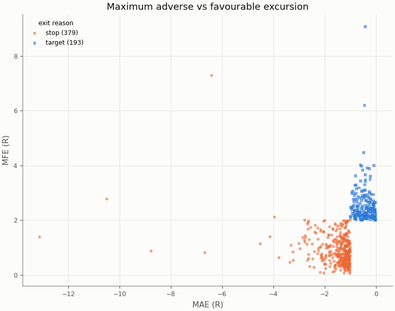

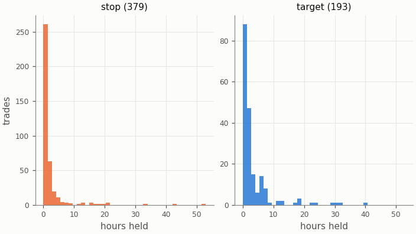

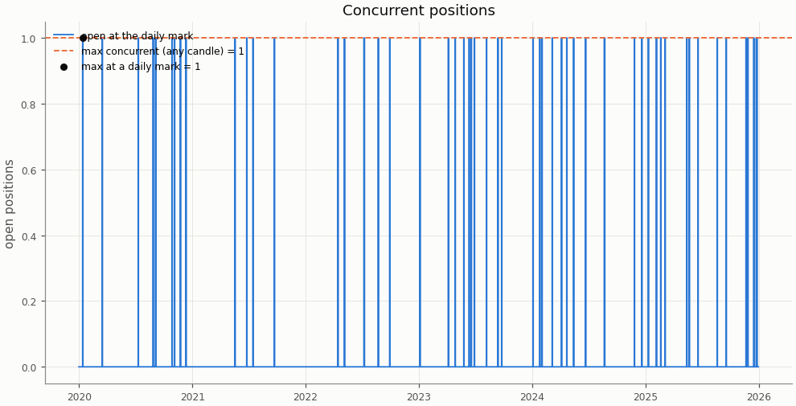

## Deflated Sharpe ratio

| Daily returns | Value |
|---|---|
| daily Sharpe (not annualised) | -0.0494 |
| days T | 2192 |
| skew | 0.734 |
| kurtosis (non-excess) | 5.179 |

| Trials | N | V (variance of daily Sharpe) | SR* | DSR |
|---|---|---|---|---|
| this pair × session's grid | 36 | 0.000207 | 0.0309 | 0.000 |
| all grid variants | 324 | 0.003906 | 0.1825 | 0.000 |

Caveat: the grid cells share most of their trades, so the effective number of independent trials is far below N and the DSR is conservative.

## Notes

- `15m_pessimistic_missing_1m`: 0 fills and 0 ambiguous (candle, order) pairs were resolved by the pessimistic 15m rule because 1m data was incomplete.
- Data gaps overlapping a trade (computed at report time from the candle manifests): 15m: 0 trades over 0 gaps; 1m: 0 trades over 0 gaps.
