# ETHUSDT / London, holdout primary

- Pair: ETHUSDT
- Session: London (08:00–16:30 Europe/London, weekdays [0, 1, 2, 3, 4], Mon = 0)
- Period: 2026-01-01 to 2026-10-20 (holdout)
- Variant id: `13d5754a646585cf74cc1be5c4ca0315844573c7292c0f19c36e5c08e98bd99d`
- Code version: `c3c05e53c0f38a9e57d65b716a78ddfb198004a84dd66fde28cf145808135dc5`
- Seed: 20260926 (generators per purpose: trade_bootstrap, day_bootstrap, sharpe_bootstrap, bh_sharpe_bootstrap, bh_diff_bootstrap, baseline_a, baseline_b)
- Role: primary; member of heatmap_1, heatmap_2, heatmap_3
- Costs: maker 0.02%, taker 0.05%, slippage 0.02%; risk 1.0% per trade; 1m resolution on

## Funnel

Every impulse that did not become a trade is counted by the first reason that stopped it (spec overview §6). Orders exclude intents skipped by the leverage cap.

| Stage | Count |
|---|---|
| impulses | 1658 |
| blocks seen | 1325 |
| skipped: no_candidate | 333 |
| skipped: ineligible | 961 |
| skipped: degenerate | 0 |
| skipped: no_displacement | 13 |
| skipped: mitigated | 40 |
| skipped: entry_above_price | 0 |
| skipped: trend | 0 |
| skipped: session_used | 153 |
| intents | 158 |
| skipped: leverage cap | 0 |
| orders placed | 158 |
| orders filled | 126 |
| fill rate | 79.7% |
| trades | 126 |
| trades in the R subset | 126 |
| trades open at the data end | 0 |

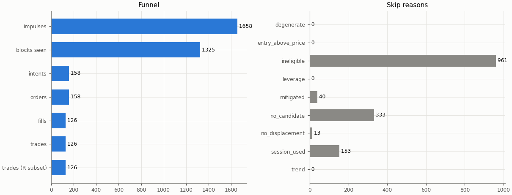

## Headline

Trade statistics use the R subset: trades closed by a stop, target or time exit (`exit_reason != data_end`); trades still open at the end of the data are left out.

| Headline | Value |
|---|---|
| trades (R subset) | 126 |
| win rate | 36.5% |
| mean gross R | 0.095 |
| mean net R | -0.169 |
| mean net R, 95% CI (trade bootstrap) | -0.436 to 0.104 |
| mean net R, 95% CI (day-block bootstrap) | -0.430 to 0.103 |
| median net R | -1.240 |
| std of net R | 1.548 |
| profit factor | 0.80 |
| mean cost (R) | 0.264 |
| mean funding (R) | 0.001 |
| mean hold (minutes) | 69.5 |
| Sharpe (annualised, daily) | -1.35 |
| Sharpe, 95% CI (10-day block bootstrap) | -3.78 to 0.50 |
| max drawdown | 27.9% |
| total return | -20.4% |
| exposure (share of candles in a trade) | 2.5% |
| mean notional / equity at the daily marks | 0.012 |
| max concurrent positions | 1 |

## Baselines

| Baseline | Observed mean net R | Runs: mean | Runs: std | p (one-sided) | z | p (Holm) | Runs |
|---|---|---|---|---|---|---|---|
| A: random entry time in the strategy's own sessions | -0.169 | -0.203 | 0.126 | 0.404 | 0.26 | 1 | 5000 |
| B: random sessions and entry times | -0.169 | -0.280 | 0.132 | 0.204 | 0.84 | 1 | 5000 |

| Table A | Value |
|---|---|
| trades covered | 126 |
| trades left out | 0 |
| baseline B: mean trades per run | 126.0 |

Holm adjustment over the holdout family of 9 primary cells (tested: A 9, B 9, buy-and-hold 9) at α = 0.05.

Baseline design (judgment calls, overview risk 13): a baseline trade enters at the open of a uniformly drawn in-session candle with the maker fee, keeps the real trade's stop distance in ATR and the variant's target and hold rule, and pays actual funding; baseline trades that reach the data end are left out of their run's mean.

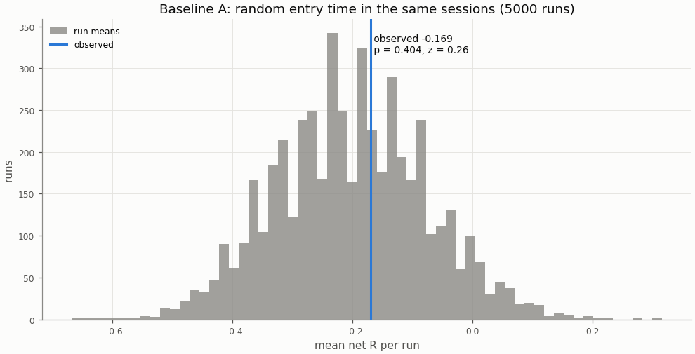

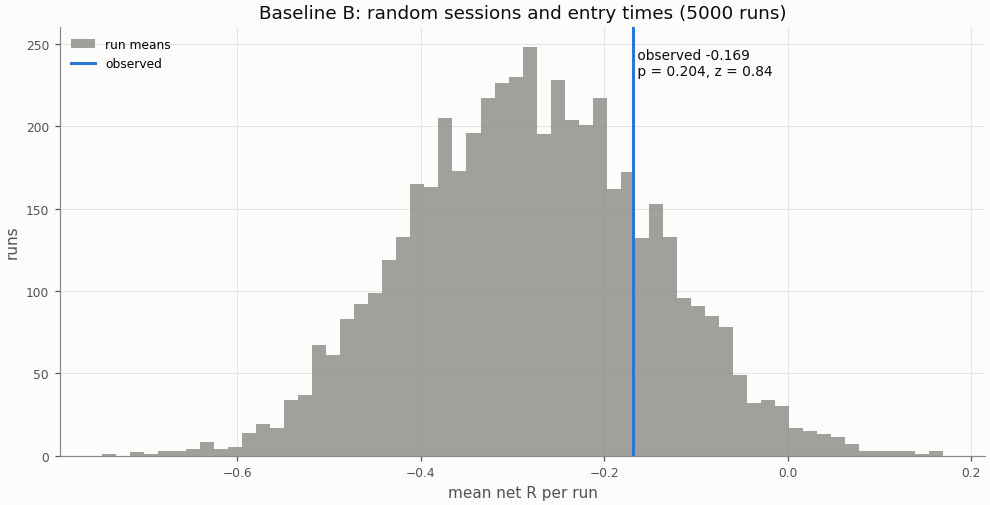

## Buy-and-hold

A constant 1× long in the perpetual with funding, scaled to the strategy's in-sample daily volatility; Sharpe is scale-invariant, the scaling matters for return and drawdown.

| Buy-and-hold | Value |
|---|---|
| days | 293 |
| buy-and-hold Sharpe | -0.12 |
| buy-and-hold Sharpe, 95% CI | -2.42 to 1.94 |
| strategy Sharpe | -1.35 |
| Sharpe difference (strategy − buy-and-hold) | -1.23 |
| Sharpe difference, 95% CI (paired block bootstrap) | -3.87 to 1.09 |
| p_BH (one-sided) | 0.858 |
| p_BH (Holm) | 1 |
| buy-and-hold total return (1×) | -18.9% |
| vol scale (σ strategy / σ buy-and-hold) | 0.227 |
| σ strategy (daily, in-sample) | 0.00986 |
| σ buy-and-hold (daily, in-sample) | 0.04346 |
| vol-scaled buy-and-hold total return | -2.1% |
| vol-scaled buy-and-hold max drawdown | 14.4% |

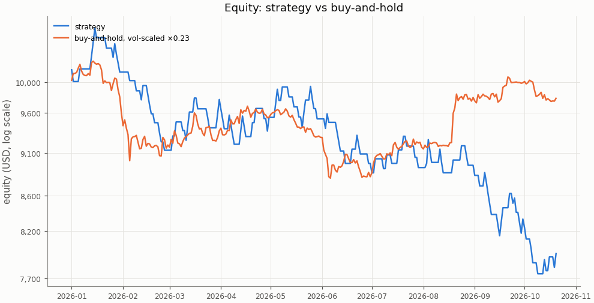

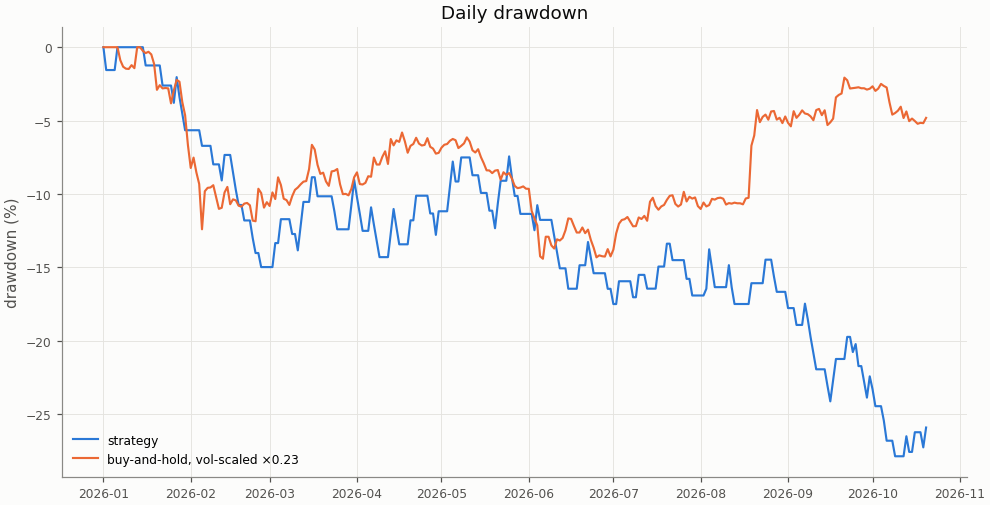

## Costs

Cost in R is fees, slippage and funding divided by the stop distance; a trade whose cost exceeds 1 R loses even when it reaches a 1 R target.

| Cost | Value |
|---|---|
| share of trades with cost above 1 R | 0.0% |

| Cost distribution | min | p05 | p25 | p50 | p75 | p95 | max | mean |
|---|---|---|---|---|---|---|---|---|
| cost per trade (R) | 0.048 | 0.085 | 0.140 | 0.253 | 0.352 | 0.511 | 0.833 | 0.264 |
| stop distance (% of entry) | 0.108 | 0.142 | 0.234 | 0.290 | 0.381 | 0.687 | 0.846 | 0.332 |
| stop distance (ATR14) | 0.322 | 0.488 | 0.680 | 0.855 | 1.028 | 1.514 | 2.298 | 0.899 |
| implied leverage (×) | 1.18 | 1.46 | 2.63 | 3.44 | 4.28 | 7.04 | 9.27 | 3.65 |
| funding (R) | -0.0014 | 0.0000 | 0.0000 | 0.0000 | 0.0000 | 0.0000 | 0.0442 | 0.0006 |

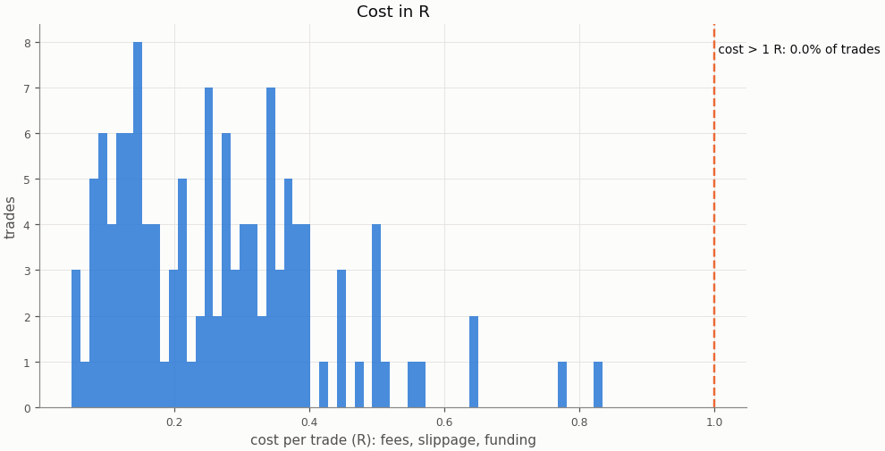

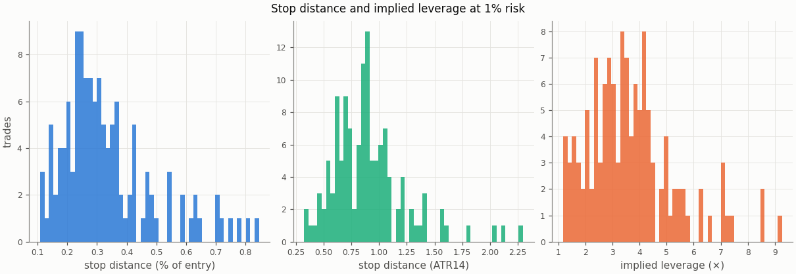

### Re-pricing (D13)

The same trades and baseline runs re-priced at other costs, without re-simulation; descriptive only, the verdict uses the registered costs.

| Slippage | Maker fee | Taker fee | n | Mean net R | 95% CI | Win rate | p_A | p_B | Costs |
|---|---|---|---|---|---|---|---|---|---|
| 0.00% | 0.00% | 0.05% | 126 | -0.023 | -0.289 to 0.252 | 36.5% | 0.404 | 0.196 |  |
| 0.00% | 0.02% | 0.05% | 126 | -0.122 | -0.382 to 0.145 | 36.5% | 0.401 | 0.198 |  |
| 0.02% | 0.00% | 0.05% | 126 | -0.070 | -0.343 to 0.210 | 36.5% | 0.404 | 0.197 |  |
| 0.02% | 0.02% | 0.05% | 126 | -0.169 | -0.436 to 0.104 | 36.5% | 0.404 | 0.204 | registered |
| 0.05% | 0.00% | 0.05% | 126 | -0.141 | -0.423 to 0.148 | 36.5% | 0.409 | 0.205 |  |
| 0.05% | 0.02% | 0.05% | 126 | -0.240 | -0.515 to 0.043 | 36.5% | 0.407 | 0.212 |  |
| 0.10% | 0.00% | 0.05% | 126 | -0.259 | -0.557 to 0.046 | 36.5% | 0.426 | 0.219 |  |
| 0.10% | 0.02% | 0.05% | 126 | -0.358 | -0.652 to -0.057 | 36.5% | 0.427 | 0.226 |  |

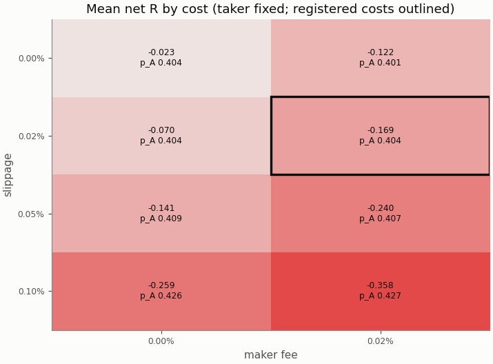

## Robustness

The grid is in-sample only; the heatmaps are in the in-sample primary report.

## Alpha decay

Per calendar year (max drawdown starts from the previous year-end equity; fill rate is filled / placed entry orders by placement year).

| Year | n | Win rate | Mean net R | Sharpe | Max DD | Fill rate |
|---|---|---|---|---|---|---|
| 2026 | 126 | 36.5% | -0.169 | -1.35 | 27.9% | 79.7% |

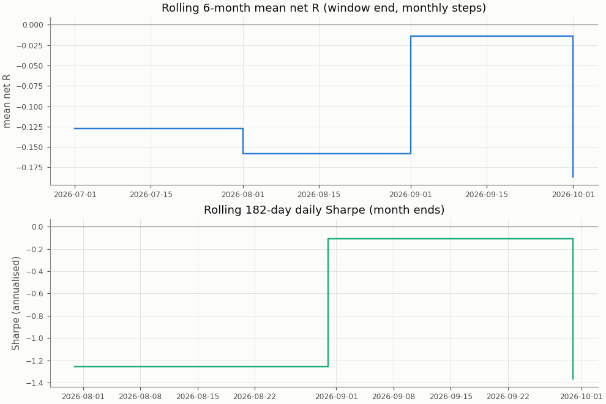

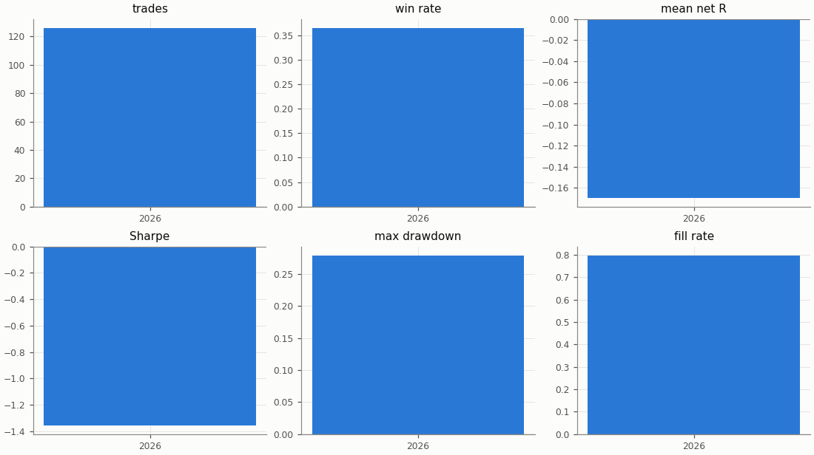

## Regimes and calendar

Trend: daily ADX(14) above 25 as of the day before entry. Volatility: 30-day realised vol of daily log returns as of the day before entry, above (`high`) or below (`low`) the in-sample median 0.03757; trades before the indicators are defined are unlabelled.

| Regime | n | Win rate | Mean net R |
|---|---|---|---|
| trend: no_trend | 51 | 51.0% | 0.272 |
| trend: trend | 75 | 26.7% | -0.470 |
| vol: high | 18 | 27.8% | -0.369 |
| vol: low | 108 | 38.0% | -0.136 |

| Day of week (UTC) | n | Win rate | Mean net R |
|---|---|---|---|
| Monday | 26 | 46.2% | 0.145 |
| Tuesday | 24 | 50.0% | 0.246 |
| Wednesday | 28 | 14.3% | -0.913 |
| Thursday | 23 | 34.8% | -0.184 |
| Friday | 25 | 40.0% | -0.049 |

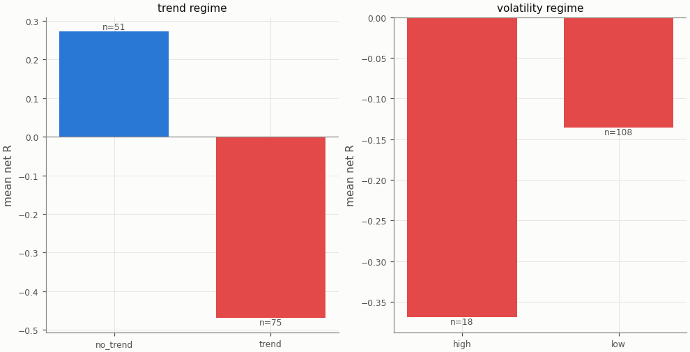

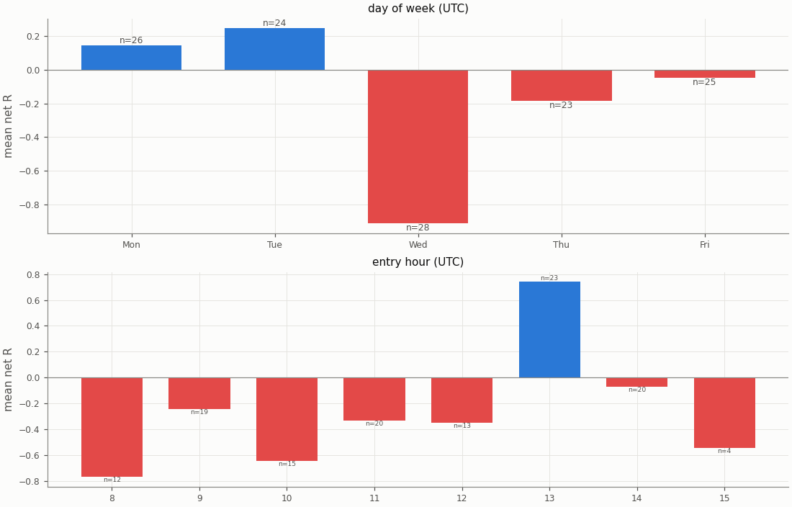

## Diagnostics

| Count | Value |
|---|---|
| trades open at the data end (left out of the R subset) | 0 |
| ambiguous candles resolved without full 1m data | 0 |
| max concurrent positions | 1 |
| funding paid in total (USD) | 6.29 |

| Fill resolution | Fills |
|---|---|
| 15m_unambiguous | 168 |
| 1m | 72 |
| 1m_pessimistic | 12 |

| Exit reason | n | Win rate | Mean net R |
|---|---|---|---|
| stop | 80 | 0.0% | -1.335 |
| target | 46 | 100.0% | 1.858 |

| Trade distribution | min | p05 | p25 | p50 | p75 | p95 | max | mean |
|---|---|---|---|---|---|---|---|---|
| hold (minutes) | 0.0 | 1.0 | 6.0 | 30.0 | 60.0 | 206.2 | 1860.0 | 69.5 |
| MAE (R) | -8.041 | -3.052 | -1.506 | -1.136 | -0.553 | -0.144 | -0.004 | -1.258 |
| MFE (R) | 0.174 | 0.272 | 0.750 | 1.419 | 2.457 | 3.667 | 5.208 | 1.692 |

Share of this variant's trades whose candidate candle is also traded by the other session variants (computed at report time from their trade tables): NY 4.8%, UTC 34.9%; any of them 38.1%. The session variants are not independent tests.

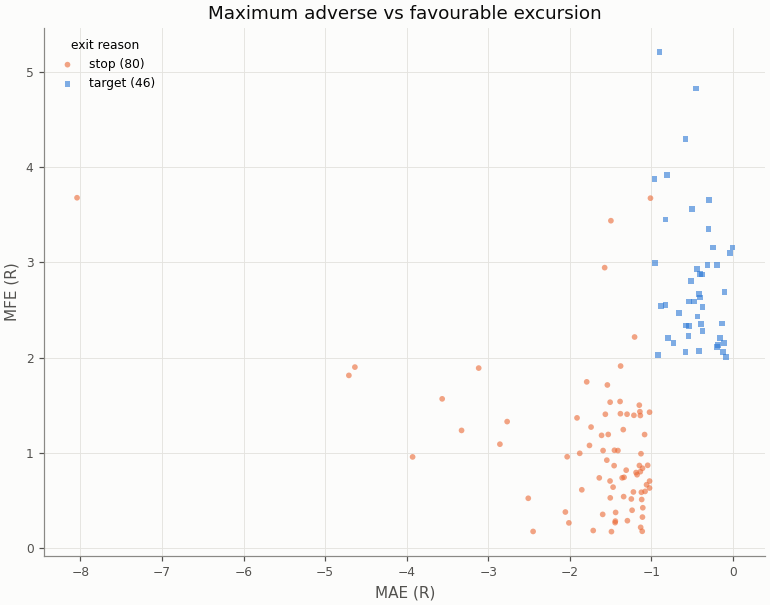

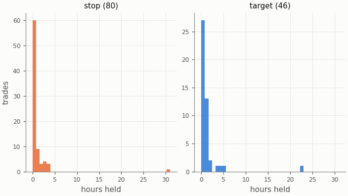

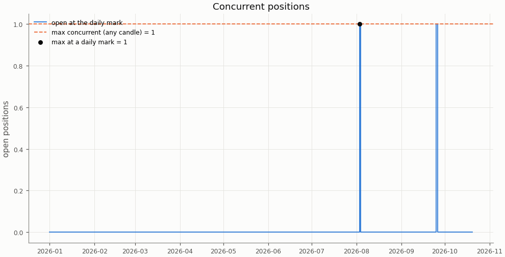

## Deflated Sharpe ratio

| Daily returns | Value |
|---|---|
| daily Sharpe (not annualised) | -0.0709 |
| days T | 293 |
| skew | 0.577 |
| kurtosis (non-excess) | 2.972 |

| Trials | N | V (variance of daily Sharpe) | SR* | DSR |
|---|---|---|---|---|
| this pair × session's grid | n/a | n/a | n/a | n/a |
| all grid variants | n/a | n/a | n/a | n/a |

The DSR is computed for the in-sample grid only; the holdout tests one pre-registered configuration per cell.

Caveat: the grid cells share most of their trades, so the effective number of independent trials is far below N and the DSR is conservative.

## Notes

- `15m_pessimistic_missing_1m`: 0 fills and 0 ambiguous (candle, order) pairs were resolved by the pessimistic 15m rule because 1m data was incomplete.
- Data gaps overlapping a trade (computed at report time from the candle manifests): 15m: 0 trades over 0 gaps; 1m: 0 trades over 0 gaps.
