# BTCUSDT / London, in-sample primary

- Pair: BTCUSDT
- Session: London (08:00–16:30 Europe/London, weekdays [0, 1, 2, 3, 4], Mon = 0)
- Period: 2020-01-01 to 2025-12-31 (in-sample)
- Variant id: `148ab35996f86e7134eecced482887cc484d9822b83d983a40a8b82b14be58cb`
- Code version: `c3c05e53c0f38a9e57d65b716a78ddfb198004a84dd66fde28cf145808135dc5`
- Seed: 20260926 (generators per purpose: trade_bootstrap, day_bootstrap, sharpe_bootstrap, bh_sharpe_bootstrap, bh_diff_bootstrap, baseline_a, baseline_b)
- Role: primary; member of heatmap_1, heatmap_2, heatmap_3
- Costs: maker 0.02%, taker 0.05%, slippage 0.02%; risk 1.0% per trade; 1m resolution on

## Funnel

Every impulse that did not become a trade is counted by the first reason that stopped it (spec overview §6). Orders exclude intents skipped by the leverage cap.

| Stage | Count |
|---|---|
| impulses | 13524 |
| blocks seen | 10665 |
| skipped: no_candidate | 2859 |
| skipped: ineligible | 7855 |
| skipped: degenerate | 0 |
| skipped: no_displacement | 122 |
| skipped: mitigated | 353 |
| skipped: entry_above_price | 0 |
| skipped: trend | 0 |
| skipped: session_used | 1127 |
| intents | 1208 |
| skipped: leverage cap | 2 |
| orders placed | 1206 |
| orders filled | 935 |
| fill rate | 77.5% |
| trades | 935 |
| trades in the R subset | 935 |
| trades open at the data end | 0 |

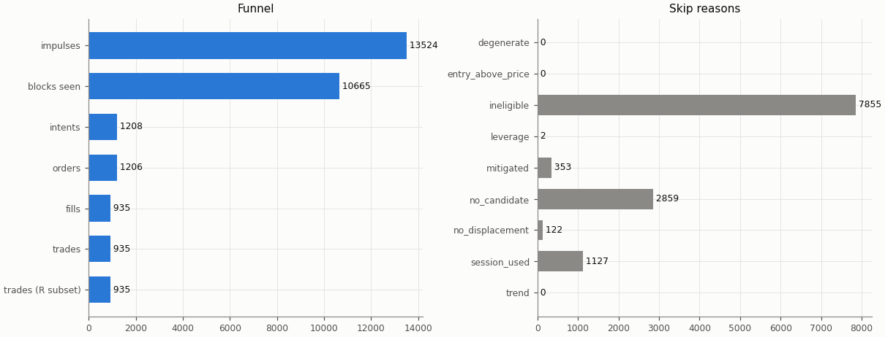

## Headline

Trade statistics use the R subset: trades closed by a stop, target or time exit (`exit_reason != data_end`); trades still open at the end of the data are left out.

| Headline | Value |
|---|---|
| trades (R subset) | 935 |
| win rate | 32.0% |
| mean gross R | -0.041 |
| mean net R | -0.327 |
| mean net R, 95% CI (trade bootstrap) | -0.422 to -0.232 |
| mean net R, 95% CI (day-block bootstrap) | -0.423 to -0.230 |
| median net R | -1.194 |
| std of net R | 1.500 |
| profit factor | 0.64 |
| mean cost (R) | 0.286 |
| mean funding (R) | 0.002 |
| mean hold (minutes) | 60.3 |
| Sharpe (annualised, daily) | -2.69 |
| Sharpe, 95% CI (10-day block bootstrap) | -3.57 to -1.86 |
| max drawdown | 96.0% |
| total return | -95.8% |
| exposure (share of candles in a trade) | 2.2% |
| mean notional / equity at the daily marks | 0.002 |
| max concurrent positions | 2 |

## Baselines

| Baseline | Observed mean net R | Runs: mean | Runs: std | p (one-sided) | z | p (Holm) | Runs |
|---|---|---|---|---|---|---|---|
| A: random entry time in the strategy's own sessions | -0.327 | -0.258 | 0.046 | 0.932 | -1.50 | 1 | 5000 |
| B: random sessions and entry times | -0.327 | -0.281 | 0.050 | 0.816 | -0.92 | 1 | 5000 |

| Table A | Value |
|---|---|
| trades covered | 935 |
| trades left out | 0 |
| baseline B: mean trades per run | 935.0 |

Holm adjustment over the in-sample family of 9 primary cells (tested: A 9, B 9, buy-and-hold 9) at α = 0.05.

Baseline design (judgment calls, overview risk 13): a baseline trade enters at the open of a uniformly drawn in-session candle with the maker fee, keeps the real trade's stop distance in ATR and the variant's target and hold rule, and pays actual funding; baseline trades that reach the data end are left out of their run's mean.

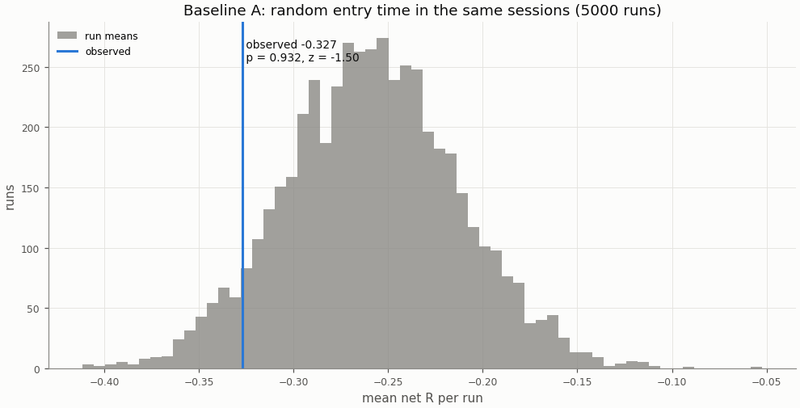

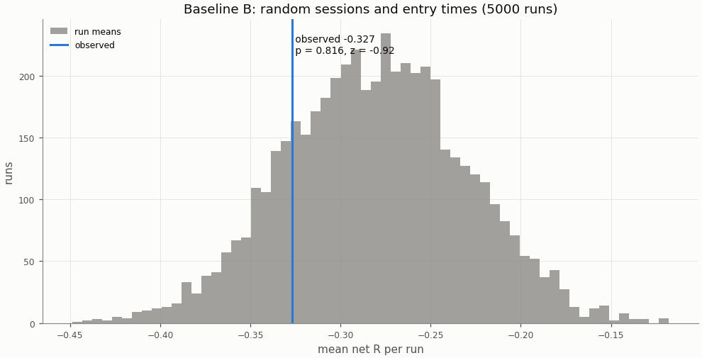

## Buy-and-hold

A constant 1× long in the perpetual with funding, scaled to the strategy's in-sample daily volatility; Sharpe is scale-invariant, the scaling matters for return and drawdown.

| Buy-and-hold | Value |
|---|---|
| days | 2192 |
| buy-and-hold Sharpe | 0.78 |
| buy-and-hold Sharpe, 95% CI | -0.01 to 1.58 |
| strategy Sharpe | -2.69 |
| Sharpe difference (strategy − buy-and-hold) | -3.47 |
| Sharpe difference, 95% CI (paired block bootstrap) | -4.54 to -2.41 |
| p_BH (one-sided) | 1 |
| p_BH (Holm) | 1 |
| buy-and-hold total return (1×) | 464.1% |
| vol scale (σ strategy / σ buy-and-hold) | 0.305 |
| σ strategy (daily, in-sample) | 0.00990 |
| σ buy-and-hold (daily, in-sample) | 0.03246 |
| vol-scaled buy-and-hold total return | 118.2% |
| vol-scaled buy-and-hold max drawdown | 33.8% |

The figures continue into the holdout run (shaded), chained onto the in-sample end.

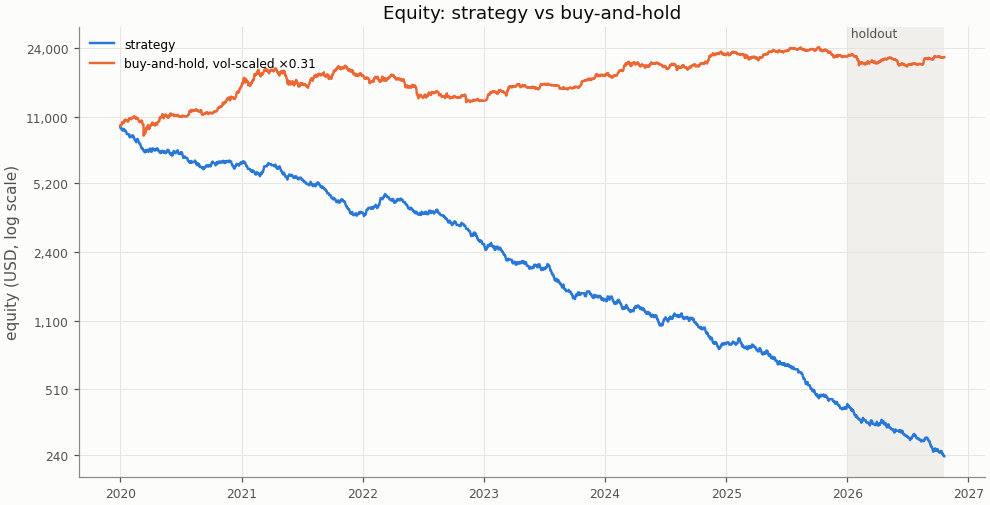

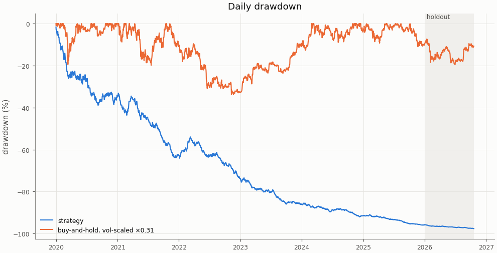

## Costs

Cost in R is fees, slippage and funding divided by the stop distance; a trade whose cost exceeds 1 R loses even when it reaches a 1 R target.

| Cost | Value |
|---|---|
| share of trades with cost above 1 R | 1.4% |

| Cost distribution | min | p05 | p25 | p50 | p75 | p95 | max | mean |
|---|---|---|---|---|---|---|---|---|
| cost per trade (R) | 0.022 | 0.063 | 0.141 | 0.234 | 0.361 | 0.680 | 1.750 | 0.286 |
| stop distance (% of entry) | 0.048 | 0.120 | 0.209 | 0.303 | 0.470 | 0.909 | 3.837 | 0.391 |
| stop distance (ATR14) | 0.139 | 0.536 | 0.707 | 0.866 | 1.089 | 1.634 | 3.325 | 0.944 |
| implied leverage (×) | 0.26 | 1.10 | 2.13 | 3.30 | 4.79 | 8.35 | 20.99 | 3.85 |
| funding (R) | -0.0917 | 0.0000 | 0.0000 | 0.0000 | 0.0000 | 0.0077 | 0.2194 | 0.0019 |

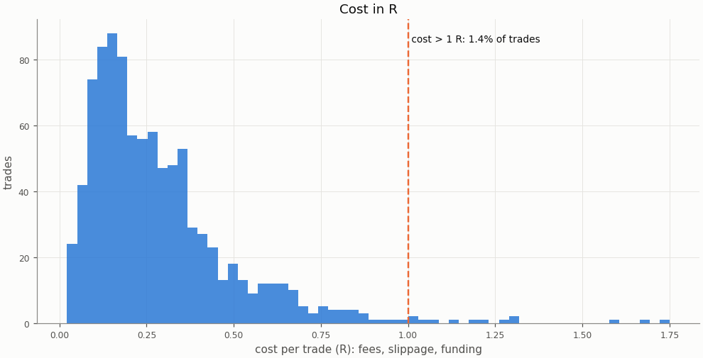

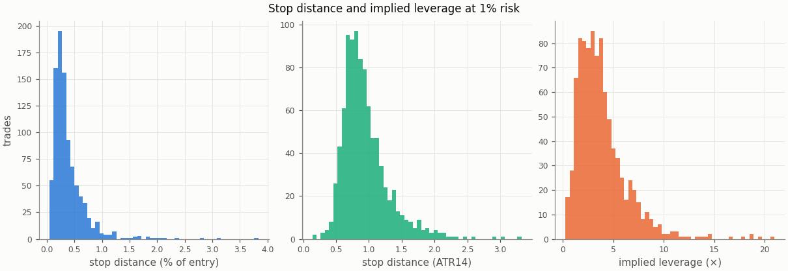

### Re-pricing (D13)

The same trades and baseline runs re-priced at other costs, without re-simulation; descriptive only, the verdict uses the registered costs.

| Slippage | Maker fee | Taker fee | n | Mean net R | 95% CI | Win rate | p_A | p_B | Costs |
|---|---|---|---|---|---|---|---|---|---|
| 0.00% | 0.00% | 0.05% | 935 | -0.173 | -0.267 to -0.078 | 32.0% | 0.923 | 0.781 |  |
| 0.00% | 0.02% | 0.05% | 935 | -0.275 | -0.367 to -0.182 | 32.0% | 0.928 | 0.809 |  |
| 0.02% | 0.00% | 0.05% | 935 | -0.225 | -0.322 to -0.127 | 32.0% | 0.928 | 0.79 |  |
| 0.02% | 0.02% | 0.05% | 935 | -0.327 | -0.422 to -0.232 | 32.0% | 0.932 | 0.816 | registered |
| 0.05% | 0.00% | 0.05% | 935 | -0.303 | -0.403 to -0.202 | 32.0% | 0.934 | 0.802 |  |
| 0.05% | 0.02% | 0.05% | 935 | -0.405 | -0.503 to -0.306 | 32.0% | 0.94 | 0.826 |  |
| 0.10% | 0.00% | 0.05% | 935 | -0.433 | -0.539 to -0.325 | 32.0% | 0.943 | 0.821 |  |
| 0.10% | 0.02% | 0.05% | 935 | -0.535 | -0.640 to -0.429 | 32.0% | 0.946 | 0.845 |  |

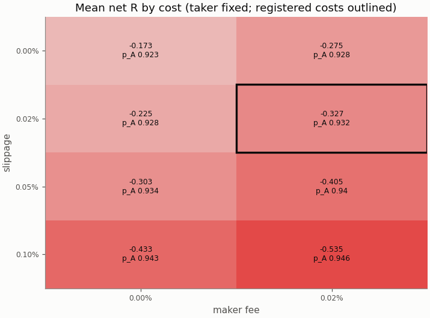

## Robustness

### Heatmap 1: r_target × entry_level

8 of 8 cells have run; the primary is outlined.

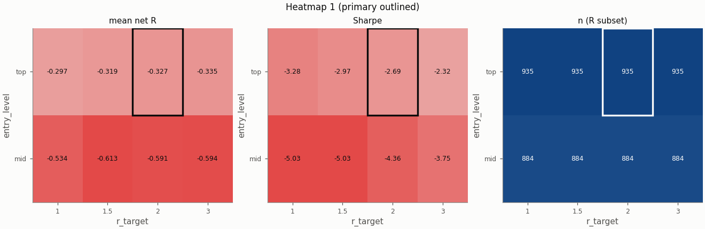

### Heatmap 2: swing_k × confirm_n

9 of 9 cells have run; the primary is outlined.

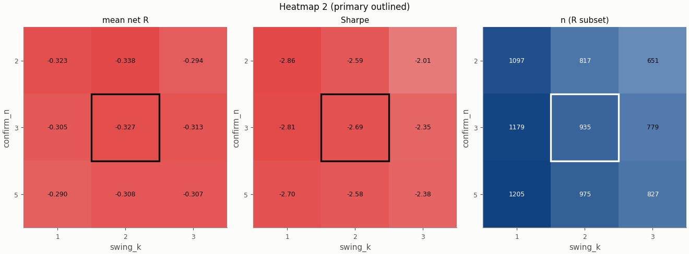

### Heatmap 3: stop_buffer × hold_rule

16 of 16 cells have run; the primary is outlined.

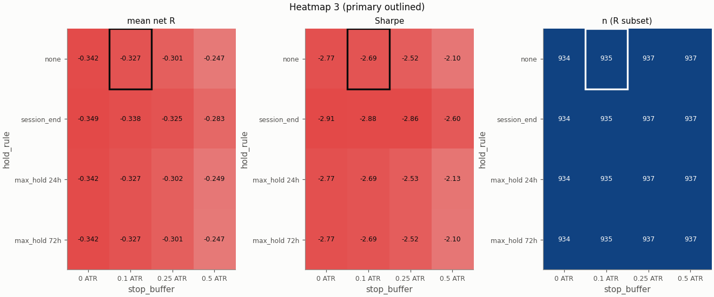

Grid variants of this pair × session:

- heatmap_2: confirm_n=2, swing_k=1 ([report](../0a55bc6389d690d085dc51f61d4a280bfdff501cab83517dfd10b20a25e3a927/report.md))
- heatmap_3: hold_rule=max_hold 24h, stop_buffer=0 ATR ([report](../140845a822646d03df027ab240df64644b6143cc68cc97dc3ac9c45099c12d70/report.md))
- single_3: trend_filter=on ([report](../1bd6c3032b574d3a9973b8dc4781237f2e58391a0cd30062e812ea54e16dea0a/report.md))
- heatmap_2: confirm_n=5, swing_k=1 ([report](../28f5bae28cd64cab5f84b49bce350e4c34f321e30f6d30f88d87720405533b8d/report.md))
- heatmap_2: confirm_n=2, swing_k=3 ([report](../2c2a348fc5ba7f5ceebc416d35ae1db15e06cd3caf562a869787411fa4a39f04/report.md))
- heatmap_3: stop_buffer=0.25 ATR ([report](../42e916fe0b44eaf4a3eab728fb458aeb6d2bdc989d37803d31bc769065112792/report.md))
- heatmap_2: swing_k=1 ([report](../5235b961adcdef8891f2a8d0b14a2ebd10561ec0abffeeb9f807081754cb9497/report.md))
- heatmap_3: hold_rule=session_end, stop_buffer=0 ATR ([report](../59bd33be93cac1e831265f54bf4785590bae9b8ab7921b40d0f63b8bfa9e8a9c/report.md))
- heatmap_3: stop_buffer=0 ATR ([report](../609ce1aa006c692c3b451e3628352ad8bbaac2bf5b0e3e3260114bc8340f1e20/report.md))
- heatmap_1: r_target=1 ([report](../6753b663797320df648f5927166eb0ffb7ba4aee01e4d90d796cd9c90cbd8266/report.md))
- heatmap_2: swing_k=3 ([report](../6a5887aa003d70ad40d707976a9a1598b568b4779ba978714ffa72ffca6b2184/report.md))
- heatmap_1: r_target=1.5 ([report](../6bdd2384983bb61a1abd94e144f3609f51c32e0384f3242d866fd5c0aaf4f6dc/report.md))
- heatmap_2: confirm_n=2 ([report](../6cbfc6bd86c9c756aa2844c6007dcdd25956fe49e3869de44be46b2321d2e0da/report.md))
- heatmap_1: entry_level=mid ([report](../6e105990b85ac5db95759e1f277923a1c7e6aeec1cec678e602933e476e5b571/report.md))
- heatmap_1: r_target=3 ([report](../6fefab12c103b7b2d7f0071097817e921a8c49125d342fd17917583d27a51fe0/report.md))
- heatmap_3: hold_rule=max_hold 24h, stop_buffer=0.5 ATR ([report](../719990af46a68526ee8fe52dbf0f6eb49d3d5de39eb990c2603abfa4b10b9740/report.md))
- heatmap_3: hold_rule=max_hold 24h ([report](../796319316234597a564dac9b1f385f0dd7fed31d62b2ff912d560dd03bef4914/report.md))
- heatmap_2: confirm_n=5 ([report](../85c11cf5d33acc0ae596cfe39320a0d802ad86a14959e61f452e62fb670729b0/report.md))
- heatmap_3: hold_rule=session_end, stop_buffer=0.25 ATR ([report](../8c03dc0696301f20c93e7a1186e421d3e4087cfcfc2701e01755587f832242a7/report.md))
- single_2: pierce=0.0005 ([report](../9b95a0930a7f85ccf3afe14d471dde90ef153963c7204d3a55693dd495a292e3/report.md))
- heatmap_3: hold_rule=max_hold 72h, stop_buffer=0.25 ATR ([report](../a2208a6737141987dced7e48959d06696b422fdf42616bb26cc7a9305a8e7305/report.md))
- heatmap_2: confirm_n=5, swing_k=3 ([report](../a7eab5943945cf6c490ac5d8509557135d5f5994e694cf8d347c6a086d2e277f/report.md))
- heatmap_3: hold_rule=session_end ([report](../ac11e46a2088fcae696c1cb9b3dbcec8202ce77943417abb2dd554777036dd23/report.md))
- single_5: stop_buffer=0.25% ([report](../ac8f69cc28898baee43f0ded2de6a291cefb321461804e650c8688ee319c6d18/report.md))
- heatmap_3: hold_rule=max_hold 72h, stop_buffer=0.5 ATR ([report](../b042ff03e9334e2655b5e68ead9aa7d4875092128492d63a5facfecdbde60cf1/report.md))
- heatmap_1: entry_level=mid, r_target=3 ([report](../b6f4560645b48413fe789feb03e3699559546ad46c44c83f46ebeea18801fa9c/report.md))
- single_1: zone=body ([report](../bf0add7b995a1f7cd5287927b9133919520a0e716c1a78f302d7833fdbf6e5c2/report.md))
- heatmap_3: hold_rule=session_end, stop_buffer=0.5 ATR ([report](../d7e40021bcfe209bbb31c2524fe1952e94b6703921845c33054d68c2354becf5/report.md))
- heatmap_3: hold_rule=max_hold 24h, stop_buffer=0.25 ATR ([report](../daca6357fbdcc5dcceb50c0521dfc59fffd125d23a8a58f0815ceef8cc36757b/report.md))
- heatmap_3: stop_buffer=0.5 ATR ([report](../dcbc34abfe026497b1c52db552bdae0fd25026c42d0dfe870fdcf4309869e71d/report.md))
- single_4: stop_buffer=0.1% ([report](../dcc56889be5eba278a72d07f087f9e62adc9d1a39d1af54f3d725bfd8e60b099/report.md))
- heatmap_1: entry_level=mid, r_target=1.5 ([report](../dfda667f8540c2eb4e5eaddcf20b4716b08a79fc3bb939ed7ad8169997783f57/report.md))
- heatmap_3: hold_rule=max_hold 72h, stop_buffer=0 ATR ([report](../ef5533fdb49e2fb5843d01d7d291b6a3d0ab22a263cf988a4d3c271e7e217d0b/report.md))
- heatmap_3: hold_rule=max_hold 72h ([report](../f36bab16e23e44fe80bd0ef9f83d39f78e38400ae5980a2f998c1e403b4a8cef/report.md))
- heatmap_1: entry_level=mid, r_target=1 ([report](../f47aee1104b0cc2e3588d22152738cda731f76eadc6523d2eec31943ee74de61/report.md))

## Alpha decay

Per calendar year (max drawdown starts from the previous year-end equity; fill rate is filled / placed entry orders by placement year).

| Year | n | Win rate | Mean net R | Sharpe | Max DD | Fill rate |
|---|---|---|---|---|---|---|
| 2020 | 156 | 33.3% | -0.255 | -2.12 | 38.9% | 74.3% |
| 2021 | 151 | 26.5% | -0.368 | -3.27 | 46.0% | 71.6% |
| 2022 | 141 | 34.0% | -0.238 | -1.84 | 43.1% | 76.2% |
| 2023 | 151 | 33.8% | -0.399 | -3.04 | 48.0% | 77.4% |
| 2024 | 178 | 33.1% | -0.274 | -2.40 | 45.0% | 83.6% |
| 2025 | 158 | 31.0% | -0.428 | -3.50 | 55.2% | 82.3% |

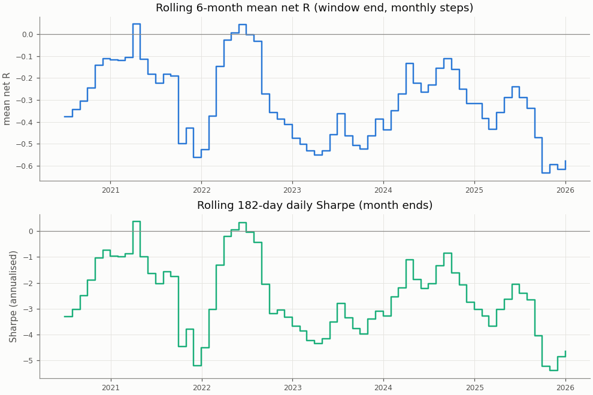

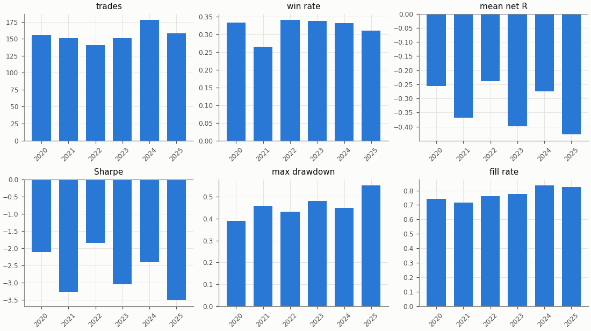

## Regimes and calendar

Trend: daily ADX(14) above 25 as of the day before entry. Volatility: 30-day realised vol of daily log returns as of the day before entry, above (`high`) or below (`low`) the in-sample median 0.02804; trades before the indicators are defined are unlabelled.

| Regime | n | Win rate | Mean net R |
|---|---|---|---|
| trend: no_trend | 417 | 32.1% | -0.365 |
| trend: trend | 518 | 31.9% | -0.296 |
| vol: high | 480 | 31.7% | -0.266 |
| vol: low | 455 | 32.3% | -0.392 |

| Day of week (UTC) | n | Win rate | Mean net R |
|---|---|---|---|
| Monday | 161 | 31.1% | -0.347 |
| Tuesday | 197 | 31.5% | -0.325 |
| Wednesday | 188 | 34.0% | -0.274 |
| Thursday | 192 | 30.7% | -0.359 |
| Friday | 197 | 32.5% | -0.331 |

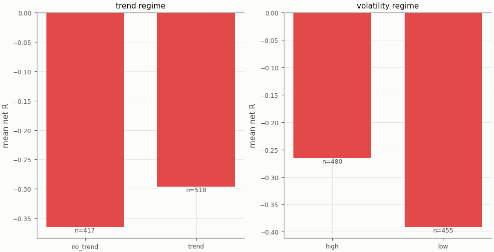

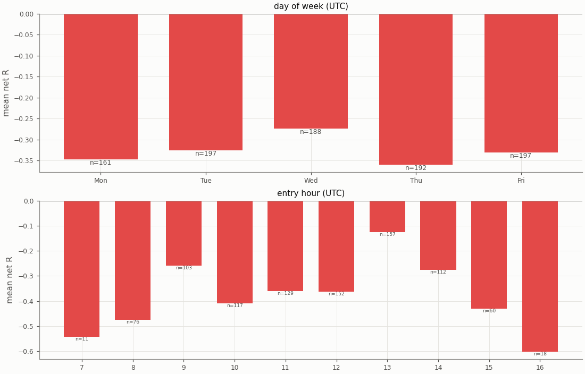

## Diagnostics

| Count | Value |
|---|---|
| trades open at the data end (left out of the R subset) | 0 |
| ambiguous candles resolved without full 1m data | 0 |
| max concurrent positions | 2 |
| funding paid in total (USD) | 88.42 |

| Fill resolution | Fills |
|---|---|
| 15m_unambiguous | 1421 |
| 1m | 339 |
| 1m_pessimistic | 110 |

| Exit reason | n | Win rate | Mean net R |
|---|---|---|---|
| stop | 636 | 0.0% | -1.346 |
| target | 299 | 100.0% | 1.841 |

| Trade distribution | min | p05 | p25 | p50 | p75 | p95 | max | mean |
|---|---|---|---|---|---|---|---|---|
| hold (minutes) | 0.0 | 1.0 | 15.0 | 30.0 | 75.0 | 225.0 | 1440.0 | 60.3 |
| MAE (R) | -12.098 | -2.750 | -1.560 | -1.185 | -0.733 | -0.117 | -0.001 | -1.284 |
| MFE (R) | 0.005 | 0.265 | 0.747 | 1.348 | 2.201 | 3.458 | 11.997 | 1.603 |

Share of this variant's trades whose candidate candle is also traded by the other session variants (computed at report time from their trade tables): NY 4.6%, UTC 29.9%; any of them 33.5%. The session variants are not independent tests.

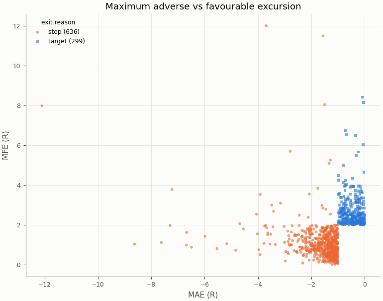

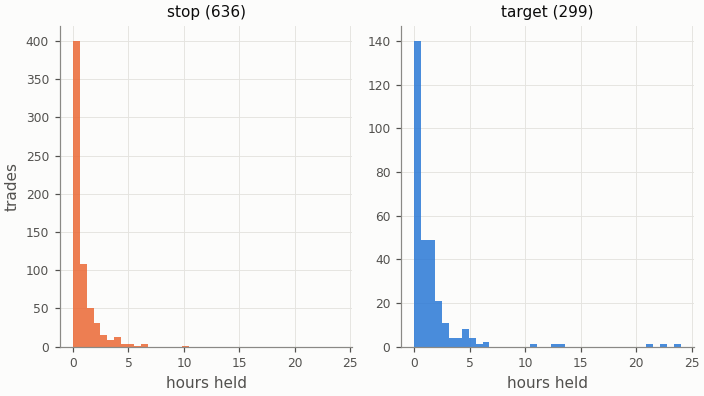

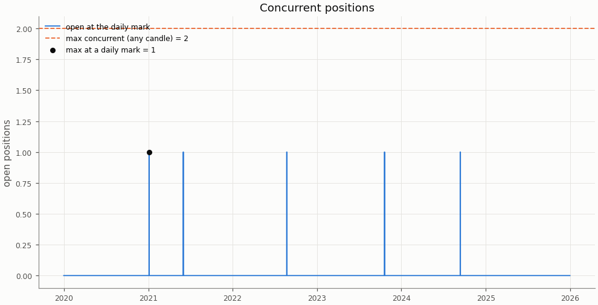

## Deflated Sharpe ratio

| Daily returns | Value |
|---|---|
| daily Sharpe (not annualised) | -0.1408 |
| days T | 2192 |
| skew | 0.508 |
| kurtosis (non-excess) | 3.026 |

| Trials | N | V (variance of daily Sharpe) | SR* | DSR |
|---|---|---|---|---|
| this pair × session's grid | 36 | 0.001795 | 0.0910 | 0.000 |
| all grid variants | 324 | 0.003906 | 0.1825 | 0.000 |

Caveat: the grid cells share most of their trades, so the effective number of independent trials is far below N and the DSR is conservative.

## Notes

- `15m_pessimistic_missing_1m`: 0 fills and 0 ambiguous (candle, order) pairs were resolved by the pessimistic 15m rule because 1m data was incomplete.
- Data gaps overlapping a trade (computed at report time from the candle manifests): 15m: 0 trades over 0 gaps; 1m: 0 trades over 0 gaps.
