# BTCUSDT / NY, in-sample primary

- Pair: BTCUSDT
- Session: NY (09:30–16:00 America/New_York, weekdays [0, 1, 2, 3, 4], Mon = 0)
- Period: 2020-01-01 to 2025-12-31 (in-sample)
- Variant id: `24cb379511f77f7669f615427846b13a5e34433f565dff2fa3359c7ac3e9935a`
- Code version: `c3c05e53c0f38a9e57d65b716a78ddfb198004a84dd66fde28cf145808135dc5`
- Seed: 20260926 (generators per purpose: trade_bootstrap, day_bootstrap, sharpe_bootstrap, bh_sharpe_bootstrap, bh_diff_bootstrap, baseline_a, baseline_b)
- Role: primary; member of heatmap_1, heatmap_2, heatmap_3
- Costs: maker 0.02%, taker 0.05%, slippage 0.02%; risk 1.0% per trade; 1m resolution on

## Funnel

Every impulse that did not become a trade is counted by the first reason that stopped it (spec overview §6). Orders exclude intents skipped by the leverage cap.

| Stage | Count |
|---|---|
| impulses | 13524 |
| blocks seen | 10665 |
| skipped: no_candidate | 2859 |
| skipped: ineligible | 9027 |
| skipped: degenerate | 0 |
| skipped: no_displacement | 84 |
| skipped: mitigated | 213 |
| skipped: entry_above_price | 0 |
| skipped: trend | 0 |
| skipped: session_used | 489 |
| intents | 852 |
| skipped: leverage cap | 0 |
| orders placed | 852 |
| orders filled | 555 |
| fill rate | 65.1% |
| trades | 555 |
| trades in the R subset | 555 |
| trades open at the data end | 0 |

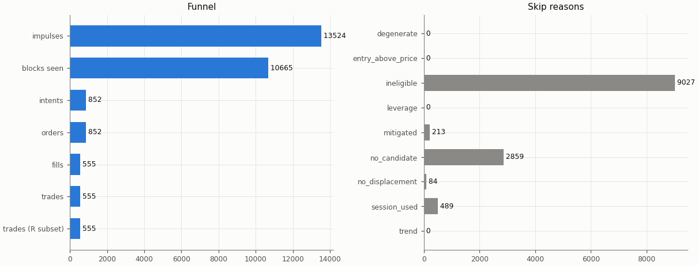

## Headline

Trade statistics use the R subset: trades closed by a stop, target or time exit (`exit_reason != data_end`); trades still open at the end of the data are left out.

| Headline | Value |
|---|---|
| trades (R subset) | 555 |
| win rate | 34.8% |
| mean gross R | 0.043 |
| mean net R | -0.153 |
| mean net R, 95% CI (trade bootstrap) | -0.279 to -0.027 |
| mean net R, 95% CI (day-block bootstrap) | -0.276 to -0.026 |
| median net R | -1.149 |
| std of net R | 1.497 |
| profit factor | 0.81 |
| mean cost (R) | 0.196 |
| mean funding (R) | 0.004 |
| mean hold (minutes) | 136.5 |
| Sharpe (annualised, daily) | -0.98 |
| Sharpe, 95% CI (10-day block bootstrap) | -1.81 to -0.16 |
| max drawdown | 65.4% |
| total return | -59.7% |
| exposure (share of candles in a trade) | 2.7% |
| mean notional / equity at the daily marks | 0.044 |
| max concurrent positions | 1 |

## Baselines

| Baseline | Observed mean net R | Runs: mean | Runs: std | p (one-sided) | z | p (Holm) | Runs |
|---|---|---|---|---|---|---|---|
| A: random entry time in the strategy's own sessions | -0.153 | -0.064 | 0.058 | 0.936 | -1.52 | 1 | 5000 |
| B: random sessions and entry times | -0.153 | -0.184 | 0.063 | 0.307 | 0.50 | 1 | 5000 |

| Table A | Value |
|---|---|
| trades covered | 555 |
| trades left out | 0 |
| baseline B: mean trades per run | 555.0 |

Holm adjustment over the in-sample family of 9 primary cells (tested: A 9, B 9, buy-and-hold 9) at α = 0.05.

Baseline design (judgment calls, overview risk 13): a baseline trade enters at the open of a uniformly drawn in-session candle with the maker fee, keeps the real trade's stop distance in ATR and the variant's target and hold rule, and pays actual funding; baseline trades that reach the data end are left out of their run's mean.

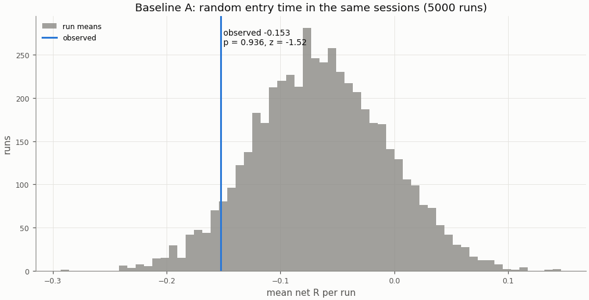

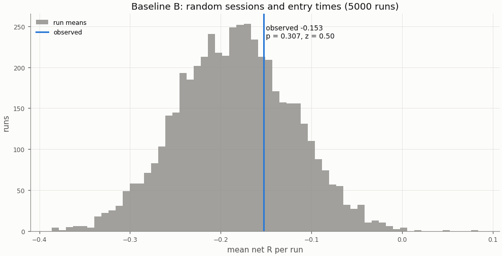

## Buy-and-hold

A constant 1× long in the perpetual with funding, scaled to the strategy's in-sample daily volatility; Sharpe is scale-invariant, the scaling matters for return and drawdown.

| Buy-and-hold | Value |
|---|---|
| days | 2192 |
| buy-and-hold Sharpe | 0.78 |
| buy-and-hold Sharpe, 95% CI | 0.01 to 1.57 |
| strategy Sharpe | -0.98 |
| Sharpe difference (strategy − buy-and-hold) | -1.76 |
| Sharpe difference, 95% CI (paired block bootstrap) | -2.85 to -0.73 |
| p_BH (one-sided) | 1 |
| p_BH (Holm) | 1 |
| buy-and-hold total return (1×) | 464.1% |
| vol scale (σ strategy / σ buy-and-hold) | 0.233 |
| σ strategy (daily, in-sample) | 0.00756 |
| σ buy-and-hold (daily, in-sample) | 0.03246 |
| vol-scaled buy-and-hold total return | 84.9% |
| vol-scaled buy-and-hold max drawdown | 26.7% |

The figures continue into the holdout run (shaded), chained onto the in-sample end.

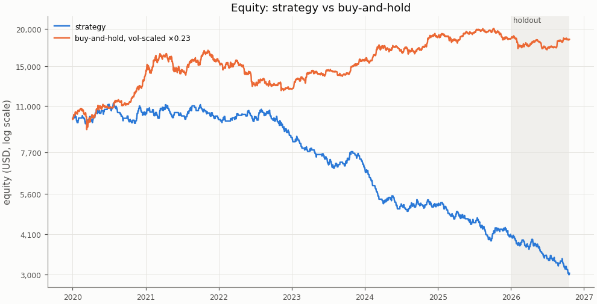

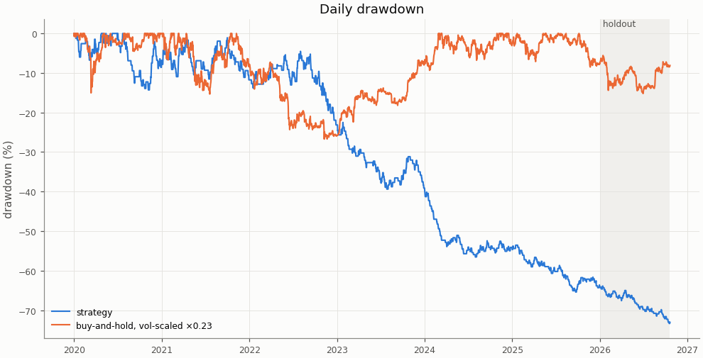

## Costs

Cost in R is fees, slippage and funding divided by the stop distance; a trade whose cost exceeds 1 R loses even when it reaches a 1 R target.

| Cost | Value |
|---|---|
| share of trades with cost above 1 R | 0.0% |

| Cost distribution | min | p05 | p25 | p50 | p75 | p95 | max | mean |
|---|---|---|---|---|---|---|---|---|
| cost per trade (R) | 0.015 | 0.051 | 0.108 | 0.164 | 0.252 | 0.447 | 0.923 | 0.196 |
| stop distance (% of entry) | 0.097 | 0.175 | 0.306 | 0.448 | 0.615 | 1.092 | 2.586 | 0.510 |
| stop distance (ATR14) | 0.267 | 0.577 | 0.763 | 0.937 | 1.201 | 1.764 | 3.343 | 1.031 |
| implied leverage (×) | 0.39 | 0.92 | 1.63 | 2.23 | 3.27 | 5.72 | 10.26 | 2.63 |
| funding (R) | -0.0917 | 0.0000 | 0.0000 | 0.0000 | 0.0000 | 0.0271 | 0.2194 | 0.0045 |

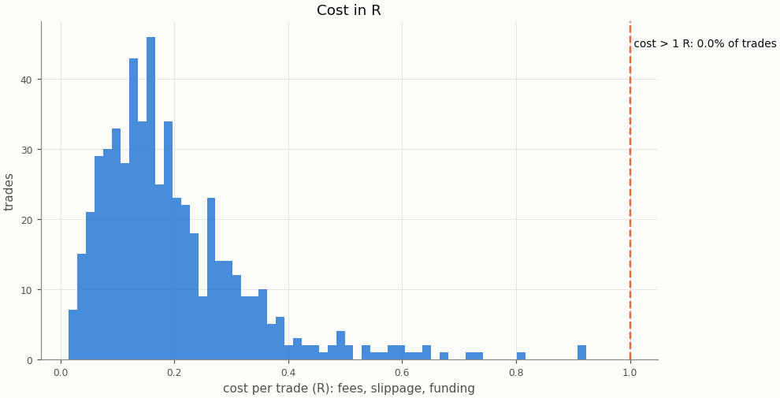

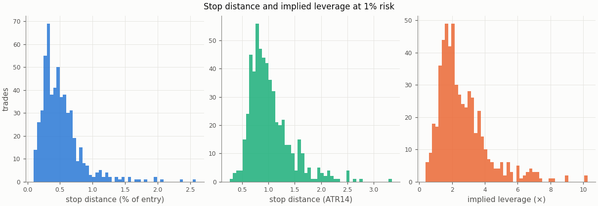

### Re-pricing (D13)

The same trades and baseline runs re-priced at other costs, without re-simulation; descriptive only, the verdict uses the registered costs.

| Slippage | Maker fee | Taker fee | n | Mean net R | 95% CI | Win rate | p_A | p_B | Costs |
|---|---|---|---|---|---|---|---|---|---|
| 0.00% | 0.00% | 0.05% | 555 | -0.047 | -0.174 to 0.078 | 34.8% | 0.936 | 0.306 |  |
| 0.00% | 0.02% | 0.05% | 555 | -0.118 | -0.243 to 0.005 | 34.8% | 0.936 | 0.305 |  |
| 0.02% | 0.00% | 0.05% | 555 | -0.082 | -0.211 to 0.047 | 34.8% | 0.937 | 0.305 |  |
| 0.02% | 0.02% | 0.05% | 555 | -0.153 | -0.279 to -0.027 | 34.8% | 0.936 | 0.307 | registered |
| 0.05% | 0.00% | 0.05% | 555 | -0.133 | -0.265 to -0.002 | 34.8% | 0.938 | 0.311 |  |
| 0.05% | 0.02% | 0.05% | 555 | -0.204 | -0.334 to -0.076 | 34.8% | 0.937 | 0.31 |  |
| 0.10% | 0.00% | 0.05% | 555 | -0.219 | -0.356 to -0.083 | 34.8% | 0.937 | 0.314 |  |
| 0.10% | 0.02% | 0.05% | 555 | -0.290 | -0.425 to -0.156 | 34.8% | 0.937 | 0.315 |  |

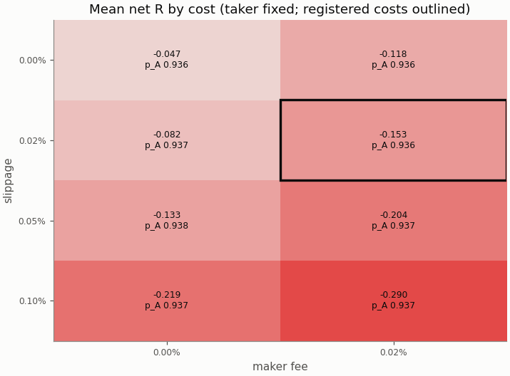

## Robustness

### Heatmap 1: r_target × entry_level

8 of 8 cells have run; the primary is outlined.

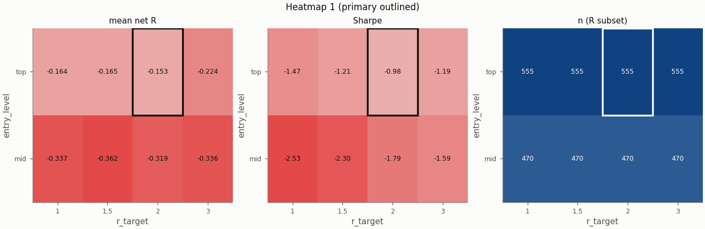

### Heatmap 2: swing_k × confirm_n

9 of 9 cells have run; the primary is outlined.

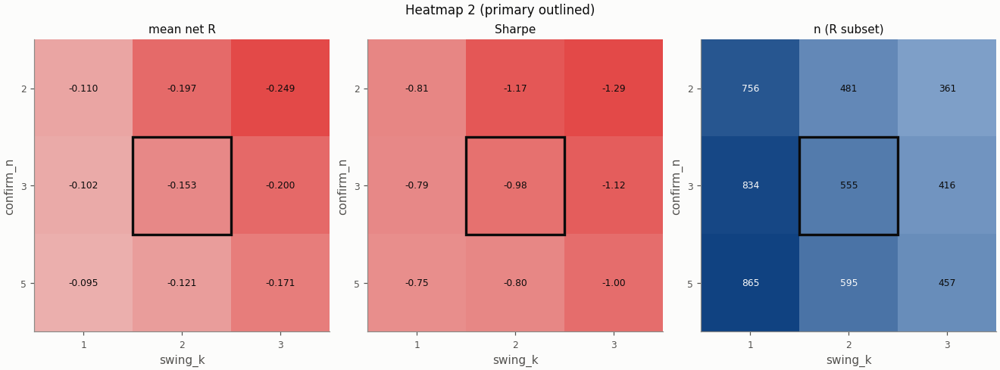

### Heatmap 3: stop_buffer × hold_rule

16 of 16 cells have run; the primary is outlined.

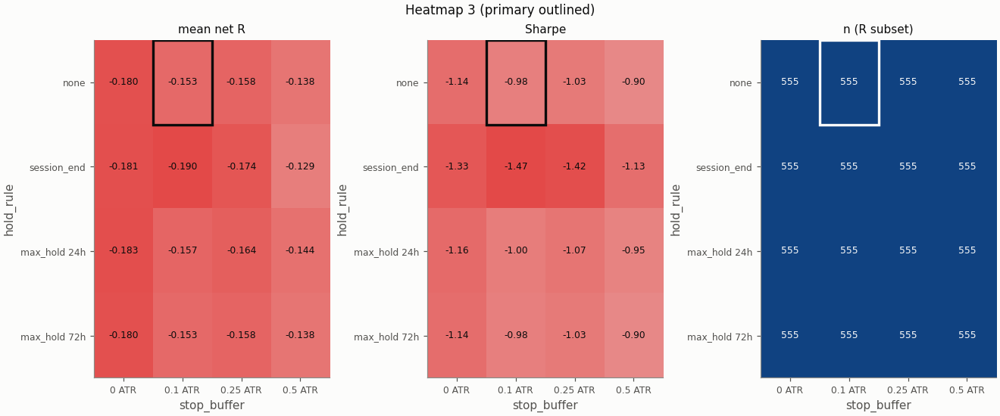

Grid variants of this pair × session:

- heatmap_3: hold_rule=session_end, stop_buffer=0 ATR ([report](../0099fc20dc6f0135e8902d74de187e331a99e7033f98b4fa47d5e8f0e148e311/report.md))
- heatmap_1: entry_level=mid, r_target=3 ([report](../08faf0fcfdfde6ebf12bd0680f030052b44f7ef82814f531b335ae9febb7b9d0/report.md))
- heatmap_3: hold_rule=max_hold 24h ([report](../155106c0f986cc08cc8713206a680adff1ff2527b9cf46d8e51f6b3f918f9ce0/report.md))
- heatmap_3: hold_rule=session_end ([report](../17648169c8b2e0d6597769ba82ae59dac0565b2b23570371599970c42b3cdd2e/report.md))
- heatmap_3: hold_rule=max_hold 72h, stop_buffer=0 ATR ([report](../1830d471fcb328b4a4fe13331f506ae3a970a51f976fbd3aa66b9b6387d4eaf8/report.md))
- heatmap_2: swing_k=3 ([report](../1e8813244fcfbc38880753787c0c732ef1af6e7d4d873595b59bef042ae5fb31/report.md))
- heatmap_3: stop_buffer=0.25 ATR ([report](../2636c56b2ee936691717a103ca7f09ee7fd02c1d88ac430d4ae292c54b386caf/report.md))
- heatmap_2: swing_k=1 ([report](../330d4ca717579f515f52444575a9c778770788bb36caeaf5c82e4656b4bc66d4/report.md))
- single_2: pierce=0.0005 ([report](../4736c3b1dbbf62b7f76fea90c79db52d7d02732ef975d22dac8a766f3202d7ca/report.md))
- heatmap_3: stop_buffer=0 ATR ([report](../4a52b2de258825065cc17183682c9304a51f255933552a9c1753cdd8f13bcdf6/report.md))
- heatmap_3: hold_rule=session_end, stop_buffer=0.25 ATR ([report](../4a6c5e08e4d5747371149ba2b42f92cb3a2cd22334ed21db603896df6574d424/report.md))
- heatmap_3: hold_rule=max_hold 72h, stop_buffer=0.5 ATR ([report](../530870c1223f2cb27fdff19a7af5950e78efc314864b0b3df8fa7903c05ae478/report.md))
- single_5: stop_buffer=0.25% ([report](../5e3b9444e827e722fef76058df09eb62f1b6358cf3434a40fccdf9b463bb8d42/report.md))
- heatmap_3: hold_rule=max_hold 24h, stop_buffer=0.5 ATR ([report](../6901d0183af6e248d08b0243936714cd2f8d3fab61cb8b509929b9e57f1e1986/report.md))
- heatmap_3: stop_buffer=0.5 ATR ([report](../6a64c7363abb3f469f2407287273720f8083c246ab8681ec66ebc878a37fe77f/report.md))
- heatmap_2: confirm_n=2, swing_k=1 ([report](../6bf89988a02360ecca5293793f30097c57acab8753cde07878fabecde485409c/report.md))
- heatmap_2: confirm_n=2, swing_k=3 ([report](../6e689d84beb2e2087227746b34f54337a7d0a6990ae62525b4467dc43ded1820/report.md))
- heatmap_1: entry_level=mid ([report](../74c33553129b8d4a3f58b40064c32db833432fd35d6e0f0e73c4cfd6e9e0e720/report.md))
- heatmap_3: hold_rule=max_hold 72h ([report](../75aba68bd05358662ab202b295efc61307e9e5a85f8dd9249dc5c0ee035d5a36/report.md))
- single_3: trend_filter=on ([report](../87293baa83f476a00d44588023383020afea7cfa6bda2758dd81ada538f41650/report.md))
- heatmap_2: confirm_n=5, swing_k=3 ([report](../8751e99af65beebe323581b90f4ef70c62e98d92a8356aae101d431b7f09c519/report.md))
- heatmap_2: confirm_n=2 ([report](../8a8b4ae12b733ae32e109cf3ec43c122775e627e67041f59fcad436b9c59a587/report.md))
- heatmap_2: confirm_n=5 ([report](../968c5f7d42b82136ccb061074463a02336493c75ed94fc2edcf25073e26f7282/report.md))
- heatmap_3: hold_rule=max_hold 72h, stop_buffer=0.25 ATR ([report](../a0bd9d58f345f275b9d6220e9bc429ab6df4e828b933ac1a1c57becf329e44e7/report.md))
- heatmap_3: hold_rule=max_hold 24h, stop_buffer=0 ATR ([report](../ae5bca6aa9254a4a97fa62a67783035267cb0c4f40a10d2318ebf89fc65feaa8/report.md))
- heatmap_1: entry_level=mid, r_target=1.5 ([report](../b92013f3dbac77e3f2fabce21326d3fbaf1d40e6ab4127650a332c068c28d420/report.md))
- heatmap_3: hold_rule=max_hold 24h, stop_buffer=0.25 ATR ([report](../b9494df143a92d7ee6f5746412de642e3a3da6d64a18a8dbb09ce8c5738280f4/report.md))
- heatmap_3: hold_rule=session_end, stop_buffer=0.5 ATR ([report](../c0ee466cccca146f2683f60634df28c3d02fafab9b565bd20fed261f89f23b31/report.md))
- heatmap_1: r_target=3 ([report](../c4e74e423cadfd070e31eac15d9810311c34a85d3ece6fe3e6ec6ecd4afc21ca/report.md))
- heatmap_1: r_target=1.5 ([report](../c87b4fef8fae1382058601fa7507731c00a6a5cf3d9f5477af0ad9b695cbd09d/report.md))
- heatmap_1: r_target=1 ([report](../c9bd1577b90069a69cff59d9556deb54641e5c125b551213e126c8478fcce91e/report.md))
- heatmap_1: entry_level=mid, r_target=1 ([report](../cba2595359fd826b192a228efe2e6ade393e5d4e49c4b92c7472cd7078869676/report.md))
- heatmap_2: confirm_n=5, swing_k=1 ([report](../d4db709907f0e43ec4b9d4e93e153c55e7ad1cf380cc39c635e9bb74d2caef0d/report.md))
- single_1: zone=body ([report](../da0d100412c02b508fce1720b59908e7aab84de133ec7a9529d65b91649b3c5f/report.md))
- single_4: stop_buffer=0.1% ([report](../efa02c16e190cf891da879b1efe1a44cc84ee2eb8b4e11001cb2fa0bcc69a4cf/report.md))

## Alpha decay

Per calendar year (max drawdown starts from the previous year-end equity; fill rate is filled / placed entry orders by placement year).

| Year | n | Win rate | Mean net R | Sharpe | Max DD | Fill rate |
|---|---|---|---|---|---|---|
| 2020 | 97 | 42.3% | 0.060 | 0.38 | 14.3% | 66.0% |
| 2021 | 91 | 36.3% | -0.049 | -0.31 | 10.8% | 69.5% |
| 2022 | 91 | 35.2% | -0.141 | -0.90 | 19.5% | 66.4% |
| 2023 | 84 | 33.3% | -0.266 | -1.61 | 21.8% | 58.3% |
| 2024 | 95 | 29.5% | -0.288 | -1.93 | 28.6% | 63.8% |
| 2025 | 97 | 32.0% | -0.244 | -1.60 | 25.5% | 67.4% |

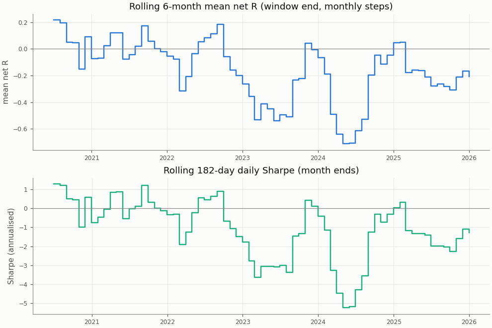

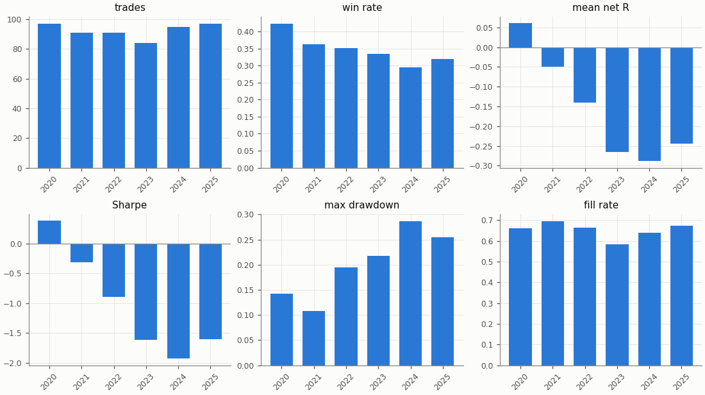

## Regimes and calendar

Trend: daily ADX(14) above 25 as of the day before entry. Volatility: 30-day realised vol of daily log returns as of the day before entry, above (`high`) or below (`low`) the in-sample median 0.02804; trades before the indicators are defined are unlabelled.

| Regime | n | Win rate | Mean net R |
|---|---|---|---|
| trend: no_trend | 262 | 37.4% | -0.087 |
| trend: trend | 293 | 32.4% | -0.211 |
| vol: high | 290 | 36.9% | -0.053 |
| vol: low | 265 | 32.5% | -0.261 |

| Day of week (UTC) | n | Win rate | Mean net R |
|---|---|---|---|
| Monday | 106 | 33.0% | -0.222 |
| Tuesday | 106 | 34.9% | -0.140 |
| Wednesday | 136 | 40.4% | 0.030 |
| Thursday | 111 | 31.5% | -0.250 |
| Friday | 96 | 32.3% | -0.235 |

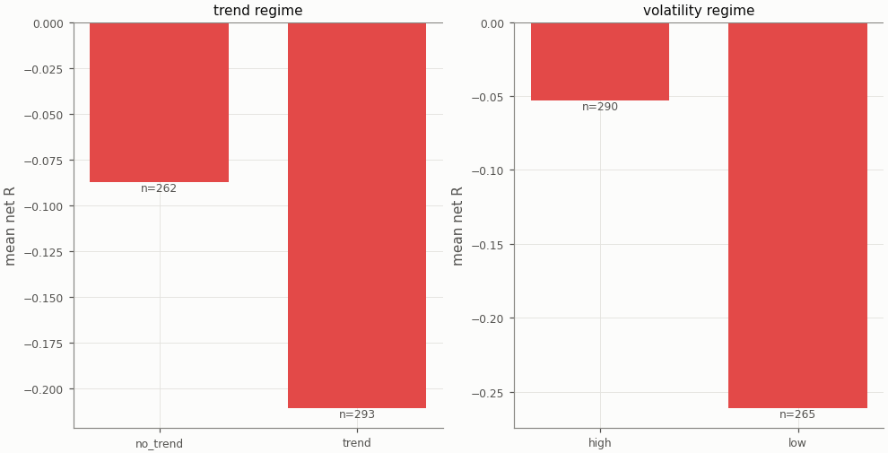

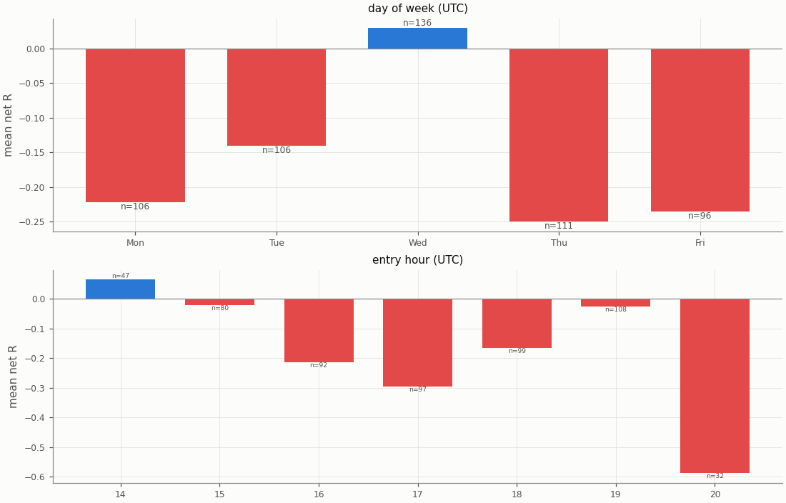

## Diagnostics

| Count | Value |
|---|---|
| trades open at the data end (left out of the R subset) | 0 |
| ambiguous candles resolved without full 1m data | 0 |
| max concurrent positions | 1 |
| funding paid in total (USD) | 207.12 |

| Fill resolution | Fills |
|---|---|
| 15m_unambiguous | 955 |
| 1m | 130 |
| 1m_pessimistic | 25 |

| Exit reason | n | Win rate | Mean net R |
|---|---|---|---|
| stop | 362 | 0.0% | -1.241 |
| target | 193 | 100.0% | 1.889 |

| Trade distribution | min | p05 | p25 | p50 | p75 | p95 | max | mean |
|---|---|---|---|---|---|---|---|---|
| hold (minutes) | 0.0 | 2.7 | 15.0 | 60.0 | 150.0 | 589.5 | 2070.0 | 136.5 |
| MAE (R) | -7.505 | -2.418 | -1.417 | -1.098 | -0.673 | -0.087 | 0.000 | -1.149 |
| MFE (R) | 0.036 | 0.276 | 0.645 | 1.288 | 2.166 | 3.107 | 6.186 | 1.478 |

Share of this variant's trades whose candidate candle is also traded by the other session variants (computed at report time from their trade tables): London 7.7%, UTC 8.8%; any of them 14.8%. The session variants are not independent tests.

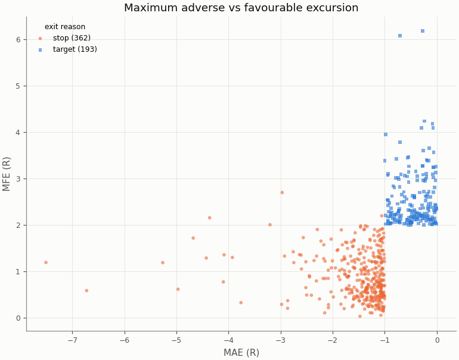

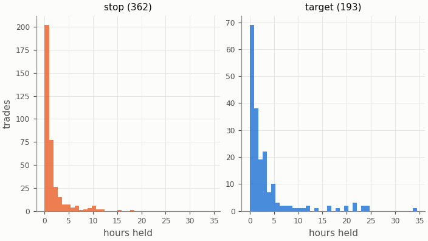

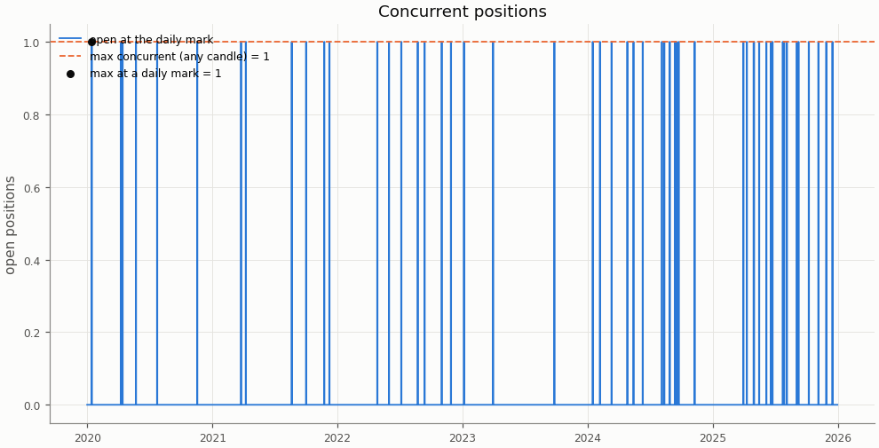

## Deflated Sharpe ratio

| Daily returns | Value |
|---|---|
| daily Sharpe (not annualised) | -0.0511 |
| days T | 2192 |
| skew | 0.670 |
| kurtosis (non-excess) | 5.262 |

| Trials | N | V (variance of daily Sharpe) | SR* | DSR |
|---|---|---|---|---|
| this pair × session's grid | 36 | 0.000535 | 0.0497 | 0.000 |
| all grid variants | 324 | 0.003906 | 0.1825 | 0.000 |

Caveat: the grid cells share most of their trades, so the effective number of independent trials is far below N and the DSR is conservative.

## Notes

- `15m_pessimistic_missing_1m`: 0 fills and 0 ambiguous (candle, order) pairs were resolved by the pessimistic 15m rule because 1m data was incomplete.
- Data gaps overlapping a trade (computed at report time from the candle manifests): 15m: 0 trades over 0 gaps; 1m: 0 trades over 0 gaps.
