# ETHUSDT / UTC, in-sample primary

- Pair: ETHUSDT
- Session: UTC (00:00–24:00 UTC, weekdays [0, 1, 2, 3, 4, 5, 6], Mon = 0)
- Period: 2020-01-01 to 2025-12-31 (in-sample)
- Variant id: `27e94a25749567b78c78caf834208a4a254e1e9295988e2cee4be1e7f8b3897c`
- Code version: `c3c05e53c0f38a9e57d65b716a78ddfb198004a84dd66fde28cf145808135dc5`
- Seed: 20260926 (generators per purpose: trade_bootstrap, day_bootstrap, sharpe_bootstrap, bh_sharpe_bootstrap, bh_diff_bootstrap, baseline_a, baseline_b)
- Role: primary; member of heatmap_1, heatmap_2, heatmap_3
- Costs: maker 0.02%, taker 0.05%, slippage 0.02%; risk 1.0% per trade; 1m resolution on

## Funnel

Every impulse that did not become a trade is counted by the first reason that stopped it (spec overview §6). Orders exclude intents skipped by the leverage cap.

| Stage | Count |
|---|---|
| impulses | 13521 |
| blocks seen | 10592 |
| skipped: no_candidate | 2929 |
| skipped: ineligible | 374 |
| skipped: degenerate | 0 |
| skipped: no_displacement | 435 |
| skipped: mitigated | 1348 |
| skipped: entry_above_price | 0 |
| skipped: trend | 0 |
| skipped: session_used | 6298 |
| intents | 2137 |
| skipped: leverage cap | 2 |
| orders placed | 2135 |
| orders filled | 1865 |
| fill rate | 87.4% |
| trades | 1865 |
| trades in the R subset | 1865 |
| trades open at the data end | 0 |

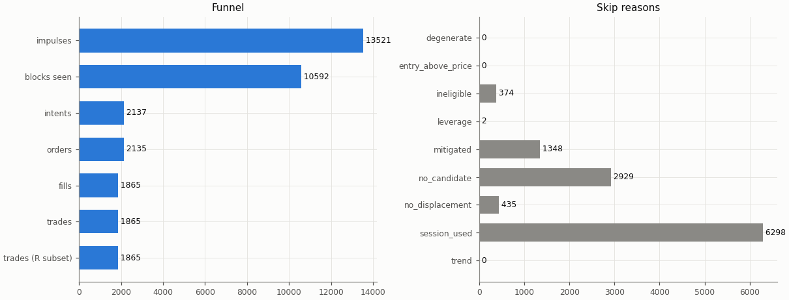

## Headline

Trade statistics use the R subset: trades closed by a stop, target or time exit (`exit_reason != data_end`); trades still open at the end of the data are left out.

| Headline | Value |
|---|---|
| trades (R subset) | 1865 |
| win rate | 34.2% |
| mean gross R | 0.025 |
| mean net R | -0.209 |
| mean net R, 95% CI (trade bootstrap) | -0.276 to -0.142 |
| mean net R, 95% CI (day-block bootstrap) | -0.278 to -0.141 |
| median net R | -1.145 |
| std of net R | 1.508 |
| profit factor | 0.75 |
| mean cost (R) | 0.234 |
| mean funding (R) | 0.004 |
| mean hold (minutes) | 91.3 |
| Sharpe (annualised, daily) | -2.45 |
| Sharpe, 95% CI (10-day block bootstrap) | -3.34 to -1.57 |
| max drawdown | 98.8% |
| total return | -98.4% |
| exposure (share of candles in a trade) | 6.3% |
| mean notional / equity at the daily marks | 0.014 |
| max concurrent positions | 2 |

## Baselines

| Baseline | Observed mean net R | Runs: mean | Runs: std | p (one-sided) | z | p (Holm) | Runs |
|---|---|---|---|---|---|---|---|
| A: random entry time in the strategy's own sessions | -0.209 | -0.254 | 0.032 | 0.0848 | 1.39 | 0.678 | 5000 |
| B: random sessions and entry times | -0.209 | -0.216 | 0.034 | 0.415 | 0.21 | 1 | 5000 |

| Table A | Value |
|---|---|
| trades covered | 1865 |
| trades left out | 0 |
| baseline B: mean trades per run | 1864.9 |

Holm adjustment over the in-sample family of 9 primary cells (tested: A 9, B 9, buy-and-hold 9) at α = 0.05.

Baseline design (judgment calls, overview risk 13): a baseline trade enters at the open of a uniformly drawn in-session candle with the maker fee, keeps the real trade's stop distance in ATR and the variant's target and hold rule, and pays actual funding; baseline trades that reach the data end are left out of their run's mean.

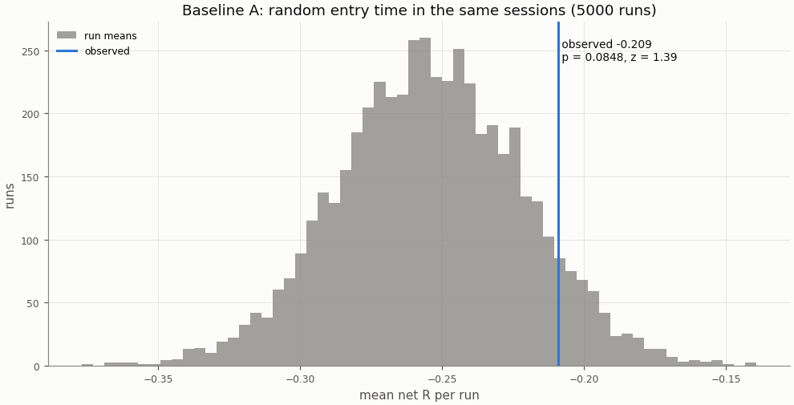

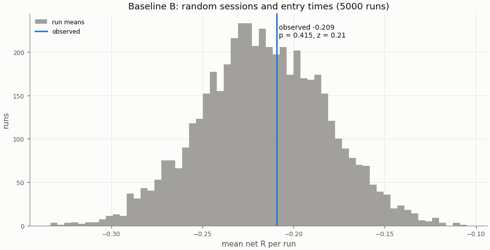

## Buy-and-hold

A constant 1× long in the perpetual with funding, scaled to the strategy's in-sample daily volatility; Sharpe is scale-invariant, the scaling matters for return and drawdown.

| Buy-and-hold | Value |
|---|---|
| days | 2192 |
| buy-and-hold Sharpe | 0.87 |
| buy-and-hold Sharpe, 95% CI | 0.10 to 1.66 |
| strategy Sharpe | -2.45 |
| Sharpe difference (strategy − buy-and-hold) | -3.32 |
| Sharpe difference, 95% CI (paired block bootstrap) | -4.37 to -2.28 |
| p_BH (one-sided) | 1 |
| p_BH (Holm) | 1 |
| buy-and-hold total return (1×) | 822.4% |
| vol scale (σ strategy / σ buy-and-hold) | 0.320 |
| σ strategy (daily, in-sample) | 0.01389 |
| σ buy-and-hold (daily, in-sample) | 0.04346 |
| vol-scaled buy-and-hold total return | 222.6% |
| vol-scaled buy-and-hold max drawdown | 37.3% |

The figures continue into the holdout run (shaded), chained onto the in-sample end.

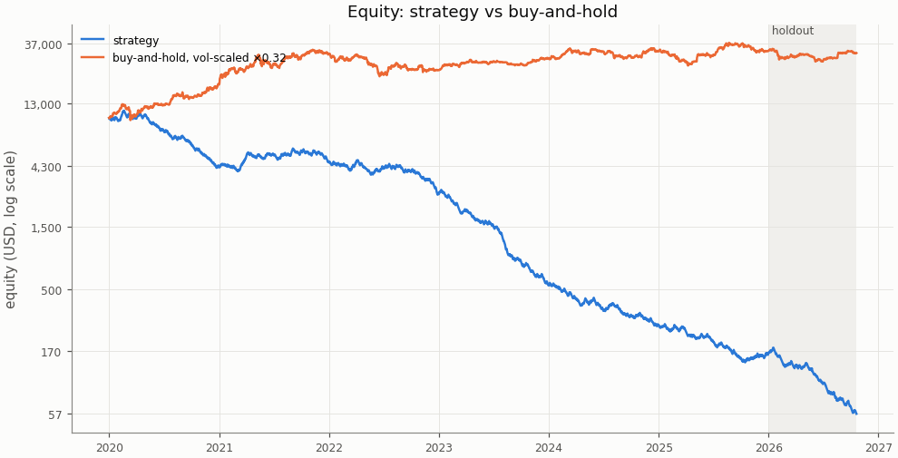

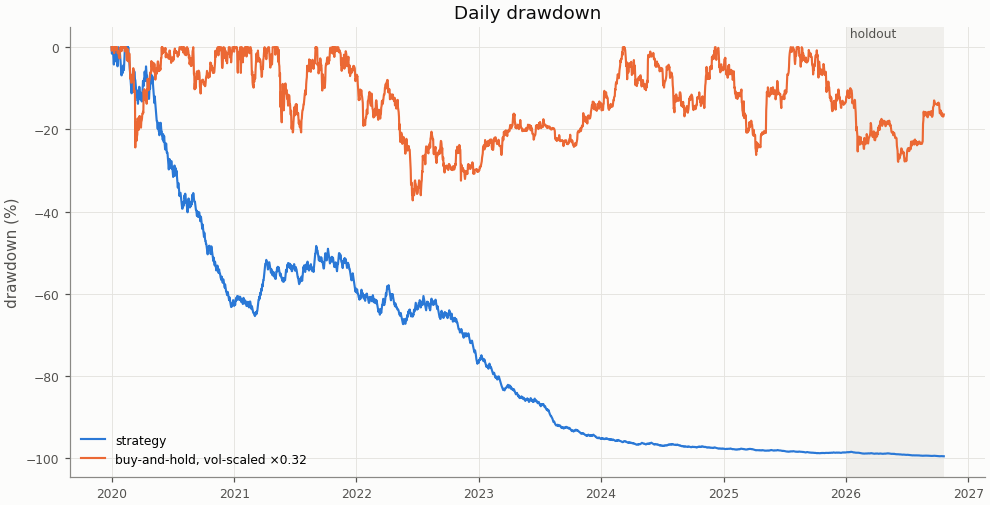

## Costs

Cost in R is fees, slippage and funding divided by the stop distance; a trade whose cost exceeds 1 R loses even when it reaches a 1 R target.

| Cost | Value |
|---|---|
| share of trades with cost above 1 R | 1.1% |

| Cost distribution | min | p05 | p25 | p50 | p75 | p95 | max | mean |
|---|---|---|---|---|---|---|---|---|
| cost per trade (R) | -0.231 | 0.052 | 0.108 | 0.180 | 0.290 | 0.594 | 2.204 | 0.234 |
| stop distance (% of entry) | 0.040 | 0.138 | 0.259 | 0.394 | 0.612 | 1.102 | 6.626 | 0.492 |
| stop distance (ATR14) | 0.179 | 0.512 | 0.706 | 0.857 | 1.077 | 1.568 | 3.158 | 0.929 |
| implied leverage (×) | 0.15 | 0.91 | 1.63 | 2.54 | 3.86 | 7.26 | 24.74 | 3.15 |
| funding (R) | -0.4514 | 0.0000 | 0.0000 | 0.0000 | 0.0000 | 0.0250 | 0.5294 | 0.0041 |

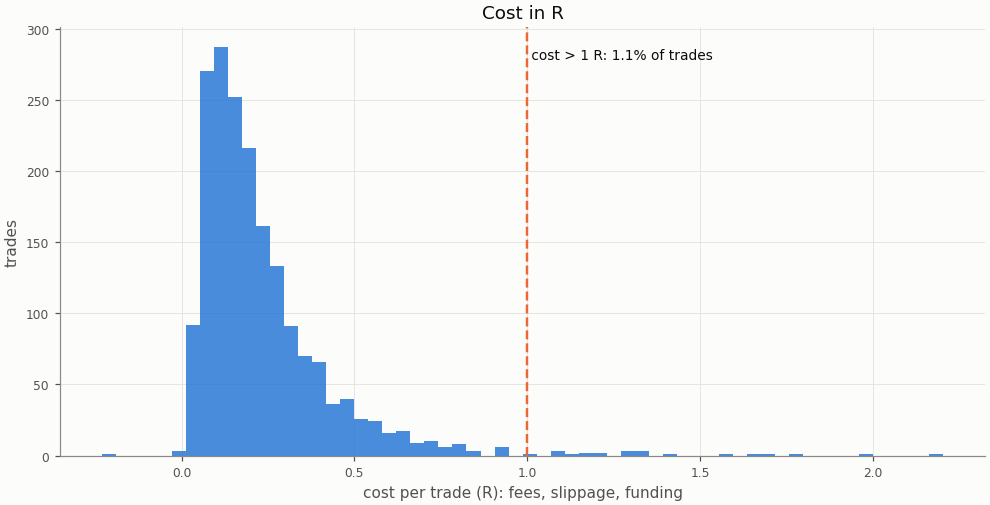

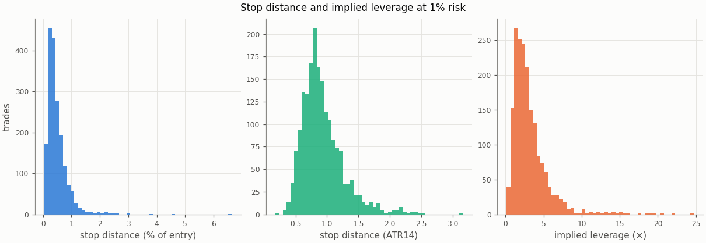

### Re-pricing (D13)

The same trades and baseline runs re-priced at other costs, without re-simulation; descriptive only, the verdict uses the registered costs.

| Slippage | Maker fee | Taker fee | n | Mean net R | 95% CI | Win rate | p_A | p_B | Costs |
|---|---|---|---|---|---|---|---|---|---|
| 0.00% | 0.00% | 0.05% | 1865 | -0.083 | -0.149 to -0.016 | 34.2% | 0.0534 | 0.312 |  |
| 0.00% | 0.02% | 0.05% | 1865 | -0.168 | -0.233 to -0.102 | 34.2% | 0.0726 | 0.382 |  |
| 0.02% | 0.00% | 0.05% | 1865 | -0.125 | -0.192 to -0.056 | 34.2% | 0.0652 | 0.342 |  |
| 0.02% | 0.02% | 0.05% | 1865 | -0.209 | -0.276 to -0.142 | 34.2% | 0.0848 | 0.415 | registered |
| 0.05% | 0.00% | 0.05% | 1865 | -0.187 | -0.256 to -0.116 | 34.2% | 0.08 | 0.391 |  |
| 0.05% | 0.02% | 0.05% | 1865 | -0.271 | -0.340 to -0.202 | 34.2% | 0.102 | 0.464 |  |
| 0.10% | 0.00% | 0.05% | 1865 | -0.290 | -0.364 to -0.216 | 34.2% | 0.108 | 0.468 |  |
| 0.10% | 0.02% | 0.05% | 1865 | -0.375 | -0.447 to -0.302 | 34.2% | 0.14 | 0.54 |  |

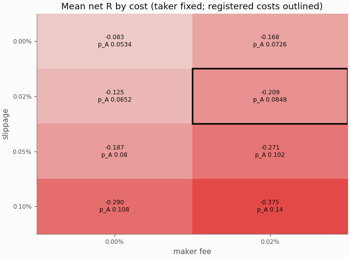

## Robustness

### Heatmap 1: r_target × entry_level

8 of 8 cells have run; the primary is outlined.

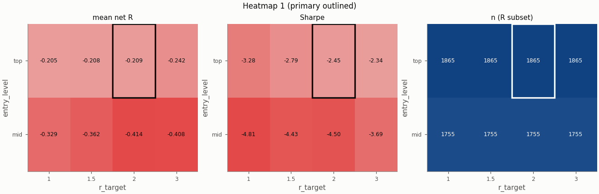

### Heatmap 2: swing_k × confirm_n

9 of 9 cells have run; the primary is outlined.

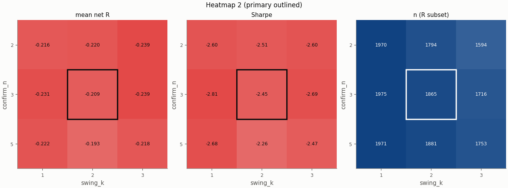

### Heatmap 3: stop_buffer × hold_rule

16 of 16 cells have run; the primary is outlined.

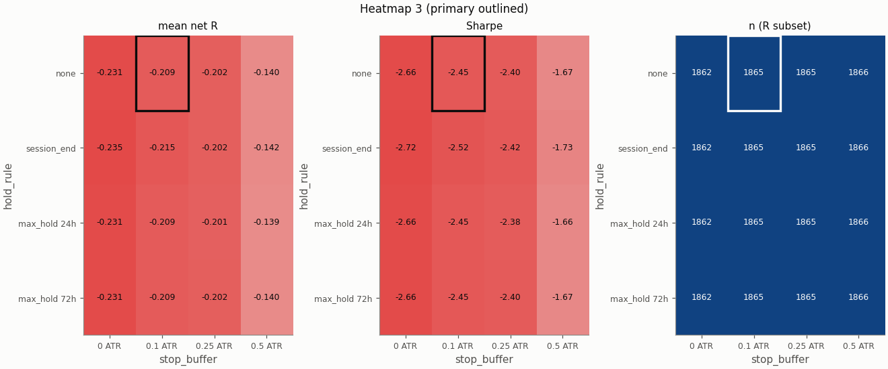

Grid variants of this pair × session:

- heatmap_3: hold_rule=session_end, stop_buffer=0.25 ATR ([report](../0b26db84432a487e618a165bad671f33b4d01e7b5356726207add8d65ca2e439/report.md))
- single_3: trend_filter=on ([report](../0b65c65be4aec62989259de5bee9622ba3632a0733d4482631d4dab0052f16cb/report.md))
- heatmap_3: hold_rule=max_hold 24h ([report](../187b7856c1a520d982df8676670d47a3120faa64943be3268655c7e38d9f7a30/report.md))
- heatmap_3: hold_rule=max_hold 72h, stop_buffer=0 ATR ([report](../1a60cb7dcec6a06983450f3c28fa5fabe13c4e7c0017eeb482859c9bda840b1d/report.md))
- heatmap_1: r_target=1.5 ([report](../1f3cba1cfdf738bcb6bdde0d3c814ffc5efe601245dfede4652f0f4d5553b7a8/report.md))
- heatmap_1: entry_level=mid, r_target=1 ([report](../26dacc55eb08cf659034418f5bd43411128018355c1da594572dcdc850caf6f1/report.md))
- heatmap_1: r_target=1 ([report](../277ee794606422e7854a030b1220bc738c3763d7033c93ef3e4f32ab8f916f88/report.md))
- heatmap_2: confirm_n=2 ([report](../3cd3162b6f755fc76de60aebb44f0524565ceee4e33ee34a9e8e26eb946824f8/report.md))
- heatmap_2: confirm_n=2, swing_k=1 ([report](../44120ba74c7901f6510df29ff398a54058e747a24cd604585757d9f9d432412e/report.md))
- heatmap_3: hold_rule=session_end, stop_buffer=0.5 ATR ([report](../4a35870c79f7906bd0b08f913d64d0fc7ed728db3dd09655fd77feb65286bec1/report.md))
- heatmap_2: confirm_n=5, swing_k=1 ([report](../4fa70812d97caea23d8059efec59fffed07f92455611081bb4081bf324c1ff42/report.md))
- heatmap_1: entry_level=mid, r_target=1.5 ([report](../588a5f4aafcea042751fdbe9cac7b9d186aea83d63cb4668c02940bdcf3a4e75/report.md))
- heatmap_2: swing_k=3 ([report](../6dc023925b0821c4051f68d67358a642f1737ea361bb44eb60eb848b9930e1f6/report.md))
- heatmap_3: hold_rule=max_hold 24h, stop_buffer=0 ATR ([report](../762fddb56bfbce1d06914c5b764c26082282aa4327ea1de21e213d92ac9fd52d/report.md))
- heatmap_2: swing_k=1 ([report](../7ab9c58396d9be75f7cc19a44dac6a64aa0c689282d42243b1f134e97762a30c/report.md))
- heatmap_3: hold_rule=max_hold 72h, stop_buffer=0.5 ATR ([report](../7ae1c79bd8e7fbb913636704f181d295b95388b26c071944e5a23fb919cd33e2/report.md))
- heatmap_1: r_target=3 ([report](../7af39e7402ff4005e2fef933cb244362bcb0d8991fcef27791eef5069bc94831/report.md))
- single_2: pierce=0.0005 ([report](../7afd2f1ddc47ad888e02c77e754c53e2a55d743e1cef01faa44c1cdc21a8fcdf/report.md))
- heatmap_3: hold_rule=max_hold 72h, stop_buffer=0.25 ATR ([report](../7d8aa32819bce93bd867a8116d0c54ffcaddc63711544f806008c3cfe932329b/report.md))
- heatmap_3: stop_buffer=0 ATR ([report](../7fbef0f615484431561ed9eb9f522ac666c60457a32f56e2c3dd4c8abb9b25be/report.md))
- heatmap_1: entry_level=mid ([report](../83d0564baee60a32248ee0de081dc8d9231b897493dffbe82c12a17625763f35/report.md))
- heatmap_3: stop_buffer=0.5 ATR ([report](../848611bbd81d74c65a961a61bf3094e9090734e3f7ab9b554d3b27d8b162a696/report.md))
- single_1: zone=body ([report](../883056705828c77a8816e6a35365d8be129b28895b38f82c6c0a3349246dc830/report.md))
- single_5: stop_buffer=0.25% ([report](../89ade1693ed36cac02ca7f116e664a63024789203ff1587290f4a571729fa674/report.md))
- heatmap_3: hold_rule=session_end ([report](../8b00dea73a1b014c5f70f53c0fc3619eda9d802ada103361354044119274b577/report.md))
- heatmap_3: hold_rule=max_hold 72h ([report](../a063f6712cf89baf075df1ecc822b839f10c7eb618db965884d29f9b399456b7/report.md))
- single_4: stop_buffer=0.1% ([report](../a1078ad7aad12f55934129f1e2384791ffdec16238cc7c42f4bb15f7e31aebb4/report.md))
- heatmap_3: hold_rule=session_end, stop_buffer=0 ATR ([report](../a324ace11945eec77f5080d986a1f56751dac1fdadcf8cdfd247e287e250a908/report.md))
- heatmap_3: hold_rule=max_hold 24h, stop_buffer=0.5 ATR ([report](../a521735078167e7c58f45e97e7145bb1c4b81b150514fec104aadfc52acc8d8f/report.md))
- heatmap_3: stop_buffer=0.25 ATR ([report](../bdcff674164f604374dcee0ea45d6f1bd4b3ff7744f16d85e33beebc52390d5b/report.md))
- heatmap_2: confirm_n=5, swing_k=3 ([report](../cd377c61116bea8da1cd91c591d56241ce02bfe28424dee6caac559b2ce02608/report.md))
- heatmap_2: confirm_n=2, swing_k=3 ([report](../f2419049ea6d4b00c63911db704a9d08e4792c3ad44d92dc4d7bbeedf942b3de/report.md))
- heatmap_3: hold_rule=max_hold 24h, stop_buffer=0.25 ATR ([report](../f26271a16968b65855bf48ad2650e3603be1bdc95e7ed1b817db2d5d12abbd20/report.md))
- heatmap_2: confirm_n=5 ([report](../f6f3f0e6a1c6591d57974bd4c32238e001e71ce3aaea8a99d43139de12653aee/report.md))
- heatmap_1: entry_level=mid, r_target=3 ([report](../fc947bf3c270a2e1d29187321d8e957fa630e6f33fba3605988bd962b6fa5623/report.md))

## Alpha decay

Per calendar year (max drawdown starts from the previous year-end equity; fill rate is filled / placed entry orders by placement year).

| Year | n | Win rate | Mean net R | Sharpe | Max DD | Fill rate |
|---|---|---|---|---|---|---|
| 2020 | 305 | 31.1% | -0.268 | -3.21 | 63.2% | 84.5% |
| 2021 | 303 | 38.9% | 0.039 | 0.46 | 21.5% | 85.6% |
| 2022 | 309 | 34.6% | -0.164 | -1.91 | 45.4% | 87.8% |
| 2023 | 311 | 30.2% | -0.507 | -5.83 | 81.2% | 87.1% |
| 2024 | 322 | 34.8% | -0.202 | -2.39 | 53.2% | 90.7% |
| 2025 | 315 | 35.2% | -0.150 | -1.77 | 48.8% | 88.5% |

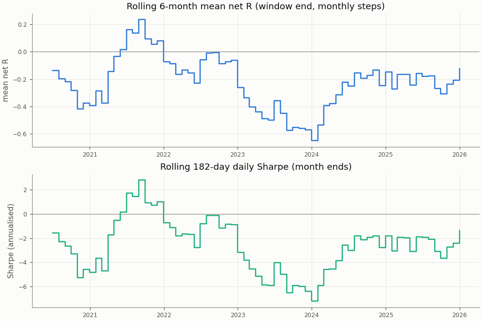

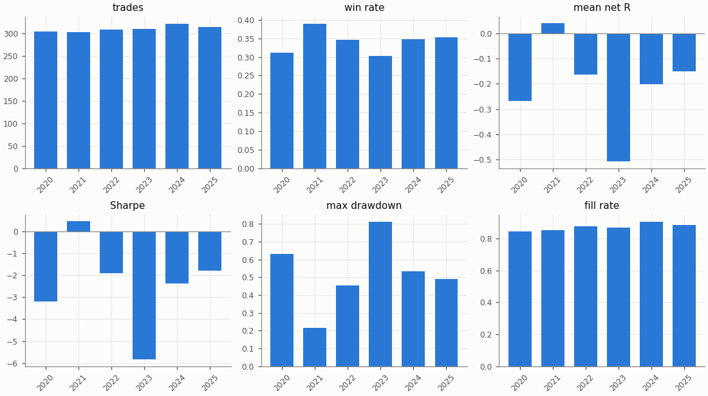

## Regimes and calendar

Trend: daily ADX(14) above 25 as of the day before entry. Volatility: 30-day realised vol of daily log returns as of the day before entry, above (`high`) or below (`low`) the in-sample median 0.03757; trades before the indicators are defined are unlabelled.

| Regime | n | Win rate | Mean net R |
|---|---|---|---|
| trend: no_trend | 762 | 34.5% | -0.235 |
| trend: trend | 1103 | 33.9% | -0.192 |
| vol: high | 930 | 35.6% | -0.099 |
| vol: low | 935 | 32.7% | -0.319 |

| Day of week (UTC) | n | Win rate | Mean net R |
|---|---|---|---|
| Monday | 253 | 35.2% | -0.162 |
| Tuesday | 275 | 35.3% | -0.153 |
| Wednesday | 262 | 37.0% | -0.096 |
| Thursday | 260 | 35.0% | -0.165 |
| Friday | 260 | 32.3% | -0.236 |
| Saturday | 283 | 33.9% | -0.257 |
| Sunday | 272 | 30.5% | -0.385 |

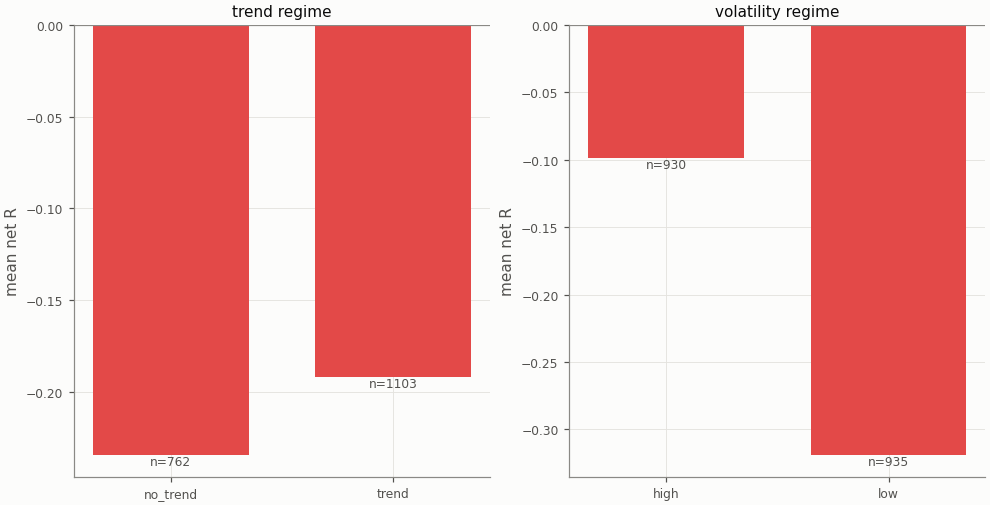

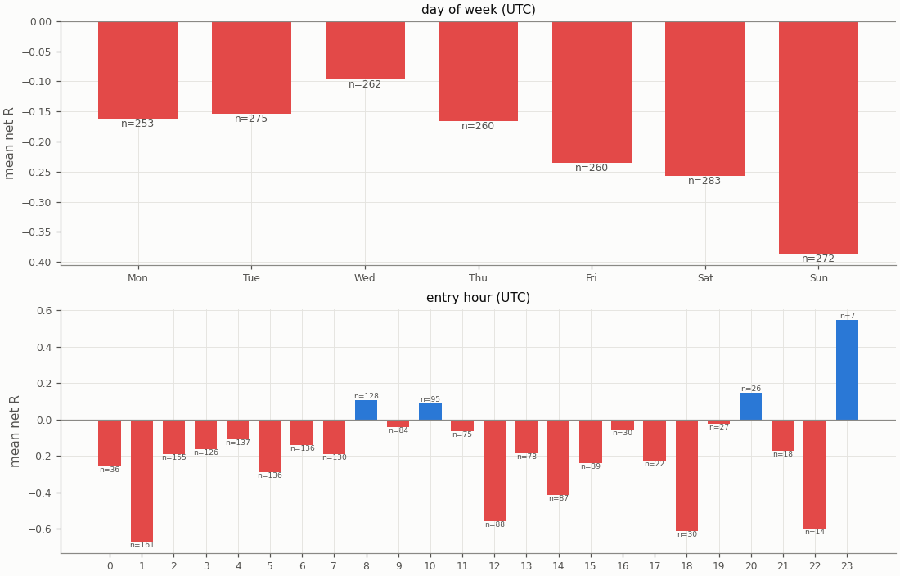

## Diagnostics

| Count | Value |
|---|---|
| trades open at the data end (left out of the R subset) | 0 |
| ambiguous candles resolved without full 1m data | 0 |
| max concurrent positions | 2 |
| funding paid in total (USD) | 326.65 |

| Fill resolution | Fills |
|---|---|
| 15m_unambiguous | 3082 |
| 1m | 518 |
| 1m_pessimistic | 129 |
| open_gap | 1 |

| Exit reason | n | Win rate | Mean net R |
|---|---|---|---|
| stop | 1228 | 0.0% | -1.286 |
| target | 637 | 100.0% | 1.867 |

| Trade distribution | min | p05 | p25 | p50 | p75 | p95 | max | mean |
|---|---|---|---|---|---|---|---|---|
| hold (minutes) | 0.0 | 1.0 | 15.0 | 45.0 | 105.0 | 330.0 | 2055.0 | 91.3 |
| MAE (R) | -11.983 | -2.624 | -1.471 | -1.116 | -0.637 | -0.109 | 0.000 | -1.226 |
| MFE (R) | 0.011 | 0.279 | 0.691 | 1.334 | 2.174 | 3.269 | 12.969 | 1.548 |

Share of this variant's trades whose candidate candle is also traded by the other session variants (computed at report time from their trade tables): London 15.2%, NY 3.1%; any of them 17.6%. The session variants are not independent tests.

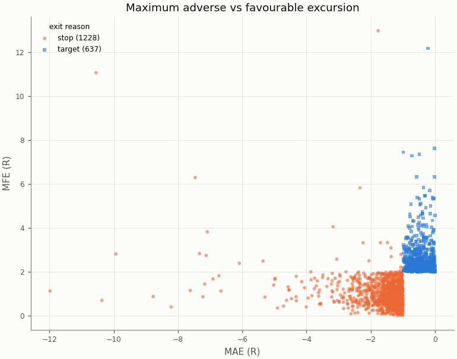

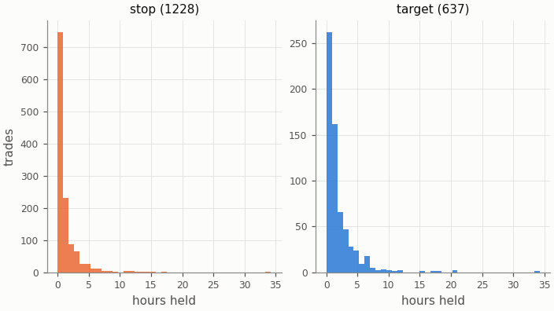

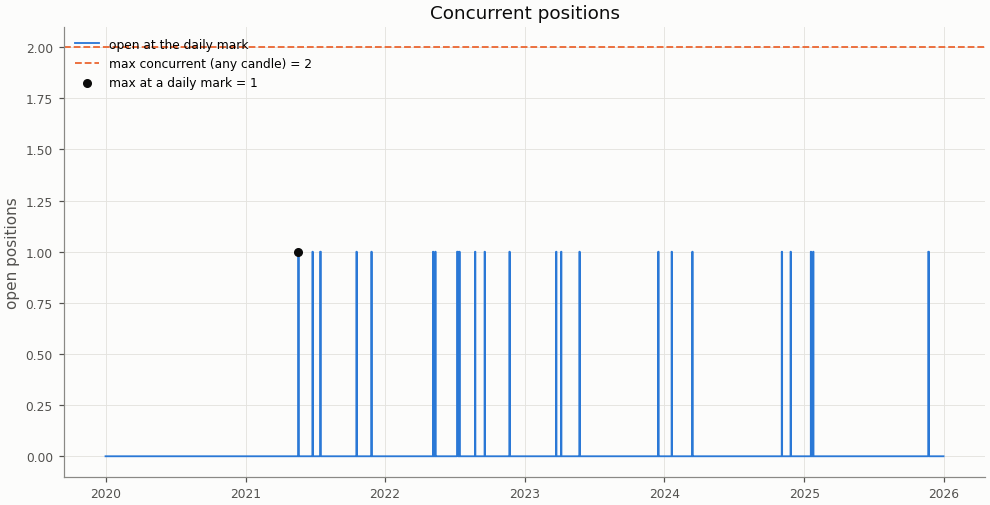

## Deflated Sharpe ratio

| Daily returns | Value |
|---|---|
| daily Sharpe (not annualised) | -0.1282 |
| days T | 2192 |
| skew | 0.584 |
| kurtosis (non-excess) | 1.698 |

| Trials | N | V (variance of daily Sharpe) | SR* | DSR |
|---|---|---|---|---|
| this pair × session's grid | 36 | 0.002192 | 0.1006 | 0.000 |
| all grid variants | 324 | 0.003906 | 0.1825 | 0.000 |

Caveat: the grid cells share most of their trades, so the effective number of independent trials is far below N and the DSR is conservative.

## Notes

- `15m_pessimistic_missing_1m`: 0 fills and 0 ambiguous (candle, order) pairs were resolved by the pessimistic 15m rule because 1m data was incomplete.
- Data gaps overlapping a trade (computed at report time from the candle manifests): 15m: 0 trades over 0 gaps; 1m: 0 trades over 0 gaps.
