# BTCUSDT / London, holdout primary

- Pair: BTCUSDT
- Session: London (08:00–16:30 Europe/London, weekdays [0, 1, 2, 3, 4], Mon = 0)
- Period: 2026-01-01 to 2026-10-20 (holdout)
- Variant id: `2c7b6dc07f06df496f4e75066b4791cae37ed5357a4d903d1cf59e4ec2f10437`
- Code version: `c3c05e53c0f38a9e57d65b716a78ddfb198004a84dd66fde28cf145808135dc5`
- Seed: 20260926 (generators per purpose: trade_bootstrap, day_bootstrap, sharpe_bootstrap, bh_sharpe_bootstrap, bh_diff_bootstrap, baseline_a, baseline_b)
- Role: primary; member of heatmap_1, heatmap_2, heatmap_3
- Costs: maker 0.02%, taker 0.05%, slippage 0.02%; risk 1.0% per trade; 1m resolution on

## Funnel

Every impulse that did not become a trade is counted by the first reason that stopped it (spec overview §6). Orders exclude intents skipped by the leverage cap.

| Stage | Count |
|---|---|
| impulses | 1748 |
| blocks seen | 1391 |
| skipped: no_candidate | 357 |
| skipped: ineligible | 1009 |
| skipped: degenerate | 0 |
| skipped: no_displacement | 18 |
| skipped: mitigated | 42 |
| skipped: entry_above_price | 0 |
| skipped: trend | 0 |
| skipped: session_used | 162 |
| intents | 160 |
| skipped: leverage cap | 0 |
| orders placed | 160 |
| orders filled | 121 |
| fill rate | 75.6% |
| trades | 121 |
| trades in the R subset | 121 |
| trades open at the data end | 0 |

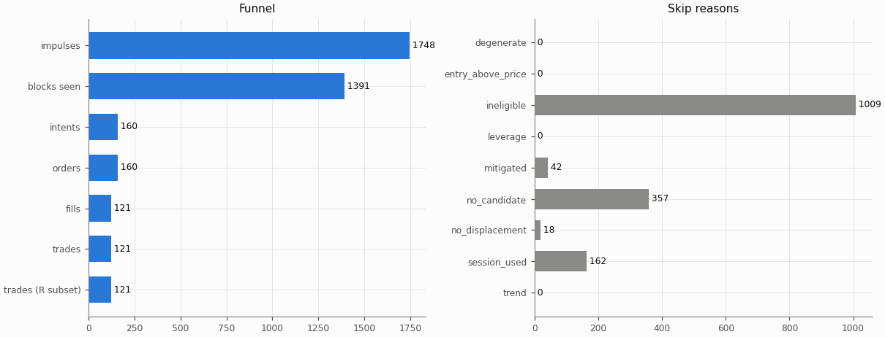

## Headline

Trade statistics use the R subset: trades closed by a stop, target or time exit (`exit_reason != data_end`); trades still open at the end of the data are left out.

| Headline | Value |
|---|---|
| trades (R subset) | 121 |
| win rate | 28.9% |
| mean gross R | -0.132 |
| mean net R | -0.463 |
| mean net R, 95% CI (trade bootstrap) | -0.720 to -0.201 |
| mean net R, 95% CI (day-block bootstrap) | -0.714 to -0.194 |
| median net R | -1.272 |
| std of net R | 1.471 |
| profit factor | 0.53 |
| mean cost (R) | 0.330 |
| mean funding (R) | 0.000 |
| mean hold (minutes) | 53.2 |
| Sharpe (annualised, daily) | -3.74 |
| Sharpe, 95% CI (10-day block bootstrap) | -6.04 to -1.41 |
| max drawdown | 44.6% |
| total return | -43.7% |
| exposure (share of candles in a trade) | 1.9% |
| mean notional / equity at the daily marks | 0.005 |
| max concurrent positions | 2 |

## Baselines

| Baseline | Observed mean net R | Runs: mean | Runs: std | p (one-sided) | z | p (Holm) | Runs |
|---|---|---|---|---|---|---|---|
| A: random entry time in the strategy's own sessions | -0.463 | -0.283 | 0.129 | 0.92 | -1.39 | 1 | 5000 |
| B: random sessions and entry times | -0.463 | -0.345 | 0.137 | 0.808 | -0.86 | 1 | 5000 |

| Table A | Value |
|---|---|
| trades covered | 121 |
| trades left out | 0 |
| baseline B: mean trades per run | 121.0 |

Holm adjustment over the holdout family of 9 primary cells (tested: A 9, B 9, buy-and-hold 9) at α = 0.05.

Baseline design (judgment calls, overview risk 13): a baseline trade enters at the open of a uniformly drawn in-session candle with the maker fee, keeps the real trade's stop distance in ATR and the variant's target and hold rule, and pays actual funding; baseline trades that reach the data end are left out of their run's mean.

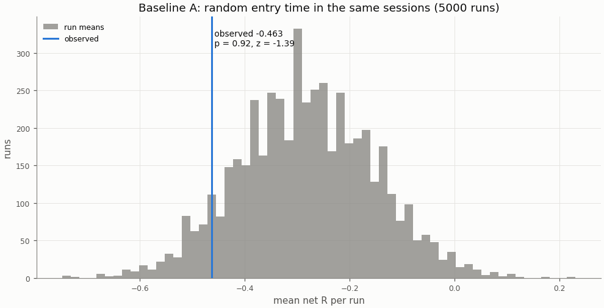

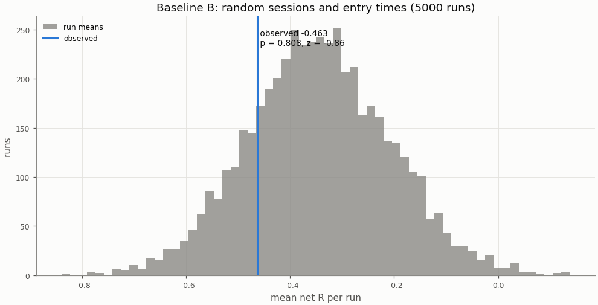

## Buy-and-hold

A constant 1× long in the perpetual with funding, scaled to the strategy's in-sample daily volatility; Sharpe is scale-invariant, the scaling matters for return and drawdown.

| Buy-and-hold | Value |
|---|---|
| days | 293 |
| buy-and-hold Sharpe | 0.01 |
| buy-and-hold Sharpe, 95% CI | -2.31 to 2.18 |
| strategy Sharpe | -3.74 |
| Sharpe difference (strategy − buy-and-hold) | -3.74 |
| Sharpe difference, 95% CI (paired block bootstrap) | -6.16 to -1.06 |
| p_BH (one-sided) | 0.997 |
| p_BH (Holm) | 1 |
| buy-and-hold total return (1×) | -7.5% |
| vol scale (σ strategy / σ buy-and-hold) | 0.305 |
| σ strategy (daily, in-sample) | 0.00990 |
| σ buy-and-hold (daily, in-sample) | 0.03246 |
| vol-scaled buy-and-hold total return | -0.7% |
| vol-scaled buy-and-hold max drawdown | 13.3% |

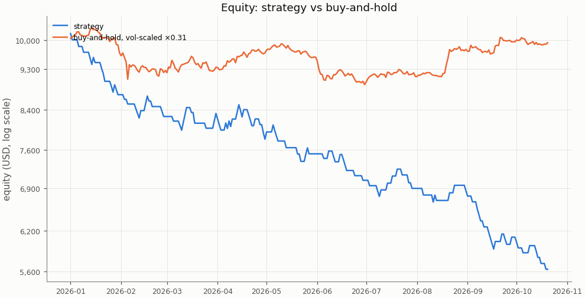

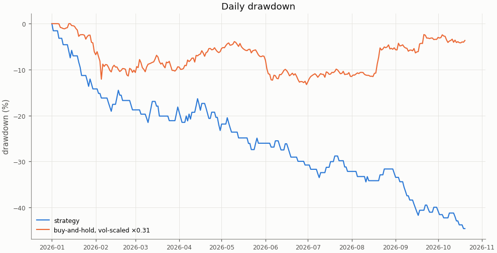

## Costs

Cost in R is fees, slippage and funding divided by the stop distance; a trade whose cost exceeds 1 R loses even when it reaches a 1 R target.

| Cost | Value |
|---|---|
| share of trades with cost above 1 R | 0.8% |

| Cost distribution | min | p05 | p25 | p50 | p75 | p95 | max | mean |
|---|---|---|---|---|---|---|---|---|
| cost per trade (R) | 0.037 | 0.104 | 0.186 | 0.287 | 0.416 | 0.663 | 1.020 | 0.330 |
| stop distance (% of entry) | 0.088 | 0.112 | 0.186 | 0.246 | 0.356 | 0.622 | 0.943 | 0.288 |
| stop distance (ATR14) | 0.375 | 0.556 | 0.766 | 0.885 | 1.087 | 1.667 | 2.275 | 0.969 |
| implied leverage (×) | 1.06 | 1.61 | 2.81 | 4.06 | 5.38 | 8.95 | 11.34 | 4.40 |
| funding (R) | -0.0171 | 0.0000 | 0.0000 | 0.0000 | 0.0000 | 0.0000 | 0.0000 | -0.0002 |

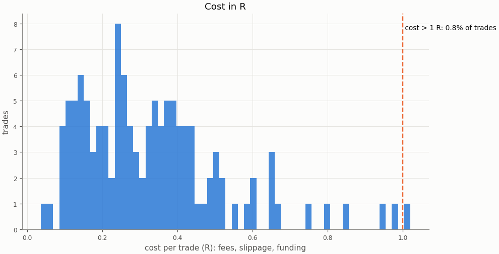

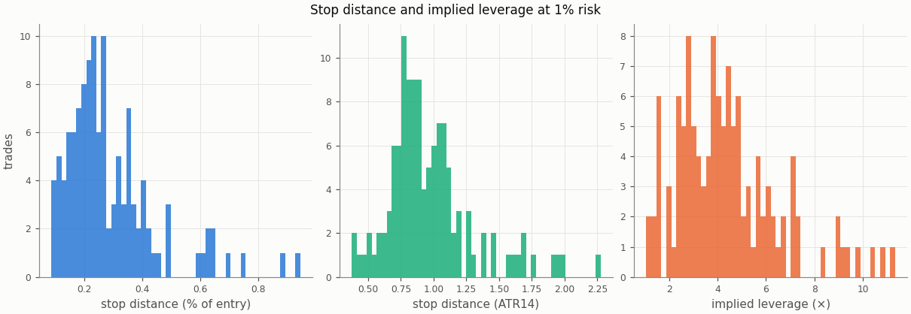

### Re-pricing (D13)

The same trades and baseline runs re-priced at other costs, without re-simulation; descriptive only, the verdict uses the registered costs.

| Slippage | Maker fee | Taker fee | n | Mean net R | 95% CI | Win rate | p_A | p_B | Costs |
|---|---|---|---|---|---|---|---|---|---|
| 0.00% | 0.00% | 0.05% | 121 | -0.286 | -0.544 to -0.024 | 28.9% | 0.916 | 0.798 |  |
| 0.00% | 0.02% | 0.05% | 121 | -0.401 | -0.652 to -0.146 | 28.9% | 0.919 | 0.806 |  |
| 0.02% | 0.00% | 0.05% | 121 | -0.348 | -0.613 to -0.080 | 28.9% | 0.917 | 0.8 |  |
| 0.02% | 0.02% | 0.05% | 121 | -0.463 | -0.720 to -0.201 | 28.9% | 0.92 | 0.808 | registered |
| 0.05% | 0.00% | 0.05% | 121 | -0.441 | -0.716 to -0.162 | 28.9% | 0.919 | 0.804 |  |
| 0.05% | 0.02% | 0.05% | 121 | -0.555 | -0.824 to -0.283 | 28.9% | 0.919 | 0.811 |  |
| 0.10% | 0.00% | 0.05% | 121 | -0.595 | -0.889 to -0.297 | 28.9% | 0.921 | 0.81 |  |
| 0.10% | 0.02% | 0.05% | 121 | -0.709 | -0.997 to -0.417 | 28.9% | 0.921 | 0.814 |  |

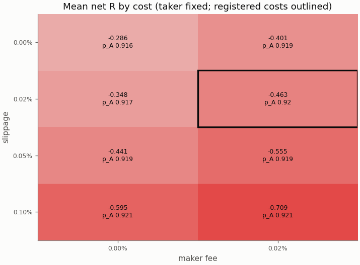

## Robustness

The grid is in-sample only; the heatmaps are in the in-sample primary report.

## Alpha decay

Per calendar year (max drawdown starts from the previous year-end equity; fill rate is filled / placed entry orders by placement year).

| Year | n | Win rate | Mean net R | Sharpe | Max DD | Fill rate |
|---|---|---|---|---|---|---|
| 2026 | 121 | 28.9% | -0.463 | -3.74 | 44.6% | 75.6% |

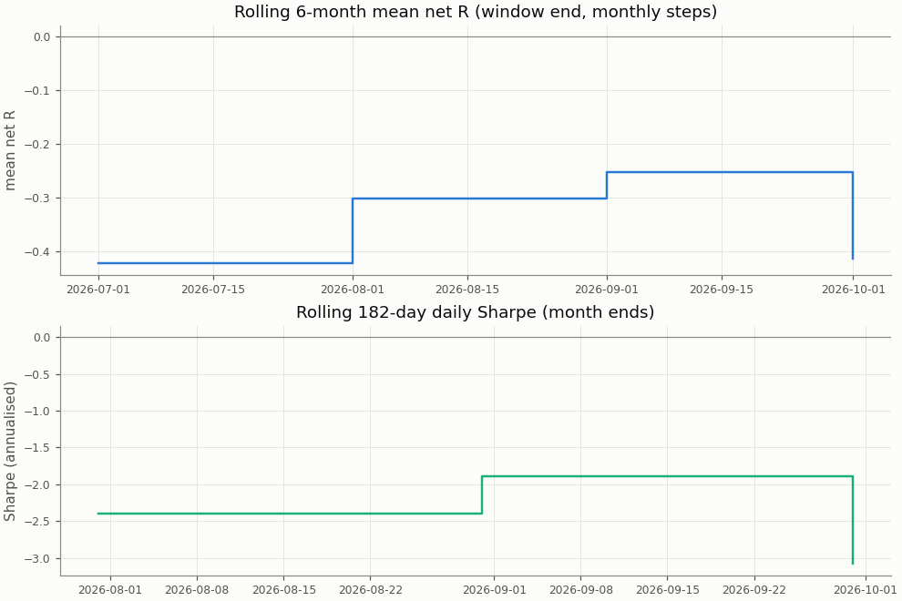

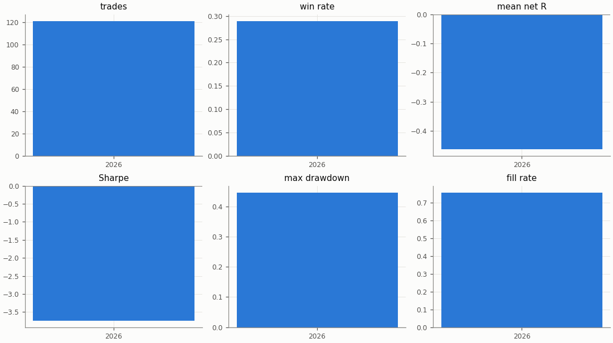

## Regimes and calendar

Trend: daily ADX(14) above 25 as of the day before entry. Volatility: 30-day realised vol of daily log returns as of the day before entry, above (`high`) or below (`low`) the in-sample median 0.02804; trades before the indicators are defined are unlabelled.

| Regime | n | Win rate | Mean net R |
|---|---|---|---|
| trend: no_trend | 46 | 39.1% | -0.191 |
| trend: trend | 75 | 22.7% | -0.629 |
| vol: high | 12 | 25.0% | -0.452 |
| vol: low | 109 | 29.4% | -0.464 |

| Day of week (UTC) | n | Win rate | Mean net R |
|---|---|---|---|
| Monday | 22 | 45.5% | 0.071 |
| Tuesday | 22 | 31.8% | -0.364 |
| Wednesday | 26 | 15.4% | -0.933 |
| Thursday | 22 | 13.6% | -0.933 |
| Friday | 29 | 37.9% | -0.163 |

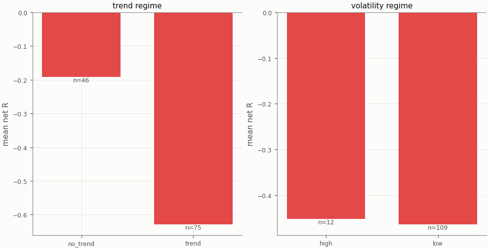

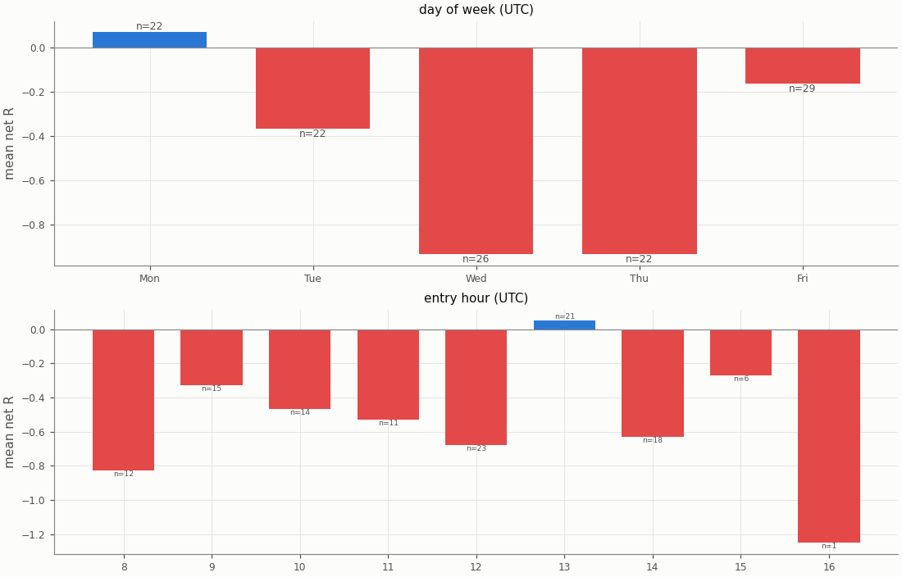

## Diagnostics

| Count | Value |
|---|---|
| trades open at the data end (left out of the R subset) | 0 |
| ambiguous candles resolved without full 1m data | 0 |
| max concurrent positions | 2 |
| funding paid in total (USD) | -2.24 |

| Fill resolution | Fills |
|---|---|
| 15m_unambiguous | 174 |
| 1m | 59 |
| 1m_pessimistic | 9 |

| Exit reason | n | Win rate | Mean net R |
|---|---|---|---|
| stop | 86 | 0.0% | -1.391 |
| target | 35 | 100.0% | 1.819 |

| Trade distribution | min | p05 | p25 | p50 | p75 | p95 | max | mean |
|---|---|---|---|---|---|---|---|---|
| hold (minutes) | 0.0 | 1.0 | 8.0 | 15.0 | 62.0 | 150.0 | 1200.0 | 53.2 |
| MAE (R) | -3.720 | -2.475 | -1.564 | -1.186 | -0.830 | -0.111 | -0.020 | -1.233 |
| MFE (R) | 0.142 | 0.257 | 0.545 | 1.110 | 2.088 | 2.937 | 4.272 | 1.357 |

Share of this variant's trades whose candidate candle is also traded by the other session variants (computed at report time from their trade tables): NY 5.0%, UTC 28.1%; any of them 31.4%. The session variants are not independent tests.

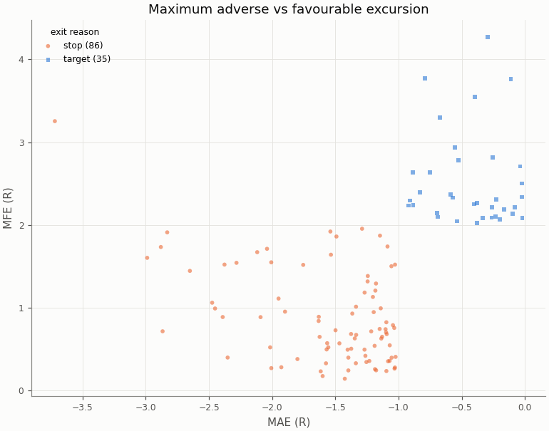

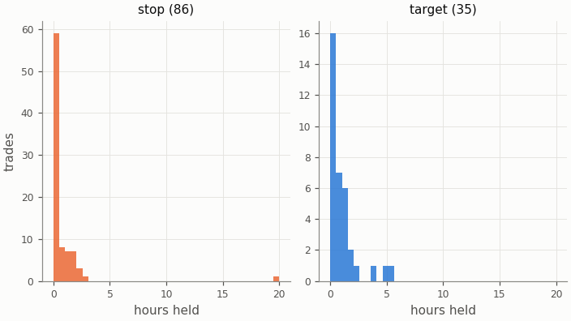

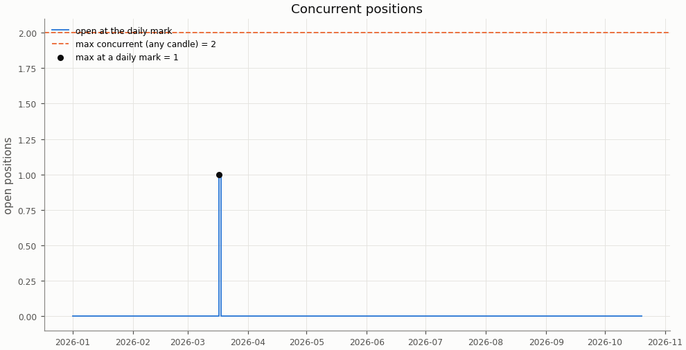

## Deflated Sharpe ratio

| Daily returns | Value |
|---|---|
| daily Sharpe (not annualised) | -0.1956 |
| days T | 293 |
| skew | 0.421 |
| kurtosis (non-excess) | 3.099 |

| Trials | N | V (variance of daily Sharpe) | SR* | DSR |
|---|---|---|---|---|
| this pair × session's grid | n/a | n/a | n/a | n/a |
| all grid variants | n/a | n/a | n/a | n/a |

The DSR is computed for the in-sample grid only; the holdout tests one pre-registered configuration per cell.

Caveat: the grid cells share most of their trades, so the effective number of independent trials is far below N and the DSR is conservative.

## Notes

- `15m_pessimistic_missing_1m`: 0 fills and 0 ambiguous (candle, order) pairs were resolved by the pessimistic 15m rule because 1m data was incomplete.
- Data gaps overlapping a trade (computed at report time from the candle manifests): 15m: 0 trades over 0 gaps; 1m: 0 trades over 0 gaps.
