# SOLUSDT / NY, holdout primary

- Pair: SOLUSDT
- Session: NY (09:30–16:00 America/New_York, weekdays [0, 1, 2, 3, 4], Mon = 0)
- Period: 2026-01-01 to 2026-10-20 (holdout)
- Variant id: `45b715b5f3b4f65a09c8be6db110f707499c283048f2843dfc92ba7846c53649`
- Code version: `c3c05e53c0f38a9e57d65b716a78ddfb198004a84dd66fde28cf145808135dc5`
- Seed: 20260926 (generators per purpose: trade_bootstrap, day_bootstrap, sharpe_bootstrap, bh_sharpe_bootstrap, bh_diff_bootstrap, baseline_a, baseline_b)
- Role: primary; member of heatmap_1, heatmap_2, heatmap_3
- Costs: maker 0.02%, taker 0.05%, slippage 0.05%; risk 1.0% per trade; 1m resolution on

## Funnel

Every impulse that did not become a trade is counted by the first reason that stopped it (spec overview §6). Orders exclude intents skipped by the leverage cap.

| Stage | Count |
|---|---|
| impulses | 1659 |
| blocks seen | 1278 |
| skipped: no_candidate | 381 |
| skipped: ineligible | 1046 |
| skipped: degenerate | 0 |
| skipped: no_displacement | 7 |
| skipped: mitigated | 28 |
| skipped: entry_above_price | 0 |
| skipped: trend | 0 |
| skipped: session_used | 77 |
| intents | 120 |
| skipped: leverage cap | 0 |
| orders placed | 120 |
| orders filled | 78 |
| fill rate | 65.0% |
| trades | 78 |
| trades in the R subset | 78 |
| trades open at the data end | 0 |

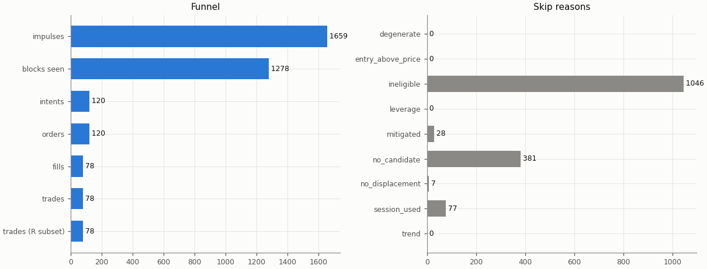

## Headline

Trade statistics use the R subset: trades closed by a stop, target or time exit (`exit_reason != data_end`); trades still open at the end of the data are left out.

| Headline | Value |
|---|---|
| trades (R subset) | 78 |
| win rate | 42.3% |
| mean gross R | 0.269 |
| mean net R | 0.108 |
| mean net R, 95% CI (trade bootstrap) | -0.228 to 0.452 |
| mean net R, 95% CI (day-block bootstrap) | -0.230 to 0.457 |
| median net R | -1.106 |
| std of net R | 1.565 |
| profit factor | 1.15 |
| mean cost (R) | 0.161 |
| mean funding (R) | -0.001 |
| mean hold (minutes) | 235.3 |
| Sharpe (annualised, daily) | 0.68 |
| Sharpe, 95% CI (10-day block bootstrap) | -1.59 to 2.28 |
| max drawdown | 10.2% |
| total return | 7.8% |
| exposure (share of candles in a trade) | 4.6% |
| mean notional / equity at the daily marks | 0.060 |
| max concurrent positions | 1 |

## Baselines

| Baseline | Observed mean net R | Runs: mean | Runs: std | p (one-sided) | z | p (Holm) | Runs |
|---|---|---|---|---|---|---|---|
| A: random entry time in the strategy's own sessions | 0.108 | -0.020 | 0.155 | 0.197 | 0.83 | 1 | 5000 |
| B: random sessions and entry times | 0.108 | -0.176 | 0.170 | 0.0538 | 1.68 | 0.484 | 5000 |

| Table A | Value |
|---|---|
| trades covered | 78 |
| trades left out | 0 |
| baseline B: mean trades per run | 77.9 |

Holm adjustment over the holdout family of 9 primary cells (tested: A 9, B 9, buy-and-hold 9) at α = 0.05.

Baseline design (judgment calls, overview risk 13): a baseline trade enters at the open of a uniformly drawn in-session candle with the maker fee, keeps the real trade's stop distance in ATR and the variant's target and hold rule, and pays actual funding; baseline trades that reach the data end are left out of their run's mean.

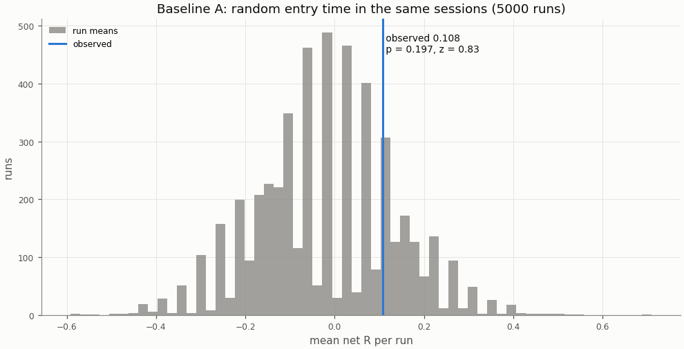

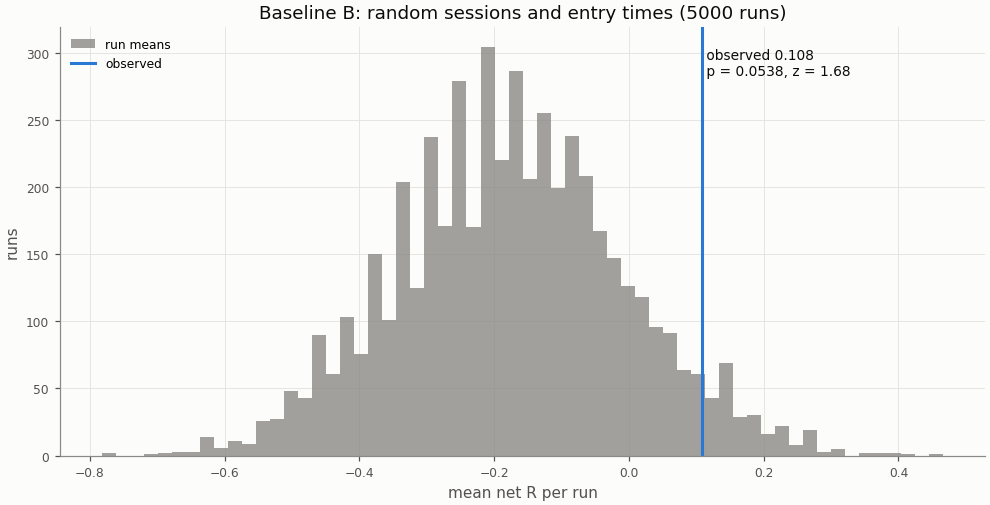

## Buy-and-hold

A constant 1× long in the perpetual with funding, scaled to the strategy's in-sample daily volatility; Sharpe is scale-invariant, the scaling matters for return and drawdown.

| Buy-and-hold | Value |
|---|---|
| days | 293 |
| buy-and-hold Sharpe | 0.02 |
| buy-and-hold Sharpe, 95% CI | -2.41 to 2.22 |
| strategy Sharpe | 0.68 |
| Sharpe difference (strategy − buy-and-hold) | 0.66 |
| Sharpe difference, 95% CI (paired block bootstrap) | -2.52 to 3.34 |
| p_BH (one-sided) | 0.349 |
| p_BH (Holm) | 1 |
| buy-and-hold total return (1×) | -13.9% |
| vol scale (σ strategy / σ buy-and-hold) | 0.120 |
| σ strategy (daily, in-sample) | 0.00755 |
| σ buy-and-hold (daily, in-sample) | 0.06286 |
| vol-scaled buy-and-hold total return | -0.1% |
| vol-scaled buy-and-hold max drawdown | 8.7% |

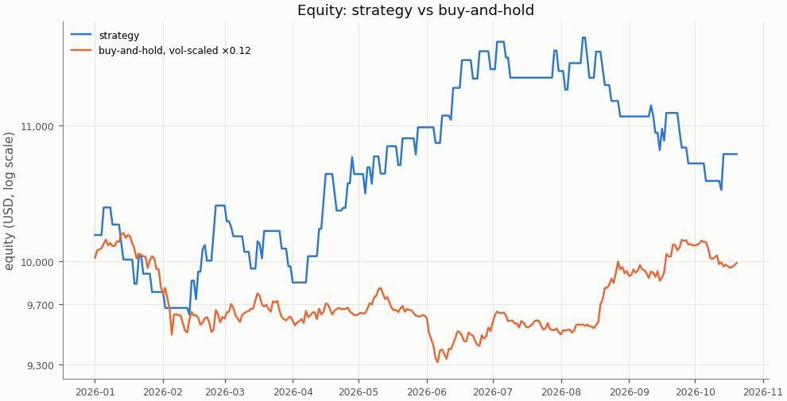

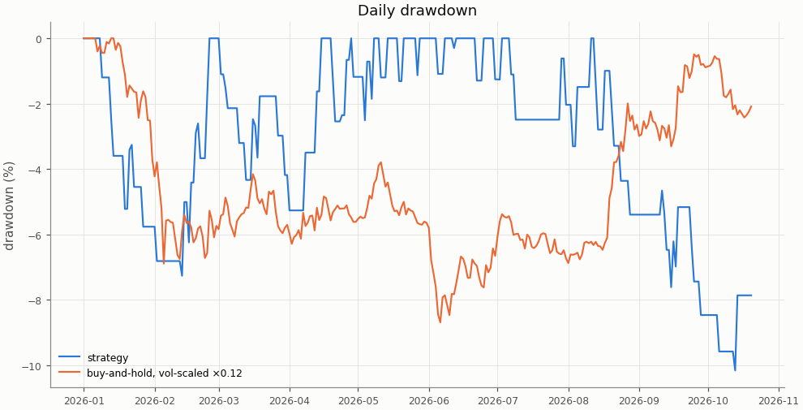

## Costs

Cost in R is fees, slippage and funding divided by the stop distance; a trade whose cost exceeds 1 R loses even when it reaches a 1 R target.

| Cost | Value |
|---|---|
| share of trades with cost above 1 R | 0.0% |

| Cost distribution | min | p05 | p25 | p50 | p75 | p95 | max | mean |
|---|---|---|---|---|---|---|---|---|
| cost per trade (R) | 0.032 | 0.040 | 0.064 | 0.132 | 0.220 | 0.394 | 0.683 | 0.161 |
| stop distance (% of entry) | 0.175 | 0.263 | 0.416 | 0.646 | 0.846 | 1.320 | 2.409 | 0.684 |
| stop distance (ATR14) | 0.555 | 0.649 | 0.828 | 1.047 | 1.395 | 1.831 | 2.389 | 1.126 |
| implied leverage (×) | 0.42 | 0.76 | 1.18 | 1.55 | 2.40 | 3.81 | 5.70 | 1.89 |
| funding (R) | -0.1138 | -0.0056 | 0.0000 | 0.0000 | 0.0000 | 0.0085 | 0.0292 | -0.0007 |

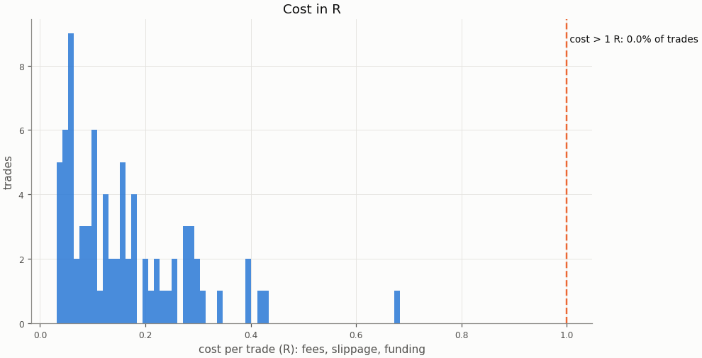

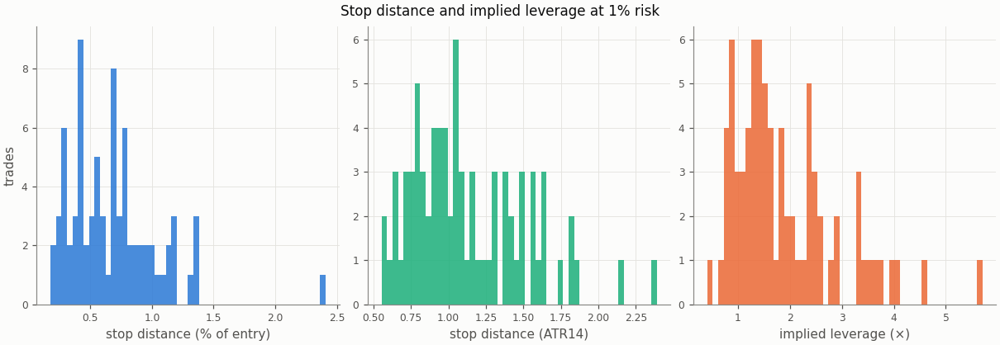

### Re-pricing (D13)

The same trades and baseline runs re-priced at other costs, without re-simulation; descriptive only, the verdict uses the registered costs.

| Slippage | Maker fee | Taker fee | n | Mean net R | 95% CI | Win rate | p_A | p_B | Costs |
|---|---|---|---|---|---|---|---|---|---|
| 0.00% | 0.00% | 0.05% | 78 | 0.216 | -0.106 to 0.566 | 42.3% | 0.196 | 0.0526 |  |
| 0.00% | 0.02% | 0.05% | 78 | 0.162 | -0.160 to 0.501 | 42.3% | 0.181 | 0.053 |  |
| 0.02% | 0.00% | 0.05% | 78 | 0.195 | -0.133 to 0.546 | 42.3% | 0.201 | 0.0526 |  |
| 0.02% | 0.02% | 0.05% | 78 | 0.140 | -0.187 to 0.481 | 42.3% | 0.189 | 0.0538 |  |
| 0.05% | 0.00% | 0.05% | 78 | 0.163 | -0.174 to 0.516 | 42.3% | 0.205 | 0.053 |  |
| 0.05% | 0.02% | 0.05% | 78 | 0.108 | -0.228 to 0.452 | 42.3% | 0.197 | 0.0538 | registered |
| 0.10% | 0.00% | 0.05% | 78 | 0.109 | -0.242 to 0.468 | 42.3% | 0.208 | 0.0538 |  |
| 0.10% | 0.02% | 0.05% | 78 | 0.055 | -0.294 to 0.409 | 42.3% | 0.202 | 0.0536 |  |

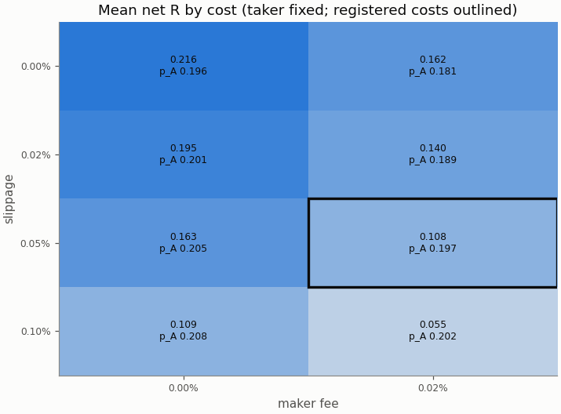

## Robustness

The grid is in-sample only; the heatmaps are in the in-sample primary report.

## Alpha decay

Per calendar year (max drawdown starts from the previous year-end equity; fill rate is filled / placed entry orders by placement year).

| Year | n | Win rate | Mean net R | Sharpe | Max DD | Fill rate |
|---|---|---|---|---|---|---|
| 2026 | 78 | 42.3% | 0.108 | 0.68 | 10.2% | 65.0% |

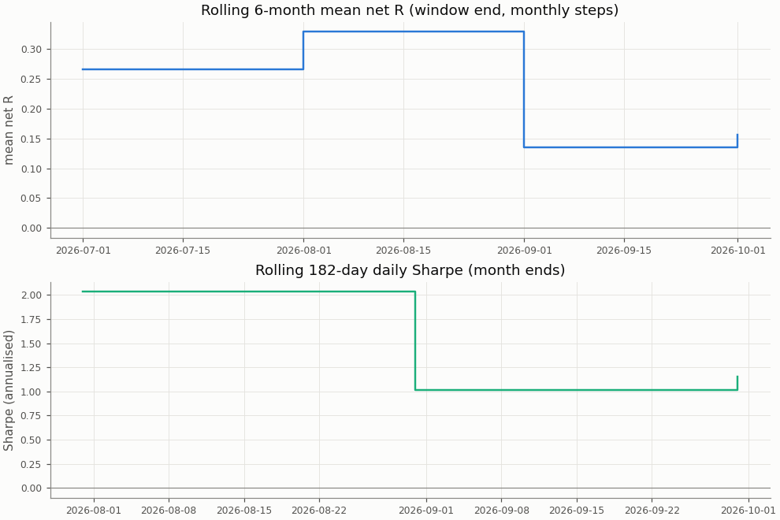

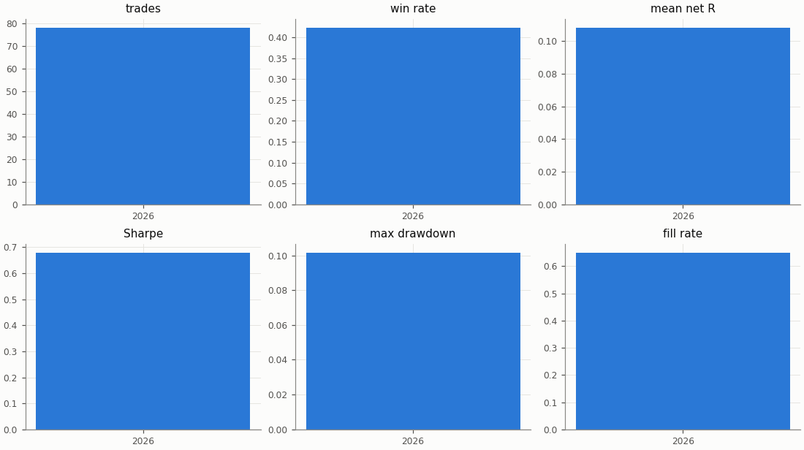

## Regimes and calendar

Trend: daily ADX(14) above 25 as of the day before entry. Volatility: 30-day realised vol of daily log returns as of the day before entry, above (`high`) or below (`low`) the in-sample median 0.04944; trades before the indicators are defined are unlabelled.

| Regime | n | Win rate | Mean net R |
|---|---|---|---|
| trend: no_trend | 43 | 46.5% | 0.220 |
| trend: trend | 35 | 37.1% | -0.029 |
| vol: high | 9 | 55.6% | 0.572 |
| vol: low | 69 | 40.6% | 0.048 |

| Day of week (UTC) | n | Win rate | Mean net R |
|---|---|---|---|
| Monday | 17 | 29.4% | -0.320 |
| Tuesday | 16 | 37.5% | -0.059 |
| Wednesday | 13 | 61.5% | 0.751 |
| Thursday | 16 | 56.2% | 0.532 |
| Friday | 16 | 31.2% | -0.216 |

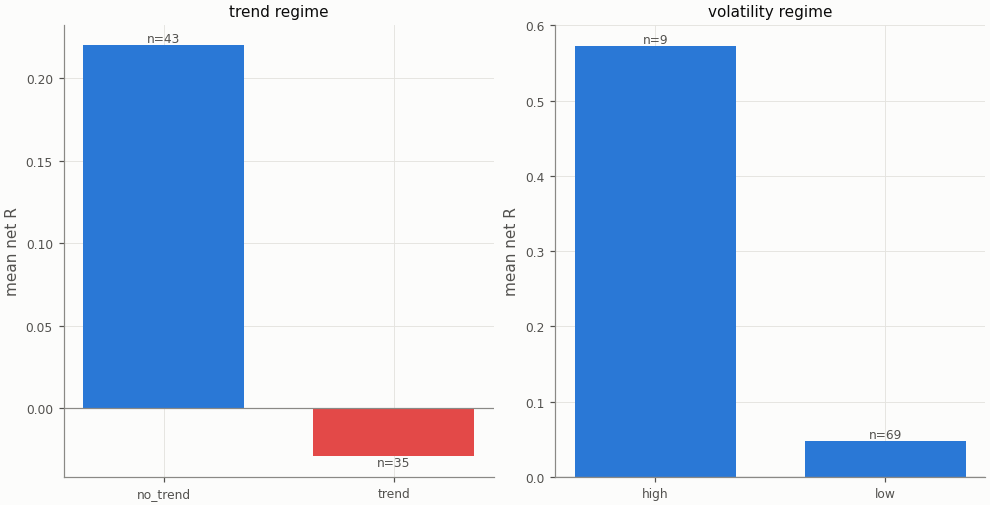

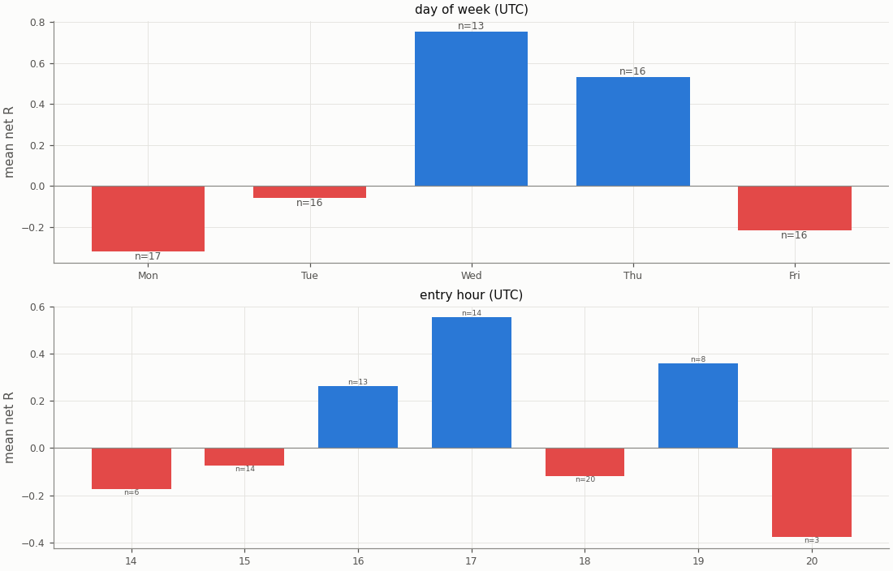

## Diagnostics

| Count | Value |
|---|---|
| trades open at the data end (left out of the R subset) | 0 |
| ambiguous candles resolved without full 1m data | 0 |
| max concurrent positions | 1 |
| funding paid in total (USD) | -5.11 |

| Fill resolution | Fills |
|---|---|
| 15m_unambiguous | 138 |
| 1m | 18 |

| Exit reason | n | Win rate | Mean net R |
|---|---|---|---|
| stop | 45 | 0.0% | -1.221 |
| target | 33 | 100.0% | 1.921 |

| Trade distribution | min | p05 | p25 | p50 | p75 | p95 | max | mean |
|---|---|---|---|---|---|---|---|---|
| hold (minutes) | 1.0 | 7.0 | 30.0 | 75.0 | 191.2 | 1226.2 | 2940.0 | 235.3 |
| MAE (R) | -2.749 | -1.737 | -1.218 | -1.038 | -0.519 | -0.098 | -0.063 | -0.943 |
| MFE (R) | 0.134 | 0.296 | 0.804 | 1.554 | 2.240 | 2.869 | 4.044 | 1.533 |

Share of this variant's trades whose candidate candle is also traded by the other session variants (computed at report time from their trade tables): London 6.4%, UTC 14.1%; any of them 15.4%. The session variants are not independent tests.

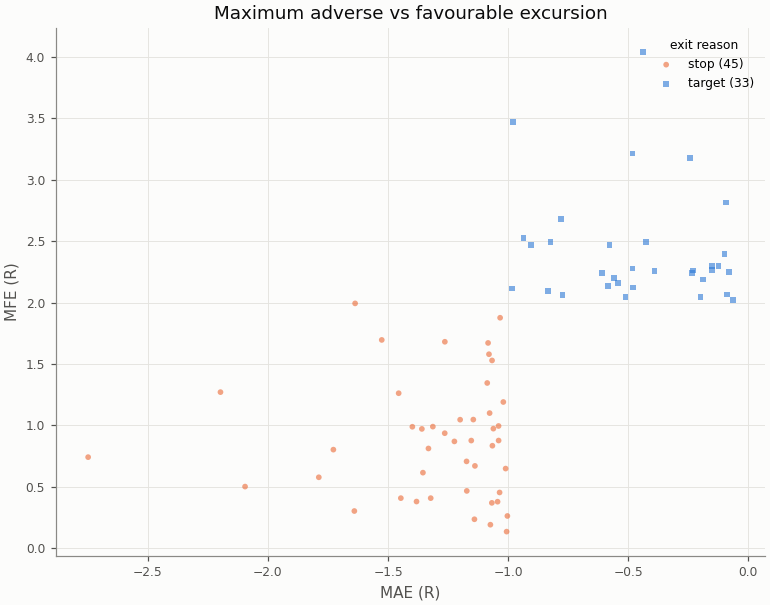

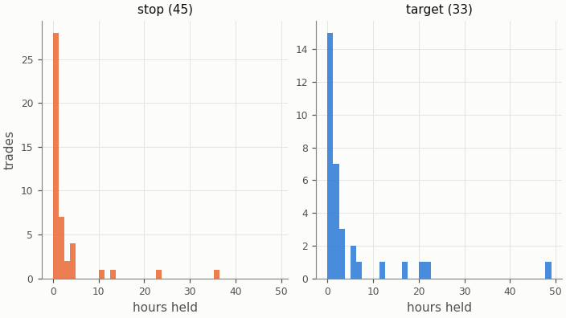

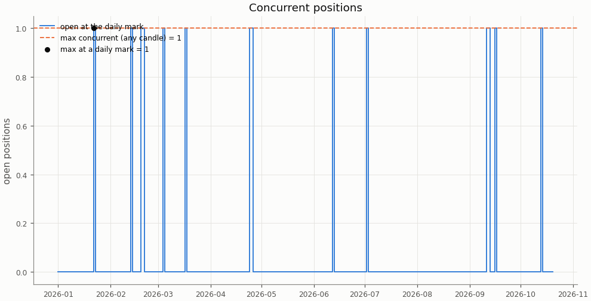

## Deflated Sharpe ratio

| Daily returns | Value |
|---|---|
| daily Sharpe (not annualised) | 0.0356 |
| days T | 293 |
| skew | 0.940 |
| kurtosis (non-excess) | 4.550 |

| Trials | N | V (variance of daily Sharpe) | SR* | DSR |
|---|---|---|---|---|
| this pair × session's grid | n/a | n/a | n/a | n/a |
| all grid variants | n/a | n/a | n/a | n/a |

The DSR is computed for the in-sample grid only; the holdout tests one pre-registered configuration per cell.

Caveat: the grid cells share most of their trades, so the effective number of independent trials is far below N and the DSR is conservative.

## Notes

- `15m_pessimistic_missing_1m`: 0 fills and 0 ambiguous (candle, order) pairs were resolved by the pessimistic 15m rule because 1m data was incomplete.
- Data gaps overlapping a trade (computed at report time from the candle manifests): 15m: 0 trades over 0 gaps; 1m: 0 trades over 0 gaps.
