# ETHUSDT / UTC, holdout primary

- Pair: ETHUSDT
- Session: UTC (00:00–24:00 UTC, weekdays [0, 1, 2, 3, 4, 5, 6], Mon = 0)
- Period: 2026-01-01 to 2026-10-20 (holdout)
- Variant id: `520761013481069885e9432471a13bf66581752eab18a4b1d2f0e331bf2358e8`
- Code version: `c3c05e53c0f38a9e57d65b716a78ddfb198004a84dd66fde28cf145808135dc5`
- Seed: 20260926 (generators per purpose: trade_bootstrap, day_bootstrap, sharpe_bootstrap, bh_sharpe_bootstrap, bh_diff_bootstrap, baseline_a, baseline_b)
- Role: primary; member of heatmap_1, heatmap_2, heatmap_3
- Costs: maker 0.02%, taker 0.05%, slippage 0.02%; risk 1.0% per trade; 1m resolution on

## Funnel

Every impulse that did not become a trade is counted by the first reason that stopped it (spec overview §6). Orders exclude intents skipped by the leverage cap.

| Stage | Count |
|---|---|
| impulses | 1658 |
| blocks seen | 1325 |
| skipped: no_candidate | 333 |
| skipped: ineligible | 46 |
| skipped: degenerate | 0 |
| skipped: no_displacement | 44 |
| skipped: mitigated | 132 |
| skipped: entry_above_price | 0 |
| skipped: trend | 0 |
| skipped: session_used | 813 |
| intents | 290 |
| skipped: leverage cap | 0 |
| orders placed | 290 |
| orders filled | 254 |
| fill rate | 87.6% |
| trades | 254 |
| trades in the R subset | 254 |
| trades open at the data end | 0 |

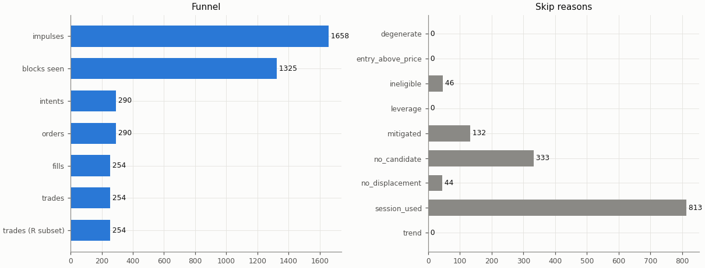

## Headline

Trade statistics use the R subset: trades closed by a stop, target or time exit (`exit_reason != data_end`); trades still open at the end of the data are left out.

| Headline | Value |
|---|---|
| trades (R subset) | 254 |
| win rate | 30.7% |
| mean gross R | -0.079 |
| mean net R | -0.400 |
| mean net R, 95% CI (trade bootstrap) | -0.588 to -0.214 |
| mean net R, 95% CI (day-block bootstrap) | -0.584 to -0.214 |
| median net R | -1.240 |
| std of net R | 1.514 |
| profit factor | 0.59 |
| mean cost (R) | 0.322 |
| mean funding (R) | 0.002 |
| mean hold (minutes) | 95.5 |
| Sharpe (annualised, daily) | -4.56 |
| Sharpe, 95% CI (10-day block bootstrap) | -7.48 to -2.16 |
| max drawdown | 68.5% |
| total return | -65.0% |
| exposure (share of candles in a trade) | 6.5% |
| mean notional / equity at the daily marks | 0.053 |
| max concurrent positions | 2 |

## Baselines

| Baseline | Observed mean net R | Runs: mean | Runs: std | p (one-sided) | z | p (Holm) | Runs |
|---|---|---|---|---|---|---|---|
| A: random entry time in the strategy's own sessions | -0.400 | -0.306 | 0.091 | 0.854 | -1.04 | 1 | 5000 |
| B: random sessions and entry times | -0.400 | -0.298 | 0.095 | 0.864 | -1.09 | 1 | 5000 |

| Table A | Value |
|---|---|
| trades covered | 254 |
| trades left out | 0 |
| baseline B: mean trades per run | 253.9 |

Holm adjustment over the holdout family of 9 primary cells (tested: A 9, B 9, buy-and-hold 9) at α = 0.05.

Baseline design (judgment calls, overview risk 13): a baseline trade enters at the open of a uniformly drawn in-session candle with the maker fee, keeps the real trade's stop distance in ATR and the variant's target and hold rule, and pays actual funding; baseline trades that reach the data end are left out of their run's mean.

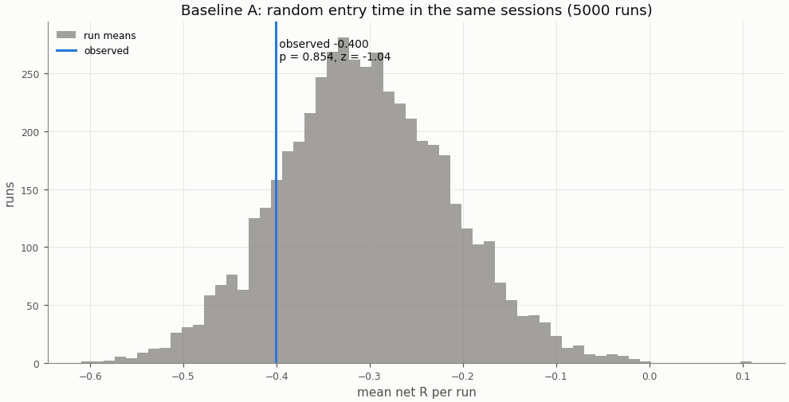

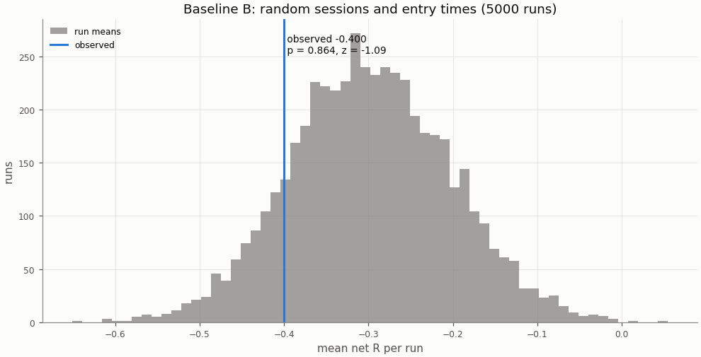

## Buy-and-hold

A constant 1× long in the perpetual with funding, scaled to the strategy's in-sample daily volatility; Sharpe is scale-invariant, the scaling matters for return and drawdown.

| Buy-and-hold | Value |
|---|---|
| days | 293 |
| buy-and-hold Sharpe | -0.12 |
| buy-and-hold Sharpe, 95% CI | -2.43 to 1.99 |
| strategy Sharpe | -4.56 |
| Sharpe difference (strategy − buy-and-hold) | -4.43 |
| Sharpe difference, 95% CI (paired block bootstrap) | -7.39 to -1.74 |
| p_BH (one-sided) | 1 |
| p_BH (Holm) | 1 |
| buy-and-hold total return (1×) | -18.9% |
| vol scale (σ strategy / σ buy-and-hold) | 0.320 |
| σ strategy (daily, in-sample) | 0.01389 |
| σ buy-and-hold (daily, in-sample) | 0.04346 |
| vol-scaled buy-and-hold total return | -3.4% |
| vol-scaled buy-and-hold max drawdown | 19.9% |

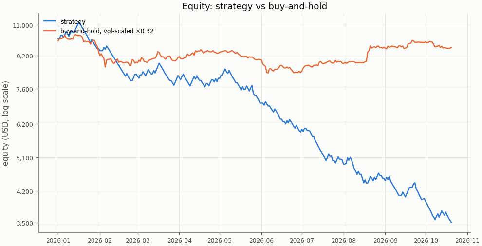

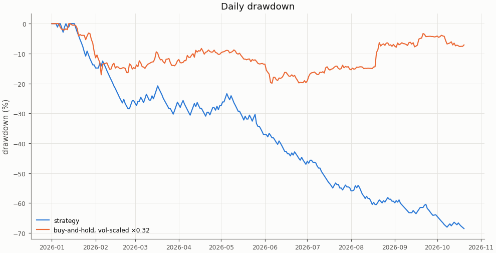

## Costs

Cost in R is fees, slippage and funding divided by the stop distance; a trade whose cost exceeds 1 R loses even when it reaches a 1 R target.

| Cost | Value |
|---|---|
| share of trades with cost above 1 R | 2.4% |

| Cost distribution | min | p05 | p25 | p50 | p75 | p95 | max | mean |
|---|---|---|---|---|---|---|---|---|
| cost per trade (R) | 0.031 | 0.072 | 0.160 | 0.259 | 0.402 | 0.728 | 1.757 | 0.322 |
| stop distance (% of entry) | 0.051 | 0.104 | 0.198 | 0.285 | 0.411 | 0.786 | 1.486 | 0.340 |
| stop distance (ATR14) | 0.322 | 0.470 | 0.690 | 0.841 | 1.049 | 1.626 | 3.167 | 0.923 |
| implied leverage (×) | 0.67 | 1.27 | 2.43 | 3.50 | 5.06 | 9.64 | 19.53 | 4.22 |
| funding (R) | -0.0125 | 0.0000 | 0.0000 | 0.0000 | 0.0000 | 0.0155 | 0.0674 | 0.0017 |

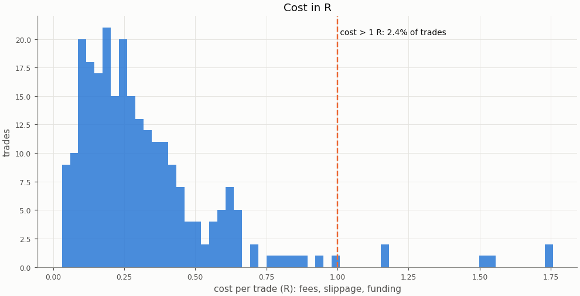

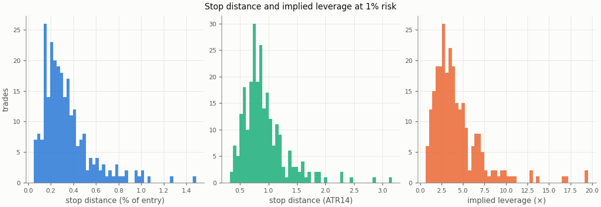

### Re-pricing (D13)

The same trades and baseline runs re-priced at other costs, without re-simulation; descriptive only, the verdict uses the registered costs.

| Slippage | Maker fee | Taker fee | n | Mean net R | 95% CI | Win rate | p_A | p_B | Costs |
|---|---|---|---|---|---|---|---|---|---|
| 0.00% | 0.00% | 0.05% | 254 | -0.232 | -0.417 to -0.047 | 30.7% | 0.836 | 0.844 |  |
| 0.00% | 0.02% | 0.05% | 254 | -0.340 | -0.522 to -0.159 | 30.7% | 0.84 | 0.852 |  |
| 0.02% | 0.00% | 0.05% | 254 | -0.292 | -0.483 to -0.102 | 30.7% | 0.848 | 0.857 |  |
| 0.02% | 0.02% | 0.05% | 254 | -0.400 | -0.588 to -0.214 | 30.7% | 0.854 | 0.864 | registered |
| 0.05% | 0.00% | 0.05% | 254 | -0.383 | -0.583 to -0.185 | 30.7% | 0.867 | 0.875 |  |
| 0.05% | 0.02% | 0.05% | 254 | -0.491 | -0.688 to -0.297 | 30.7% | 0.872 | 0.882 |  |
| 0.10% | 0.00% | 0.05% | 254 | -0.534 | -0.748 to -0.321 | 30.7% | 0.892 | 0.898 |  |
| 0.10% | 0.02% | 0.05% | 254 | -0.642 | -0.855 to -0.431 | 30.7% | 0.898 | 0.905 |  |

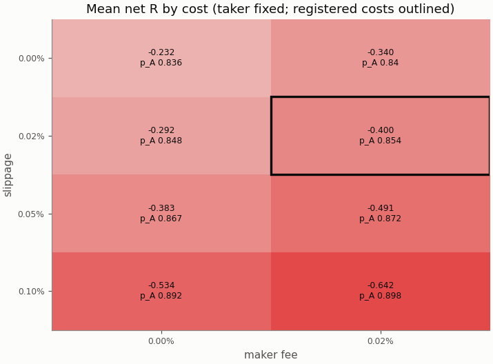

## Robustness

The grid is in-sample only; the heatmaps are in the in-sample primary report.

## Alpha decay

Per calendar year (max drawdown starts from the previous year-end equity; fill rate is filled / placed entry orders by placement year).

| Year | n | Win rate | Mean net R | Sharpe | Max DD | Fill rate |
|---|---|---|---|---|---|---|
| 2026 | 254 | 30.7% | -0.400 | -4.56 | 68.5% | 87.6% |

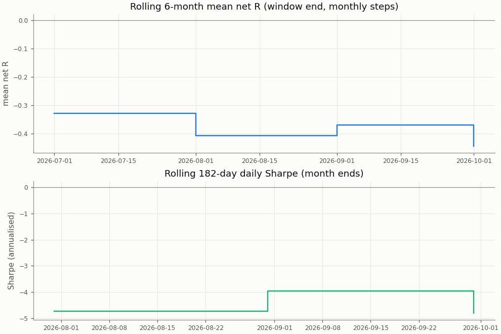

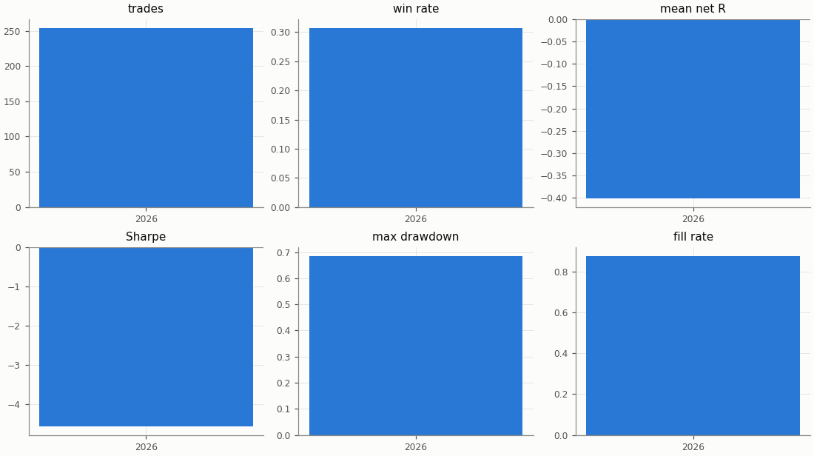

## Regimes and calendar

Trend: daily ADX(14) above 25 as of the day before entry. Volatility: 30-day realised vol of daily log returns as of the day before entry, above (`high`) or below (`low`) the in-sample median 0.03757; trades before the indicators are defined are unlabelled.

| Regime | n | Win rate | Mean net R |
|---|---|---|---|
| trend: no_trend | 111 | 37.8% | -0.207 |
| trend: trend | 143 | 25.2% | -0.550 |
| vol: high | 38 | 26.3% | -0.420 |
| vol: low | 216 | 31.5% | -0.397 |

| Day of week (UTC) | n | Win rate | Mean net R |
|---|---|---|---|
| Monday | 36 | 36.1% | -0.152 |
| Tuesday | 38 | 36.8% | -0.172 |
| Wednesday | 36 | 19.4% | -0.702 |
| Thursday | 36 | 33.3% | -0.251 |
| Friday | 37 | 37.8% | -0.094 |
| Saturday | 35 | 31.4% | -0.565 |
| Sunday | 36 | 19.4% | -0.893 |

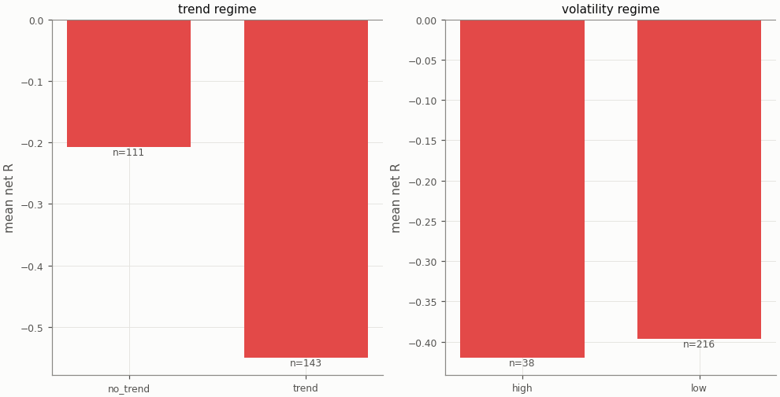

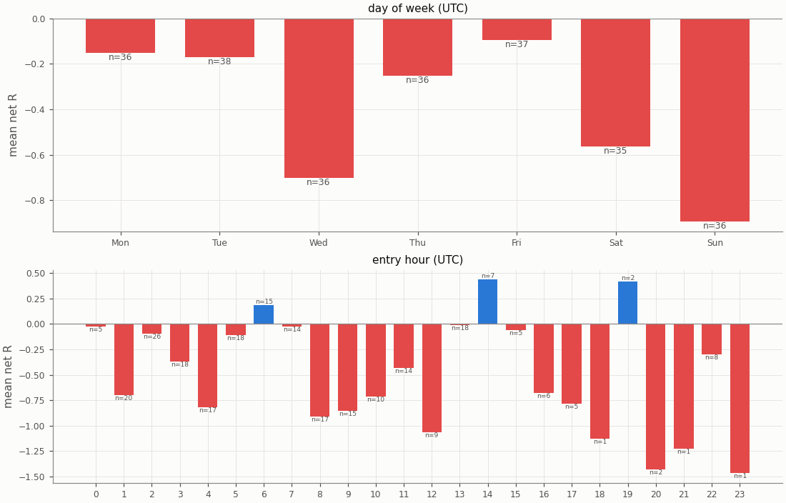

## Diagnostics

| Count | Value |
|---|---|
| trades open at the data end (left out of the R subset) | 0 |
| ambiguous candles resolved without full 1m data | 0 |
| max concurrent positions | 2 |
| funding paid in total (USD) | 28.16 |

| Fill resolution | Fills |
|---|---|
| 15m_unambiguous | 387 |
| 1m | 101 |
| 1m_pessimistic | 20 |

| Exit reason | n | Win rate | Mean net R |
|---|---|---|---|
| stop | 176 | 0.0% | -1.394 |
| target | 78 | 100.0% | 1.842 |

| Trade distribution | min | p05 | p25 | p50 | p75 | p95 | max | mean |
|---|---|---|---|---|---|---|---|---|
| hold (minutes) | 0.0 | 1.0 | 15.0 | 45.0 | 105.0 | 300.0 | 1500.0 | 95.5 |
| MAE (R) | -8.672 | -2.545 | -1.501 | -1.180 | -0.772 | -0.166 | -0.015 | -1.249 |
| MFE (R) | 0.072 | 0.202 | 0.718 | 1.349 | 2.198 | 3.387 | 7.441 | 1.531 |

Share of this variant's trades whose candidate candle is also traded by the other session variants (computed at report time from their trade tables): London 17.3%, NY 3.5%; any of them 20.1%. The session variants are not independent tests.

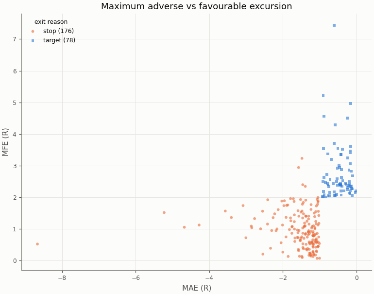

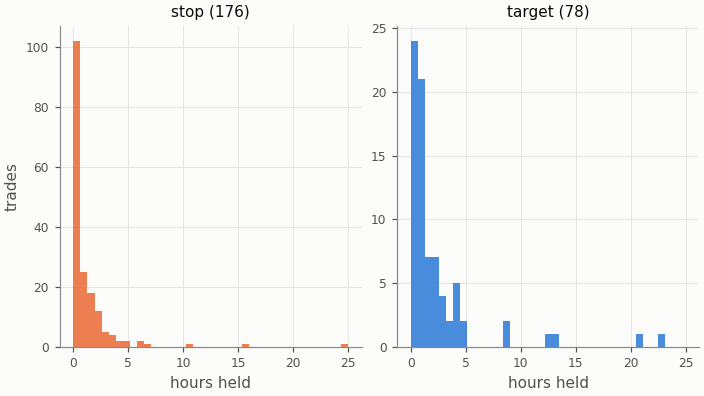

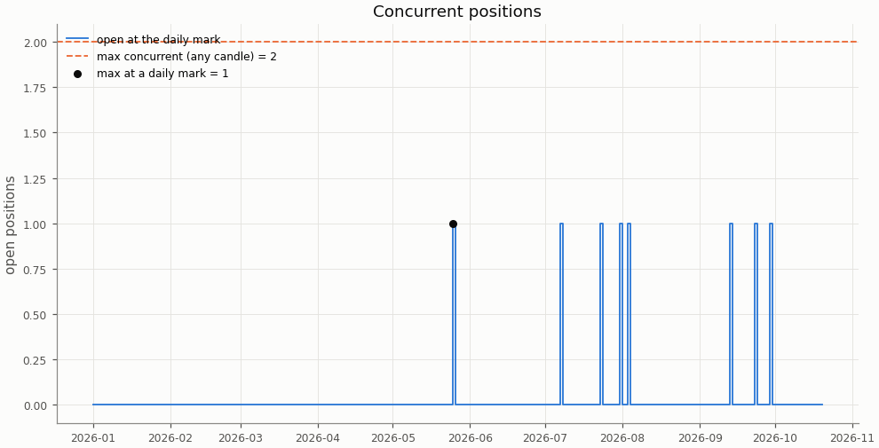

## Deflated Sharpe ratio

| Daily returns | Value |
|---|---|
| daily Sharpe (not annualised) | -0.2384 |
| days T | 293 |
| skew | 0.537 |
| kurtosis (non-excess) | 2.057 |

| Trials | N | V (variance of daily Sharpe) | SR* | DSR |
|---|---|---|---|---|
| this pair × session's grid | n/a | n/a | n/a | n/a |
| all grid variants | n/a | n/a | n/a | n/a |

The DSR is computed for the in-sample grid only; the holdout tests one pre-registered configuration per cell.

Caveat: the grid cells share most of their trades, so the effective number of independent trials is far below N and the DSR is conservative.

## Notes

- `15m_pessimistic_missing_1m`: 0 fills and 0 ambiguous (candle, order) pairs were resolved by the pessimistic 15m rule because 1m data was incomplete.
- Data gaps overlapping a trade (computed at report time from the candle manifests): 15m: 0 trades over 0 gaps; 1m: 0 trades over 0 gaps.
