# SOLUSDT / London, in-sample primary

- Pair: SOLUSDT
- Session: London (08:00–16:30 Europe/London, weekdays [0, 1, 2, 3, 4], Mon = 0)
- Period: 2020-01-01 to 2025-12-31 (in-sample)
- Variant id: `8039d5859b0ce7ddf2cd0a123bc96c43726daf91730dacc8136ceca348c132cd`
- Code version: `c3c05e53c0f38a9e57d65b716a78ddfb198004a84dd66fde28cf145808135dc5`
- Seed: 20260926 (generators per purpose: trade_bootstrap, day_bootstrap, sharpe_bootstrap, bh_sharpe_bootstrap, bh_diff_bootstrap, baseline_a, baseline_b)
- Role: primary; member of heatmap_1, heatmap_2, heatmap_3
- Costs: maker 0.02%, taker 0.05%, slippage 0.05%; risk 1.0% per trade; 1m resolution on

## Funnel

Every impulse that did not become a trade is counted by the first reason that stopped it (spec overview §6). Orders exclude intents skipped by the leverage cap.

| Stage | Count |
|---|---|
| impulses | 12089 |
| blocks seen | 9247 |
| skipped: no_candidate | 2842 |
| skipped: ineligible | 6870 |
| skipped: degenerate | 0 |
| skipped: no_displacement | 104 |
| skipped: mitigated | 342 |
| skipped: entry_above_price | 0 |
| skipped: trend | 0 |
| skipped: session_used | 921 |
| intents | 1010 |
| skipped: leverage cap | 0 |
| orders placed | 1010 |
| orders filled | 786 |
| fill rate | 77.8% |
| trades | 786 |
| trades in the R subset | 786 |
| trades open at the data end | 0 |

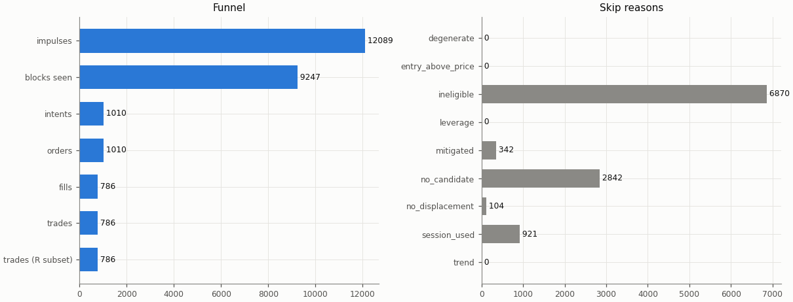

## Headline

Trade statistics use the R subset: trades closed by a stop, target or time exit (`exit_reason != data_end`); trades still open at the end of the data are left out.

| Headline | Value |
|---|---|
| trades (R subset) | 786 |
| win rate | 31.3% |
| mean gross R | -0.061 |
| mean net R | -0.229 |
| mean net R, 95% CI (trade bootstrap) | -0.331 to -0.125 |
| mean net R, 95% CI (day-block bootstrap) | -0.329 to -0.128 |
| median net R | -1.137 |
| std of net R | 1.461 |
| profit factor | 0.73 |
| mean cost (R) | 0.168 |
| mean funding (R) | 0.001 |
| mean hold (minutes) | 69.4 |
| Sharpe (annualised, daily) | -1.89 |
| Sharpe, 95% CI (10-day block bootstrap) | -2.83 to -1.04 |
| max drawdown | 87.1% |
| total return | -84.8% |
| exposure (share of candles in a trade) | 2.4% |
| mean notional / equity at the daily marks | 0.001 |
| max concurrent positions | 2 |

## Baselines

| Baseline | Observed mean net R | Runs: mean | Runs: std | p (one-sided) | z | p (Holm) | Runs |
|---|---|---|---|---|---|---|---|
| A: random entry time in the strategy's own sessions | -0.229 | -0.143 | 0.049 | 0.961 | -1.74 | 1 | 5000 |
| B: random sessions and entry times | -0.229 | -0.198 | 0.051 | 0.731 | -0.60 | 1 | 5000 |

| Table A | Value |
|---|---|
| trades covered | 786 |
| trades left out | 0 |
| baseline B: mean trades per run | 786.0 |

Holm adjustment over the in-sample family of 9 primary cells (tested: A 9, B 9, buy-and-hold 9) at α = 0.05.

Baseline design (judgment calls, overview risk 13): a baseline trade enters at the open of a uniformly drawn in-session candle with the maker fee, keeps the real trade's stop distance in ATR and the variant's target and hold rule, and pays actual funding; baseline trades that reach the data end are left out of their run's mean.

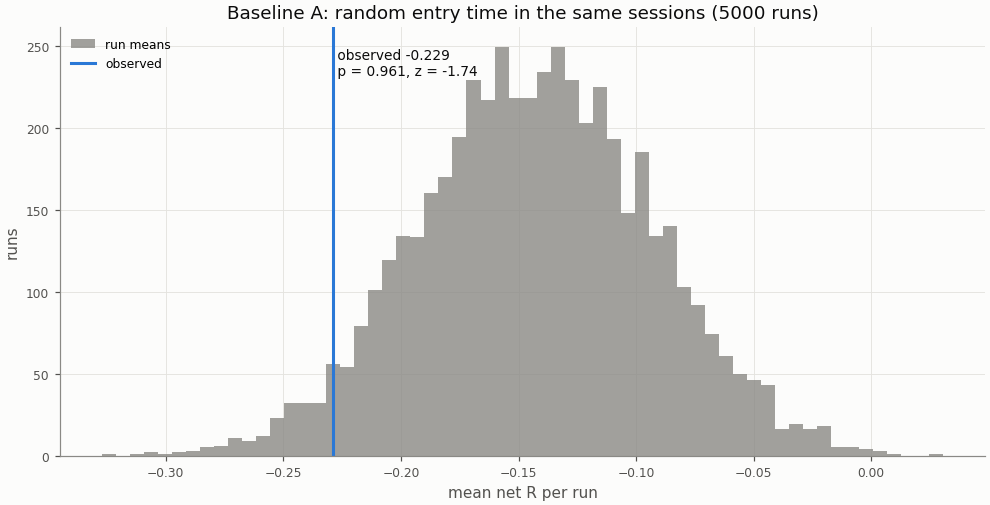

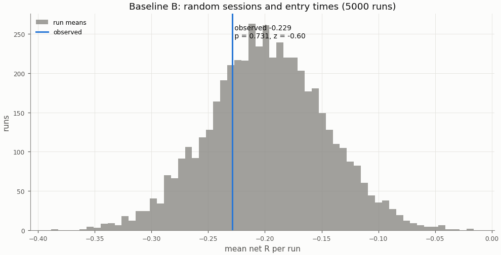

## Buy-and-hold

A constant 1× long in the perpetual with funding, scaled to the strategy's in-sample daily volatility; Sharpe is scale-invariant, the scaling matters for return and drawdown.

| Buy-and-hold | Value |
|---|---|
| days | 1935 |
| buy-and-hold Sharpe | 1.16 |
| buy-and-hold Sharpe, 95% CI | 0.35 to 2.01 |
| strategy Sharpe | -1.89 |
| Sharpe difference (strategy − buy-and-hold) | -3.05 |
| Sharpe difference, 95% CI (paired block bootstrap) | -4.22 to -2.01 |
| p_BH (one-sided) | 1 |
| p_BH (Holm) | 1 |
| buy-and-hold total return (1×) | 3693.0% |
| vol scale (σ strategy / σ buy-and-hold) | 0.149 |
| σ strategy (daily, in-sample) | 0.00939 |
| σ buy-and-hold (daily, in-sample) | 0.06286 |
| vol-scaled buy-and-hold total return | 176.7% |
| vol-scaled buy-and-hold max drawdown | 29.8% |

The figures continue into the holdout run (shaded), chained onto the in-sample end.

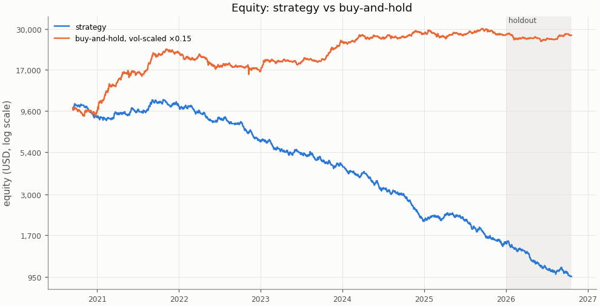

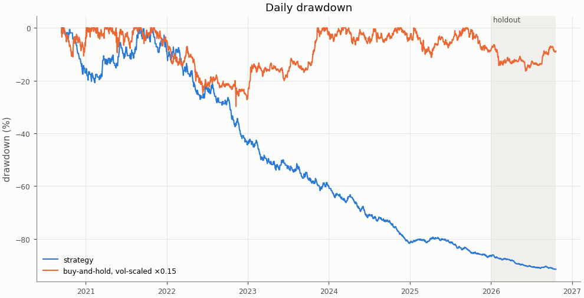

## Costs

Cost in R is fees, slippage and funding divided by the stop distance; a trade whose cost exceeds 1 R loses even when it reaches a 1 R target.

| Cost | Value |
|---|---|
| share of trades with cost above 1 R | 0.0% |

| Cost distribution | min | p05 | p25 | p50 | p75 | p95 | max | mean |
|---|---|---|---|---|---|---|---|---|
| cost per trade (R) | -0.109 | 0.030 | 0.077 | 0.144 | 0.228 | 0.403 | 0.710 | 0.168 |
| stop distance (% of entry) | 0.162 | 0.282 | 0.433 | 0.655 | 0.934 | 1.912 | 5.727 | 0.801 |
| stop distance (ATR14) | 0.322 | 0.578 | 0.730 | 0.909 | 1.118 | 1.533 | 4.711 | 0.970 |
| implied leverage (×) | 0.17 | 0.52 | 1.07 | 1.53 | 2.31 | 3.55 | 6.16 | 1.75 |
| funding (R) | -0.1328 | 0.0000 | 0.0000 | 0.0000 | 0.0000 | 0.0089 | 0.2891 | 0.0009 |

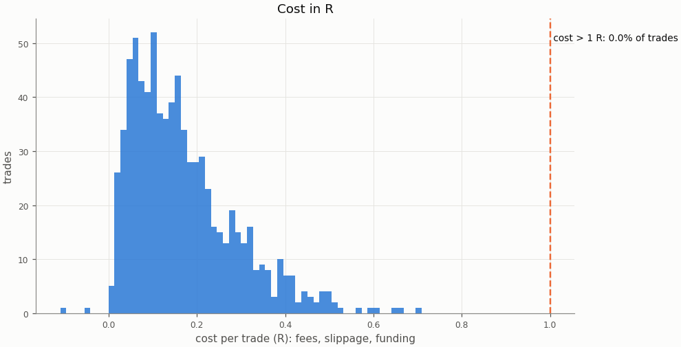

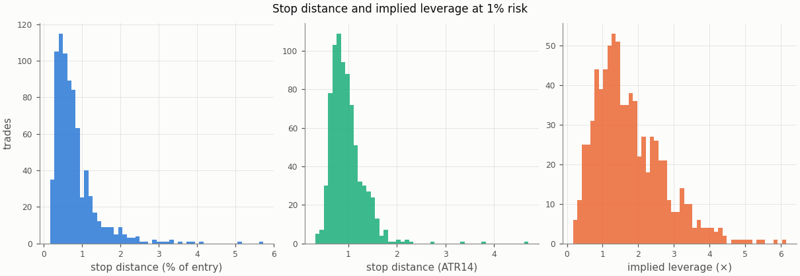

### Re-pricing (D13)

The same trades and baseline runs re-priced at other costs, without re-simulation; descriptive only, the verdict uses the registered costs.

| Slippage | Maker fee | Taker fee | n | Mean net R | 95% CI | Win rate | p_A | p_B | Costs |
|---|---|---|---|---|---|---|---|---|---|
| 0.00% | 0.00% | 0.05% | 786 | -0.122 | -0.223 to -0.021 | 31.3% | 0.955 | 0.699 |  |
| 0.00% | 0.02% | 0.05% | 786 | -0.168 | -0.268 to -0.068 | 31.3% | 0.955 | 0.71 |  |
| 0.02% | 0.00% | 0.05% | 786 | -0.147 | -0.248 to -0.044 | 31.3% | 0.957 | 0.706 |  |
| 0.02% | 0.02% | 0.05% | 786 | -0.192 | -0.293 to -0.091 | 31.3% | 0.957 | 0.718 |  |
| 0.05% | 0.00% | 0.05% | 786 | -0.183 | -0.287 to -0.078 | 31.3% | 0.96 | 0.716 |  |
| 0.05% | 0.02% | 0.05% | 786 | -0.229 | -0.331 to -0.125 | 31.3% | 0.961 | 0.731 | registered |
| 0.10% | 0.00% | 0.05% | 786 | -0.243 | -0.350 to -0.136 | 31.3% | 0.963 | 0.736 |  |
| 0.10% | 0.02% | 0.05% | 786 | -0.289 | -0.395 to -0.183 | 31.3% | 0.964 | 0.746 |  |

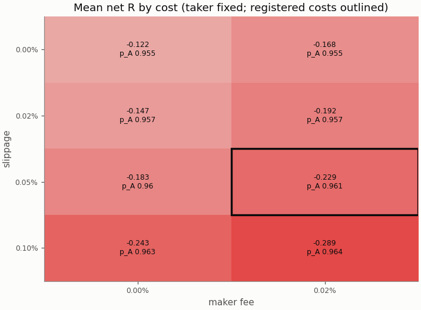

## Robustness

### Heatmap 1: r_target × entry_level

8 of 8 cells have run; the primary is outlined.

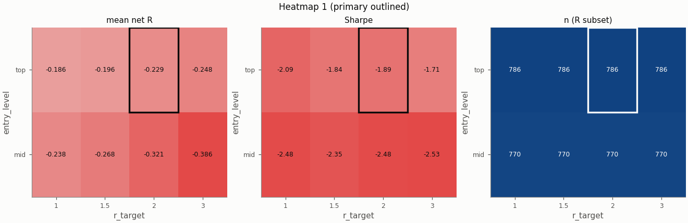

### Heatmap 2: swing_k × confirm_n

9 of 9 cells have run; the primary is outlined.

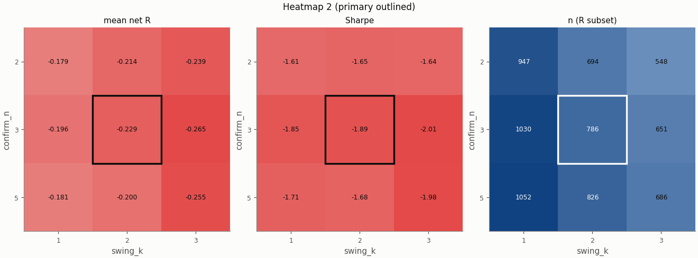

### Heatmap 3: stop_buffer × hold_rule

16 of 16 cells have run; the primary is outlined.

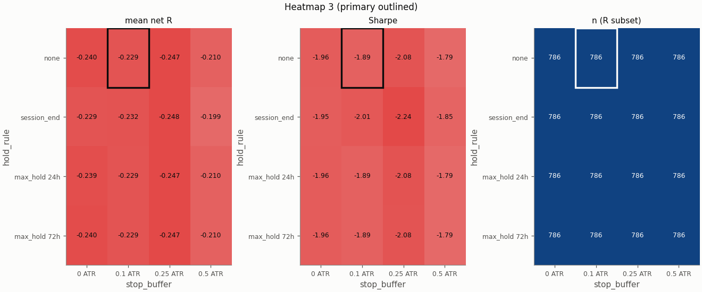

Grid variants of this pair × session:

- heatmap_3: hold_rule=max_hold 24h ([report](../058e9c9a22015281482762eb553df89db3a78843582fa012bf552186569c4fb4/report.md))
- heatmap_2: confirm_n=2, swing_k=3 ([report](../093fa62c40b5b5b1cb5991845c2d32f147d70c69e97afae2aa4dbba6d0321cc7/report.md))
- heatmap_3: stop_buffer=0.5 ATR ([report](../0e8e469573a6c2f0a55f7a8b4dc270ec7b9a8ae60a3fa7967f3397dc736dd679/report.md))
- heatmap_2: confirm_n=2, swing_k=1 ([report](../1a6cd5b0d46059cbf3dbb252409e04542ff2b7419462e4c1bc4b5edffc05d47e/report.md))
- heatmap_1: entry_level=mid, r_target=1 ([report](../203fee62bd5901826781cac2913a5c4efaeb8f02e866d1de4facca4e44b3d97e/report.md))
- single_4: stop_buffer=0.1% ([report](../2a70e1adbb5cd31094b2eba23bd680569a641346afbbd7fbdfc2fa2725a40b99/report.md))
- heatmap_2: swing_k=3 ([report](../2b2df6b8672310523e17ae1815a24d8b12f1d2871aabb7d5fd4ef30170283679/report.md))
- heatmap_2: confirm_n=5, swing_k=1 ([report](../2ef985d98fb2e4102dcad57facd095fb47de1a40e337f382f0b057d8daadd03b/report.md))
- heatmap_3: stop_buffer=0.25 ATR ([report](../2fb34b0c419417e3cdba291f4622aaf1936ab0c8094485bd07856a80d216a67a/report.md))
- heatmap_3: hold_rule=max_hold 24h, stop_buffer=0 ATR ([report](../3cb081a0253a42e7ef591b2d302192dca35df5f905a3bcb78a534521bb6f6751/report.md))
- heatmap_1: entry_level=mid, r_target=3 ([report](../432fa2f5683615673106c554243fee48f3c9fa097fe9c3c454eabf195f2e7c1c/report.md))
- heatmap_2: swing_k=1 ([report](../4c8fbc98c4886f172ad2d34746a36a0b39af3e80862c5ec6331c5c3f48e10183/report.md))
- heatmap_3: hold_rule=max_hold 24h, stop_buffer=0.25 ATR ([report](../52f110018f78df83325858935a28e13df2743b9e0ad3c0c01937f1aee6699d46/report.md))
- heatmap_2: confirm_n=5 ([report](../6fbe7785f47be32019bc7e00c0ba3d36c8ac429949c2dc83815bdb45c99f4f4b/report.md))
- heatmap_3: hold_rule=max_hold 24h, stop_buffer=0.5 ATR ([report](../71863dc7c233cda5eff67925c9d2118f20c06c4b4416621c0f22f8991d117263/report.md))
- heatmap_3: hold_rule=max_hold 72h, stop_buffer=0.5 ATR ([report](../83c78890f21129bac5e17b66e042f9b3c4d33da4b9932aa65fe9eeaf4076a212/report.md))
- heatmap_1: r_target=1 ([report](../8972c1d8a91fa3b8f712fc90a3ca6ac6965605ef66fbc1c89ca30ca4fe439381/report.md))
- heatmap_1: entry_level=mid ([report](../9bf3307b6aa8d9f8bfb3ad575e34b9aee32bd77d73bd249a1a46c1d3de80f6fb/report.md))
- single_3: trend_filter=on ([report](../a0dfcb9a49d4d18b7908a3d88c6e61ee2bc5eac6d15f46217bc9f6bd0390c749/report.md))
- heatmap_2: confirm_n=5, swing_k=3 ([report](../a6fd261317e4fc2aab96d2dccc51433f52c8141a404f2e39b6782cfb420f1659/report.md))
- heatmap_3: hold_rule=max_hold 72h, stop_buffer=0 ATR ([report](../acd8d8df7226e0db94f6c9e5c2feda163a0e55aab15f64db9fbbeea938dab379/report.md))
- heatmap_3: hold_rule=max_hold 72h, stop_buffer=0.25 ATR ([report](../ae12d790ce450ef7d9dad4af47f5d18a96856824a629b6df3b9010b99335a757/report.md))
- heatmap_3: hold_rule=max_hold 72h ([report](../b3dd859f8c79595478ec0149c2431ab943e2de96040339c0e3ce11402bcb4cd7/report.md))
- heatmap_1: r_target=3 ([report](../b5a023e0ab0810d93a7384364a4fb722f26b2708ef94fdfa13761deea6c27a1f/report.md))
- heatmap_1: r_target=1.5 ([report](../ba57e238bb9c2a01e31d5ea04df1aab0179c3aab0a7b8b4a59f46da04eb8bb63/report.md))
- heatmap_3: hold_rule=session_end ([report](../ba796ad18cdf68058722b741e1f6eb48d2adb6db0871ecc8ff01dc6e137c2b61/report.md))
- heatmap_2: confirm_n=2 ([report](../bdddd625df2c217528f793e9b2ad7fe0896e7fe4333fea860877342d492e46a5/report.md))
- single_1: zone=body ([report](../c4d4eeb7baa2637e0a3a32797a416ef7c2c2c7c3870323a4987b1f30bac21ec7/report.md))
- heatmap_3: stop_buffer=0 ATR ([report](../cd17b053c1d9811152a8b614cb5e23b70a7991640444715ec6088af02cfb36a7/report.md))
- heatmap_3: hold_rule=session_end, stop_buffer=0 ATR ([report](../cd2405f24ad3b865581a30b79735d612c8b41afdca959c2c3846fb54713bd1db/report.md))
- heatmap_3: hold_rule=session_end, stop_buffer=0.5 ATR ([report](../cd79f0f775fd6da86930bc0b87c8cd1e85e08acbc56bb51a6f955720abd9b230/report.md))
- heatmap_3: hold_rule=session_end, stop_buffer=0.25 ATR ([report](../d0e8dfab5fb3c9163d81b1fc1efd26e89969e160b24c97d49fe0d8de94748c46/report.md))
- single_2: pierce=0.0005 ([report](../df62d34e2614d6470fa80236e96d9075dc0447f6da2683cd95b5d0421a496225/report.md))
- single_5: stop_buffer=0.25% ([report](../eb40fcce3221c0350628bd2944801a024e71eedd47747a7880b649cb482576ad/report.md))
- heatmap_1: entry_level=mid, r_target=1.5 ([report](../fca2bdd3d81aeb8c2b7c118fd3695c0defa8ed55f475e4b161d0b041b0b8281b/report.md))

## Alpha decay

Per calendar year (max drawdown starts from the previous year-end equity; fill rate is filled / placed entry orders by placement year).

| Year | n | Win rate | Mean net R | Sharpe | Max DD | Fill rate |
|---|---|---|---|---|---|---|
| 2020 | 38 | 26.3% | -0.332 | -2.56 | 17.5% | 71.7% |
| 2021 | 143 | 40.6% | 0.117 | 0.92 | 9.3% | 71.9% |
| 2022 | 144 | 27.8% | -0.331 | -2.77 | 39.9% | 76.2% |
| 2023 | 149 | 32.9% | -0.211 | -1.71 | 33.7% | 81.9% |
| 2024 | 162 | 24.1% | -0.460 | -4.23 | 54.2% | 79.8% |
| 2025 | 150 | 33.3% | -0.203 | -1.64 | 37.4% | 81.5% |

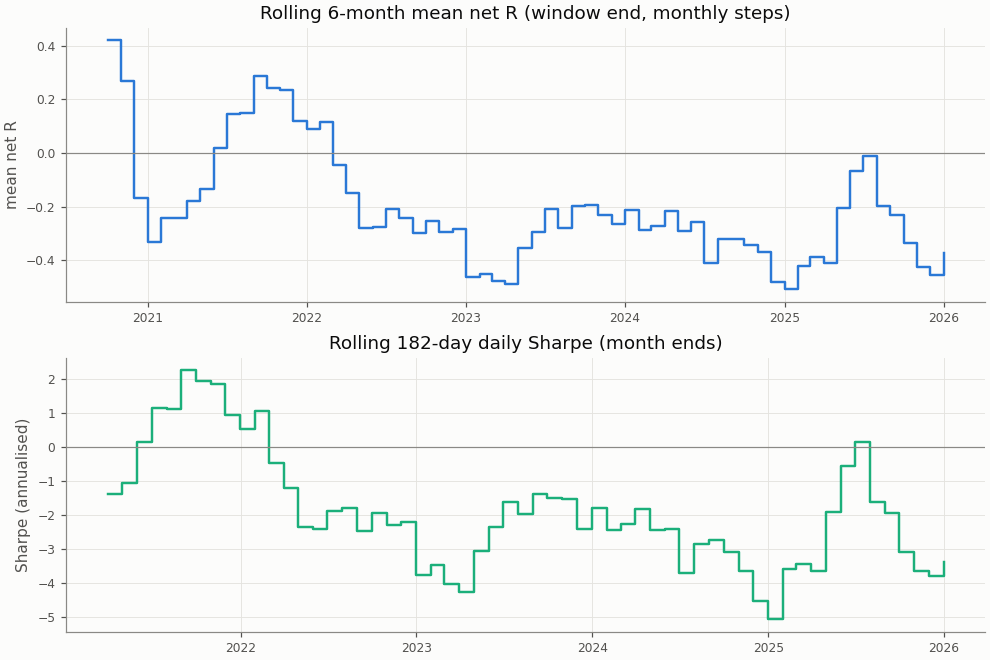

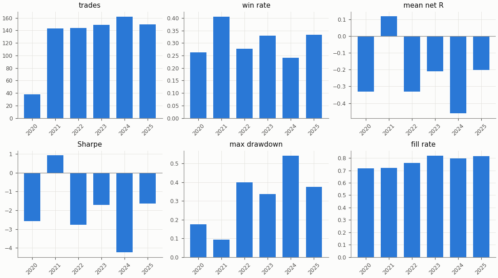

## Regimes and calendar

Trend: daily ADX(14) above 25 as of the day before entry. Volatility: 30-day realised vol of daily log returns as of the day before entry, above (`high`) or below (`low`) the in-sample median 0.04944; trades before the indicators are defined are unlabelled.

| Regime | n | Win rate | Mean net R |
|---|---|---|---|
| trend: no_trend | 368 | 29.3% | -0.307 |
| trend: trend | 408 | 32.6% | -0.173 |
| trend: unlabelled | 10 | 50.0% | 0.401 |
| vol: high | 375 | 35.2% | -0.066 |
| vol: low | 400 | 27.3% | -0.395 |
| vol: unlabelled | 11 | 45.5% | 0.245 |

| Day of week (UTC) | n | Win rate | Mean net R |
|---|---|---|---|
| Monday | 152 | 21.7% | -0.524 |
| Tuesday | 161 | 32.9% | -0.166 |
| Wednesday | 146 | 30.8% | -0.253 |
| Thursday | 170 | 34.7% | -0.122 |
| Friday | 157 | 35.7% | -0.101 |

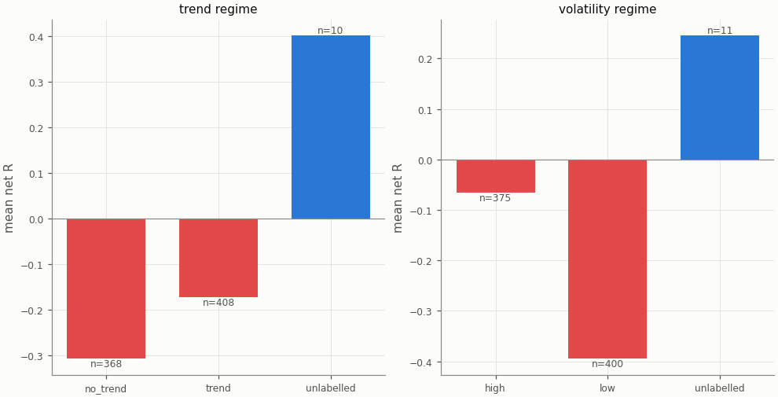

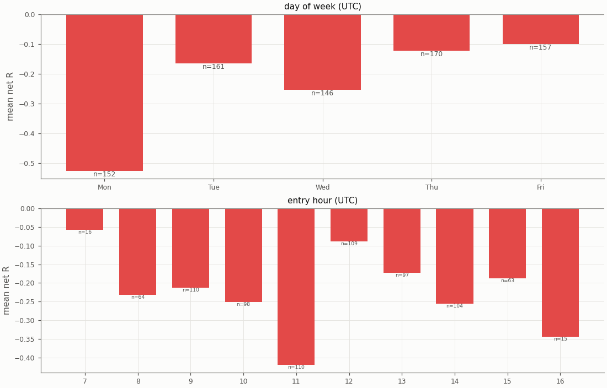

## Diagnostics

| Count | Value |
|---|---|
| trades open at the data end (left out of the R subset) | 0 |
| ambiguous candles resolved without full 1m data | 0 |
| max concurrent positions | 2 |
| funding paid in total (USD) | 61.32 |

| Fill resolution | Fills |
|---|---|
| 15m_unambiguous | 1314 |
| 1m | 214 |
| 1m_pessimistic | 40 |
| open_gap | 4 |

| Exit reason | n | Win rate | Mean net R |
|---|---|---|---|
| stop | 540 | 0.0% | -1.212 |
| target | 246 | 100.0% | 1.929 |

| Trade distribution | min | p05 | p25 | p50 | p75 | p95 | max | mean |
|---|---|---|---|---|---|---|---|---|
| hold (minutes) | 0.0 | 2.0 | 15.0 | 30.0 | 90.0 | 225.0 | 1710.0 | 69.4 |
| MAE (R) | -11.171 | -2.499 | -1.470 | -1.153 | -0.717 | -0.105 | 0.000 | -1.211 |
| MFE (R) | 0.054 | 0.283 | 0.677 | 1.233 | 2.123 | 3.063 | 20.287 | 1.483 |

Share of this variant's trades whose candidate candle is also traded by the other session variants (computed at report time from their trade tables): NY 5.7%, UTC 32.7%; any of them 35.8%. The session variants are not independent tests.

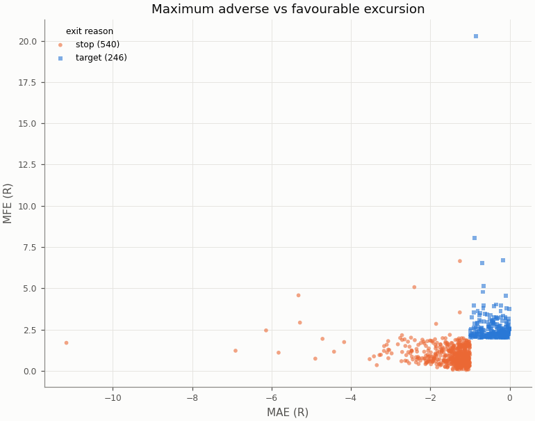

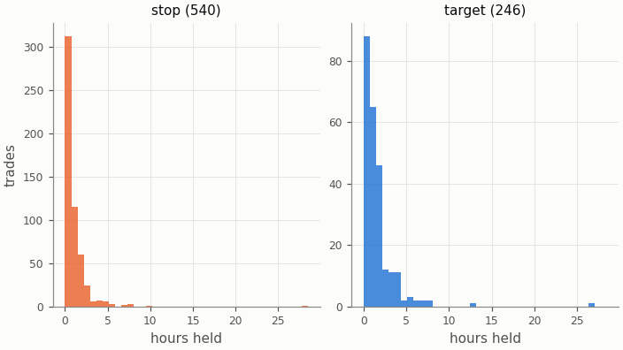

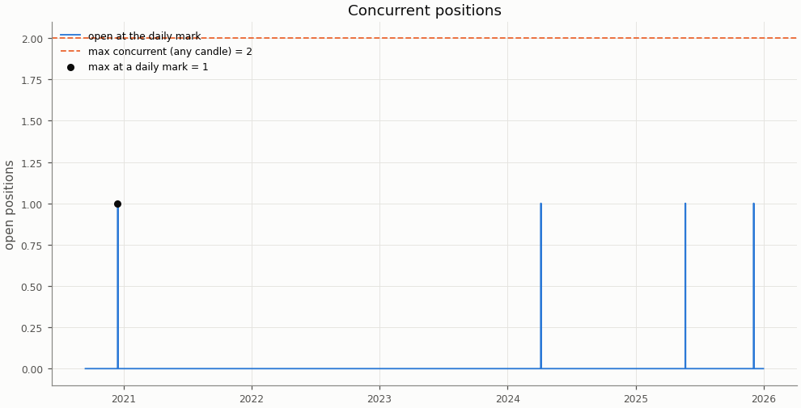

## Deflated Sharpe ratio

| Daily returns | Value |
|---|---|
| daily Sharpe (not annualised) | -0.0989 |
| days T | 1935 |
| skew | 0.758 |
| kurtosis (non-excess) | 3.383 |

| Trials | N | V (variance of daily Sharpe) | SR* | DSR |
|---|---|---|---|---|
| this pair × session's grid | 36 | 0.000309 | 0.0378 | 0.000 |
| all grid variants | 324 | 0.003906 | 0.1825 | 0.000 |

Caveat: the grid cells share most of their trades, so the effective number of independent trials is far below N and the DSR is conservative.

## Notes

- `15m_pessimistic_missing_1m`: 0 fills and 0 ambiguous (candle, order) pairs were resolved by the pessimistic 15m rule because 1m data was incomplete.
- Data gaps overlapping a trade (computed at report time from the candle manifests): 15m: 0 trades over 0 gaps; 1m: 0 trades over 0 gaps.
