# SOLUSDT / London, holdout primary

- Pair: SOLUSDT
- Session: London (08:00–16:30 Europe/London, weekdays [0, 1, 2, 3, 4], Mon = 0)
- Period: 2026-01-01 to 2026-10-20 (holdout)
- Variant id: `940646c6972da0efcbb00bf7792bd85907d51bbf4e2366bb95963ffb3156f8c0`
- Code version: `c3c05e53c0f38a9e57d65b716a78ddfb198004a84dd66fde28cf145808135dc5`
- Seed: 20260926 (generators per purpose: trade_bootstrap, day_bootstrap, sharpe_bootstrap, bh_sharpe_bootstrap, bh_diff_bootstrap, baseline_a, baseline_b)
- Role: primary; member of heatmap_1, heatmap_2, heatmap_3
- Costs: maker 0.02%, taker 0.05%, slippage 0.05%; risk 1.0% per trade; 1m resolution on

## Funnel

Every impulse that did not become a trade is counted by the first reason that stopped it (spec overview §6). Orders exclude intents skipped by the leverage cap.

| Stage | Count |
|---|---|
| impulses | 1659 |
| blocks seen | 1278 |
| skipped: no_candidate | 381 |
| skipped: ineligible | 943 |
| skipped: degenerate | 0 |
| skipped: no_displacement | 10 |
| skipped: mitigated | 42 |
| skipped: entry_above_price | 0 |
| skipped: trend | 0 |
| skipped: session_used | 135 |
| intents | 148 |
| skipped: leverage cap | 0 |
| orders placed | 148 |
| orders filled | 112 |
| fill rate | 75.7% |
| trades | 112 |
| trades in the R subset | 112 |
| trades open at the data end | 0 |

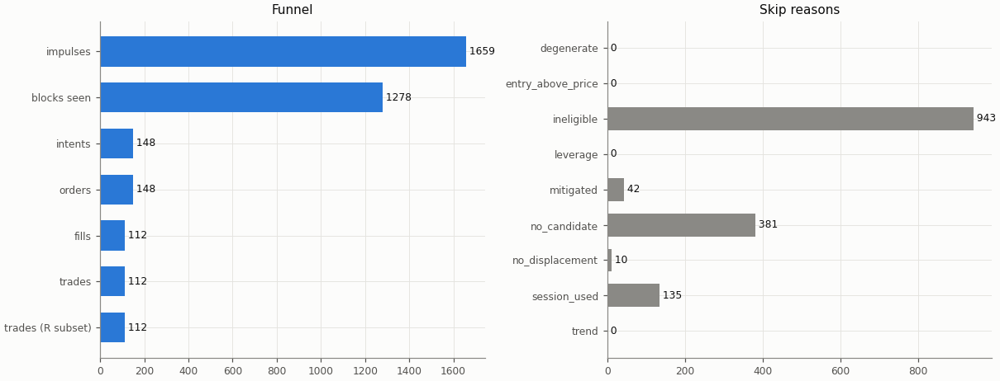

## Headline

Trade statistics use the R subset: trades closed by a stop, target or time exit (`exit_reason != data_end`); trades still open at the end of the data are left out.

| Headline | Value |
|---|---|
| trades (R subset) | 112 |
| win rate | 29.5% |
| mean gross R | -0.116 |
| mean net R | -0.406 |
| mean net R, 95% CI (trade bootstrap) | -0.672 to -0.131 |
| mean net R, 95% CI (day-block bootstrap) | -0.678 to -0.121 |
| median net R | -1.264 |
| std of net R | 1.490 |
| profit factor | 0.58 |
| mean cost (R) | 0.290 |
| mean funding (R) | -0.001 |
| mean hold (minutes) | 60.7 |
| Sharpe (annualised, daily) | -3.16 |
| Sharpe, 95% CI (10-day block bootstrap) | -5.42 to -1.30 |
| max drawdown | 38.9% |
| total return | -37.4% |
| exposure (share of candles in a trade) | 2.0% |
| mean notional / equity at the daily marks | 0.002 |
| max concurrent positions | 1 |

## Baselines

| Baseline | Observed mean net R | Runs: mean | Runs: std | p (one-sided) | z | p (Holm) | Runs |
|---|---|---|---|---|---|---|---|
| A: random entry time in the strategy's own sessions | -0.406 | -0.215 | 0.135 | 0.927 | -1.41 | 1 | 5000 |
| B: random sessions and entry times | -0.406 | -0.328 | 0.142 | 0.704 | -0.55 | 1 | 5000 |

| Table A | Value |
|---|---|
| trades covered | 112 |
| trades left out | 0 |
| baseline B: mean trades per run | 112.0 |

Holm adjustment over the holdout family of 9 primary cells (tested: A 9, B 9, buy-and-hold 9) at α = 0.05.

Baseline design (judgment calls, overview risk 13): a baseline trade enters at the open of a uniformly drawn in-session candle with the maker fee, keeps the real trade's stop distance in ATR and the variant's target and hold rule, and pays actual funding; baseline trades that reach the data end are left out of their run's mean.

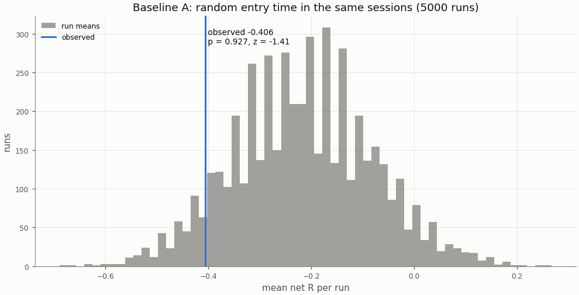

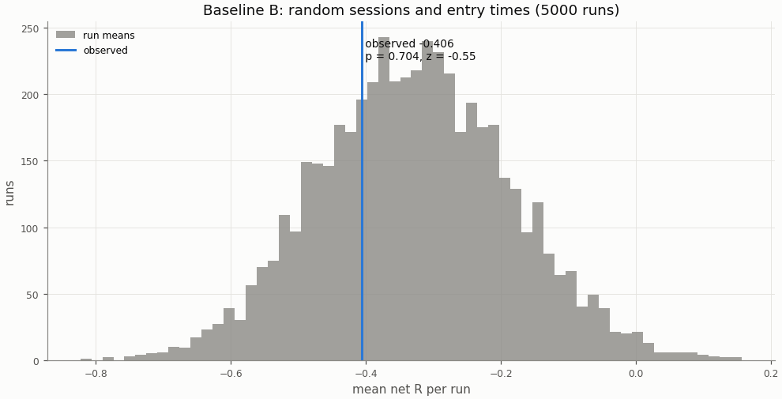

## Buy-and-hold

A constant 1× long in the perpetual with funding, scaled to the strategy's in-sample daily volatility; Sharpe is scale-invariant, the scaling matters for return and drawdown.

| Buy-and-hold | Value |
|---|---|
| days | 293 |
| buy-and-hold Sharpe | 0.02 |
| buy-and-hold Sharpe, 95% CI | -2.49 to 2.27 |
| strategy Sharpe | -3.16 |
| Sharpe difference (strategy − buy-and-hold) | -3.17 |
| Sharpe difference, 95% CI (paired block bootstrap) | -5.91 to -0.54 |
| p_BH (one-sided) | 0.992 |
| p_BH (Holm) | 1 |
| buy-and-hold total return (1×) | -13.9% |
| vol scale (σ strategy / σ buy-and-hold) | 0.149 |
| σ strategy (daily, in-sample) | 0.00939 |
| σ buy-and-hold (daily, in-sample) | 0.06286 |
| vol-scaled buy-and-hold total return | -0.2% |
| vol-scaled buy-and-hold max drawdown | 10.7% |

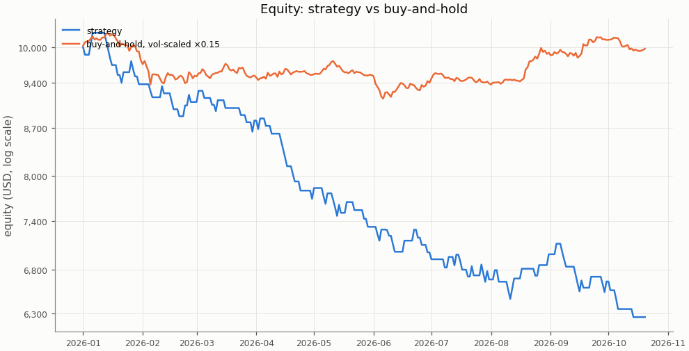

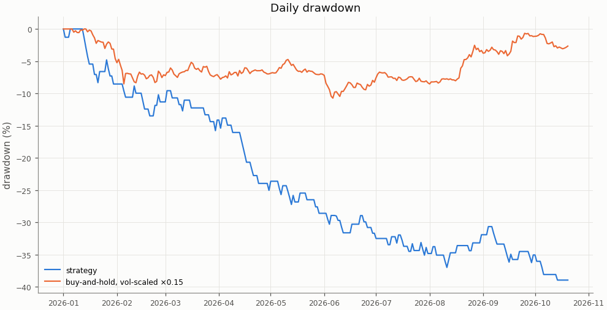

## Costs

Cost in R is fees, slippage and funding divided by the stop distance; a trade whose cost exceeds 1 R loses even when it reaches a 1 R target.

| Cost | Value |
|---|---|
| share of trades with cost above 1 R | 0.0% |

| Cost distribution | min | p05 | p25 | p50 | p75 | p95 | max | mean |
|---|---|---|---|---|---|---|---|---|
| cost per trade (R) | 0.037 | 0.057 | 0.139 | 0.280 | 0.414 | 0.562 | 0.988 | 0.290 |
| stop distance (% of entry) | 0.109 | 0.186 | 0.270 | 0.339 | 0.490 | 0.888 | 1.551 | 0.425 |
| stop distance (ATR14) | 0.405 | 0.505 | 0.716 | 0.881 | 1.116 | 1.737 | 2.323 | 0.972 |
| implied leverage (×) | 0.64 | 1.13 | 2.04 | 2.95 | 3.70 | 5.37 | 9.16 | 3.02 |
| funding (R) | -0.1138 | 0.0000 | 0.0000 | 0.0000 | 0.0000 | 0.0000 | 0.0405 | -0.0008 |

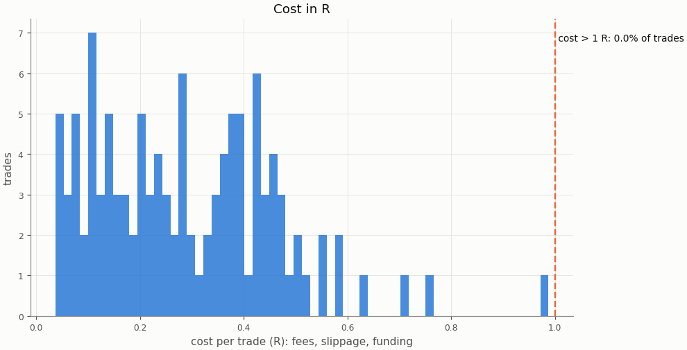

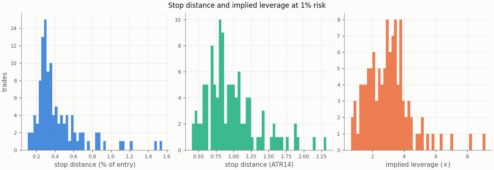

### Re-pricing (D13)

The same trades and baseline runs re-priced at other costs, without re-simulation; descriptive only, the verdict uses the registered costs.

| Slippage | Maker fee | Taker fee | n | Mean net R | 95% CI | Win rate | p_A | p_B | Costs |
|---|---|---|---|---|---|---|---|---|---|
| 0.00% | 0.00% | 0.05% | 112 | -0.222 | -0.478 to 0.039 | 29.5% | 0.919 | 0.691 |  |
| 0.00% | 0.02% | 0.05% | 112 | -0.300 | -0.553 to -0.041 | 29.5% | 0.929 | 0.694 |  |
| 0.02% | 0.00% | 0.05% | 112 | -0.264 | -0.526 to 0.003 | 29.5% | 0.921 | 0.692 |  |
| 0.02% | 0.02% | 0.05% | 112 | -0.342 | -0.601 to -0.077 | 29.5% | 0.928 | 0.696 |  |
| 0.05% | 0.00% | 0.05% | 112 | -0.328 | -0.598 to -0.050 | 29.5% | 0.921 | 0.695 |  |
| 0.05% | 0.02% | 0.05% | 112 | -0.406 | -0.672 to -0.131 | 29.5% | 0.927 | 0.704 | registered |
| 0.10% | 0.00% | 0.05% | 112 | -0.434 | -0.718 to -0.141 | 29.5% | 0.922 | 0.704 |  |
| 0.10% | 0.02% | 0.05% | 112 | -0.512 | -0.791 to -0.224 | 29.5% | 0.927 | 0.715 |  |

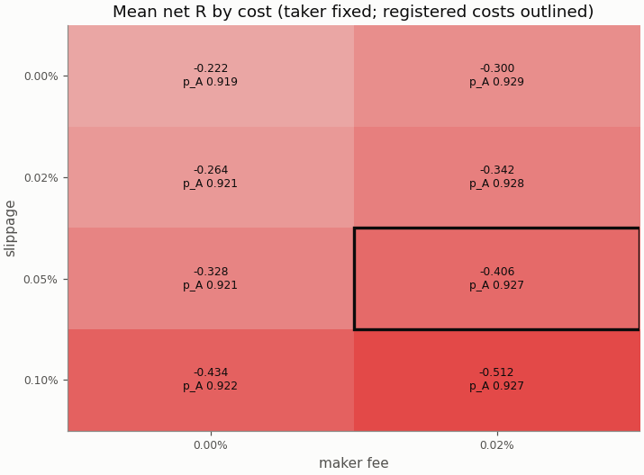

## Robustness

The grid is in-sample only; the heatmaps are in the in-sample primary report.

## Alpha decay

Per calendar year (max drawdown starts from the previous year-end equity; fill rate is filled / placed entry orders by placement year).

| Year | n | Win rate | Mean net R | Sharpe | Max DD | Fill rate |
|---|---|---|---|---|---|---|
| 2026 | 112 | 29.5% | -0.406 | -3.16 | 38.9% | 75.7% |

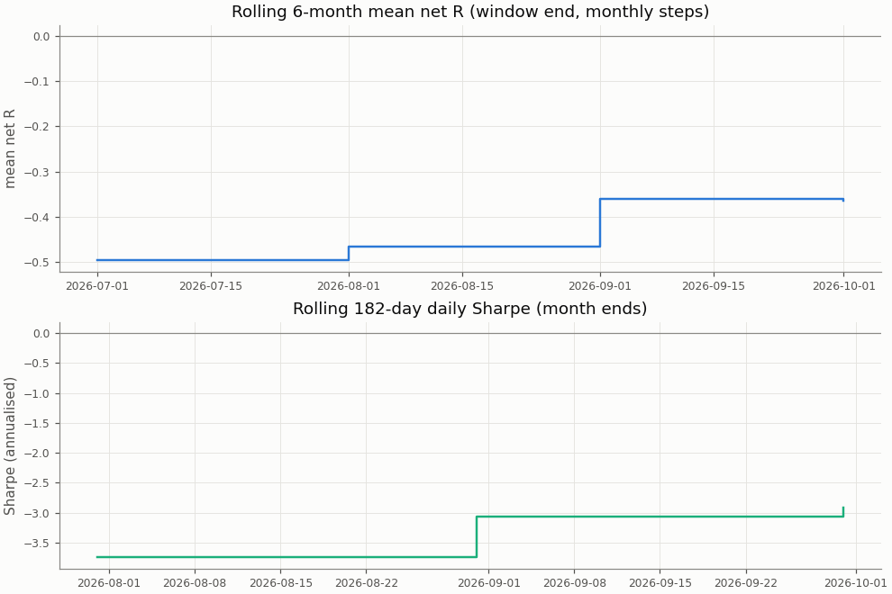

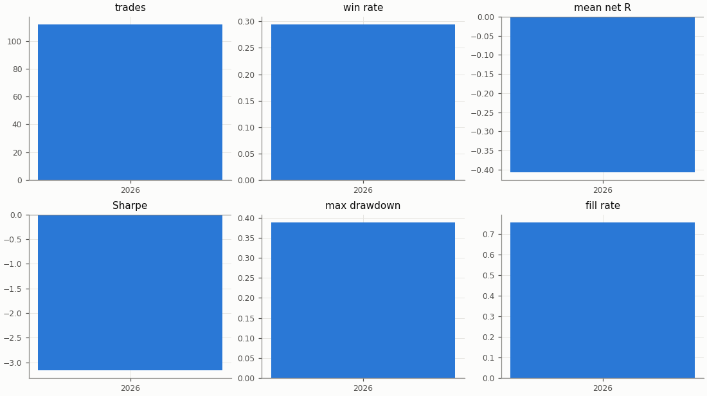

## Regimes and calendar

Trend: daily ADX(14) above 25 as of the day before entry. Volatility: 30-day realised vol of daily log returns as of the day before entry, above (`high`) or below (`low`) the in-sample median 0.04944; trades before the indicators are defined are unlabelled.

| Regime | n | Win rate | Mean net R |
|---|---|---|---|
| trend: no_trend | 57 | 31.6% | -0.368 |
| trend: trend | 55 | 27.3% | -0.445 |
| vol: high | 10 | 40.0% | 0.000 |
| vol: low | 102 | 28.4% | -0.446 |

| Day of week (UTC) | n | Win rate | Mean net R |
|---|---|---|---|
| Monday | 28 | 35.7% | -0.203 |
| Tuesday | 17 | 23.5% | -0.624 |
| Wednesday | 24 | 29.2% | -0.437 |
| Thursday | 20 | 30.0% | -0.360 |
| Friday | 23 | 26.1% | -0.501 |

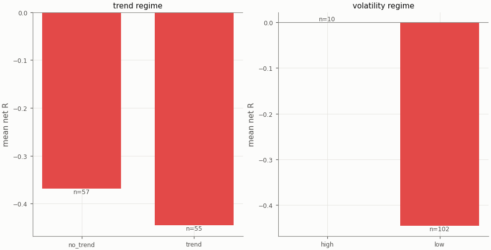

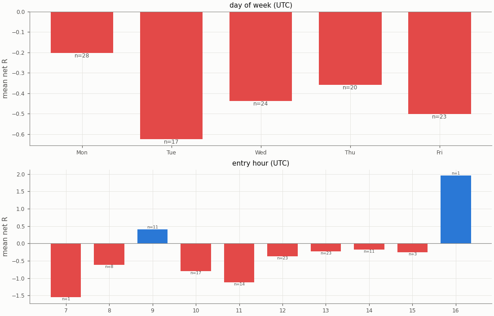

## Diagnostics

| Count | Value |
|---|---|
| trades open at the data end (left out of the R subset) | 0 |
| ambiguous candles resolved without full 1m data | 0 |
| max concurrent positions | 1 |
| funding paid in total (USD) | -8.21 |

| Fill resolution | Fills |
|---|---|
| 15m_unambiguous | 168 |
| 1m | 46 |
| 1m_pessimistic | 10 |

| Exit reason | n | Win rate | Mean net R |
|---|---|---|---|
| stop | 79 | 0.0% | -1.361 |
| target | 33 | 100.0% | 1.879 |

| Trade distribution | min | p05 | p25 | p50 | p75 | p95 | max | mean |
|---|---|---|---|---|---|---|---|---|
| hold (minutes) | 0.0 | 1.0 | 12.5 | 30.0 | 75.0 | 216.7 | 690.0 | 60.7 |
| MAE (R) | -5.778 | -2.605 | -1.536 | -1.176 | -0.849 | -0.199 | 0.000 | -1.283 |
| MFE (R) | 0.048 | 0.262 | 0.699 | 1.120 | 2.124 | 3.362 | 5.264 | 1.465 |

Share of this variant's trades whose candidate candle is also traded by the other session variants (computed at report time from their trade tables): NY 4.5%, UTC 42.0%; any of them 42.9%. The session variants are not independent tests.

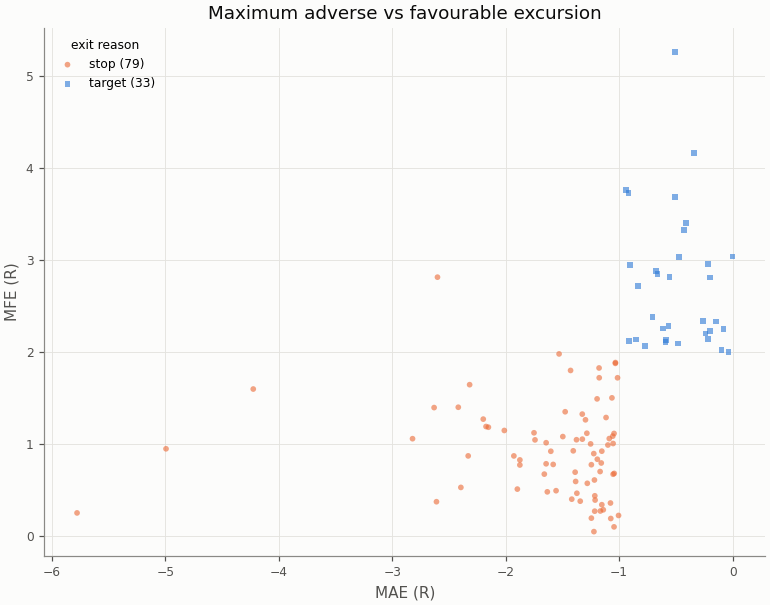

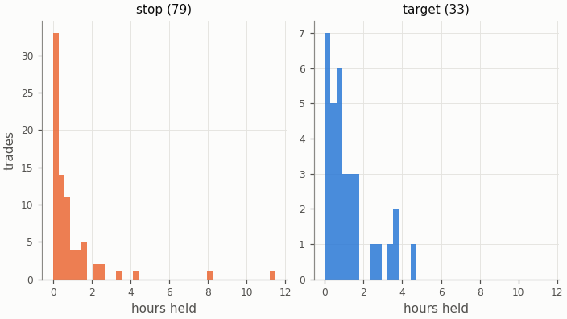

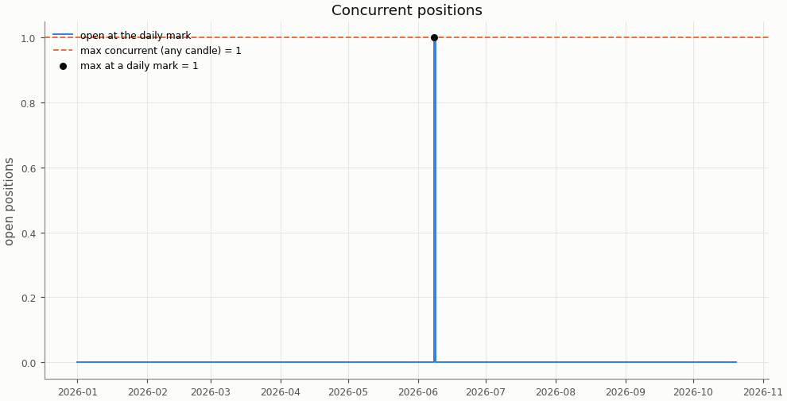

## Deflated Sharpe ratio

| Daily returns | Value |
|---|---|
| daily Sharpe (not annualised) | -0.1653 |
| days T | 293 |
| skew | 0.556 |
| kurtosis (non-excess) | 3.329 |

| Trials | N | V (variance of daily Sharpe) | SR* | DSR |
|---|---|---|---|---|
| this pair × session's grid | n/a | n/a | n/a | n/a |
| all grid variants | n/a | n/a | n/a | n/a |

The DSR is computed for the in-sample grid only; the holdout tests one pre-registered configuration per cell.

Caveat: the grid cells share most of their trades, so the effective number of independent trials is far below N and the DSR is conservative.

## Notes

- `15m_pessimistic_missing_1m`: 0 fills and 0 ambiguous (candle, order) pairs were resolved by the pessimistic 15m rule because 1m data was incomplete.
- Data gaps overlapping a trade (computed at report time from the candle manifests): 15m: 0 trades over 0 gaps; 1m: 0 trades over 0 gaps.
