# SOLUSDT / UTC, in-sample primary

- Pair: SOLUSDT
- Session: UTC (00:00–24:00 UTC, weekdays [0, 1, 2, 3, 4, 5, 6], Mon = 0)
- Period: 2020-01-01 to 2025-12-31 (in-sample)
- Variant id: `9b998229906f81a91471f50f482ce1894b875d62eece204e24e2393c83f48749`
- Code version: `c3c05e53c0f38a9e57d65b716a78ddfb198004a84dd66fde28cf145808135dc5`
- Seed: 20260926 (generators per purpose: trade_bootstrap, day_bootstrap, sharpe_bootstrap, bh_sharpe_bootstrap, bh_diff_bootstrap, baseline_a, baseline_b)
- Role: primary; member of heatmap_1, heatmap_2, heatmap_3
- Costs: maker 0.02%, taker 0.05%, slippage 0.05%; risk 1.0% per trade; 1m resolution on

## Funnel

Every impulse that did not become a trade is counted by the first reason that stopped it (spec overview §6). Orders exclude intents skipped by the leverage cap.

| Stage | Count |
|---|---|
| impulses | 12089 |
| blocks seen | 9247 |
| skipped: no_candidate | 2842 |
| skipped: ineligible | 315 |
| skipped: degenerate | 0 |
| skipped: no_displacement | 380 |
| skipped: mitigated | 1170 |
| skipped: entry_above_price | 0 |
| skipped: trend | 0 |
| skipped: session_used | 5495 |
| intents | 1887 |
| skipped: leverage cap | 0 |
| orders placed | 1887 |
| orders filled | 1639 |
| fill rate | 86.9% |
| trades | 1639 |
| trades in the R subset | 1639 |
| trades open at the data end | 0 |

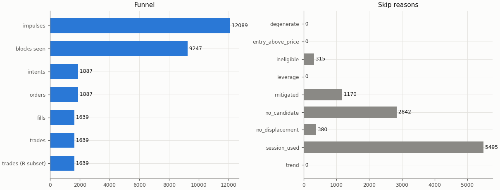

## Headline

Trade statistics use the R subset: trades closed by a stop, target or time exit (`exit_reason != data_end`); trades still open at the end of the data are left out.

| Headline | Value |
|---|---|
| trades (R subset) | 1639 |
| win rate | 33.9% |
| mean gross R | 0.016 |
| mean net R | -0.152 |
| mean net R, 95% CI (trade bootstrap) | -0.224 to -0.081 |
| mean net R, 95% CI (day-block bootstrap) | -0.223 to -0.080 |
| median net R | -1.129 |
| std of net R | 1.492 |
| profit factor | 0.81 |
| mean cost (R) | 0.168 |
| mean funding (R) | 0.002 |
| mean hold (minutes) | 94.1 |
| Sharpe (annualised, daily) | -1.80 |
| Sharpe, 95% CI (10-day block bootstrap) | -2.64 to -0.92 |
| max drawdown | 93.4% |
| total return | -93.2% |
| exposure (share of candles in a trade) | 6.4% |
| mean notional / equity at the daily marks | 0.020 |
| max concurrent positions | 2 |

## Baselines

| Baseline | Observed mean net R | Runs: mean | Runs: std | p (one-sided) | z | p (Holm) | Runs |
|---|---|---|---|---|---|---|---|
| A: random entry time in the strategy's own sessions | -0.152 | -0.212 | 0.034 | 0.0436 | 1.74 | 0.392 | 5000 |
| B: random sessions and entry times | -0.152 | -0.180 | 0.037 | 0.23 | 0.74 | 1 | 5000 |

| Table A | Value |
|---|---|
| trades covered | 1639 |
| trades left out | 0 |
| baseline B: mean trades per run | 1638.9 |

Holm adjustment over the in-sample family of 9 primary cells (tested: A 9, B 9, buy-and-hold 9) at α = 0.05.

Baseline design (judgment calls, overview risk 13): a baseline trade enters at the open of a uniformly drawn in-session candle with the maker fee, keeps the real trade's stop distance in ATR and the variant's target and hold rule, and pays actual funding; baseline trades that reach the data end are left out of their run's mean.

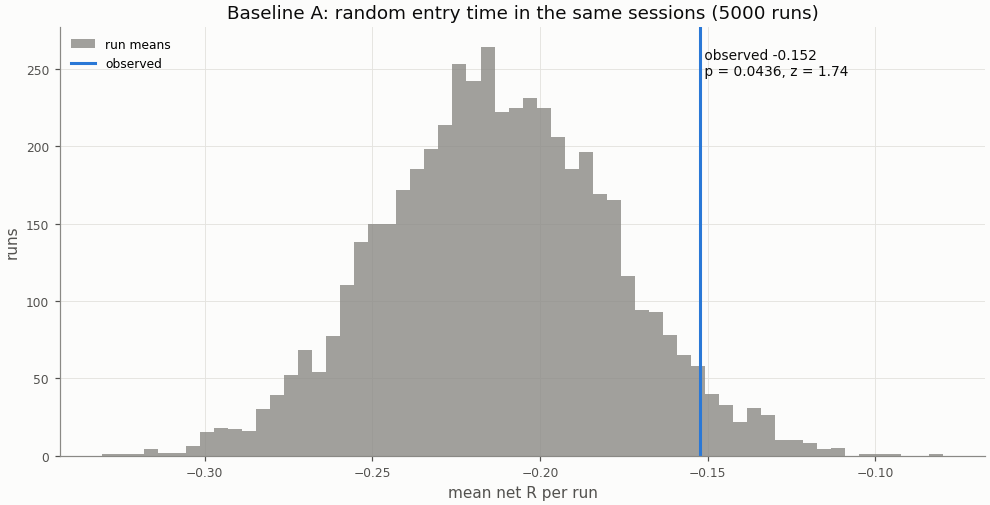

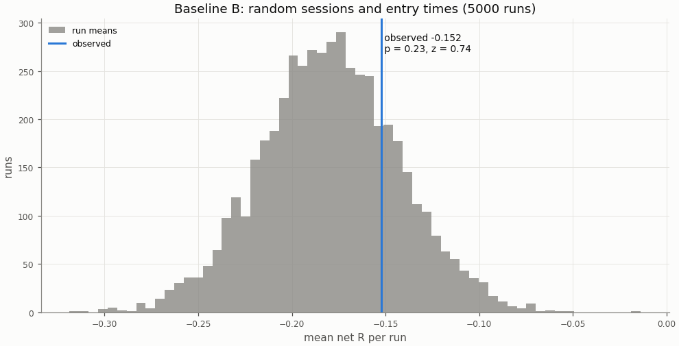

## Buy-and-hold

A constant 1× long in the perpetual with funding, scaled to the strategy's in-sample daily volatility; Sharpe is scale-invariant, the scaling matters for return and drawdown.

| Buy-and-hold | Value |
|---|---|
| days | 1935 |
| buy-and-hold Sharpe | 1.16 |
| buy-and-hold Sharpe, 95% CI | 0.37 to 2.02 |
| strategy Sharpe | -1.80 |
| Sharpe difference (strategy − buy-and-hold) | -2.96 |
| Sharpe difference, 95% CI (paired block bootstrap) | -4.11 to -1.84 |
| p_BH (one-sided) | 1 |
| p_BH (Holm) | 1 |
| buy-and-hold total return (1×) | 3693.0% |
| vol scale (σ strategy / σ buy-and-hold) | 0.218 |
| σ strategy (daily, in-sample) | 0.01373 |
| σ buy-and-hold (daily, in-sample) | 0.06286 |
| vol-scaled buy-and-hold total return | 318.0% |
| vol-scaled buy-and-hold max drawdown | 41.0% |

The figures continue into the holdout run (shaded), chained onto the in-sample end.

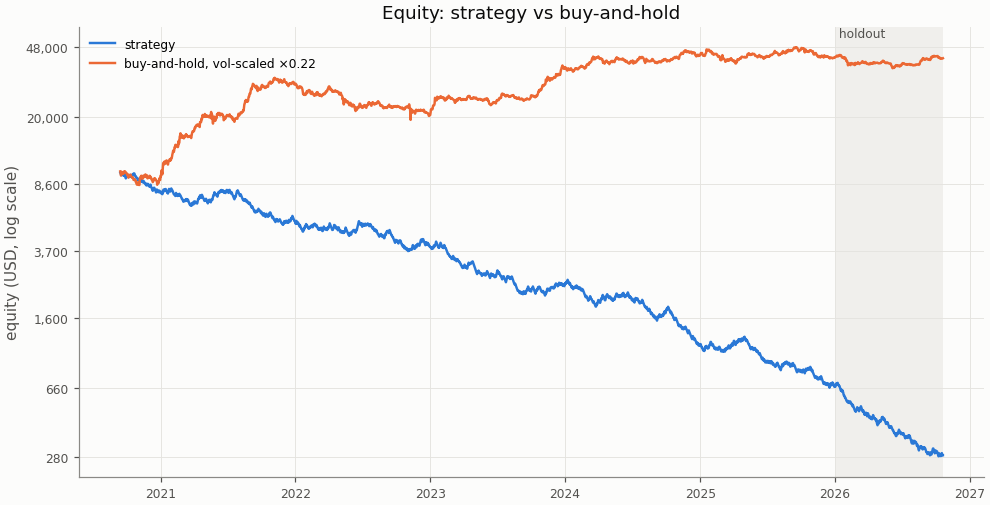

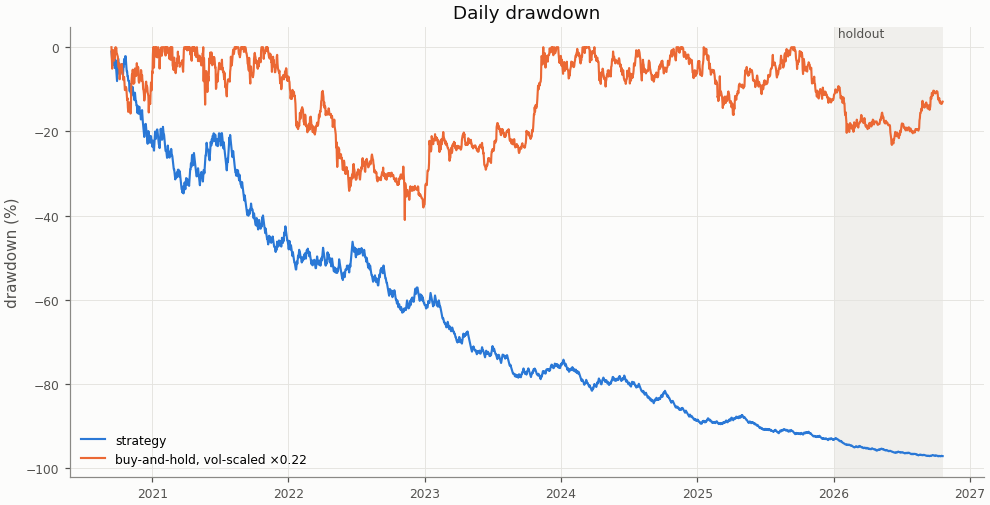

## Costs

Cost in R is fees, slippage and funding divided by the stop distance; a trade whose cost exceeds 1 R loses even when it reaches a 1 R target.

| Cost | Value |
|---|---|
| share of trades with cost above 1 R | 0.0% |

| Cost distribution | min | p05 | p25 | p50 | p75 | p95 | max | mean |
|---|---|---|---|---|---|---|---|---|
| cost per trade (R) | -0.287 | 0.034 | 0.075 | 0.139 | 0.225 | 0.412 | 0.892 | 0.168 |
| stop distance (% of entry) | 0.134 | 0.271 | 0.435 | 0.639 | 0.926 | 1.784 | 7.198 | 0.790 |
| stop distance (ATR14) | 0.279 | 0.540 | 0.737 | 0.914 | 1.131 | 1.547 | 4.711 | 0.964 |
| implied leverage (×) | 0.14 | 0.56 | 1.08 | 1.56 | 2.30 | 3.69 | 7.44 | 1.79 |
| funding (R) | -0.2929 | 0.0000 | 0.0000 | 0.0000 | 0.0000 | 0.0149 | 0.3353 | 0.0020 |

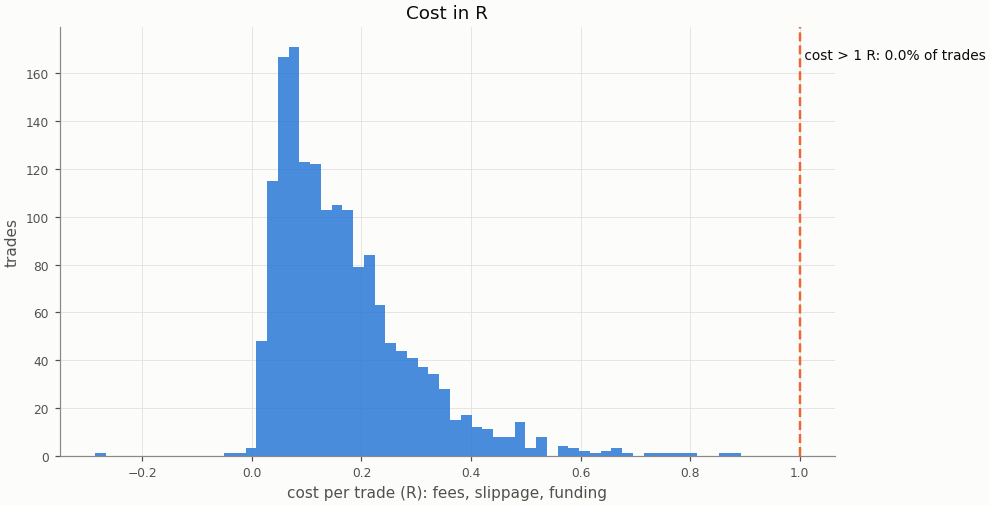

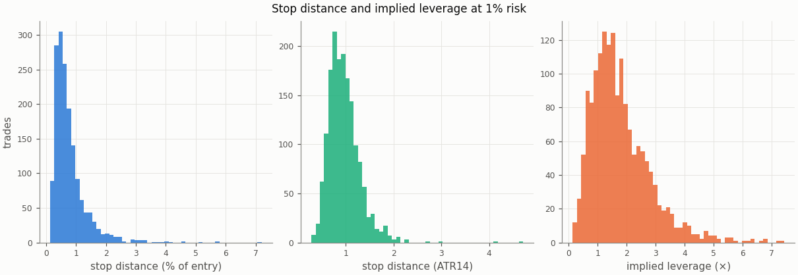

### Re-pricing (D13)

The same trades and baseline runs re-priced at other costs, without re-simulation; descriptive only, the verdict uses the registered costs.

| Slippage | Maker fee | Taker fee | n | Mean net R | 95% CI | Win rate | p_A | p_B | Costs |
|---|---|---|---|---|---|---|---|---|---|
| 0.00% | 0.00% | 0.05% | 1639 | -0.045 | -0.116 to 0.025 | 33.9% | 0.0352 | 0.21 |  |
| 0.00% | 0.02% | 0.05% | 1639 | -0.093 | -0.163 to -0.024 | 33.9% | 0.0374 | 0.218 |  |
| 0.02% | 0.00% | 0.05% | 1639 | -0.069 | -0.140 to 0.002 | 33.9% | 0.0368 | 0.213 |  |
| 0.02% | 0.02% | 0.05% | 1639 | -0.117 | -0.188 to -0.047 | 33.9% | 0.0392 | 0.221 |  |
| 0.05% | 0.00% | 0.05% | 1639 | -0.105 | -0.178 to -0.032 | 33.9% | 0.0404 | 0.22 |  |
| 0.05% | 0.02% | 0.05% | 1639 | -0.152 | -0.224 to -0.081 | 33.9% | 0.0436 | 0.23 | registered |
| 0.10% | 0.00% | 0.05% | 1639 | -0.164 | -0.238 to -0.089 | 33.9% | 0.0452 | 0.231 |  |
| 0.10% | 0.02% | 0.05% | 1639 | -0.212 | -0.285 to -0.138 | 33.9% | 0.0482 | 0.24 |  |

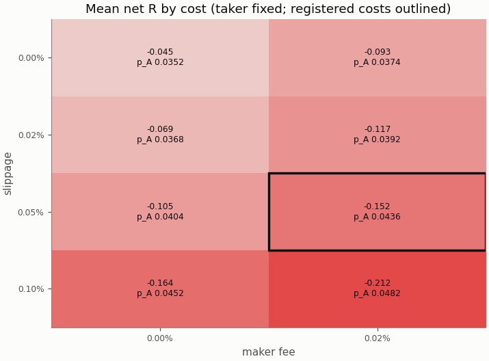

## Robustness

### Heatmap 1: r_target × entry_level

8 of 8 cells have run; the primary is outlined.

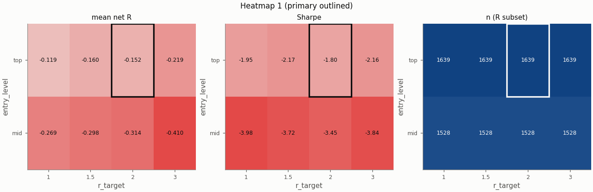

### Heatmap 2: swing_k × confirm_n

9 of 9 cells have run; the primary is outlined.

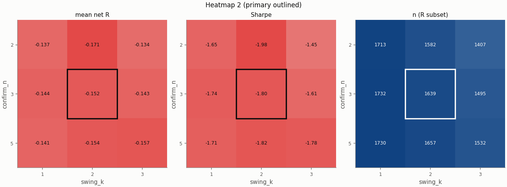

### Heatmap 3: stop_buffer × hold_rule

16 of 16 cells have run; the primary is outlined.

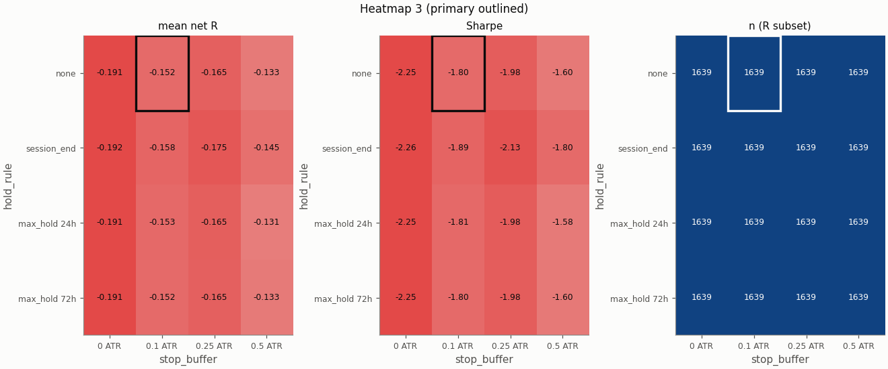

Grid variants of this pair × session:

- heatmap_3: hold_rule=session_end ([report](../0274862d3e73f2944bbd74af0650dd21d2bd779148c4500df0a5f5d093376528/report.md))
- single_3: trend_filter=on ([report](../0929b9127c7f1dc7a3a4ba32c3887e9175a9378e9dde6c4a9b0066f4724dd9a7/report.md))
- heatmap_3: hold_rule=max_hold 24h, stop_buffer=0.25 ATR ([report](../14e01f4491b19cbdd92994f658f6d48068bba4da3e26a7b635a9cb446811900c/report.md))
- heatmap_3: stop_buffer=0.25 ATR ([report](../18d058f5fb48375dfa446b5f74ed93a06a7a671e0d1b1a72f91eb08b57ec2b51/report.md))
- heatmap_1: r_target=1 ([report](../22f7908425c0ee1ff85e16934a412e4febcbc981c2d8cd0569ed3a410e1eddb6/report.md))
- heatmap_2: confirm_n=2 ([report](../3952e5f8497f48665b6b09b8587df72e055b8759a154bf4087445dbd3258dd62/report.md))
- heatmap_3: hold_rule=session_end, stop_buffer=0.5 ATR ([report](../3cde6da17efb5d5d25e36be2477ad27155a747dc51474666ddb6f25eac51581b/report.md))
- heatmap_3: hold_rule=max_hold 24h, stop_buffer=0 ATR ([report](../41b64a12ef0c0d1992c3081e72f0a72f74a5de7766f1f851ca1a77cc5325b392/report.md))
- heatmap_2: confirm_n=2, swing_k=3 ([report](../46ecb6677dcc40b7bcef648dbfc8d12138b77dd98104d5a330ade473d23403b2/report.md))
- heatmap_3: hold_rule=session_end, stop_buffer=0.25 ATR ([report](../471f0fd1202700e36191ea21861c8441aa3458206fe5fa1e87c12692e42e0f23/report.md))
- heatmap_1: entry_level=mid, r_target=1 ([report](../49091ce50e3471720f11cf23d3c82e51483b9bf8468118626a315f4ab98ccc09/report.md))
- heatmap_2: confirm_n=5, swing_k=1 ([report](../5551858f028367aa4391810190d299fab4bbd67b97d10addde22b34005589121/report.md))
- heatmap_1: entry_level=mid ([report](../68d89f663868ef1e292e966647a16833fd8f80feecdbb0fd975b30ec36758027/report.md))
- heatmap_3: hold_rule=max_hold 72h, stop_buffer=0 ATR ([report](../6c4865c1a9543cead772dfb39cf36c3c3a793b167ce81b55e1002567738609e0/report.md))
- heatmap_3: hold_rule=max_hold 72h, stop_buffer=0.25 ATR ([report](../6d395067ac0fba48a3679b0555fc20c759aedc4c042b722c1cb1b2285032bedd/report.md))
- single_4: stop_buffer=0.1% ([report](../7027de3b8de0a4ac8ab44dd26723220598c7709bb5b2449735e6ee37385500c9/report.md))
- heatmap_1: r_target=3 ([report](../703b3370b5ec64c213ce7d8ea1c7d913955b1e95eec762889c7d2ff675090763/report.md))
- heatmap_3: hold_rule=max_hold 24h, stop_buffer=0.5 ATR ([report](../77822388b0bc046f796d6c5b0688a0396bf963f385eae4800c74c8b20eb513cd/report.md))
- heatmap_1: entry_level=mid, r_target=3 ([report](../7e54e9c270757359a7c79803037a85098508582044011e840cead8b5b4cd8beb/report.md))
- heatmap_3: hold_rule=max_hold 72h ([report](../7e6310e45f48e1c20b80844d3d441d87079640c5fc10ef36711a097ae709d027/report.md))
- heatmap_1: entry_level=mid, r_target=1.5 ([report](../87f4f95eeaf71e576f10f0b3b4943e06464b6bd33914460799e5e725613de335/report.md))
- heatmap_2: confirm_n=5 ([report](../896ce904b399daeadbfd9ff46afe9760add1dfc68efd0266a800c377a83283b9/report.md))
- heatmap_1: r_target=1.5 ([report](../8b58bb6db0b80637cc53b7e01d6dcd28ffc435abbfa151285bbb06a6df6b847d/report.md))
- single_2: pierce=0.0005 ([report](../93d81cca854436725360a3c5327b516bf48797502451dae2903cba07dd2c1741/report.md))
- heatmap_2: confirm_n=2, swing_k=1 ([report](../a04b4c1448ea6bf69298b222d522d3f382664742997c18899068ad6119363983/report.md))
- heatmap_3: stop_buffer=0 ATR ([report](../a0639e3ad3bd11e960c4279304adca1c4b92f52657d8bd53a09bb2bd49040e78/report.md))
- heatmap_2: swing_k=1 ([report](../aea56f6ecc9580e1f236ad4c884f36919b07f484bbb15707e3a3cce8d2f87e4a/report.md))
- heatmap_3: hold_rule=max_hold 72h, stop_buffer=0.5 ATR ([report](../cb407f05f9e7c069a5623b88df5985a0769606123b63f9cd387b4bc569c26d0b/report.md))
- single_5: stop_buffer=0.25% ([report](../d1c249971b18e98575822d8bf1254e04edee9dc99fa2331a2910e0dbd5069d22/report.md))
- heatmap_3: stop_buffer=0.5 ATR ([report](../dd17560948b886d30aded731d403f2503c395532f7db93ab4d538494d574ed73/report.md))
- heatmap_3: hold_rule=session_end, stop_buffer=0 ATR ([report](../e4c7f53906ef1c3595b7da80506c1dbaae89b7c0d2a47091916a179b378037b8/report.md))
- heatmap_2: swing_k=3 ([report](../ee0e8ee75abc290b5b93a6bdd6169c6c52a57a7a0511f587648c5a118f81669d/report.md))
- heatmap_2: confirm_n=5, swing_k=3 ([report](../f7785ab5d39481bc5cf9ab6765d56afa728e046e85d11548771e9d96b3fb5258/report.md))
- single_1: zone=body ([report](../f8ddf055f42a7bba901037da5b8909619db385f5ae2521092100e5999dc9c7be/report.md))
- heatmap_3: hold_rule=max_hold 24h ([report](../fb91f7cd0adf6282d0791e337c10658173730978e8c321ee208eda425929125e/report.md))

## Alpha decay

Per calendar year (max drawdown starts from the previous year-end equity; fill rate is filled / placed entry orders by placement year).

| Year | n | Win rate | Mean net R | Sharpe | Max DD | Fill rate |
|---|---|---|---|---|---|---|
| 2020 | 84 | 28.6% | -0.298 | -3.50 | 22.9% | 80.0% |
| 2021 | 309 | 33.3% | -0.108 | -1.30 | 36.7% | 86.3% |
| 2022 | 313 | 35.8% | -0.088 | -1.01 | 31.6% | 88.7% |
| 2023 | 300 | 34.7% | -0.149 | -1.76 | 49.2% | 84.5% |
| 2024 | 321 | 32.1% | -0.222 | -2.69 | 56.3% | 89.2% |
| 2025 | 312 | 34.9% | -0.154 | -1.77 | 47.3% | 87.6% |

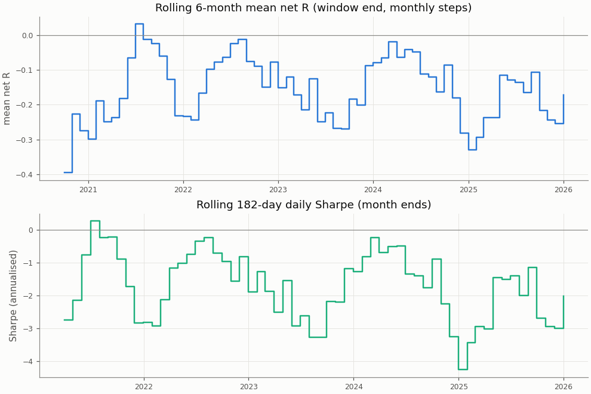

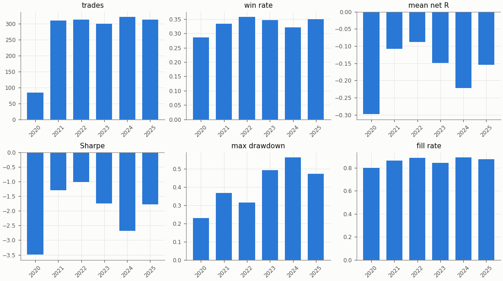

## Regimes and calendar

Trend: daily ADX(14) above 25 as of the day before entry. Volatility: 30-day realised vol of daily log returns as of the day before entry, above (`high`) or below (`low`) the in-sample median 0.04944; trades before the indicators are defined are unlabelled.

| Regime | n | Win rate | Mean net R |
|---|---|---|---|
| trend: no_trend | 779 | 33.1% | -0.194 |
| trend: trend | 836 | 34.6% | -0.113 |
| trend: unlabelled | 24 | 33.3% | -0.161 |
| vol: high | 808 | 36.8% | -0.026 |
| vol: low | 806 | 31.0% | -0.277 |
| vol: unlabelled | 25 | 32.0% | -0.207 |

| Day of week (UTC) | n | Win rate | Mean net R |
|---|---|---|---|
| Monday | 225 | 32.0% | -0.203 |
| Tuesday | 239 | 37.7% | -0.013 |
| Wednesday | 238 | 32.8% | -0.175 |
| Thursday | 231 | 35.9% | -0.072 |
| Friday | 234 | 33.8% | -0.145 |
| Saturday | 230 | 31.7% | -0.247 |
| Sunday | 242 | 33.1% | -0.214 |

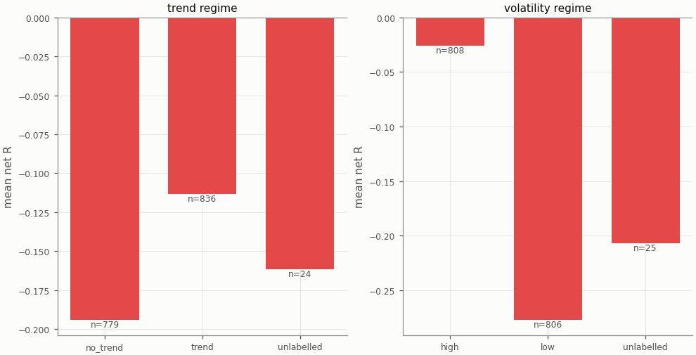

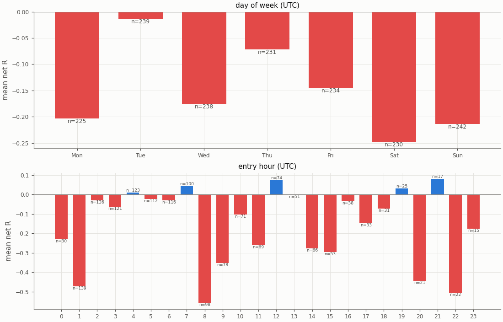

## Diagnostics

| Count | Value |
|---|---|
| trades open at the data end (left out of the R subset) | 0 |
| ambiguous candles resolved without full 1m data | 0 |
| max concurrent positions | 2 |
| funding paid in total (USD) | 174.78 |

| Fill resolution | Fills |
|---|---|
| 15m_unambiguous | 2769 |
| 1m | 421 |
| 1m_pessimistic | 87 |
| open_gap | 1 |

| Exit reason | n | Win rate | Mean net R |
|---|---|---|---|
| stop | 1084 | 0.0% | -1.217 |
| target | 555 | 100.0% | 1.927 |

| Trade distribution | min | p05 | p25 | p50 | p75 | p95 | max | mean |
|---|---|---|---|---|---|---|---|---|
| hold (minutes) | 0.0 | 2.0 | 15.0 | 45.0 | 120.0 | 315.0 | 2625.0 | 94.1 |
| MAE (R) | -15.131 | -2.386 | -1.435 | -1.124 | -0.659 | -0.083 | 0.000 | -1.158 |
| MFE (R) | 0.030 | 0.266 | 0.727 | 1.275 | 2.145 | 2.928 | 9.799 | 1.474 |

Share of this variant's trades whose candidate candle is also traded by the other session variants (computed at report time from their trade tables): London 15.7%, NY 5.1%; any of them 19.5%. The session variants are not independent tests.

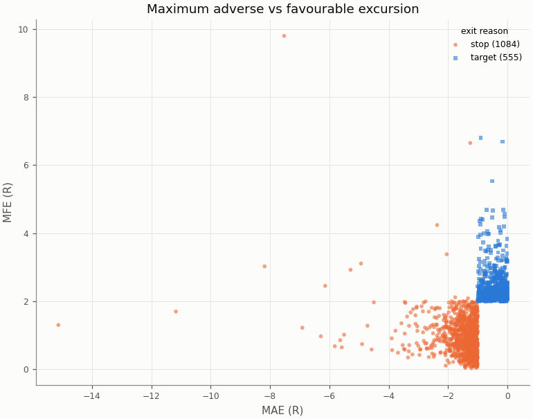

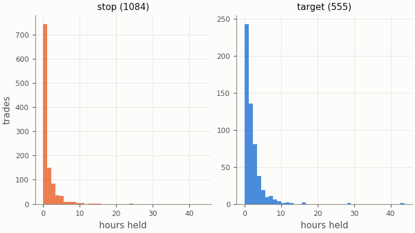

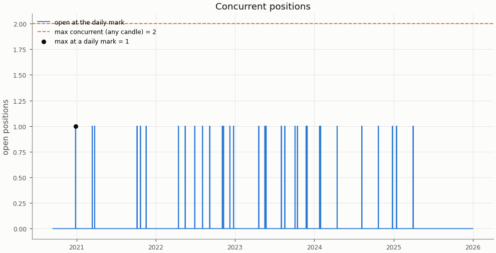

## Deflated Sharpe ratio

| Daily returns | Value |
|---|---|
| daily Sharpe (not annualised) | -0.0941 |
| days T | 1935 |
| skew | 0.667 |
| kurtosis (non-excess) | 1.784 |

| Trials | N | V (variance of daily Sharpe) | SR* | DSR |
|---|---|---|---|---|
| this pair × session's grid | 36 | 0.001399 | 0.0803 | 0.000 |
| all grid variants | 324 | 0.003906 | 0.1825 | 0.000 |

Caveat: the grid cells share most of their trades, so the effective number of independent trials is far below N and the DSR is conservative.

## Notes

- `15m_pessimistic_missing_1m`: 0 fills and 0 ambiguous (candle, order) pairs were resolved by the pessimistic 15m rule because 1m data was incomplete.
- Data gaps overlapping a trade (computed at report time from the candle manifests): 15m: 0 trades over 0 gaps; 1m: 0 trades over 0 gaps.
