# SOLUSDT / NY, in-sample primary

- Pair: SOLUSDT
- Session: NY (09:30–16:00 America/New_York, weekdays [0, 1, 2, 3, 4], Mon = 0)
- Period: 2020-01-01 to 2025-12-31 (in-sample)
- Variant id: `9fff76bb25168f8ecaa1caa59d3b8ff5e634c5922c4beec6f390eb05c6e07715`
- Code version: `c3c05e53c0f38a9e57d65b716a78ddfb198004a84dd66fde28cf145808135dc5`
- Seed: 20260926 (generators per purpose: trade_bootstrap, day_bootstrap, sharpe_bootstrap, bh_sharpe_bootstrap, bh_diff_bootstrap, baseline_a, baseline_b)
- Role: primary; member of heatmap_1, heatmap_2, heatmap_3
- Costs: maker 0.02%, taker 0.05%, slippage 0.05%; risk 1.0% per trade; 1m resolution on

## Funnel

Every impulse that did not become a trade is counted by the first reason that stopped it (spec overview §6). Orders exclude intents skipped by the leverage cap.

| Stage | Count |
|---|---|
| impulses | 12089 |
| blocks seen | 9247 |
| skipped: no_candidate | 2842 |
| skipped: ineligible | 7735 |
| skipped: degenerate | 0 |
| skipped: no_displacement | 76 |
| skipped: mitigated | 191 |
| skipped: entry_above_price | 0 |
| skipped: trend | 0 |
| skipped: session_used | 479 |
| intents | 766 |
| skipped: leverage cap | 0 |
| orders placed | 766 |
| orders filled | 521 |
| fill rate | 68.0% |
| trades | 521 |
| trades in the R subset | 521 |
| trades open at the data end | 0 |

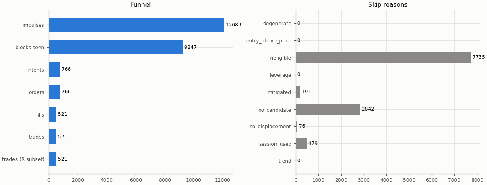

## Headline

Trade statistics use the R subset: trades closed by a stop, target or time exit (`exit_reason != data_end`); trades still open at the end of the data are left out.

| Headline | Value |
|---|---|
| trades (R subset) | 521 |
| win rate | 33.6% |
| mean gross R | 0.008 |
| mean net R | -0.114 |
| mean net R, 95% CI (trade bootstrap) | -0.237 to 0.015 |
| mean net R, 95% CI (day-block bootstrap) | -0.239 to 0.019 |
| median net R | -1.100 |
| std of net R | 1.473 |
| profit factor | 0.85 |
| mean cost (R) | 0.122 |
| mean funding (R) | 0.001 |
| mean hold (minutes) | 132.3 |
| Sharpe (annualised, daily) | -0.78 |
| Sharpe, 95% CI (10-day block bootstrap) | -1.69 to 0.07 |
| max drawdown | 54.9% |
| total return | -47.8% |
| exposure (share of candles in a trade) | 2.8% |
| mean notional / equity at the daily marks | 0.023 |
| max concurrent positions | 1 |

## Baselines

| Baseline | Observed mean net R | Runs: mean | Runs: std | p (one-sided) | z | p (Holm) | Runs |
|---|---|---|---|---|---|---|---|
| A: random entry time in the strategy's own sessions | -0.114 | -0.065 | 0.057 | 0.805 | -0.86 | 1 | 5000 |
| B: random sessions and entry times | -0.114 | -0.151 | 0.063 | 0.272 | 0.58 | 1 | 5000 |

| Table A | Value |
|---|---|
| trades covered | 521 |
| trades left out | 0 |
| baseline B: mean trades per run | 521.0 |

Holm adjustment over the in-sample family of 9 primary cells (tested: A 9, B 9, buy-and-hold 9) at α = 0.05.

Baseline design (judgment calls, overview risk 13): a baseline trade enters at the open of a uniformly drawn in-session candle with the maker fee, keeps the real trade's stop distance in ATR and the variant's target and hold rule, and pays actual funding; baseline trades that reach the data end are left out of their run's mean.

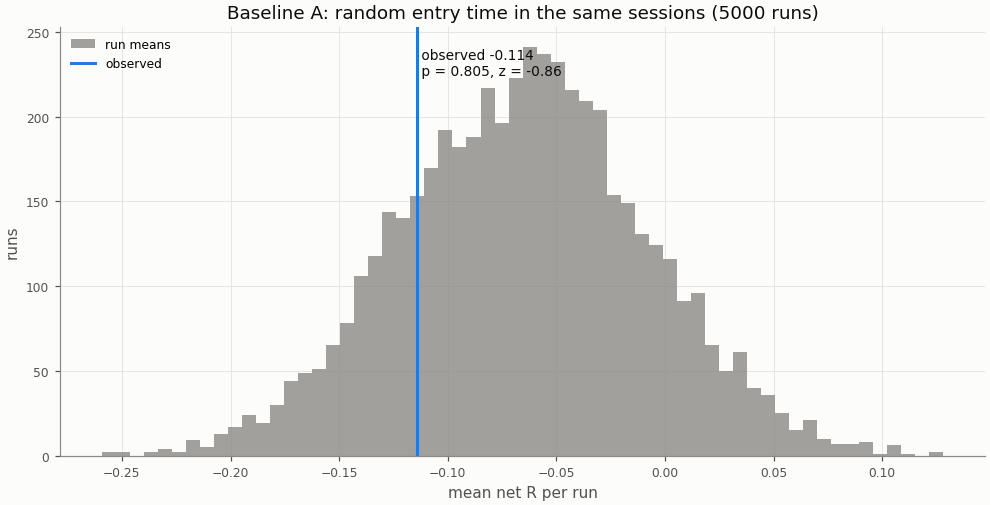

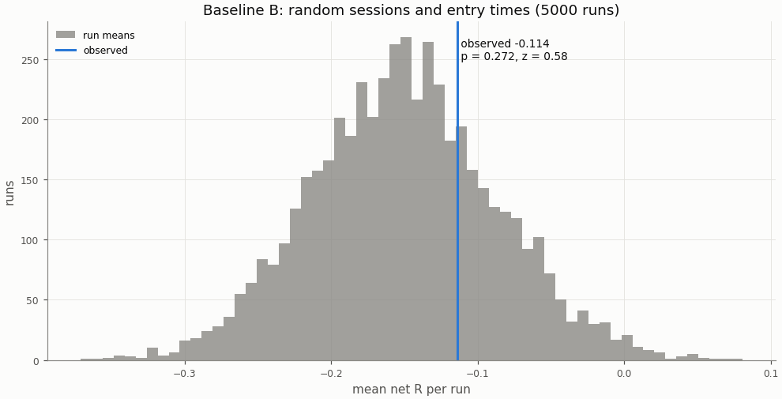

## Buy-and-hold

A constant 1× long in the perpetual with funding, scaled to the strategy's in-sample daily volatility; Sharpe is scale-invariant, the scaling matters for return and drawdown.

| Buy-and-hold | Value |
|---|---|
| days | 1935 |
| buy-and-hold Sharpe | 1.16 |
| buy-and-hold Sharpe, 95% CI | 0.34 to 2.00 |
| strategy Sharpe | -0.78 |
| Sharpe difference (strategy − buy-and-hold) | -1.94 |
| Sharpe difference, 95% CI (paired block bootstrap) | -3.13 to -0.83 |
| p_BH (one-sided) | 1 |
| p_BH (Holm) | 1 |
| buy-and-hold total return (1×) | 3693.0% |
| vol scale (σ strategy / σ buy-and-hold) | 0.120 |
| σ strategy (daily, in-sample) | 0.00755 |
| σ buy-and-hold (daily, in-sample) | 0.06286 |
| vol-scaled buy-and-hold total return | 129.7% |
| vol-scaled buy-and-hold max drawdown | 24.6% |

The figures continue into the holdout run (shaded), chained onto the in-sample end.

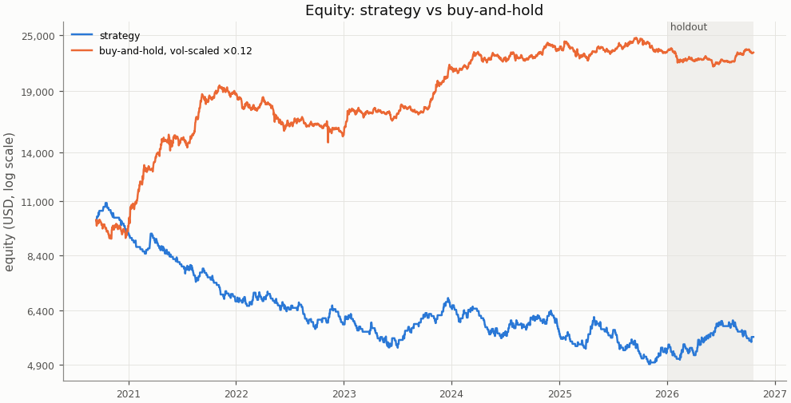

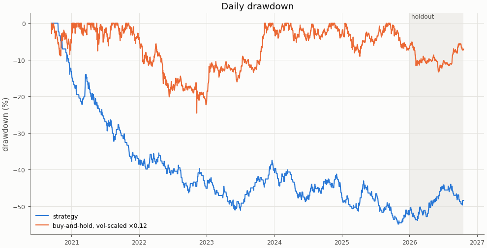

## Costs

Cost in R is fees, slippage and funding divided by the stop distance; a trade whose cost exceeds 1 R loses even when it reaches a 1 R target.

| Cost | Value |
|---|---|
| share of trades with cost above 1 R | 0.0% |

| Cost distribution | min | p05 | p25 | p50 | p75 | p95 | max | mean |
|---|---|---|---|---|---|---|---|---|
| cost per trade (R) | -0.675 | 0.028 | 0.055 | 0.103 | 0.171 | 0.293 | 0.493 | 0.122 |
| stop distance (% of entry) | 0.243 | 0.393 | 0.612 | 0.870 | 1.204 | 2.291 | 8.185 | 1.040 |
| stop distance (ATR14) | 0.447 | 0.579 | 0.794 | 1.020 | 1.257 | 1.748 | 4.097 | 1.068 |
| implied leverage (×) | 0.12 | 0.44 | 0.83 | 1.15 | 1.63 | 2.54 | 4.11 | 1.29 |
| funding (R) | -0.6828 | -0.0028 | 0.0000 | 0.0000 | 0.0000 | 0.0133 | 0.2891 | 0.0007 |

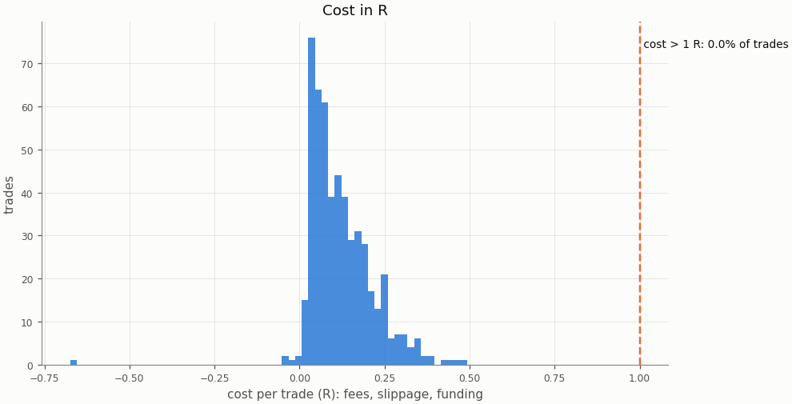

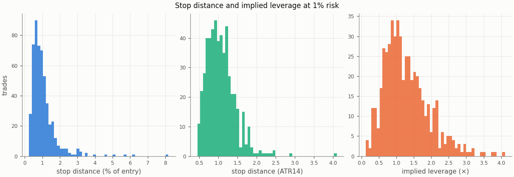

### Re-pricing (D13)

The same trades and baseline runs re-priced at other costs, without re-simulation; descriptive only, the verdict uses the registered costs.

| Slippage | Maker fee | Taker fee | n | Mean net R | 95% CI | Win rate | p_A | p_B | Costs |
|---|---|---|---|---|---|---|---|---|---|
| 0.00% | 0.00% | 0.05% | 521 | -0.036 | -0.157 to 0.091 | 33.6% | 0.802 | 0.273 |  |
| 0.00% | 0.02% | 0.05% | 521 | -0.071 | -0.191 to 0.056 | 33.6% | 0.801 | 0.268 |  |
| 0.02% | 0.00% | 0.05% | 521 | -0.054 | -0.176 to 0.075 | 33.6% | 0.803 | 0.273 |  |
| 0.02% | 0.02% | 0.05% | 521 | -0.088 | -0.209 to 0.039 | 33.6% | 0.803 | 0.27 |  |
| 0.05% | 0.00% | 0.05% | 521 | -0.080 | -0.203 to 0.050 | 33.6% | 0.804 | 0.275 |  |
| 0.05% | 0.02% | 0.05% | 521 | -0.114 | -0.237 to 0.015 | 33.6% | 0.805 | 0.272 | registered |
| 0.10% | 0.00% | 0.05% | 521 | -0.123 | -0.249 to 0.010 | 33.6% | 0.808 | 0.277 |  |
| 0.10% | 0.02% | 0.05% | 521 | -0.157 | -0.283 to -0.025 | 33.6% | 0.808 | 0.275 |  |

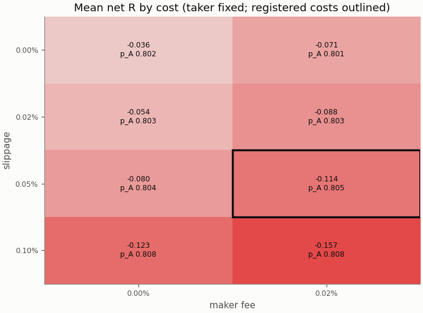

## Robustness

### Heatmap 1: r_target × entry_level

8 of 8 cells have run; the primary is outlined.

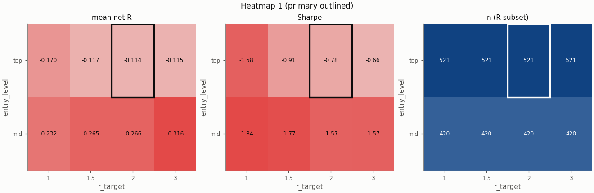

### Heatmap 2: swing_k × confirm_n

9 of 9 cells have run; the primary is outlined.

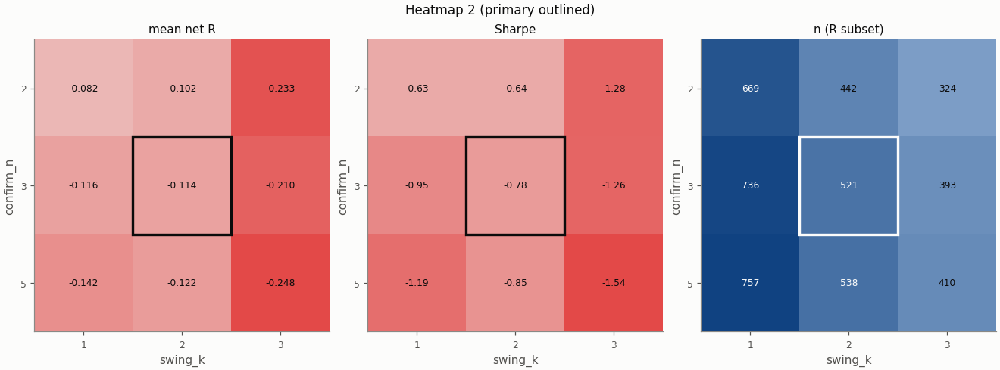

### Heatmap 3: stop_buffer × hold_rule

16 of 16 cells have run; the primary is outlined.

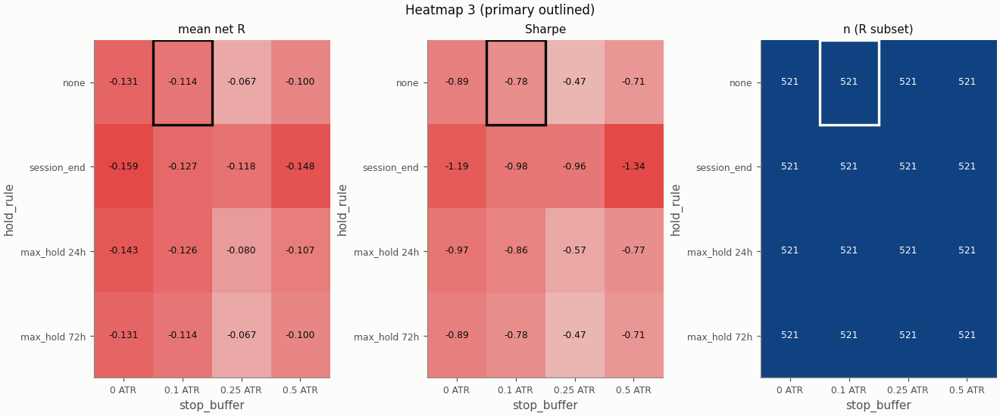

Grid variants of this pair × session:

- heatmap_3: hold_rule=session_end, stop_buffer=0 ATR ([report](../0688369dd813d97717f299d1741b406469686e6993399ea8cb13a168338f18cf/report.md))
- heatmap_3: hold_rule=max_hold 72h ([report](../0c98f5882cb2f1a9dc33722ed5555a7d2c9ac30820d6de3ba1ff1a179212e486/report.md))
- heatmap_3: hold_rule=max_hold 72h, stop_buffer=0 ATR ([report](../10685a881dcbfa6798fd7b12139c482c0e0bd1a2040a30cfe6019ef38dad9bdf/report.md))
- heatmap_2: confirm_n=5, swing_k=1 ([report](../1871901c8bdf38d37f8d84359391c201c6d94a12339cdf4844fd00f910f4d54f/report.md))
- heatmap_3: hold_rule=max_hold 72h, stop_buffer=0.25 ATR ([report](../1f17c1aa5ad2c9043ebd93f62d330cdeddbe5f60d5ae878f9d5ff679a6e68d3a/report.md))
- heatmap_2: swing_k=1 ([report](../1fdf052a2d6d82a9c33854bc524f625c260ed1e1952f525af246f571752c05d3/report.md))
- heatmap_3: hold_rule=max_hold 24h, stop_buffer=0.25 ATR ([report](../2984ad6258f33aa118d392aafd4e5f2095ab1c9345f682cf05f974401a9db7b0/report.md))
- heatmap_2: confirm_n=2, swing_k=3 ([report](../3ddc3f472878b73acdbac9a5760d55c6dfaedd96134c825ca4eb1ab9619c890d/report.md))
- heatmap_1: r_target=1.5 ([report](../43a529558317805e2950341d9a150744c3cfd683a7f6b708da24fe568c25dd27/report.md))
- heatmap_3: hold_rule=session_end, stop_buffer=0.5 ATR ([report](../4ab65bfa213fff5de0f91c746a9c2f0237b757cfc02d5395f4c809f274d9b3ea/report.md))
- heatmap_3: hold_rule=session_end ([report](../5b3a82e991140b56eb727c6e1b57428c29465fbee9f102d1cffe16310791213e/report.md))
- heatmap_3: hold_rule=max_hold 24h, stop_buffer=0 ATR ([report](../6188439cd227fa9754743560b0440dabf33d9520e28e3fcdf49f05fa0ec33669/report.md))
- heatmap_1: entry_level=mid ([report](../691e8df4b4a6fbbfaecee31bf54399831054ea8ca218f52566501bd7ddb2f6cc/report.md))
- single_2: pierce=0.0005 ([report](../6a4a36f411aa9b6dd1675b9a13603a444206cd39499940fe4d38f1a4672effe1/report.md))
- single_1: zone=body ([report](../7eda1c167715ddaed48f1ffabc97880ba863b70e8f1324b98ca62786cefdecf3/report.md))
- heatmap_2: confirm_n=2 ([report](../8fd788aa69b6acc40b2c87ea75331f2dccefc3a41e11aeceb4f444af30eda721/report.md))
- heatmap_3: hold_rule=max_hold 72h, stop_buffer=0.5 ATR ([report](../9037df47d0ab95b261e7dc281cffde0e9b14d406ebf8fda365151e957b511187/report.md))
- heatmap_2: confirm_n=5, swing_k=3 ([report](../9a499872f15766e90a12d7e52455530ae6af31b5c5eac888fdeb71188954d97a/report.md))
- heatmap_1: entry_level=mid, r_target=1.5 ([report](../9ed074aafa842ba6a9dc15835711489c0c76106ceb13dcef2a1adbf49494bb4e/report.md))
- heatmap_1: entry_level=mid, r_target=3 ([report](../a79ce8018290ce3422ca7965f1fee7e402bd62ce59179b37de1d3fcf8c0f6130/report.md))
- heatmap_3: stop_buffer=0.25 ATR ([report](../b6e37271f32a458fc6e512d977047ff7d705feebed528ba0ee73954b1f692116/report.md))
- heatmap_3: hold_rule=max_hold 24h ([report](../b8f348c3c68c0f2a13444563fdc0bd9d06a16b16c7b8a64ef715e1cf6929022b/report.md))
- heatmap_1: r_target=1 ([report](../c1ad55b457e9da0a65481e6bb3ed91149d4a971da401e34085fae310c90e62f2/report.md))
- heatmap_2: confirm_n=5 ([report](../c2b2b4764f88e9acfb90b1e52552e59add1e7f6e074876ceff30e84aa5d4dcdd/report.md))
- heatmap_3: stop_buffer=0.5 ATR ([report](../d2222f4b12a82157c487feec3876a83006ab9c1f1428e635a244cb43329b01b1/report.md))
- heatmap_3: hold_rule=session_end, stop_buffer=0.25 ATR ([report](../d7ceedcd4707202bce78440c618554fe59bca6c3357605d5aceb15a33fe0ff6e/report.md))
- single_5: stop_buffer=0.25% ([report](../d86993281f2027cbc3322b83257d1d53a80a2357597495234acabfb2023daf00/report.md))
- heatmap_1: r_target=3 ([report](../ecda43dba0d72ef3d4fbd93f0e35ad58d25642356e1db7fa5023dc2beabfb78a/report.md))
- heatmap_2: swing_k=3 ([report](../ef39dac04f7743b570e07cc724bf888d80dfe0a0e4d51d262276a72735124c83/report.md))
- heatmap_3: hold_rule=max_hold 24h, stop_buffer=0.5 ATR ([report](../f3ab0aa3a3d305850e3c7a3828c3cd5b2bc063698207e54539768ac675edf46e/report.md))
- single_4: stop_buffer=0.1% ([report](../f98fb7f98eb78b631355fccc81428341743b6c12f6db44e347dd17e073f8be80/report.md))
- heatmap_3: stop_buffer=0 ATR ([report](../fad60e035a25b40bea22b3469f9ca89de7e2454964ac3685c808a1837bbc7f8f/report.md))
- heatmap_1: entry_level=mid, r_target=1 ([report](../fb0e6b2a818a720f4e8427108d9af8d8e8266dbcbc1072b8ad854a6f89c5528f/report.md))
- single_3: trend_filter=on ([report](../fba03d23a4c11660e1d0ca5bec0dbf85b4115b6dc03009d1cd39828cd6c83eea/report.md))
- heatmap_2: confirm_n=2, swing_k=1 ([report](../fec3f860be5da01cb3bcd77c1a7d7e384d6fa1a1a13faee83b8b61c5fb097831/report.md))

## Alpha decay

Per calendar year (max drawdown starts from the previous year-end equity; fill rate is filled / placed entry orders by placement year).

| Year | n | Win rate | Mean net R | Sharpe | Max DD | Fill rate |
|---|---|---|---|---|---|---|
| 2020 | 26 | 30.8% | -0.201 | -1.31 | 14.0% | 57.8% |
| 2021 | 101 | 25.7% | -0.332 | -2.45 | 29.2% | 66.4% |
| 2022 | 94 | 33.0% | -0.110 | -0.75 | 16.9% | 72.3% |
| 2023 | 84 | 41.7% | 0.115 | 0.67 | 15.4% | 59.2% |
| 2024 | 116 | 34.5% | -0.094 | -0.71 | 15.0% | 77.9% |
| 2025 | 100 | 35.0% | -0.090 | -0.61 | 20.8% | 67.6% |

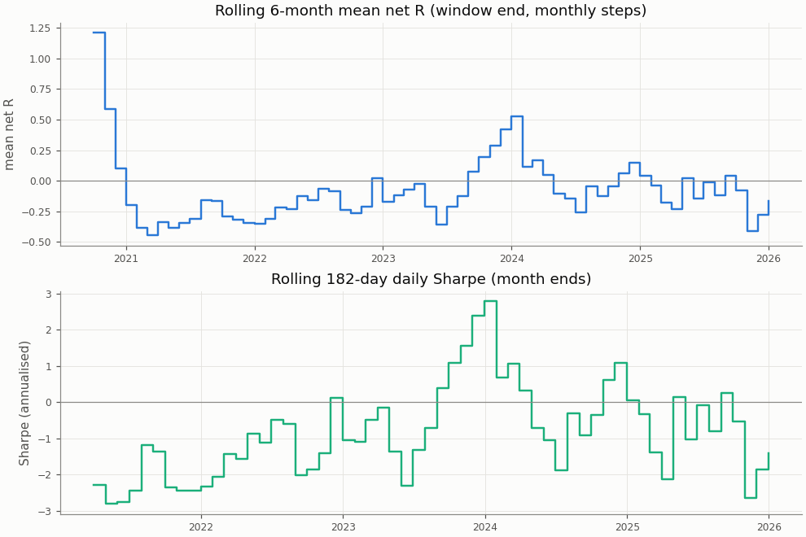

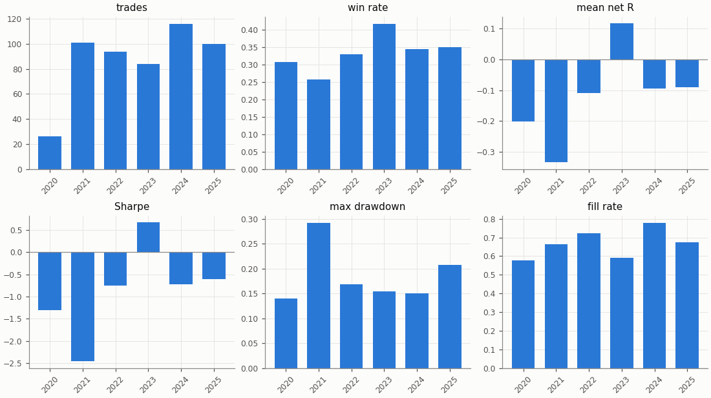

## Regimes and calendar

Trend: daily ADX(14) above 25 as of the day before entry. Volatility: 30-day realised vol of daily log returns as of the day before entry, above (`high`) or below (`low`) the in-sample median 0.04944; trades before the indicators are defined are unlabelled.

| Regime | n | Win rate | Mean net R |
|---|---|---|---|
| trend: no_trend | 237 | 32.9% | -0.145 |
| trend: trend | 279 | 33.3% | -0.114 |
| trend: unlabelled | 5 | 80.0% | 1.363 |
| vol: high | 268 | 31.0% | -0.175 |
| vol: low | 248 | 35.5% | -0.078 |
| vol: unlabelled | 5 | 80.0% | 1.363 |

| Day of week (UTC) | n | Win rate | Mean net R |
|---|---|---|---|
| Monday | 101 | 28.7% | -0.276 |
| Tuesday | 100 | 33.0% | -0.136 |
| Wednesday | 124 | 40.3% | 0.097 |
| Thursday | 101 | 29.7% | -0.224 |
| Friday | 95 | 34.7% | -0.079 |

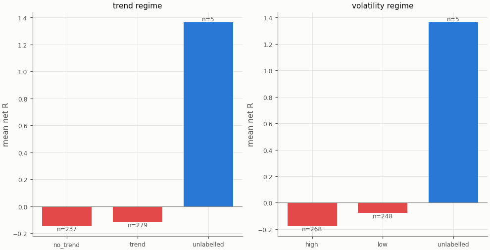

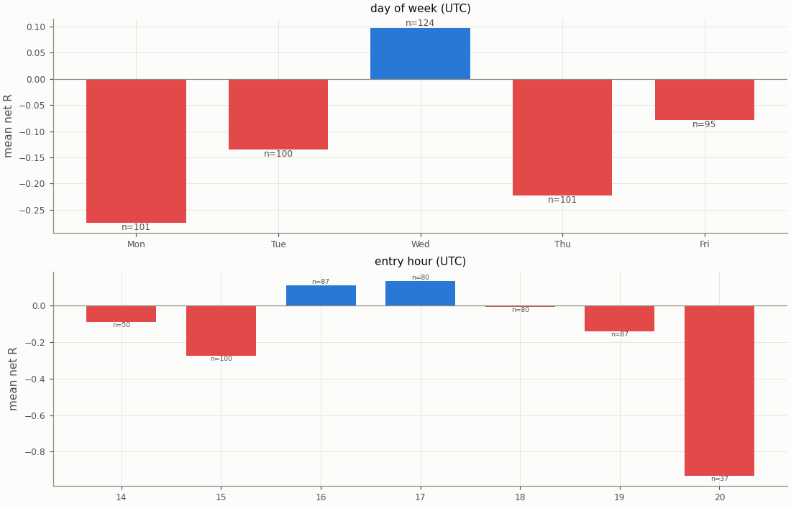

## Diagnostics

| Count | Value |
|---|---|
| trades open at the data end (left out of the R subset) | 0 |
| ambiguous candles resolved without full 1m data | 0 |
| max concurrent positions | 1 |
| funding paid in total (USD) | 45.21 |

| Fill resolution | Fills |
|---|---|
| 15m_unambiguous | 912 |
| 1m | 111 |
| 1m_pessimistic | 17 |
| open_gap | 2 |

| Exit reason | n | Win rate | Mean net R |
|---|---|---|---|
| stop | 346 | 0.0% | -1.159 |
| target | 175 | 100.0% | 1.953 |

| Trade distribution | min | p05 | p25 | p50 | p75 | p95 | max | mean |
|---|---|---|---|---|---|---|---|---|
| hold (minutes) | 0.0 | 2.0 | 15.0 | 45.0 | 135.0 | 540.0 | 2625.0 | 132.3 |
| MAE (R) | -6.479 | -2.087 | -1.404 | -1.102 | -0.702 | -0.098 | 0.000 | -1.111 |
| MFE (R) | 0.048 | 0.243 | 0.738 | 1.265 | 2.137 | 2.872 | 10.687 | 1.462 |

Share of this variant's trades whose candidate candle is also traded by the other session variants (computed at report time from their trade tables): London 8.6%, UTC 15.9%; any of them 20.5%. The session variants are not independent tests.

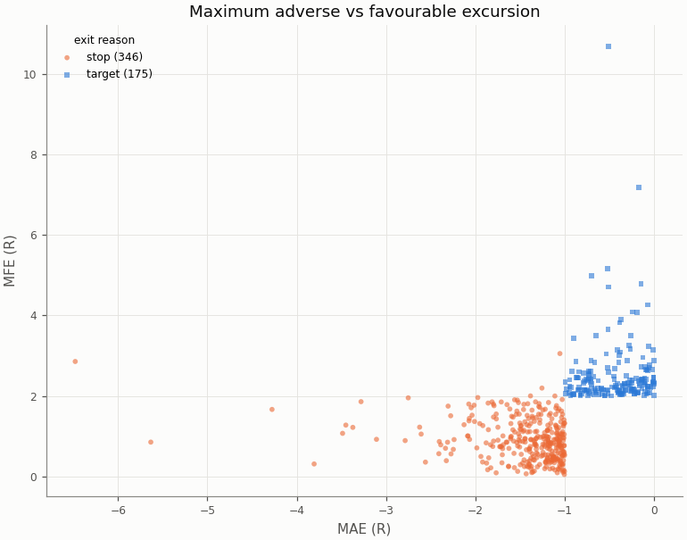

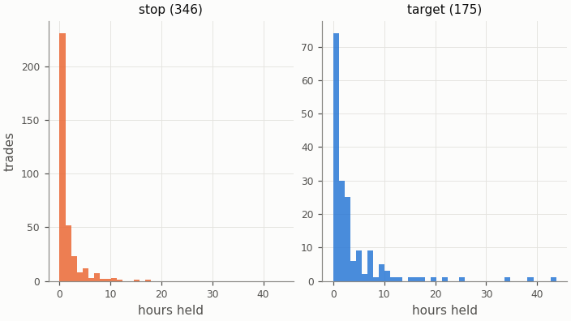

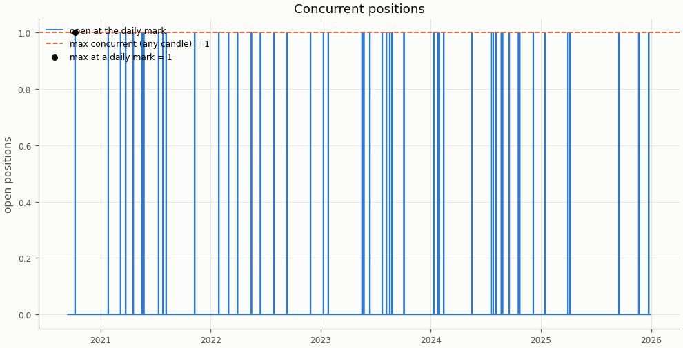

## Deflated Sharpe ratio

| Daily returns | Value |
|---|---|
| daily Sharpe (not annualised) | -0.0408 |
| days T | 1935 |
| skew | 0.878 |
| kurtosis (non-excess) | 5.268 |

| Trials | N | V (variance of daily Sharpe) | SR* | DSR |
|---|---|---|---|---|
| this pair × session's grid | 36 | 0.000398 | 0.0428 | 0.000 |
| all grid variants | 324 | 0.003906 | 0.1825 | 0.000 |

Caveat: the grid cells share most of their trades, so the effective number of independent trials is far below N and the DSR is conservative.

## Notes

- `15m_pessimistic_missing_1m`: 0 fills and 0 ambiguous (candle, order) pairs were resolved by the pessimistic 15m rule because 1m data was incomplete.
- Data gaps overlapping a trade (computed at report time from the candle manifests): 15m: 0 trades over 0 gaps; 1m: 0 trades over 0 gaps.
