# BTCUSDT / UTC, in-sample primary

- Pair: BTCUSDT
- Session: UTC (00:00–24:00 UTC, weekdays [0, 1, 2, 3, 4, 5, 6], Mon = 0)
- Period: 2020-01-01 to 2025-12-31 (in-sample)
- Variant id: `a69c0fe9357ca321a26cf98c8f9f87ff455f8dcbaac887d4dd2561c3e1d5442d`
- Code version: `c3c05e53c0f38a9e57d65b716a78ddfb198004a84dd66fde28cf145808135dc5`
- Seed: 20260926 (generators per purpose: trade_bootstrap, day_bootstrap, sharpe_bootstrap, bh_sharpe_bootstrap, bh_diff_bootstrap, baseline_a, baseline_b)
- Role: primary; member of heatmap_1, heatmap_2, heatmap_3
- Costs: maker 0.02%, taker 0.05%, slippage 0.02%; risk 1.0% per trade; 1m resolution on

## Funnel

Every impulse that did not become a trade is counted by the first reason that stopped it (spec overview §6). Orders exclude intents skipped by the leverage cap.

| Stage | Count |
|---|---|
| impulses | 13524 |
| blocks seen | 10665 |
| skipped: no_candidate | 2859 |
| skipped: ineligible | 355 |
| skipped: degenerate | 0 |
| skipped: no_displacement | 435 |
| skipped: mitigated | 1288 |
| skipped: entry_above_price | 0 |
| skipped: trend | 0 |
| skipped: session_used | 6442 |
| intents | 2145 |
| skipped: leverage cap | 12 |
| orders placed | 2133 |
| orders filled | 1848 |
| fill rate | 86.6% |
| trades | 1848 |
| trades in the R subset | 1848 |
| trades open at the data end | 0 |

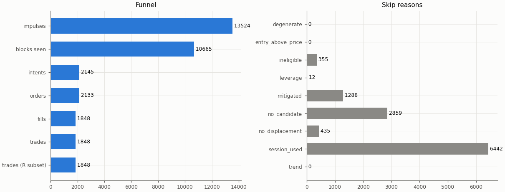

## Headline

Trade statistics use the R subset: trades closed by a stop, target or time exit (`exit_reason != data_end`); trades still open at the end of the data are left out.

| Headline | Value |
|---|---|
| trades (R subset) | 1848 |
| win rate | 32.9% |
| mean gross R | -0.013 |
| mean net R | -0.341 |
| mean net R, 95% CI (trade bootstrap) | -0.410 to -0.272 |
| mean net R, 95% CI (day-block bootstrap) | -0.410 to -0.270 |
| median net R | -1.207 |
| std of net R | 1.535 |
| profit factor | 0.64 |
| mean cost (R) | 0.328 |
| mean funding (R) | 0.005 |
| mean hold (minutes) | 91.7 |
| Sharpe (annualised, daily) | -3.87 |
| Sharpe, 95% CI (10-day block bootstrap) | -4.76 to -3.06 |
| max drawdown | 99.9% |
| total return | -99.9% |
| exposure (share of candles in a trade) | 6.2% |
| mean notional / equity at the daily marks | 0.026 |
| max concurrent positions | 2 |

## Baselines

| Baseline | Observed mean net R | Runs: mean | Runs: std | p (one-sided) | z | p (Holm) | Runs |
|---|---|---|---|---|---|---|---|
| A: random entry time in the strategy's own sessions | -0.341 | -0.341 | 0.033 | 0.507 | -0.01 | 1 | 5000 |
| B: random sessions and entry times | -0.341 | -0.312 | 0.036 | 0.792 | -0.81 | 1 | 5000 |

| Table A | Value |
|---|---|
| trades covered | 1848 |
| trades left out | 0 |
| baseline B: mean trades per run | 1847.9 |

Holm adjustment over the in-sample family of 9 primary cells (tested: A 9, B 9, buy-and-hold 9) at α = 0.05.

Baseline design (judgment calls, overview risk 13): a baseline trade enters at the open of a uniformly drawn in-session candle with the maker fee, keeps the real trade's stop distance in ATR and the variant's target and hold rule, and pays actual funding; baseline trades that reach the data end are left out of their run's mean.

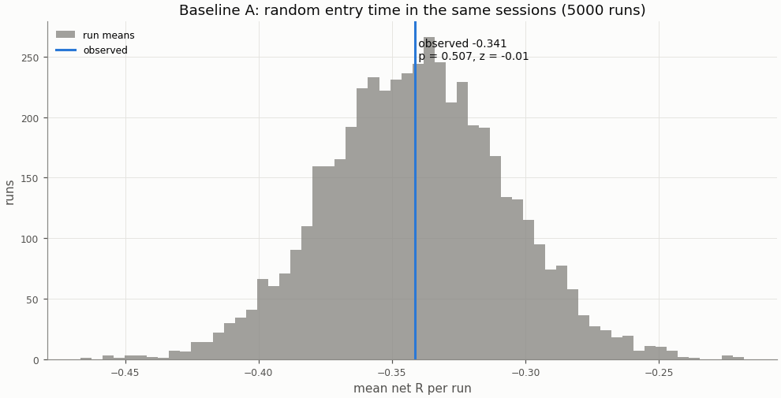

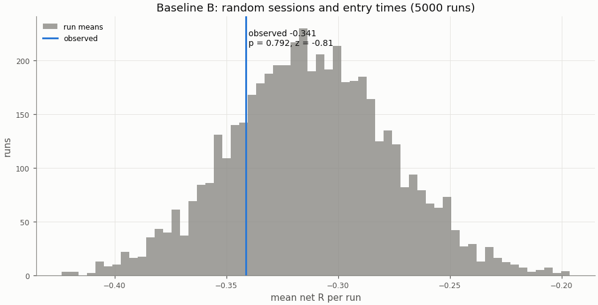

## Buy-and-hold

A constant 1× long in the perpetual with funding, scaled to the strategy's in-sample daily volatility; Sharpe is scale-invariant, the scaling matters for return and drawdown.

| Buy-and-hold | Value |
|---|---|
| days | 2192 |
| buy-and-hold Sharpe | 0.78 |
| buy-and-hold Sharpe, 95% CI | 0.01 to 1.58 |
| strategy Sharpe | -3.87 |
| Sharpe difference (strategy − buy-and-hold) | -4.65 |
| Sharpe difference, 95% CI (paired block bootstrap) | -5.79 to -3.59 |
| p_BH (one-sided) | 1 |
| p_BH (Holm) | 1 |
| buy-and-hold total return (1×) | 464.1% |
| vol scale (σ strategy / σ buy-and-hold) | 0.437 |
| σ strategy (daily, in-sample) | 0.01420 |
| σ buy-and-hold (daily, in-sample) | 0.03246 |
| vol-scaled buy-and-hold total return | 186.0% |
| vol-scaled buy-and-hold max drawdown | 45.4% |

The figures continue into the holdout run (shaded), chained onto the in-sample end.

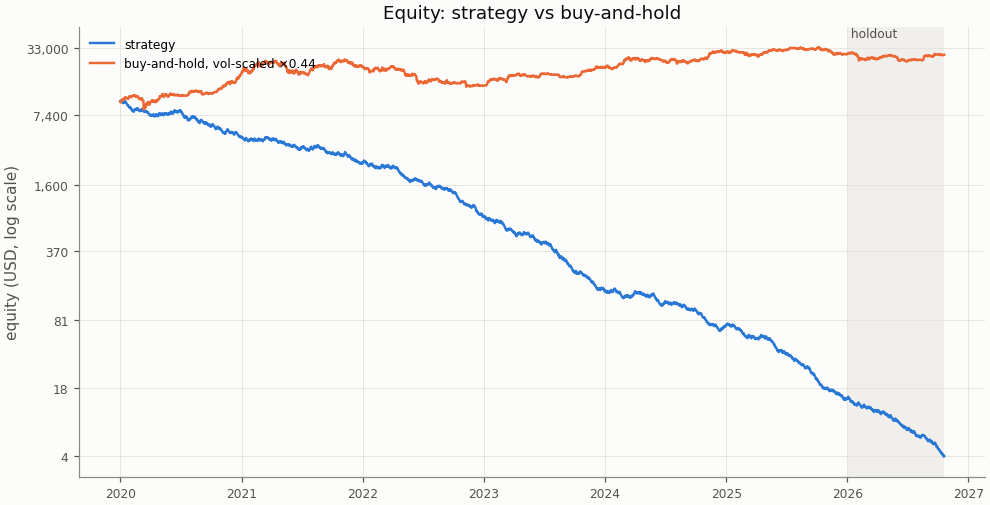

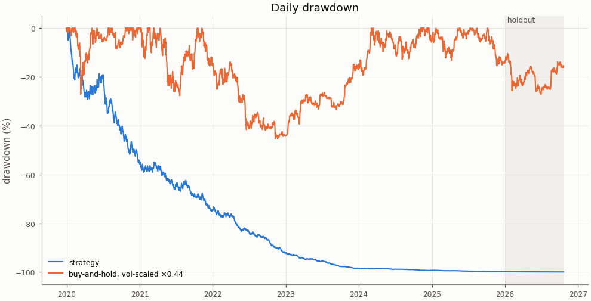

## Costs

Cost in R is fees, slippage and funding divided by the stop distance; a trade whose cost exceeds 1 R loses even when it reaches a 1 R target.

| Cost | Value |
|---|---|
| share of trades with cost above 1 R | 3.0% |

| Cost distribution | min | p05 | p25 | p50 | p75 | p95 | max | mean |
|---|---|---|---|---|---|---|---|---|
| cost per trade (R) | 0.010 | 0.070 | 0.149 | 0.254 | 0.416 | 0.811 | 2.234 | 0.328 |
| stop distance (% of entry) | 0.040 | 0.099 | 0.178 | 0.283 | 0.437 | 0.864 | 4.018 | 0.361 |
| stop distance (ATR14) | 0.179 | 0.493 | 0.684 | 0.848 | 1.066 | 1.627 | 5.124 | 0.920 |
| implied leverage (×) | 0.25 | 1.16 | 2.29 | 3.54 | 5.62 | 10.13 | 24.83 | 4.38 |
| funding (R) | -0.0612 | 0.0000 | 0.0000 | 0.0000 | 0.0000 | 0.0324 | 0.3029 | 0.0052 |

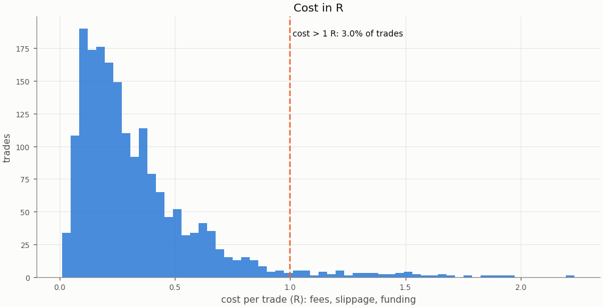

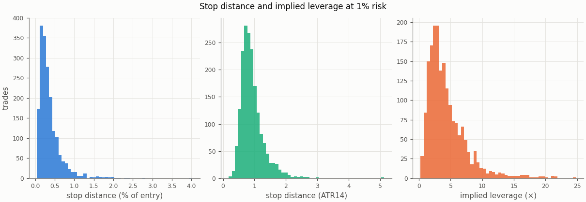

### Re-pricing (D13)

The same trades and baseline runs re-priced at other costs, without re-simulation; descriptive only, the verdict uses the registered costs.

| Slippage | Maker fee | Taker fee | n | Mean net R | 95% CI | Win rate | p_A | p_B | Costs |
|---|---|---|---|---|---|---|---|---|---|
| 0.00% | 0.00% | 0.05% | 1848 | -0.166 | -0.235 to -0.098 | 32.9% | 0.362 | 0.693 |  |
| 0.00% | 0.02% | 0.05% | 1848 | -0.282 | -0.349 to -0.215 | 32.9% | 0.451 | 0.762 |  |
| 0.02% | 0.00% | 0.05% | 1848 | -0.225 | -0.295 to -0.155 | 32.9% | 0.416 | 0.731 |  |
| 0.02% | 0.02% | 0.05% | 1848 | -0.341 | -0.410 to -0.272 | 32.9% | 0.507 | 0.792 | registered |
| 0.05% | 0.00% | 0.05% | 1848 | -0.314 | -0.388 to -0.240 | 32.9% | 0.497 | 0.78 |  |
| 0.05% | 0.02% | 0.05% | 1848 | -0.430 | -0.503 to -0.358 | 32.9% | 0.583 | 0.83 |  |
| 0.10% | 0.00% | 0.05% | 1848 | -0.462 | -0.541 to -0.382 | 32.9% | 0.612 | 0.838 |  |
| 0.10% | 0.02% | 0.05% | 1848 | -0.578 | -0.657 to -0.500 | 32.9% | 0.687 | 0.875 |  |

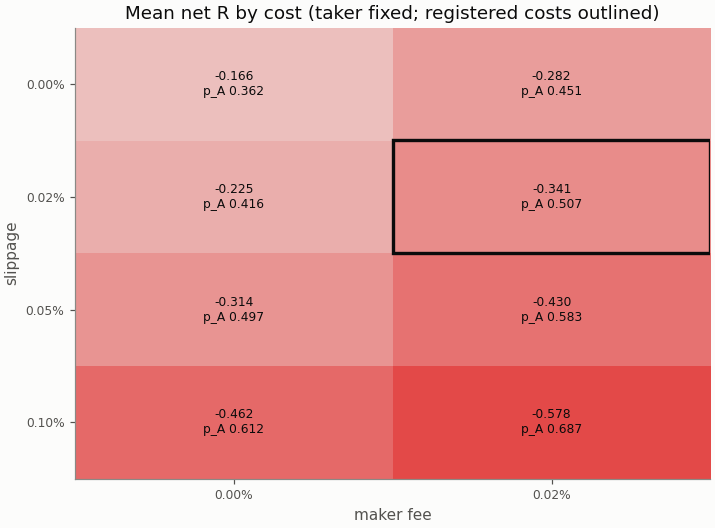

## Robustness

### Heatmap 1: r_target × entry_level

8 of 8 cells have run; the primary is outlined.

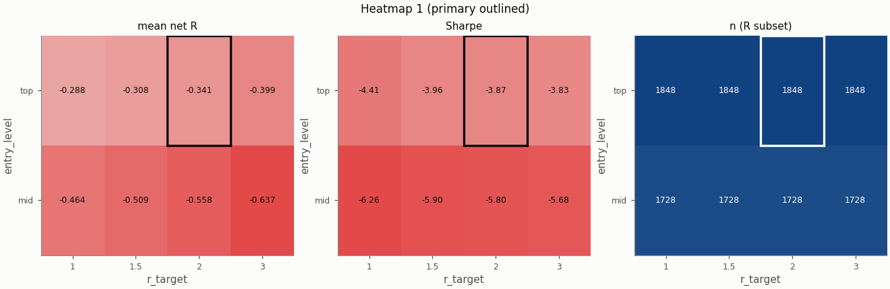

### Heatmap 2: swing_k × confirm_n

9 of 9 cells have run; the primary is outlined.

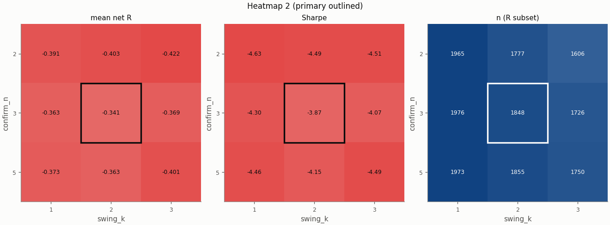

### Heatmap 3: stop_buffer × hold_rule

16 of 16 cells have run; the primary is outlined.

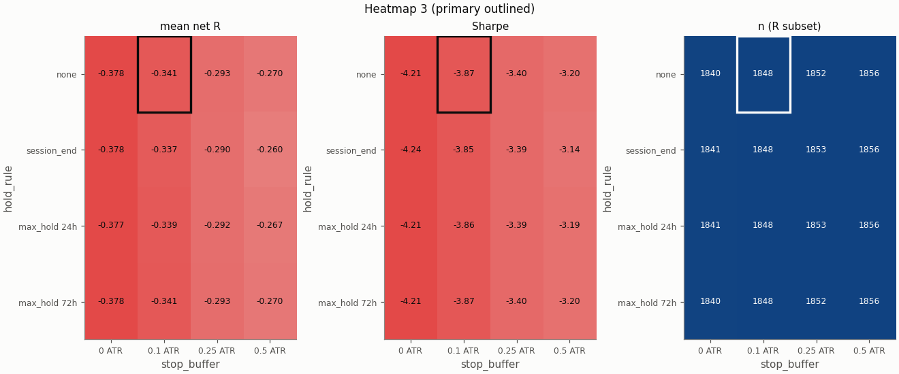

Grid variants of this pair × session:

- heatmap_3: hold_rule=max_hold 72h, stop_buffer=0.25 ATR ([report](../00568725eba2df7205c563259c9967c4d8fcdbef349d4a42bd2a2ee9d1286549/report.md))
- heatmap_2: confirm_n=2 ([report](../103208ed260f176a7c101e0ab2e87c4fff744554bf2e785cf8da400504abf165/report.md))
- heatmap_3: hold_rule=session_end ([report](../1794eec0b1c2810c5dec54c3723623f06c6d6e80ebe4c12bd7aea0caa0438e4b/report.md))
- single_3: trend_filter=on ([report](../17966ae3581228b518310541ec3bcad5b41e0946e7d517cdbf981d437f36822a/report.md))
- heatmap_1: entry_level=mid ([report](../1f3f4e7034430427682a7de08088e23c210a5b137e342964bbc01bf1d0b6d222/report.md))
- single_2: pierce=0.0005 ([report](../210ba1ff135d2513fa7ede1d13cf6e798f77c393b34b18f62e4b385b0b90f1c8/report.md))
- single_4: stop_buffer=0.1% ([report](../21c0d578aeb7e18ed1a2836e760037e84fb745311df6ebc8165cc6edfa513fe2/report.md))
- heatmap_1: r_target=1.5 ([report](../23a6d4aecf9964ad8f72d2c6245ac2cca20ba961c8110087eafb9239f29c40db/report.md))
- heatmap_2: confirm_n=5, swing_k=1 ([report](../24b7fdef381eee615214398b24186f8a1ff50bc4352178d3eb2c888e41ad1cb5/report.md))
- heatmap_2: confirm_n=2, swing_k=1 ([report](../2ad56e02b2c1954fcdde5dc65df53b28f0de7418ce23c4caf73241e40bda9cfe/report.md))
- heatmap_3: stop_buffer=0 ATR ([report](../37f317e48998128986bb0d7e5e5fcc5cd40e44f441c7d4d731f8a5c351405b0c/report.md))
- heatmap_3: hold_rule=max_hold 72h, stop_buffer=0.5 ATR ([report](../4080dc3096415fe81eaa6205db869b74fb260448c872286906f9a121e7c2edb4/report.md))
- heatmap_2: confirm_n=2, swing_k=3 ([report](../427ec2bc264632bc417ffce16fb83d3baf527ffb31868b00ddefa680a928bf86/report.md))
- heatmap_1: entry_level=mid, r_target=1 ([report](../430daef906435b604c7b15b18775a5b616d4b7dbf99e801d7b79d19e7b2ffdf8/report.md))
- heatmap_2: swing_k=1 ([report](../4c07ec4679583d05c97d71588011dc28292a39da0500e32417c18fa2df77f867/report.md))
- heatmap_1: entry_level=mid, r_target=1.5 ([report](../523a3f147d802d67afac6f32e826494bc04e5ba4426aee515ad43f38b8e592fe/report.md))
- heatmap_3: stop_buffer=0.5 ATR ([report](../5ab055030d3b898df2d184f103b542c6906253ce5de3792e5abcbfd4bc994176/report.md))
- heatmap_2: confirm_n=5, swing_k=3 ([report](../6158908673c3077e7944ea009f773d12bbf1fee22d74291de22e8678f0e40c86/report.md))
- heatmap_3: hold_rule=max_hold 72h, stop_buffer=0 ATR ([report](../6a97c01d234d0f86df9e81c68d036353660d1d21ed2a803e34316ab436086ece/report.md))
- heatmap_2: confirm_n=5 ([report](../705cf2993690af431e0a10b5cc048aba4ec11bedd8c98cd015c40f6245df8928/report.md))
- heatmap_2: swing_k=3 ([report](../80d05f069cceaeee0a60cef5af80ac3300b2a282ec2eec48001c3d18c5e2e02e/report.md))
- single_5: stop_buffer=0.25% ([report](../8526302f88e418bcb8a9e5a11d281a78559da5e501f74384bd169d3628c89ceb/report.md))
- heatmap_1: r_target=1 ([report](../8a3beb2ab7fd3e86807c8633b3f0a6074cb9891a00f290a85df762c0e58756c9/report.md))
- heatmap_3: hold_rule=session_end, stop_buffer=0.5 ATR ([report](../8bc0d4b508547606c4a53e3871fb154d0c09d8793cb6c44e81933cf9943fdbd4/report.md))
- heatmap_3: hold_rule=max_hold 24h, stop_buffer=0.5 ATR ([report](../98c758799b8e984f5502d007e20577b3a441668d74a8e67eec666779879a1376/report.md))
- heatmap_1: r_target=3 ([report](../ad12cb71bdfe13495425f19b6c1a100db9531a9abf416d3ad27498d7f3a09799/report.md))
- heatmap_3: hold_rule=session_end, stop_buffer=0 ATR ([report](../b392be09eef57054ec6edbd2ee11c2034817c38af81efdb8e7c859af29f59cb0/report.md))
- heatmap_1: entry_level=mid, r_target=3 ([report](../bab22301e91379718239f555d4da4b23db99d9d5a419f9547bdbacdb412407be/report.md))
- heatmap_3: hold_rule=max_hold 72h ([report](../c2a39a30803e7cd473cd086a07f3f66ef1f59ede70c6b14e8129cbcc73cce3b5/report.md))
- heatmap_3: stop_buffer=0.25 ATR ([report](../c8006d28724abf0152cda1249539459b761c89c40287ca6b2c2e5ac04b361a6c/report.md))
- heatmap_3: hold_rule=max_hold 24h ([report](../cbbc053444b3966e8cb5f8272358e0e4b1408955d5af5818e8d656752ed380a3/report.md))
- heatmap_3: hold_rule=session_end, stop_buffer=0.25 ATR ([report](../d0d3a71e5de4fb12dae4fdc900947adff74a9743ec66827c13c3d884ba736df8/report.md))
- single_1: zone=body ([report](../df5fb09234a16f26594bc52f4d96a763004f9f2a28c6708914c8a00c961f7f7e/report.md))
- heatmap_3: hold_rule=max_hold 24h, stop_buffer=0 ATR ([report](../e8aace833b4666ea153a9bb8ca1d5fb2ec2541a223999795b7cb675d1638b441/report.md))
- heatmap_3: hold_rule=max_hold 24h, stop_buffer=0.25 ATR ([report](../ec1e6b1480be55b7570d8028f3d26a238c663c91a6fd048c0bd726903d116fac/report.md))

## Alpha decay

Per calendar year (max drawdown starts from the previous year-end equity; fill rate is filled / placed entry orders by placement year).

| Year | n | Win rate | Mean net R | Sharpe | Max DD | Fill rate |
|---|---|---|---|---|---|---|
| 2020 | 308 | 35.1% | -0.242 | -2.74 | 55.3% | 85.1% |
| 2021 | 307 | 32.9% | -0.176 | -2.12 | 44.7% | 85.5% |
| 2022 | 307 | 31.3% | -0.366 | -4.17 | 70.9% | 88.0% |
| 2023 | 304 | 31.6% | -0.531 | -5.77 | 80.9% | 86.9% |
| 2024 | 315 | 36.2% | -0.229 | -2.60 | 60.6% | 87.3% |
| 2025 | 307 | 30.3% | -0.509 | -5.76 | 81.3% | 87.2% |

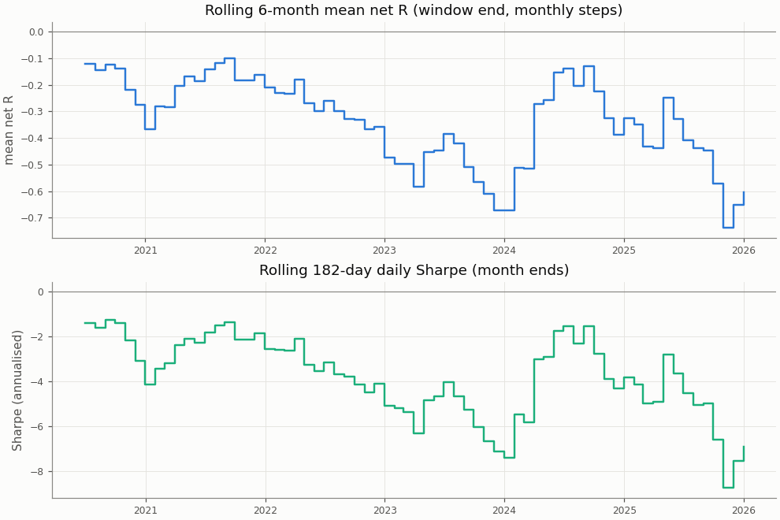

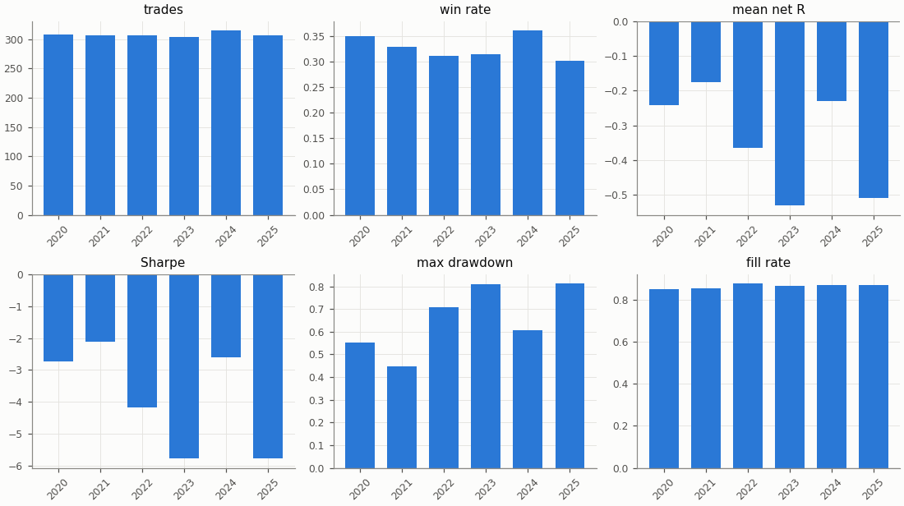

## Regimes and calendar

Trend: daily ADX(14) above 25 as of the day before entry. Volatility: 30-day realised vol of daily log returns as of the day before entry, above (`high`) or below (`low`) the in-sample median 0.02804; trades before the indicators are defined are unlabelled.

| Regime | n | Win rate | Mean net R |
|---|---|---|---|
| trend: no_trend | 821 | 32.8% | -0.393 |
| trend: trend | 1027 | 33.0% | -0.300 |
| vol: high | 945 | 34.9% | -0.185 |
| vol: low | 903 | 30.8% | -0.505 |

| Day of week (UTC) | n | Win rate | Mean net R |
|---|---|---|---|
| Monday | 250 | 34.0% | -0.244 |
| Tuesday | 275 | 32.4% | -0.320 |
| Wednesday | 262 | 32.4% | -0.320 |
| Thursday | 273 | 28.9% | -0.461 |
| Friday | 254 | 30.3% | -0.384 |
| Saturday | 274 | 38.7% | -0.239 |
| Sunday | 260 | 33.5% | -0.420 |

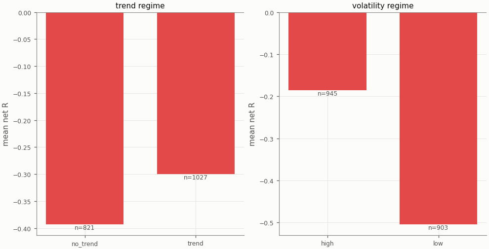

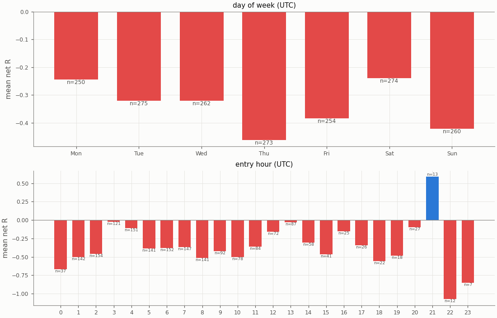

## Diagnostics

| Count | Value |
|---|---|
| trades open at the data end (left out of the R subset) | 0 |
| ambiguous candles resolved without full 1m data | 0 |
| max concurrent positions | 2 |
| funding paid in total (USD) | 291.53 |

| Fill resolution | Fills |
|---|---|
| 15m_unambiguous | 3027 |
| 1m | 505 |
| 1m_pessimistic | 163 |
| open_gap | 1 |

| Exit reason | n | Win rate | Mean net R |
|---|---|---|---|
| stop | 1240 | 0.0% | -1.401 |
| target | 608 | 100.0% | 1.820 |

| Trade distribution | min | p05 | p25 | p50 | p75 | p95 | max | mean |
|---|---|---|---|---|---|---|---|---|
| hold (minutes) | 0.0 | 1.0 | 15.0 | 45.0 | 105.0 | 315.0 | 3915.0 | 91.7 |
| MAE (R) | -10.680 | -2.662 | -1.516 | -1.158 | -0.653 | -0.101 | 0.000 | -1.226 |
| MFE (R) | 0.003 | 0.275 | 0.739 | 1.347 | 2.156 | 3.325 | 12.496 | 1.561 |

Share of this variant's trades whose candidate candle is also traded by the other session variants (computed at report time from their trade tables): London 15.2%, NY 2.7%; any of them 17.3%. The session variants are not independent tests.

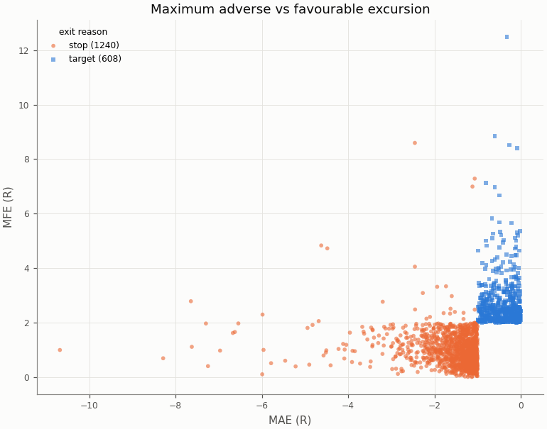

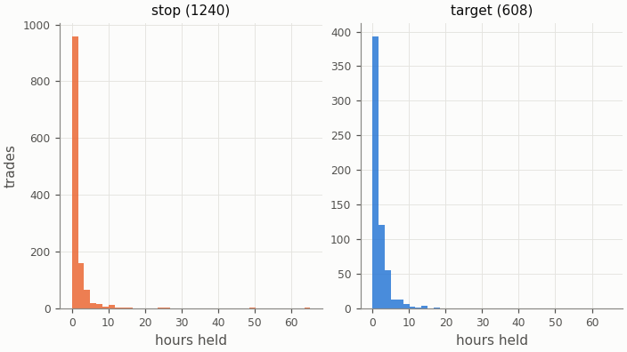

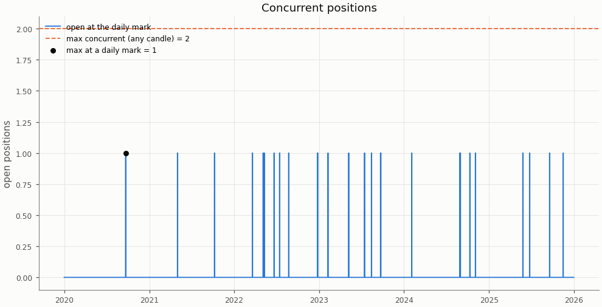

## Deflated Sharpe ratio

| Daily returns | Value |
|---|---|
| daily Sharpe (not annualised) | -0.2026 |
| days T | 2192 |
| skew | 0.534 |
| kurtosis (non-excess) | 1.807 |

| Trials | N | V (variance of daily Sharpe) | SR* | DSR |
|---|---|---|---|---|
| this pair × session's grid | 36 | 0.003028 | 0.1182 | 0.000 |
| all grid variants | 324 | 0.003906 | 0.1825 | 0.000 |

Caveat: the grid cells share most of their trades, so the effective number of independent trials is far below N and the DSR is conservative.

## Notes

- `15m_pessimistic_missing_1m`: 0 fills and 0 ambiguous (candle, order) pairs were resolved by the pessimistic 15m rule because 1m data was incomplete.
- Data gaps overlapping a trade (computed at report time from the candle manifests): 15m: 0 trades over 0 gaps; 1m: 0 trades over 0 gaps.
