# ETHUSDT / NY, holdout primary

- Pair: ETHUSDT
- Session: NY (09:30–16:00 America/New_York, weekdays [0, 1, 2, 3, 4], Mon = 0)
- Period: 2026-01-01 to 2026-10-20 (holdout)
- Variant id: `b85e7a6c6e1fb2c9687f545dc789d1f0ad8c2692f8e409599bfcd278eacaf285`
- Code version: `c3c05e53c0f38a9e57d65b716a78ddfb198004a84dd66fde28cf145808135dc5`
- Seed: 20260926 (generators per purpose: trade_bootstrap, day_bootstrap, sharpe_bootstrap, bh_sharpe_bootstrap, bh_diff_bootstrap, baseline_a, baseline_b)
- Role: primary; member of heatmap_1, heatmap_2, heatmap_3
- Costs: maker 0.02%, taker 0.05%, slippage 0.02%; risk 1.0% per trade; 1m resolution on

## Funnel

Every impulse that did not become a trade is counted by the first reason that stopped it (spec overview §6). Orders exclude intents skipped by the leverage cap.

| Stage | Count |
|---|---|
| impulses | 1658 |
| blocks seen | 1325 |
| skipped: no_candidate | 333 |
| skipped: ineligible | 1084 |
| skipped: degenerate | 0 |
| skipped: no_displacement | 9 |
| skipped: mitigated | 27 |
| skipped: entry_above_price | 0 |
| skipped: trend | 0 |
| skipped: session_used | 80 |
| intents | 125 |
| skipped: leverage cap | 0 |
| orders placed | 125 |
| orders filled | 74 |
| fill rate | 59.2% |
| trades | 74 |
| trades in the R subset | 74 |
| trades open at the data end | 0 |

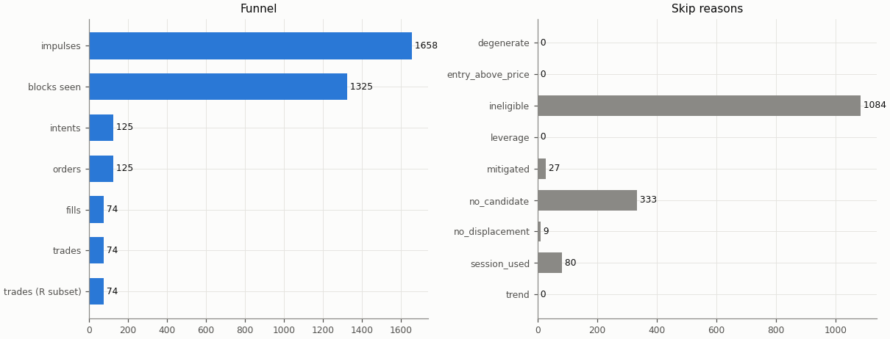

## Headline

Trade statistics use the R subset: trades closed by a stop, target or time exit (`exit_reason != data_end`); trades still open at the end of the data are left out.

| Headline | Value |
|---|---|
| trades (R subset) | 74 |
| win rate | 35.1% |
| mean gross R | 0.054 |
| mean net R | -0.104 |
| mean net R, 95% CI (trade bootstrap) | -0.437 to 0.231 |
| mean net R, 95% CI (day-block bootstrap) | -0.435 to 0.234 |
| median net R | -1.132 |
| std of net R | 1.487 |
| profit factor | 0.87 |
| mean cost (R) | 0.158 |
| mean funding (R) | 0.002 |
| mean hold (minutes) | 271.6 |
| Sharpe (annualised, daily) | -0.63 |
| Sharpe, 95% CI (10-day block bootstrap) | -3.06 to 1.30 |
| max drawdown | 14.1% |
| total return | -8.1% |
| exposure (share of candles in a trade) | 5.0% |
| mean notional / equity at the daily marks | 0.070 |
| max concurrent positions | 1 |

## Baselines

| Baseline | Observed mean net R | Runs: mean | Runs: std | p (one-sided) | z | p (Holm) | Runs |
|---|---|---|---|---|---|---|---|
| A: random entry time in the strategy's own sessions | -0.104 | -0.082 | 0.154 | 0.531 | -0.14 | 1 | 5000 |
| B: random sessions and entry times | -0.104 | -0.160 | 0.173 | 0.372 | 0.33 | 1 | 5000 |

| Table A | Value |
|---|---|
| trades covered | 74 |
| trades left out | 0 |
| baseline B: mean trades per run | 73.9 |

Holm adjustment over the holdout family of 9 primary cells (tested: A 9, B 9, buy-and-hold 9) at α = 0.05.

Baseline design (judgment calls, overview risk 13): a baseline trade enters at the open of a uniformly drawn in-session candle with the maker fee, keeps the real trade's stop distance in ATR and the variant's target and hold rule, and pays actual funding; baseline trades that reach the data end are left out of their run's mean.

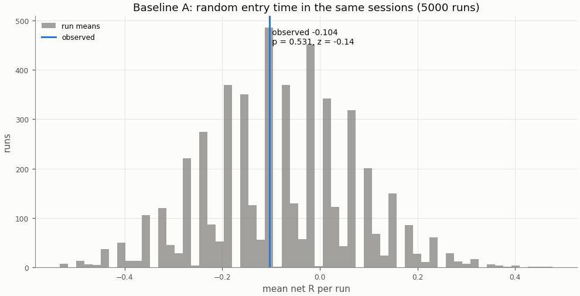

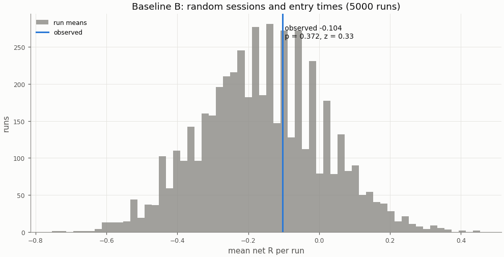

## Buy-and-hold

A constant 1× long in the perpetual with funding, scaled to the strategy's in-sample daily volatility; Sharpe is scale-invariant, the scaling matters for return and drawdown.

| Buy-and-hold | Value |
|---|---|
| days | 293 |
| buy-and-hold Sharpe | -0.12 |
| buy-and-hold Sharpe, 95% CI | -2.45 to 2.01 |
| strategy Sharpe | -0.63 |
| Sharpe difference (strategy − buy-and-hold) | -0.51 |
| Sharpe difference, 95% CI (paired block bootstrap) | -3.71 to 2.38 |
| p_BH (one-sided) | 0.663 |
| p_BH (Holm) | 1 |
| buy-and-hold total return (1×) | -18.9% |
| vol scale (σ strategy / σ buy-and-hold) | 0.171 |
| σ strategy (daily, in-sample) | 0.00742 |
| σ buy-and-hold (daily, in-sample) | 0.04346 |
| vol-scaled buy-and-hold total return | -1.5% |
| vol-scaled buy-and-hold max drawdown | 11.0% |

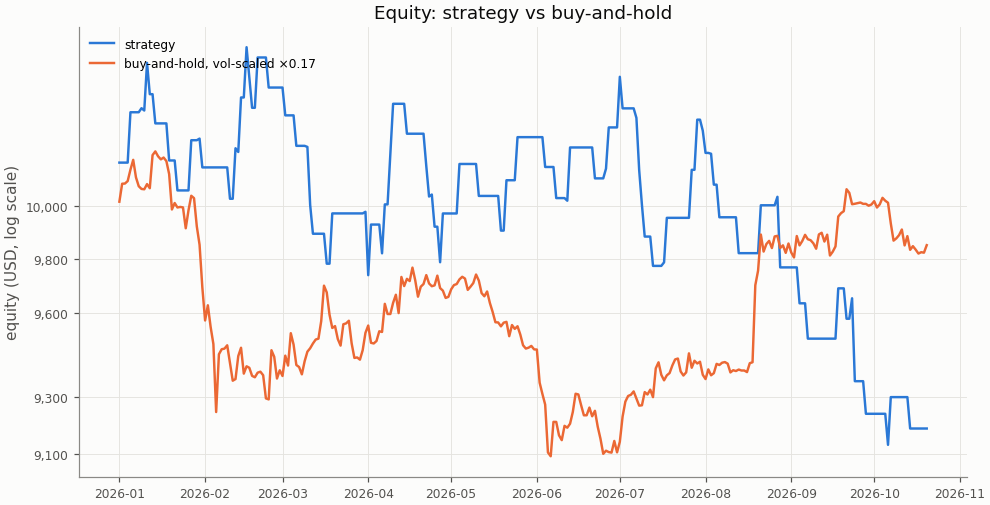

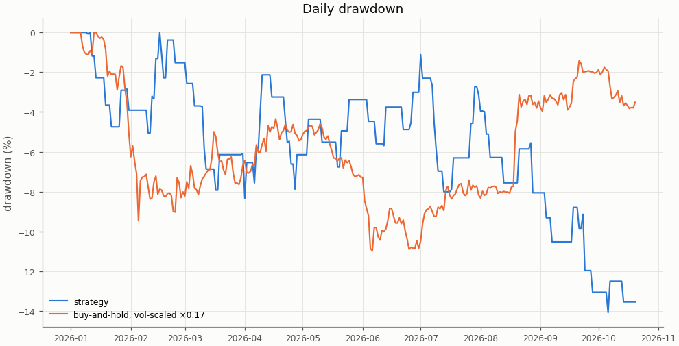

## Costs

Cost in R is fees, slippage and funding divided by the stop distance; a trade whose cost exceeds 1 R loses even when it reaches a 1 R target.

| Cost | Value |
|---|---|
| share of trades with cost above 1 R | 0.0% |

| Cost distribution | min | p05 | p25 | p50 | p75 | p95 | max | mean |
|---|---|---|---|---|---|---|---|---|
| cost per trade (R) | 0.032 | 0.049 | 0.074 | 0.143 | 0.203 | 0.344 | 0.405 | 0.158 |
| stop distance (% of entry) | 0.117 | 0.248 | 0.381 | 0.553 | 0.696 | 1.048 | 2.557 | 0.600 |
| stop distance (ATR14) | 0.384 | 0.615 | 0.827 | 1.003 | 1.384 | 1.981 | 2.566 | 1.126 |
| implied leverage (×) | 0.39 | 0.96 | 1.44 | 1.81 | 2.63 | 4.03 | 8.54 | 2.21 |
| funding (R) | -0.0132 | -0.0051 | 0.0000 | 0.0000 | 0.0000 | 0.0152 | 0.0527 | 0.0017 |

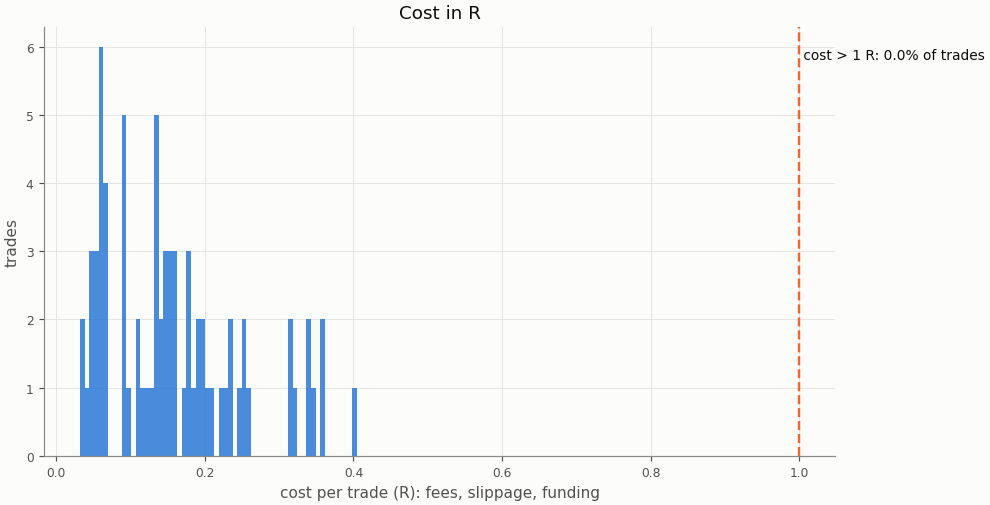

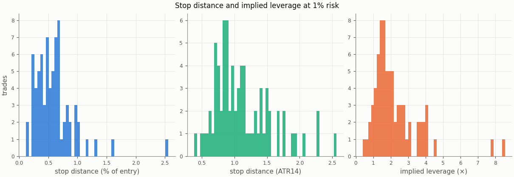

### Re-pricing (D13)

The same trades and baseline runs re-priced at other costs, without re-simulation; descriptive only, the verdict uses the registered costs.

| Slippage | Maker fee | Taker fee | n | Mean net R | 95% CI | Win rate | p_A | p_B | Costs |
|---|---|---|---|---|---|---|---|---|---|
| 0.00% | 0.00% | 0.05% | 74 | -0.015 | -0.350 to 0.321 | 35.1% | 0.531 | 0.361 |  |
| 0.00% | 0.02% | 0.05% | 74 | -0.077 | -0.405 to 0.254 | 35.1% | 0.536 | 0.373 |  |
| 0.02% | 0.00% | 0.05% | 74 | -0.042 | -0.382 to 0.299 | 35.1% | 0.53 | 0.359 |  |
| 0.02% | 0.02% | 0.05% | 74 | -0.104 | -0.437 to 0.231 | 35.1% | 0.531 | 0.372 | registered |
| 0.05% | 0.00% | 0.05% | 74 | -0.083 | -0.429 to 0.266 | 35.1% | 0.529 | 0.359 |  |
| 0.05% | 0.02% | 0.05% | 74 | -0.144 | -0.485 to 0.199 | 35.1% | 0.529 | 0.368 |  |
| 0.10% | 0.00% | 0.05% | 74 | -0.150 | -0.508 to 0.211 | 35.1% | 0.529 | 0.357 |  |
| 0.10% | 0.02% | 0.05% | 74 | -0.212 | -0.563 to 0.144 | 35.1% | 0.529 | 0.363 |  |

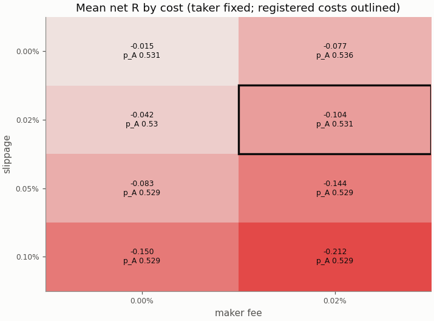

## Robustness

The grid is in-sample only; the heatmaps are in the in-sample primary report.

## Alpha decay

Per calendar year (max drawdown starts from the previous year-end equity; fill rate is filled / placed entry orders by placement year).

| Year | n | Win rate | Mean net R | Sharpe | Max DD | Fill rate |
|---|---|---|---|---|---|---|
| 2026 | 74 | 35.1% | -0.104 | -0.63 | 14.1% | 59.2% |

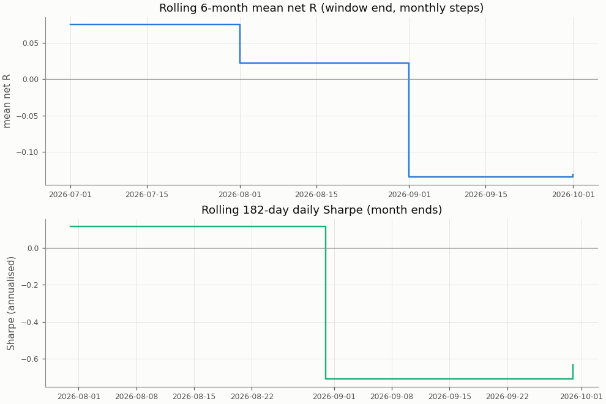

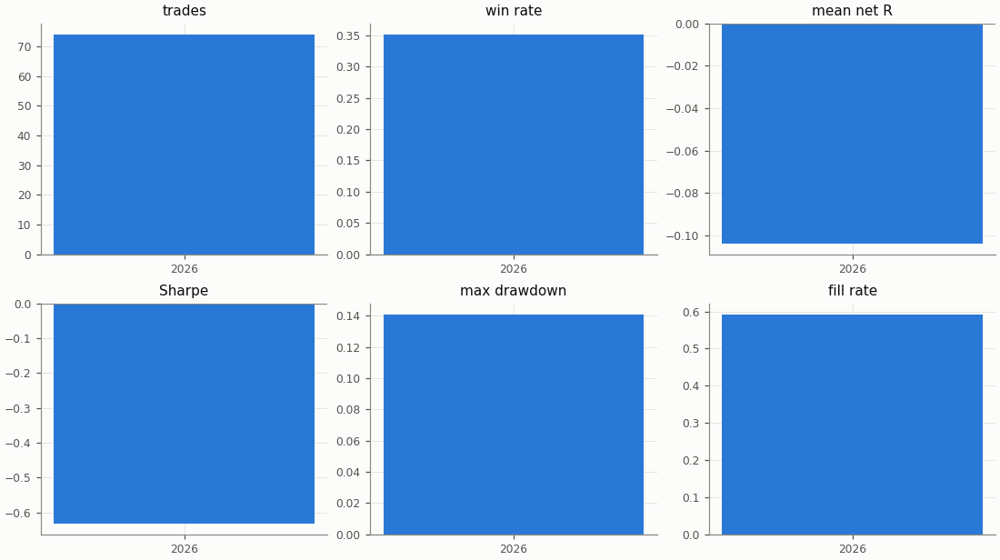

## Regimes and calendar

Trend: daily ADX(14) above 25 as of the day before entry. Volatility: 30-day realised vol of daily log returns as of the day before entry, above (`high`) or below (`low`) the in-sample median 0.03757; trades before the indicators are defined are unlabelled.

| Regime | n | Win rate | Mean net R |
|---|---|---|---|
| trend: no_trend | 34 | 38.2% | -0.013 |
| trend: trend | 40 | 32.5% | -0.181 |
| vol: high | 11 | 45.5% | 0.261 |
| vol: low | 63 | 33.3% | -0.167 |

| Day of week (UTC) | n | Win rate | Mean net R |
|---|---|---|---|
| Monday | 18 | 27.8% | -0.356 |
| Tuesday | 12 | 25.0% | -0.389 |
| Wednesday | 12 | 25.0% | -0.407 |
| Thursday | 16 | 37.5% | -0.039 |
| Friday | 16 | 56.2% | 0.557 |

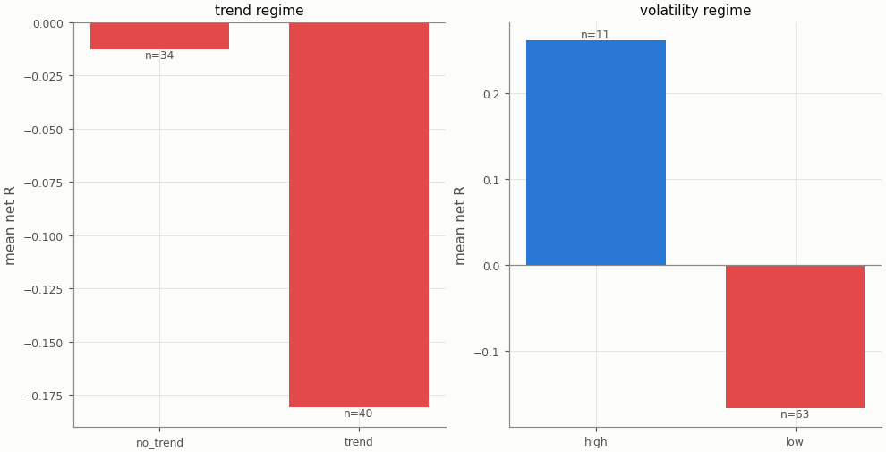

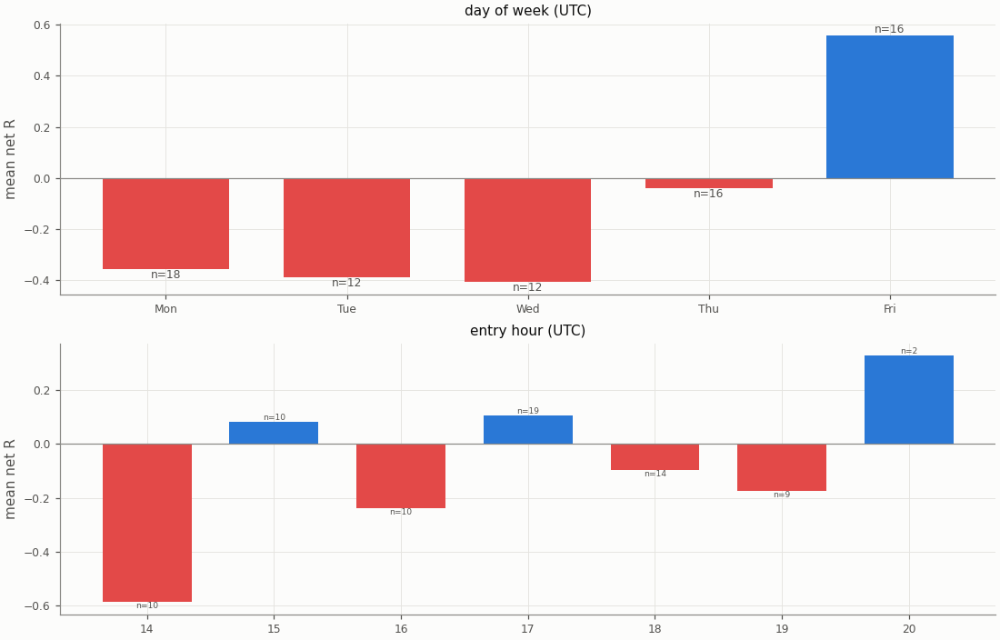

## Diagnostics

| Count | Value |
|---|---|
| trades open at the data end (left out of the R subset) | 0 |
| ambiguous candles resolved without full 1m data | 0 |
| max concurrent positions | 1 |
| funding paid in total (USD) | 12.46 |

| Fill resolution | Fills |
|---|---|
| 15m_unambiguous | 129 |
| 1m | 19 |

| Exit reason | n | Win rate | Mean net R |
|---|---|---|---|
| stop | 48 | 0.0% | -1.189 |
| target | 26 | 100.0% | 1.900 |

| Trade distribution | min | p05 | p25 | p50 | p75 | p95 | max | mean |
|---|---|---|---|---|---|---|---|---|
| hold (minutes) | 1.0 | 2.7 | 30.0 | 67.5 | 225.0 | 1415.2 | 2775.0 | 271.6 |
| MAE (R) | -3.927 | -1.945 | -1.355 | -1.091 | -0.719 | -0.167 | -0.018 | -1.097 |
| MFE (R) | 0.129 | 0.259 | 0.602 | 0.987 | 2.100 | 2.672 | 3.918 | 1.367 |

Share of this variant's trades whose candidate candle is also traded by the other session variants (computed at report time from their trade tables): London 8.1%, UTC 12.2%; any of them 17.6%. The session variants are not independent tests.

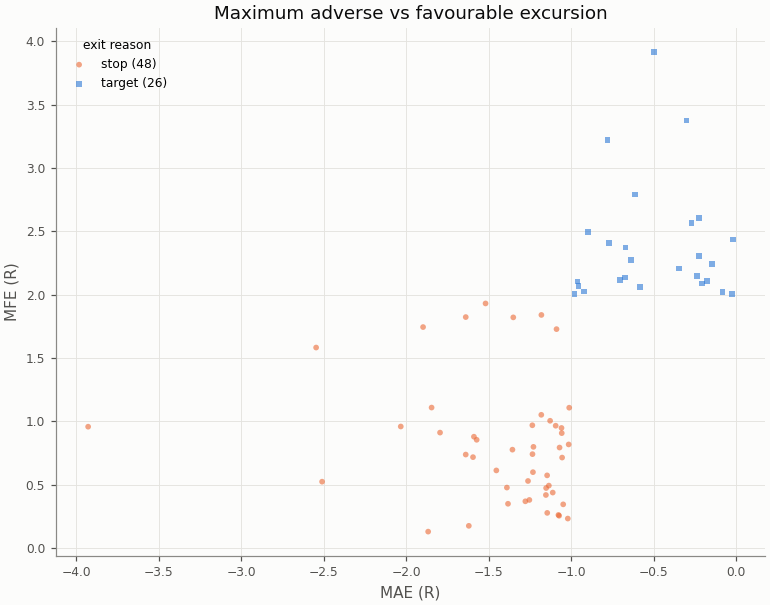

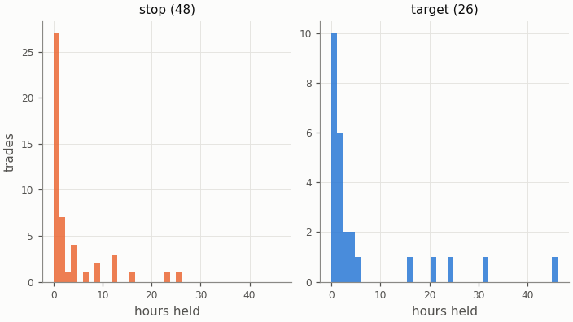

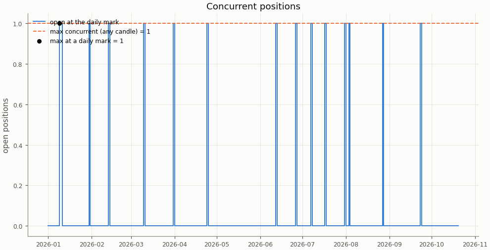

## Deflated Sharpe ratio

| Daily returns | Value |
|---|---|
| daily Sharpe (not annualised) | -0.0330 |
| days T | 293 |
| skew | 0.323 |
| kurtosis (non-excess) | 5.798 |

| Trials | N | V (variance of daily Sharpe) | SR* | DSR |
|---|---|---|---|---|
| this pair × session's grid | n/a | n/a | n/a | n/a |
| all grid variants | n/a | n/a | n/a | n/a |

The DSR is computed for the in-sample grid only; the holdout tests one pre-registered configuration per cell.

Caveat: the grid cells share most of their trades, so the effective number of independent trials is far below N and the DSR is conservative.

## Notes

- `15m_pessimistic_missing_1m`: 0 fills and 0 ambiguous (candle, order) pairs were resolved by the pessimistic 15m rule because 1m data was incomplete.
- Data gaps overlapping a trade (computed at report time from the candle manifests): 15m: 0 trades over 0 gaps; 1m: 0 trades over 0 gaps.
