# BTCUSDT / NY, holdout primary

- Pair: BTCUSDT
- Session: NY (09:30–16:00 America/New_York, weekdays [0, 1, 2, 3, 4], Mon = 0)
- Period: 2026-01-01 to 2026-10-20 (holdout)
- Variant id: `c3fb9192040289b15a43df09b97d60e46b679d722d5c1884ba61c04921e70a18`
- Code version: `c3c05e53c0f38a9e57d65b716a78ddfb198004a84dd66fde28cf145808135dc5`
- Seed: 20260926 (generators per purpose: trade_bootstrap, day_bootstrap, sharpe_bootstrap, bh_sharpe_bootstrap, bh_diff_bootstrap, baseline_a, baseline_b)
- Role: primary; member of heatmap_1, heatmap_2, heatmap_3
- Costs: maker 0.02%, taker 0.05%, slippage 0.02%; risk 1.0% per trade; 1m resolution on

## Funnel

Every impulse that did not become a trade is counted by the first reason that stopped it (spec overview §6). Orders exclude intents skipped by the leverage cap.

| Stage | Count |
|---|---|
| impulses | 1748 |
| blocks seen | 1391 |
| skipped: no_candidate | 357 |
| skipped: ineligible | 1178 |
| skipped: degenerate | 0 |
| skipped: no_displacement | 6 |
| skipped: mitigated | 25 |
| skipped: entry_above_price | 0 |
| skipped: trend | 0 |
| skipped: session_used | 64 |
| intents | 118 |
| skipped: leverage cap | 0 |
| orders placed | 118 |
| orders filled | 79 |
| fill rate | 66.9% |
| trades | 79 |
| trades in the R subset | 78 |
| trades open at the data end | 1 |

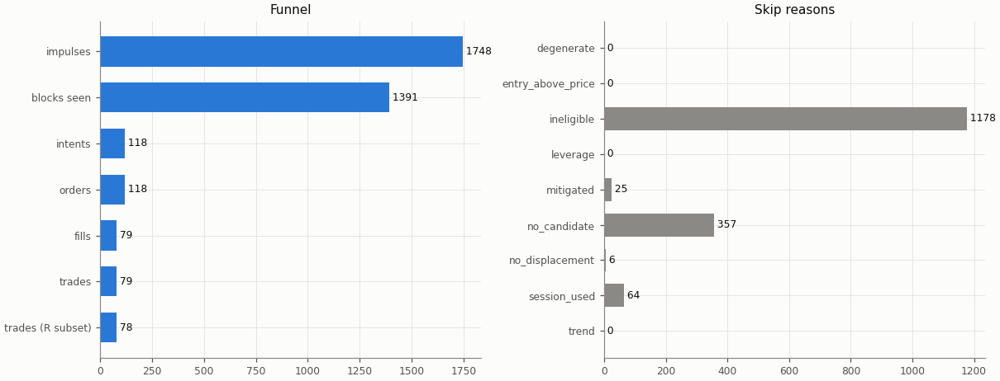

## Headline

Trade statistics use the R subset: trades closed by a stop, target or time exit (`exit_reason != data_end`); trades still open at the end of the data are left out.

| Headline | Value |
|---|---|
| trades (R subset) | 78 |
| win rate | 28.2% |
| mean gross R | -0.154 |
| mean net R | -0.369 |
| mean net R, 95% CI (trade bootstrap) | -0.679 to -0.047 |
| mean net R, 95% CI (day-block bootstrap) | -0.677 to -0.041 |
| median net R | -1.173 |
| std of net R | 1.438 |
| profit factor | 0.59 |
| mean cost (R) | 0.216 |
| mean funding (R) | 0.003 |
| mean hold (minutes) | 342.0 |
| Sharpe (annualised, daily) | -2.36 |
| Sharpe, 95% CI (10-day block bootstrap) | -4.56 to -0.29 |
| max drawdown | 26.2% |
| total return | -24.8% |
| exposure (share of candles in a trade) | 6.6% |
| mean notional / equity at the daily marks | 0.116 |
| max concurrent positions | 2 |

## Baselines

| Baseline | Observed mean net R | Runs: mean | Runs: std | p (one-sided) | z | p (Holm) | Runs |
|---|---|---|---|---|---|---|---|
| A: random entry time in the strategy's own sessions | -0.369 | -0.120 | 0.153 | 0.952 | -1.63 | 1 | 5000 |
| B: random sessions and entry times | -0.369 | -0.216 | 0.170 | 0.816 | -0.91 | 1 | 5000 |

| Table A | Value |
|---|---|
| trades covered | 78 |
| trades left out | 0 |
| baseline B: mean trades per run | 77.9 |

Holm adjustment over the holdout family of 9 primary cells (tested: A 9, B 9, buy-and-hold 9) at α = 0.05.

Baseline design (judgment calls, overview risk 13): a baseline trade enters at the open of a uniformly drawn in-session candle with the maker fee, keeps the real trade's stop distance in ATR and the variant's target and hold rule, and pays actual funding; baseline trades that reach the data end are left out of their run's mean.

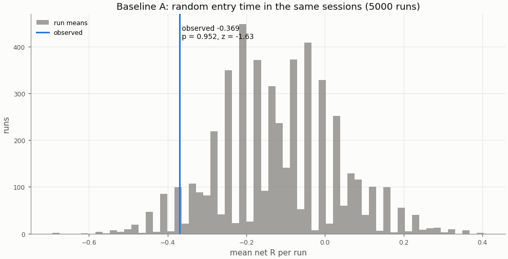

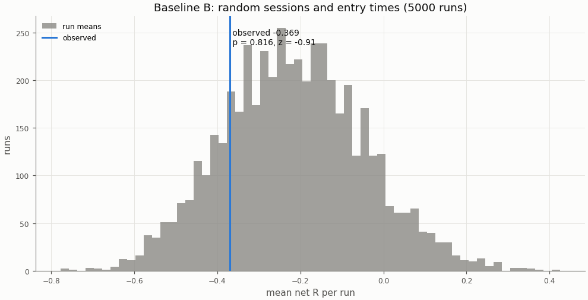

## Buy-and-hold

A constant 1× long in the perpetual with funding, scaled to the strategy's in-sample daily volatility; Sharpe is scale-invariant, the scaling matters for return and drawdown.

| Buy-and-hold | Value |
|---|---|
| days | 293 |
| buy-and-hold Sharpe | 0.01 |
| buy-and-hold Sharpe, 95% CI | -2.35 to 2.25 |
| strategy Sharpe | -2.36 |
| Sharpe difference (strategy − buy-and-hold) | -2.37 |
| Sharpe difference, 95% CI (paired block bootstrap) | -5.30 to 0.44 |
| p_BH (one-sided) | 0.948 |
| p_BH (Holm) | 1 |
| buy-and-hold total return (1×) | -7.5% |
| vol scale (σ strategy / σ buy-and-hold) | 0.233 |
| σ strategy (daily, in-sample) | 0.00756 |
| σ buy-and-hold (daily, in-sample) | 0.03246 |
| vol-scaled buy-and-hold total return | -0.4% |
| vol-scaled buy-and-hold max drawdown | 10.2% |

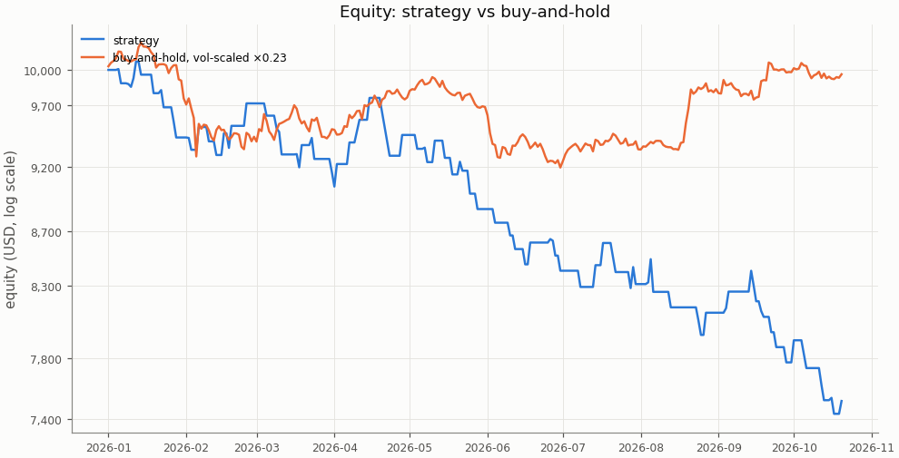

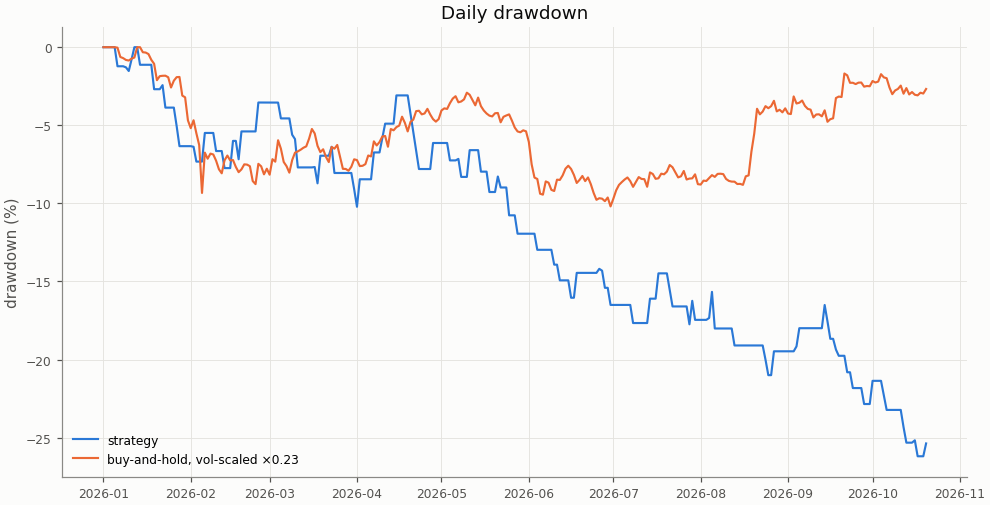

## Costs

Cost in R is fees, slippage and funding divided by the stop distance; a trade whose cost exceeds 1 R loses even when it reaches a 1 R target.

| Cost | Value |
|---|---|
| share of trades with cost above 1 R | 0.0% |

| Cost distribution | min | p05 | p25 | p50 | p75 | p95 | max | mean |
|---|---|---|---|---|---|---|---|---|
| cost per trade (R) | 0.021 | 0.053 | 0.110 | 0.188 | 0.291 | 0.457 | 0.960 | 0.216 |
| stop distance (% of entry) | 0.094 | 0.197 | 0.291 | 0.392 | 0.624 | 0.989 | 1.828 | 0.491 |
| stop distance (ATR14) | 0.597 | 0.643 | 0.805 | 0.975 | 1.448 | 1.991 | 2.589 | 1.159 |
| implied leverage (×) | 0.55 | 1.01 | 1.60 | 2.55 | 3.44 | 5.09 | 10.67 | 2.74 |
| funding (R) | -0.0302 | -0.0106 | 0.0000 | 0.0000 | 0.0012 | 0.0240 | 0.0518 | 0.0027 |

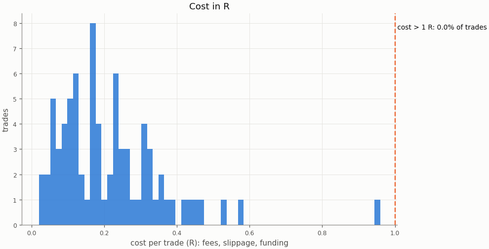

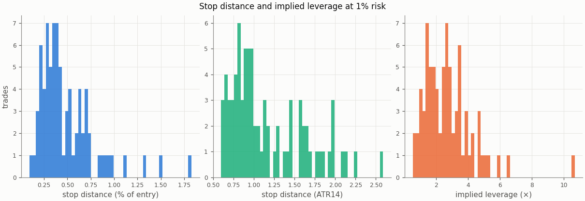

### Re-pricing (D13)

The same trades and baseline runs re-priced at other costs, without re-simulation; descriptive only, the verdict uses the registered costs.

| Slippage | Maker fee | Taker fee | n | Mean net R | 95% CI | Win rate | p_A | p_B | Costs |
|---|---|---|---|---|---|---|---|---|---|
| 0.00% | 0.00% | 0.05% | 78 | -0.260 | -0.573 to 0.061 | 28.2% | 0.957 | 0.822 |  |
| 0.00% | 0.02% | 0.05% | 78 | -0.328 | -0.633 to -0.012 | 28.2% | 0.95 | 0.813 |  |
| 0.02% | 0.00% | 0.05% | 78 | -0.301 | -0.616 to 0.026 | 28.2% | 0.957 | 0.823 |  |
| 0.02% | 0.02% | 0.05% | 78 | -0.369 | -0.679 to -0.047 | 28.2% | 0.952 | 0.816 | registered |
| 0.05% | 0.00% | 0.05% | 78 | -0.363 | -0.684 to -0.028 | 28.2% | 0.956 | 0.824 |  |
| 0.05% | 0.02% | 0.05% | 78 | -0.431 | -0.749 to -0.101 | 28.2% | 0.953 | 0.821 |  |
| 0.10% | 0.00% | 0.05% | 78 | -0.466 | -0.800 to -0.117 | 28.2% | 0.956 | 0.83 |  |
| 0.10% | 0.02% | 0.05% | 78 | -0.534 | -0.868 to -0.188 | 28.2% | 0.954 | 0.828 |  |

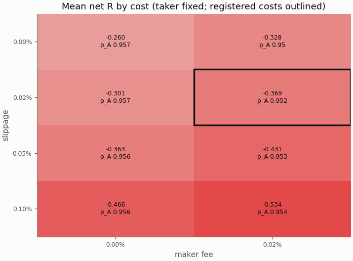

## Robustness

The grid is in-sample only; the heatmaps are in the in-sample primary report.

## Alpha decay

Per calendar year (max drawdown starts from the previous year-end equity; fill rate is filled / placed entry orders by placement year).

| Year | n | Win rate | Mean net R | Sharpe | Max DD | Fill rate |
|---|---|---|---|---|---|---|
| 2026 | 78 | 28.2% | -0.369 | -2.36 | 26.2% | 66.9% |

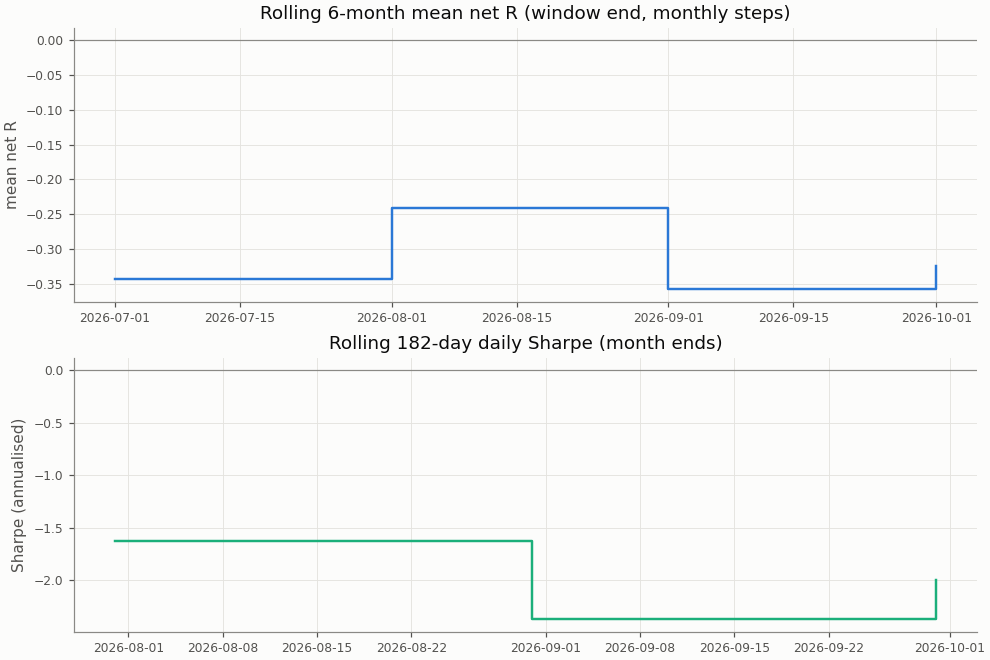

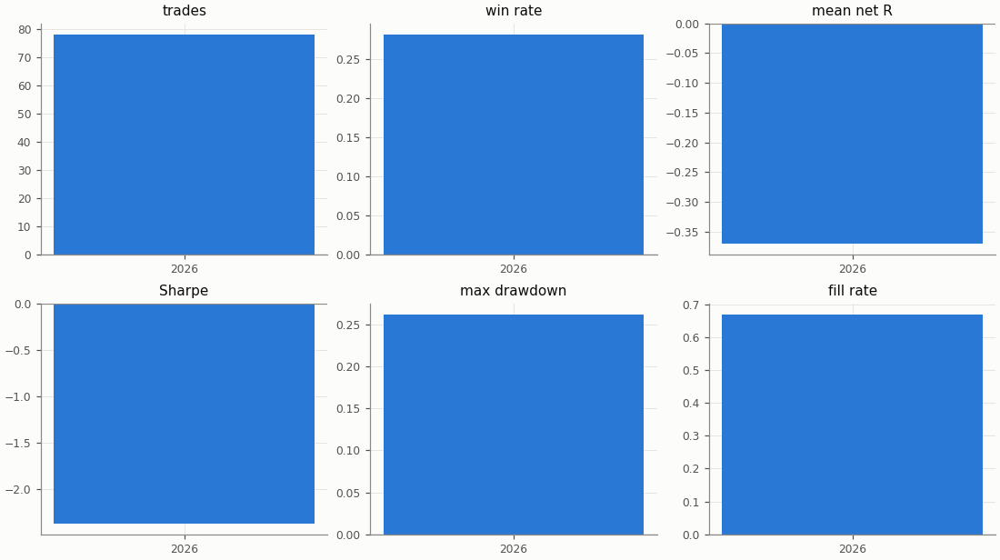

## Regimes and calendar

Trend: daily ADX(14) above 25 as of the day before entry. Volatility: 30-day realised vol of daily log returns as of the day before entry, above (`high`) or below (`low`) the in-sample median 0.02804; trades before the indicators are defined are unlabelled.

| Regime | n | Win rate | Mean net R |
|---|---|---|---|
| trend: no_trend | 28 | 35.7% | -0.165 |
| trend: trend | 50 | 24.0% | -0.484 |
| vol: high | 8 | 50.0% | 0.380 |
| vol: low | 70 | 25.7% | -0.455 |

| Day of week (UTC) | n | Win rate | Mean net R |
|---|---|---|---|
| Monday | 16 | 18.8% | -0.710 |
| Tuesday | 19 | 21.1% | -0.580 |
| Wednesday | 15 | 20.0% | -0.603 |
| Thursday | 16 | 43.8% | 0.124 |
| Friday | 12 | 41.7% | 0.054 |

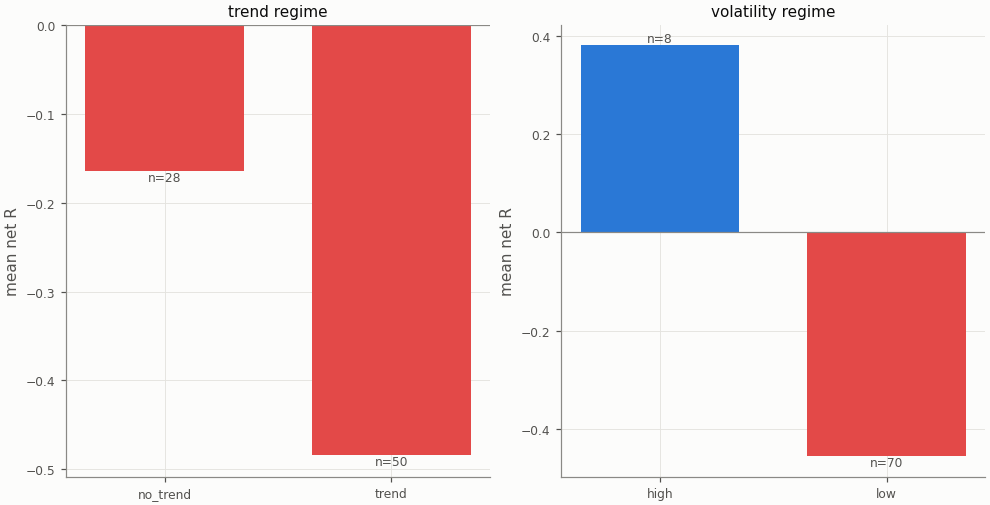

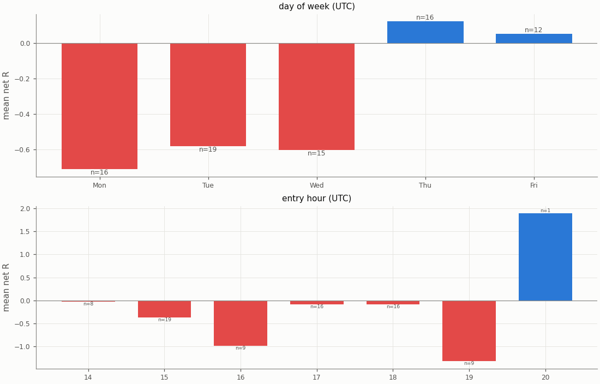

## Diagnostics

| Count | Value |
|---|---|
| trades open at the data end (left out of the R subset) | 1 |
| ambiguous candles resolved without full 1m data | 0 |
| max concurrent positions | 2 |
| funding paid in total (USD) | 17.59 |

| Fill resolution | Fills |
|---|---|
| 15m_unambiguous | 131 |
| 1m | 21 |
| 1m_pessimistic | 6 |

| Exit reason | n | Win rate | Mean net R |
|---|---|---|---|
| stop | 56 | 0.0% | -1.261 |
| target | 22 | 100.0% | 1.901 |

| Trade distribution | min | p05 | p25 | p50 | p75 | p95 | max | mean |
|---|---|---|---|---|---|---|---|---|
| hold (minutes) | 0.0 | 1.9 | 15.0 | 75.0 | 262.5 | 1566.7 | 3360.0 | 342.0 |
| MAE (R) | -2.774 | -2.167 | -1.353 | -1.121 | -0.825 | -0.124 | -0.017 | -1.100 |
| MFE (R) | 0.047 | 0.201 | 0.545 | 1.208 | 2.051 | 2.837 | 3.547 | 1.301 |

Share of this variant's trades whose candidate candle is also traded by the other session variants (computed at report time from their trade tables): London 7.6%, UTC 12.7%; any of them 17.7%. The session variants are not independent tests.

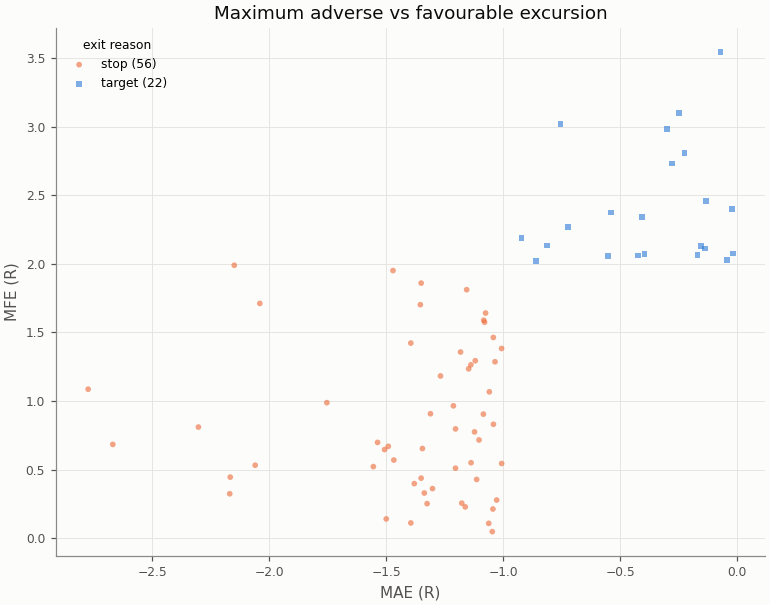

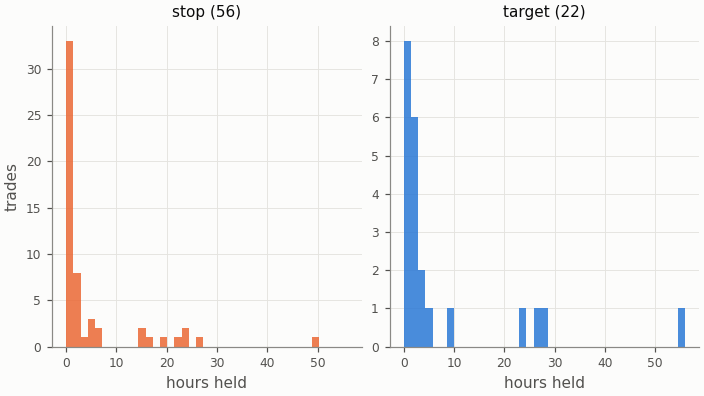

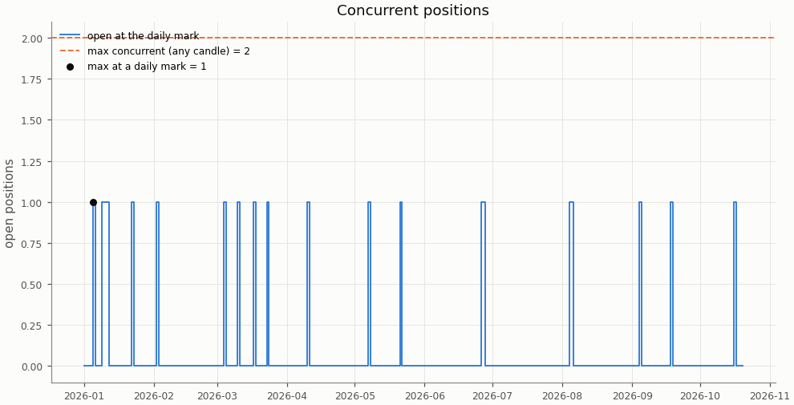

## Deflated Sharpe ratio

| Daily returns | Value |
|---|---|
| daily Sharpe (not annualised) | -0.1237 |
| days T | 293 |
| skew | 0.330 |
| kurtosis (non-excess) | 4.941 |

| Trials | N | V (variance of daily Sharpe) | SR* | DSR |
|---|---|---|---|---|
| this pair × session's grid | n/a | n/a | n/a | n/a |
| all grid variants | n/a | n/a | n/a | n/a |

The DSR is computed for the in-sample grid only; the holdout tests one pre-registered configuration per cell.

Caveat: the grid cells share most of their trades, so the effective number of independent trials is far below N and the DSR is conservative.

## Notes

- `15m_pessimistic_missing_1m`: 0 fills and 0 ambiguous (candle, order) pairs were resolved by the pessimistic 15m rule because 1m data was incomplete.
- Data gaps overlapping a trade (computed at report time from the candle manifests): 15m: 0 trades over 0 gaps; 1m: 0 trades over 0 gaps.
