# ETHUSDT / London, in-sample primary

- Pair: ETHUSDT
- Session: London (08:00–16:30 Europe/London, weekdays [0, 1, 2, 3, 4], Mon = 0)
- Period: 2020-01-01 to 2025-12-31 (in-sample)
- Variant id: `c68c55c9bac65bdbae6ce6be07dabb073e6eb1e28159411bda69b47ea04a7b68`
- Code version: `c3c05e53c0f38a9e57d65b716a78ddfb198004a84dd66fde28cf145808135dc5`
- Seed: 20260926 (generators per purpose: trade_bootstrap, day_bootstrap, sharpe_bootstrap, bh_sharpe_bootstrap, bh_diff_bootstrap, baseline_a, baseline_b)
- Role: primary; member of heatmap_1, heatmap_2, heatmap_3
- Costs: maker 0.02%, taker 0.05%, slippage 0.02%; risk 1.0% per trade; 1m resolution on

## Funnel

Every impulse that did not become a trade is counted by the first reason that stopped it (spec overview §6). Orders exclude intents skipped by the leverage cap.

| Stage | Count |
|---|---|
| impulses | 13521 |
| blocks seen | 10592 |
| skipped: no_candidate | 2929 |
| skipped: ineligible | 7839 |
| skipped: degenerate | 0 |
| skipped: no_displacement | 115 |
| skipped: mitigated | 370 |
| skipped: entry_above_price | 0 |
| skipped: trend | 0 |
| skipped: session_used | 1073 |
| intents | 1195 |
| skipped: leverage cap | 1 |
| orders placed | 1194 |
| orders filled | 925 |
| fill rate | 77.5% |
| trades | 925 |
| trades in the R subset | 925 |
| trades open at the data end | 0 |

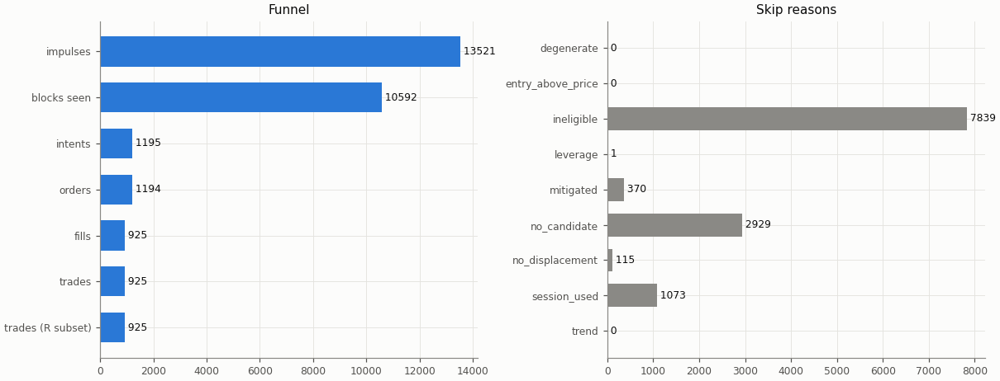

## Headline

Trade statistics use the R subset: trades closed by a stop, target or time exit (`exit_reason != data_end`); trades still open at the end of the data are left out.

| Headline | Value |
|---|---|
| trades (R subset) | 925 |
| win rate | 35.9% |
| mean gross R | 0.077 |
| mean net R | -0.129 |
| mean net R, 95% CI (trade bootstrap) | -0.223 to -0.032 |
| mean net R, 95% CI (day-block bootstrap) | -0.226 to -0.031 |
| median net R | -1.136 |
| std of net R | 1.514 |
| profit factor | 0.84 |
| mean cost (R) | 0.206 |
| mean funding (R) | 0.002 |
| mean hold (minutes) | 87.3 |
| Sharpe (annualised, daily) | -1.05 |
| Sharpe, 95% CI (10-day block bootstrap) | -1.89 to -0.25 |
| max drawdown | 80.1% |
| total return | -72.7% |
| exposure (share of candles in a trade) | 3.0% |
| mean notional / equity at the daily marks | 0.010 |
| max concurrent positions | 2 |

## Baselines

| Baseline | Observed mean net R | Runs: mean | Runs: std | p (one-sided) | z | p (Holm) | Runs |
|---|---|---|---|---|---|---|---|
| A: random entry time in the strategy's own sessions | -0.129 | -0.181 | 0.045 | 0.126 | 1.15 | 0.882 | 5000 |
| B: random sessions and entry times | -0.129 | -0.209 | 0.048 | 0.0498 | 1.66 | 0.448 | 5000 |

| Table A | Value |
|---|---|
| trades covered | 925 |
| trades left out | 0 |
| baseline B: mean trades per run | 925.0 |

Holm adjustment over the in-sample family of 9 primary cells (tested: A 9, B 9, buy-and-hold 9) at α = 0.05.

Baseline design (judgment calls, overview risk 13): a baseline trade enters at the open of a uniformly drawn in-session candle with the maker fee, keeps the real trade's stop distance in ATR and the variant's target and hold rule, and pays actual funding; baseline trades that reach the data end are left out of their run's mean.

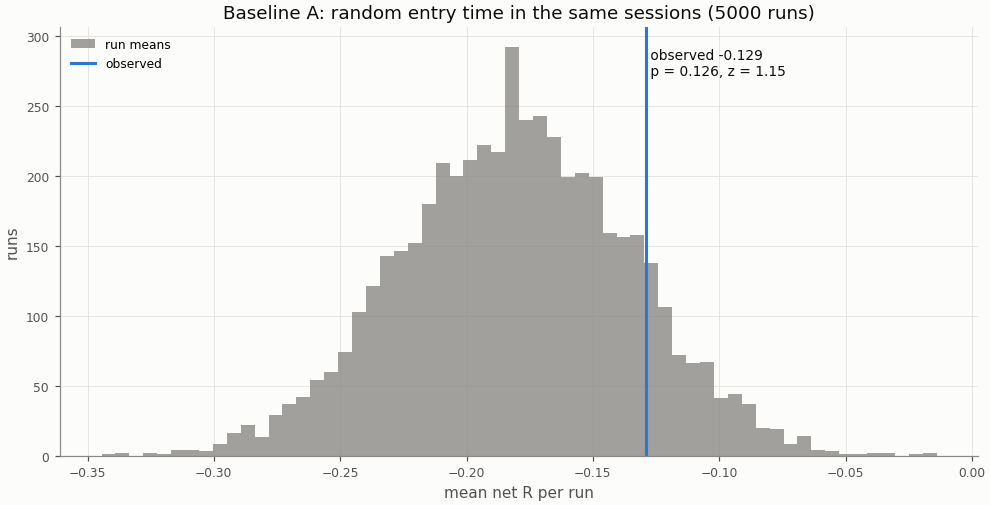

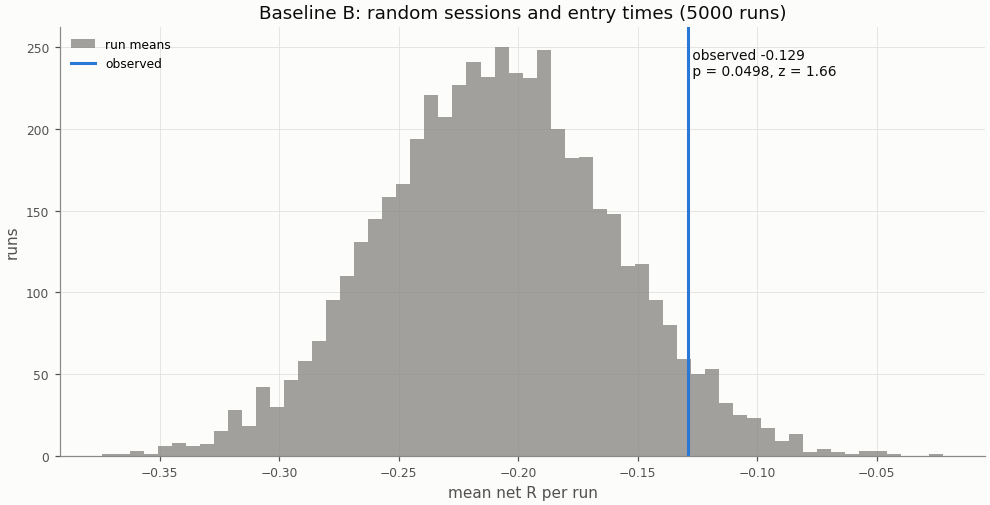

## Buy-and-hold

A constant 1× long in the perpetual with funding, scaled to the strategy's in-sample daily volatility; Sharpe is scale-invariant, the scaling matters for return and drawdown.

| Buy-and-hold | Value |
|---|---|
| days | 2192 |
| buy-and-hold Sharpe | 0.87 |
| buy-and-hold Sharpe, 95% CI | 0.10 to 1.65 |
| strategy Sharpe | -1.05 |
| Sharpe difference (strategy − buy-and-hold) | -1.92 |
| Sharpe difference, 95% CI (paired block bootstrap) | -2.98 to -0.89 |
| p_BH (one-sided) | 1 |
| p_BH (Holm) | 1 |
| buy-and-hold total return (1×) | 822.4% |
| vol scale (σ strategy / σ buy-and-hold) | 0.227 |
| σ strategy (daily, in-sample) | 0.00986 |
| σ buy-and-hold (daily, in-sample) | 0.04346 |
| vol-scaled buy-and-hold total return | 140.1% |
| vol-scaled buy-and-hold max drawdown | 27.9% |

The figures continue into the holdout run (shaded), chained onto the in-sample end.

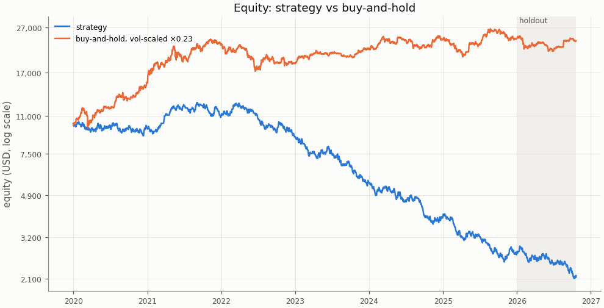

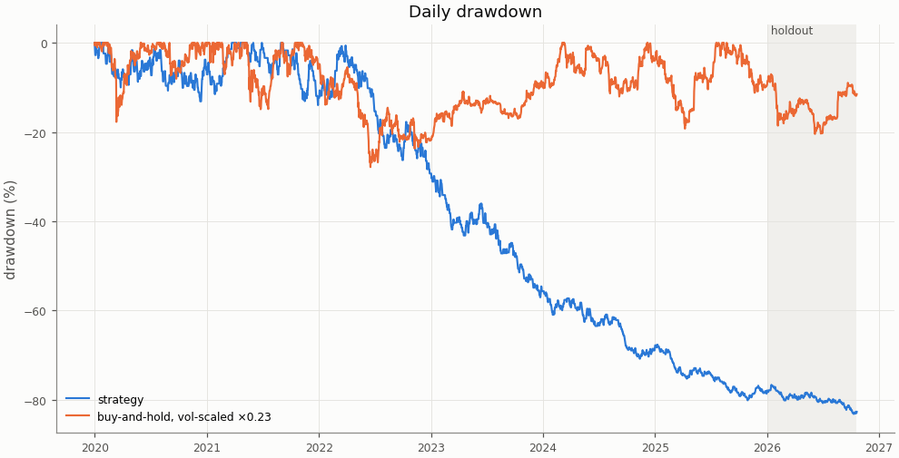

## Costs

Cost in R is fees, slippage and funding divided by the stop distance; a trade whose cost exceeds 1 R loses even when it reaches a 1 R target.

| Cost | Value |
|---|---|
| share of trades with cost above 1 R | 0.5% |

| Cost distribution | min | p05 | p25 | p50 | p75 | p95 | max | mean |
|---|---|---|---|---|---|---|---|---|
| cost per trade (R) | -0.145 | 0.049 | 0.101 | 0.169 | 0.258 | 0.487 | 1.695 | 0.206 |
| stop distance (% of entry) | 0.053 | 0.162 | 0.283 | 0.425 | 0.631 | 1.187 | 3.793 | 0.521 |
| stop distance (ATR14) | 0.179 | 0.548 | 0.735 | 0.897 | 1.116 | 1.590 | 4.024 | 0.966 |
| implied leverage (×) | 0.26 | 0.84 | 1.58 | 2.35 | 3.54 | 6.19 | 18.84 | 2.82 |
| funding (R) | -0.3023 | 0.0000 | 0.0000 | 0.0000 | 0.0000 | 0.0176 | 0.2879 | 0.0024 |

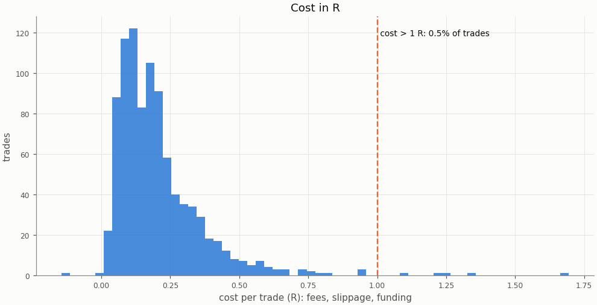

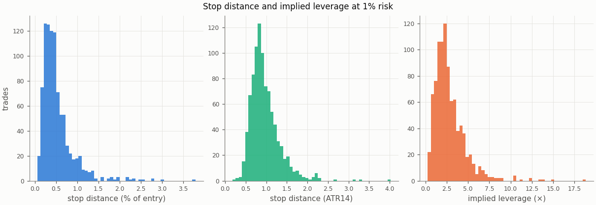

### Re-pricing (D13)

The same trades and baseline runs re-priced at other costs, without re-simulation; descriptive only, the verdict uses the registered costs.

| Slippage | Maker fee | Taker fee | n | Mean net R | 95% CI | Win rate | p_A | p_B | Costs |
|---|---|---|---|---|---|---|---|---|---|
| 0.00% | 0.00% | 0.05% | 925 | -0.016 | -0.110 to 0.080 | 35.9% | 0.117 | 0.0406 |  |
| 0.00% | 0.02% | 0.05% | 925 | -0.093 | -0.185 to 0.003 | 35.9% | 0.118 | 0.0468 |  |
| 0.02% | 0.00% | 0.05% | 925 | -0.052 | -0.148 to 0.046 | 35.9% | 0.124 | 0.0444 |  |
| 0.02% | 0.02% | 0.05% | 925 | -0.129 | -0.223 to -0.032 | 35.9% | 0.126 | 0.0498 | registered |
| 0.05% | 0.00% | 0.05% | 925 | -0.107 | -0.205 to -0.005 | 35.9% | 0.136 | 0.0486 |  |
| 0.05% | 0.02% | 0.05% | 925 | -0.183 | -0.281 to -0.082 | 35.9% | 0.14 | 0.0558 |  |
| 0.10% | 0.00% | 0.05% | 925 | -0.197 | -0.301 to -0.091 | 35.9% | 0.153 | 0.0594 |  |
| 0.10% | 0.02% | 0.05% | 925 | -0.274 | -0.376 to -0.168 | 35.9% | 0.156 | 0.0682 |  |

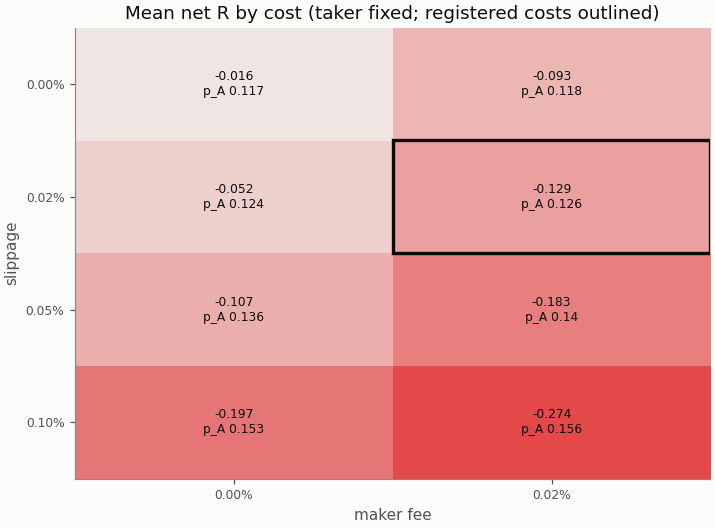

## Robustness

### Heatmap 1: r_target × entry_level

8 of 8 cells have run; the primary is outlined.

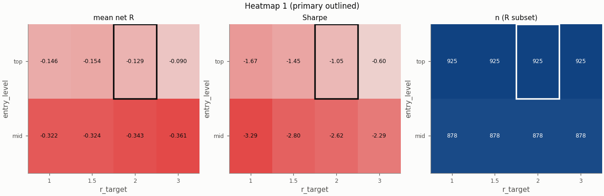

### Heatmap 2: swing_k × confirm_n

9 of 9 cells have run; the primary is outlined.

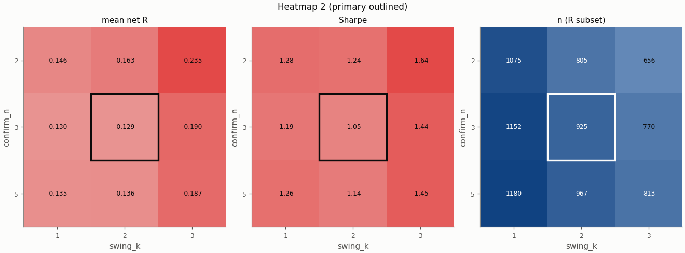

### Heatmap 3: stop_buffer × hold_rule

16 of 16 cells have run; the primary is outlined.

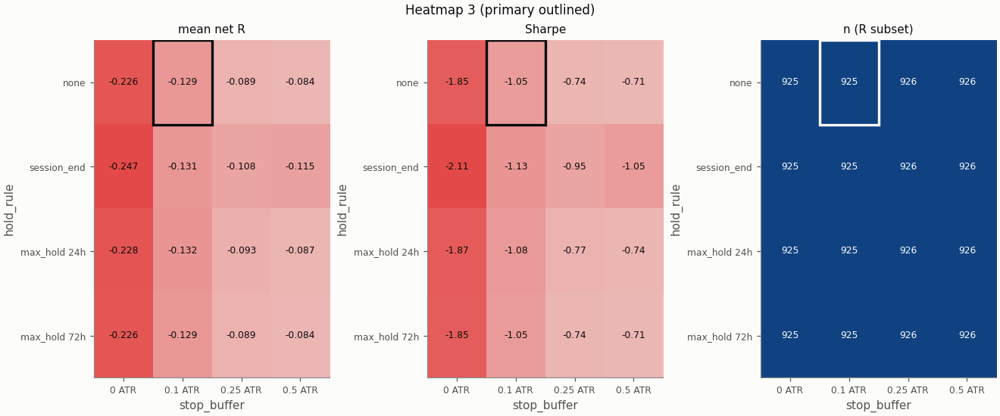

Grid variants of this pair × session:

- heatmap_1: entry_level=mid, r_target=3 ([report](../04a44f8864e63291c011a47a849eabb1a83834732fa81e0d341a50f539dee997/report.md))
- heatmap_2: confirm_n=5, swing_k=3 ([report](../16f5c1b863fa86f9c2dc4b37ab25dea6193c3fddcd46328ca7b663187ec34447/report.md))
- heatmap_1: r_target=3 ([report](../1b42d8028b8818193eb073a300161487e701290797b0303e5dc41d1bac60aa5d/report.md))
- heatmap_3: hold_rule=max_hold 72h, stop_buffer=0.5 ATR ([report](../1ed036b1de34c79aef2cc9514cc6a4adc1e0a1c8bca8877c798029fcb2070b90/report.md))
- heatmap_2: swing_k=1 ([report](../2048734846aeda6dda31137f554a6f8f2a32b622853c14cc9132af0ef649ea03/report.md))
- heatmap_3: hold_rule=session_end, stop_buffer=0 ATR ([report](../22c54dce05fe0b4fb2c0f4c3266cd1839fbcafced5dcd088fb4aa8fecc30788e/report.md))
- heatmap_2: confirm_n=5, swing_k=1 ([report](../31148c07758af5166a97fcca3d93e908163b0aa95a4f746591e0c867b4a5d677/report.md))
- heatmap_2: confirm_n=2, swing_k=1 ([report](../32f9118e4304da3cf5f4244016da8b6aba2fbb73fd49e62e9c56ea293f5241b6/report.md))
- heatmap_2: swing_k=3 ([report](../36b4ad095602dc8dec6547272a5cae4f9e373e6cbf46f1e452d0f173758a3971/report.md))
- heatmap_3: hold_rule=max_hold 72h, stop_buffer=0 ATR ([report](../3e103b141e3ed713edc67aa898dbf2a43659f22de0ffcc603e3ac9f8d915734a/report.md))
- heatmap_1: entry_level=mid, r_target=1 ([report](../4a53d7bbe082cade1e21696888bc072d4cd739580cc6ff1dd211282b0aca577d/report.md))
- heatmap_3: hold_rule=session_end, stop_buffer=0.25 ATR ([report](../4eb79d2a2bcbe8012e63bbb8fcc76604de26812a280482101372eb00cea2533e/report.md))
- single_1: zone=body ([report](../512385e747c08d9d7f8d326ef13c7d473ed6a931ee921f1ae4065ad4b84189cc/report.md))
- single_5: stop_buffer=0.25% ([report](../5b7f3dd973a5ff3dea8578981c9d9587d1c1a48ba093eb9fce056f19e1ddc376/report.md))
- heatmap_2: confirm_n=5 ([report](../5beb114b29d2270aac66501e64502ae4e55ce4c2ace16e1e1f00ad9e1b8913a7/report.md))
- heatmap_2: confirm_n=2, swing_k=3 ([report](../62fc21f7444963a0b54ee35946de977000ad558b5bd5f28cc839d4f1888d9c2b/report.md))
- heatmap_3: hold_rule=max_hold 72h ([report](../7a0861d90043dd81e5a1a0d984b866416432e2e32f4d7e3d40dcaeb4d8711737/report.md))
- heatmap_1: r_target=1 ([report](../7e64d93229b1a56ccd3e876d5b4bdf7589375d047829919b4fdecb1d0ca08195/report.md))
- heatmap_1: r_target=1.5 ([report](../84e3075ac4a55ec9fb618cf36562043877cdf705651d222bab1f1d0157d404d2/report.md))
- heatmap_3: hold_rule=max_hold 24h, stop_buffer=0.5 ATR ([report](../8611ddae2cb237dcfddb7de77f152af8c5c866b911885bc15afc8d70d86d3d4a/report.md))
- heatmap_1: entry_level=mid, r_target=1.5 ([report](../868785a588a8690697875c821312cefa15d09e73476aca67a699240cc37c401a/report.md))
- single_2: pierce=0.0005 ([report](../9023defa05239fa76b66a71dd812795cc8dba3ee01b0d73bc222875dde9a8b76/report.md))
- heatmap_3: hold_rule=max_hold 24h ([report](../958a05412a982413948ae5e259245b59d5a74a0d8626f7214c7d67a0f62a13ce/report.md))
- heatmap_3: hold_rule=max_hold 24h, stop_buffer=0 ATR ([report](../a040524e08c50cfe1e0a7b65bc064726ba0785d174f01da11ba62469cba24ae4/report.md))
- heatmap_3: stop_buffer=0.25 ATR ([report](../a3e18819df8f0951729af92367c85560836be3784b804b4d48066ffecff8d17c/report.md))
- heatmap_3: hold_rule=session_end ([report](../a56795b8a9bb21c786418ed5fd910e5a76c72469bd9be3daf8824c8073960572/report.md))
- heatmap_2: confirm_n=2 ([report](../ab62e4418b6e9fa7fc95f2f036701885609d3965935503f5af16ea616ffbc8a3/report.md))
- single_4: stop_buffer=0.1% ([report](../b74f92df91b113340a4d5941fdccdbbdf9556c109335a65222243a5e6b90b2f6/report.md))
- heatmap_3: hold_rule=max_hold 72h, stop_buffer=0.25 ATR ([report](../c78c3214064452226b26763ee493e84eca9f4847b3f7fc8cf6a9dcd34f250df3/report.md))
- heatmap_3: stop_buffer=0 ATR ([report](../c8d9c021518dd0cd38a198e710b7d0d0bf2a2b873b5a037a57704c7c7d16df36/report.md))
- heatmap_3: hold_rule=max_hold 24h, stop_buffer=0.25 ATR ([report](../e818322aeccd42345ce52af46af62ff167875078f52bb3fb51c3ec6c2c77bfde/report.md))
- heatmap_1: entry_level=mid ([report](../ebfb0cb9cf8a303b0d1b73cf6b1c617b9058171f053b665c8f3b3ba0cbd30397/report.md))
- heatmap_3: hold_rule=session_end, stop_buffer=0.5 ATR ([report](../f6967cf5b61668dfba54f908485502cfa2b2f2d3acc1fde46bd9ab3f17db197a/report.md))
- single_3: trend_filter=on ([report](../f730d6a0c753120fcf38bac682063c5272fb39058a47cfd14561f0927cef9650/report.md))
- heatmap_3: stop_buffer=0.5 ATR ([report](../fc5f130d7b553542f64bc274d3d39df9047ce050723817ad9e3fbd602a9afb53/report.md))

## Alpha decay

Per calendar year (max drawdown starts from the previous year-end equity; fill rate is filled / placed entry orders by placement year).

| Year | n | Win rate | Mean net R | Sharpe | Max DD | Fill rate |
|---|---|---|---|---|---|---|
| 2020 | 162 | 38.9% | -0.006 | -0.05 | 13.1% | 77.1% |
| 2021 | 132 | 40.9% | 0.106 | 0.79 | 14.0% | 67.0% |
| 2022 | 145 | 34.5% | -0.137 | -1.10 | 28.9% | 73.6% |
| 2023 | 158 | 35.4% | -0.283 | -2.25 | 39.2% | 79.4% |
| 2024 | 164 | 34.1% | -0.194 | -1.65 | 34.2% | 85.0% |
| 2025 | 164 | 32.3% | -0.218 | -1.93 | 38.5% | 82.8% |

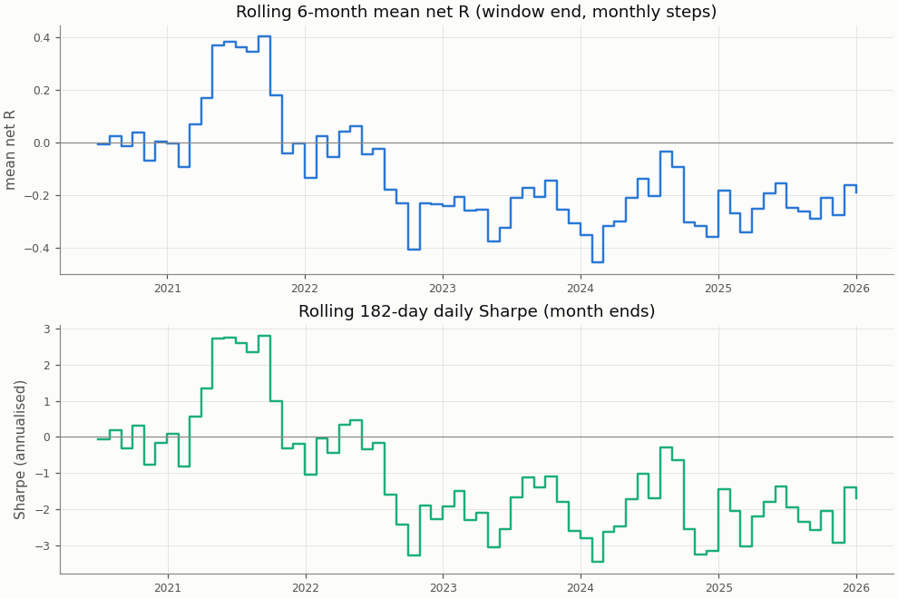

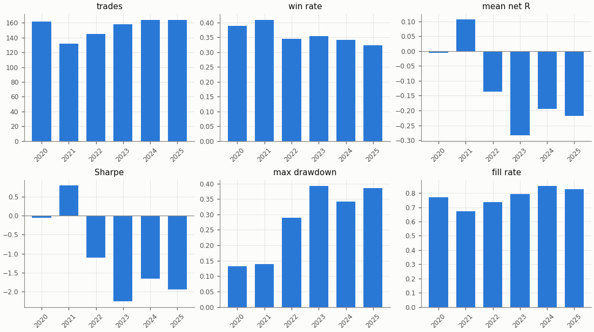

## Regimes and calendar

Trend: daily ADX(14) above 25 as of the day before entry. Volatility: 30-day realised vol of daily log returns as of the day before entry, above (`high`) or below (`low`) the in-sample median 0.03757; trades before the indicators are defined are unlabelled.

| Regime | n | Win rate | Mean net R |
|---|---|---|---|
| trend: no_trend | 374 | 38.8% | -0.070 |
| trend: trend | 551 | 33.9% | -0.169 |
| vol: high | 458 | 37.8% | -0.016 |
| vol: low | 467 | 34.0% | -0.240 |

| Day of week (UTC) | n | Win rate | Mean net R |
|---|---|---|---|
| Monday | 180 | 36.7% | -0.113 |
| Tuesday | 209 | 34.9% | -0.161 |
| Wednesday | 180 | 36.7% | -0.116 |
| Thursday | 173 | 38.7% | -0.030 |
| Friday | 183 | 32.8% | -0.215 |

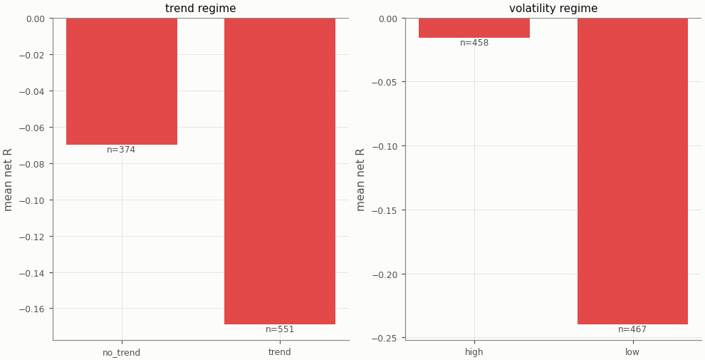

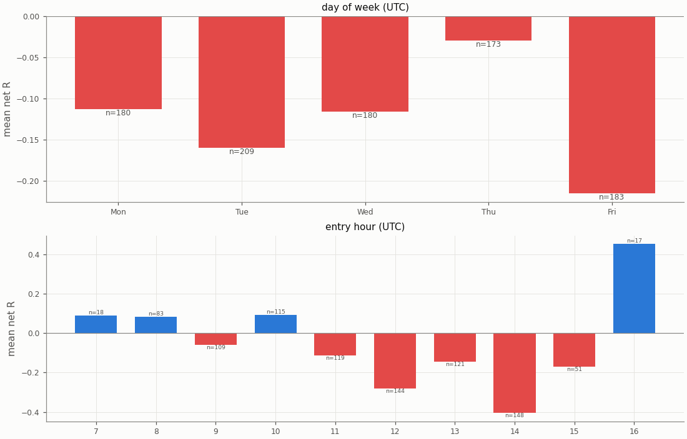

## Diagnostics

| Count | Value |
|---|---|
| trades open at the data end (left out of the R subset) | 0 |
| ambiguous candles resolved without full 1m data | 0 |
| max concurrent positions | 2 |
| funding paid in total (USD) | 189.35 |

| Fill resolution | Fills |
|---|---|
| 15m_unambiguous | 1454 |
| 1m | 309 |
| 1m_pessimistic | 87 |

| Exit reason | n | Win rate | Mean net R |
|---|---|---|---|
| stop | 593 | 0.0% | -1.256 |
| target | 332 | 100.0% | 1.884 |

| Trade distribution | min | p05 | p25 | p50 | p75 | p95 | max | mean |
|---|---|---|---|---|---|---|---|---|
| hold (minutes) | 0.0 | 1.0 | 15.0 | 45.0 | 90.0 | 255.0 | 3420.0 | 87.3 |
| MAE (R) | -15.593 | -2.788 | -1.550 | -1.143 | -0.650 | -0.114 | 0.000 | -1.253 |
| MFE (R) | 0.015 | 0.282 | 0.696 | 1.419 | 2.269 | 3.569 | 9.717 | 1.634 |

Share of this variant's trades whose candidate candle is also traded by the other session variants (computed at report time from their trade tables): NY 6.4%, UTC 30.6%; any of them 35.6%. The session variants are not independent tests.

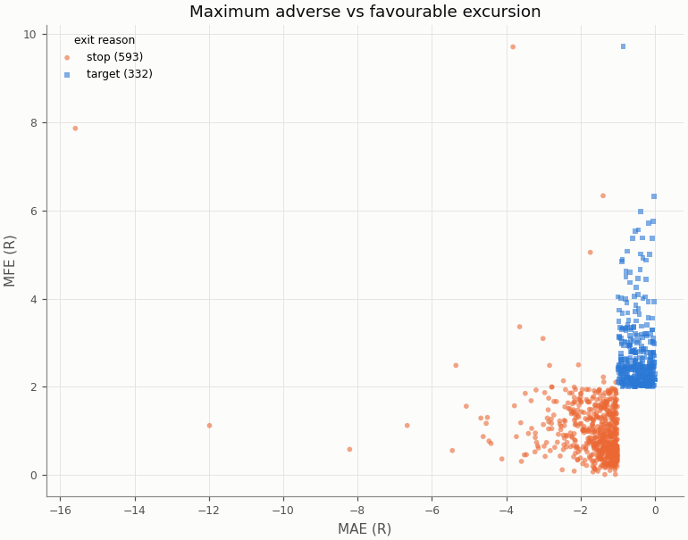

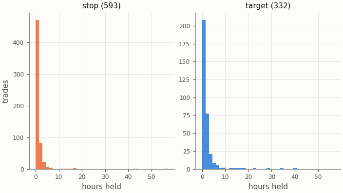

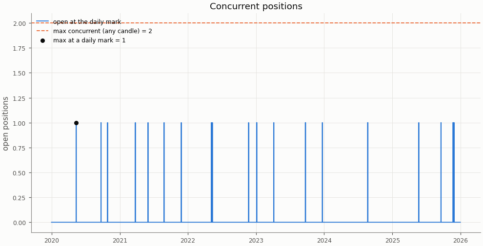

## Deflated Sharpe ratio

| Daily returns | Value |
|---|---|
| daily Sharpe (not annualised) | -0.0552 |
| days T | 2192 |
| skew | 0.677 |
| kurtosis (non-excess) | 3.245 |

| Trials | N | V (variance of daily Sharpe) | SR* | DSR |
|---|---|---|---|---|
| this pair × session's grid | 36 | 0.001352 | 0.0790 | 0.000 |
| all grid variants | 324 | 0.003906 | 0.1825 | 0.000 |

Caveat: the grid cells share most of their trades, so the effective number of independent trials is far below N and the DSR is conservative.

## Notes

- `15m_pessimistic_missing_1m`: 0 fills and 0 ambiguous (candle, order) pairs were resolved by the pessimistic 15m rule because 1m data was incomplete.
- Data gaps overlapping a trade (computed at report time from the candle manifests): 15m: 0 trades over 0 gaps; 1m: 0 trades over 0 gaps.
