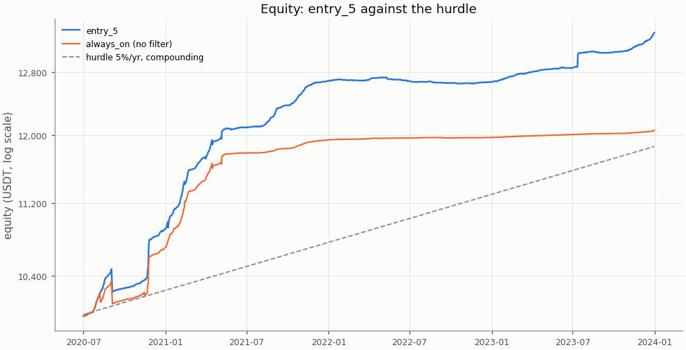
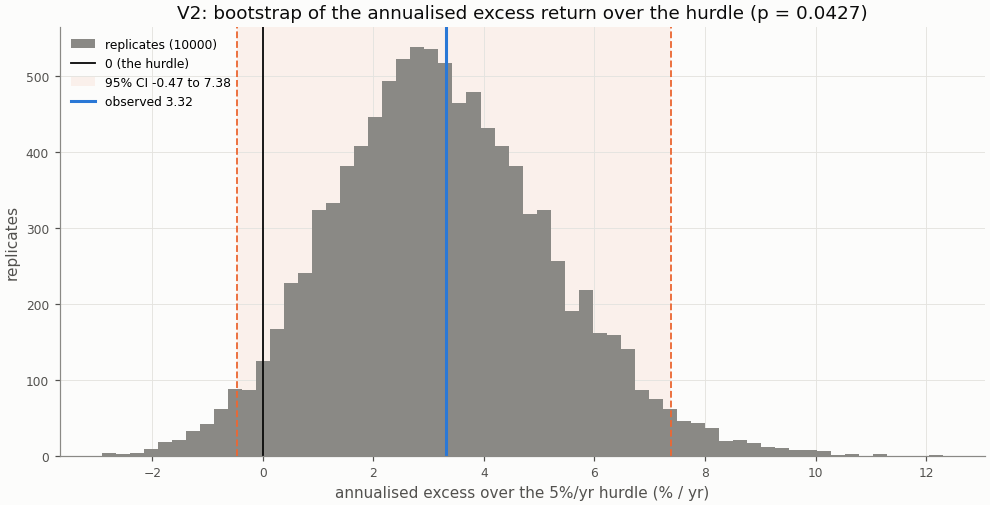
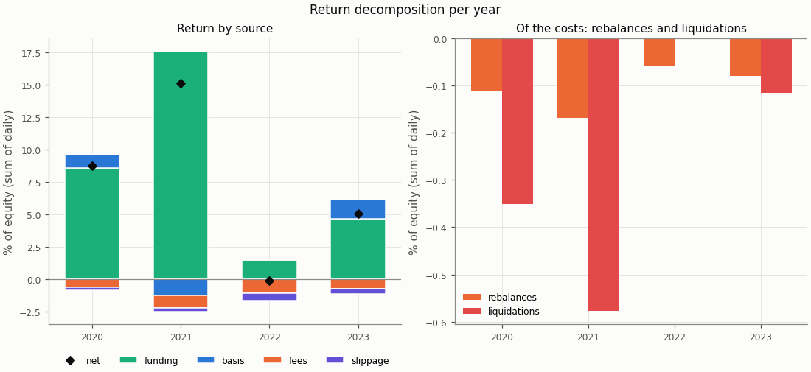
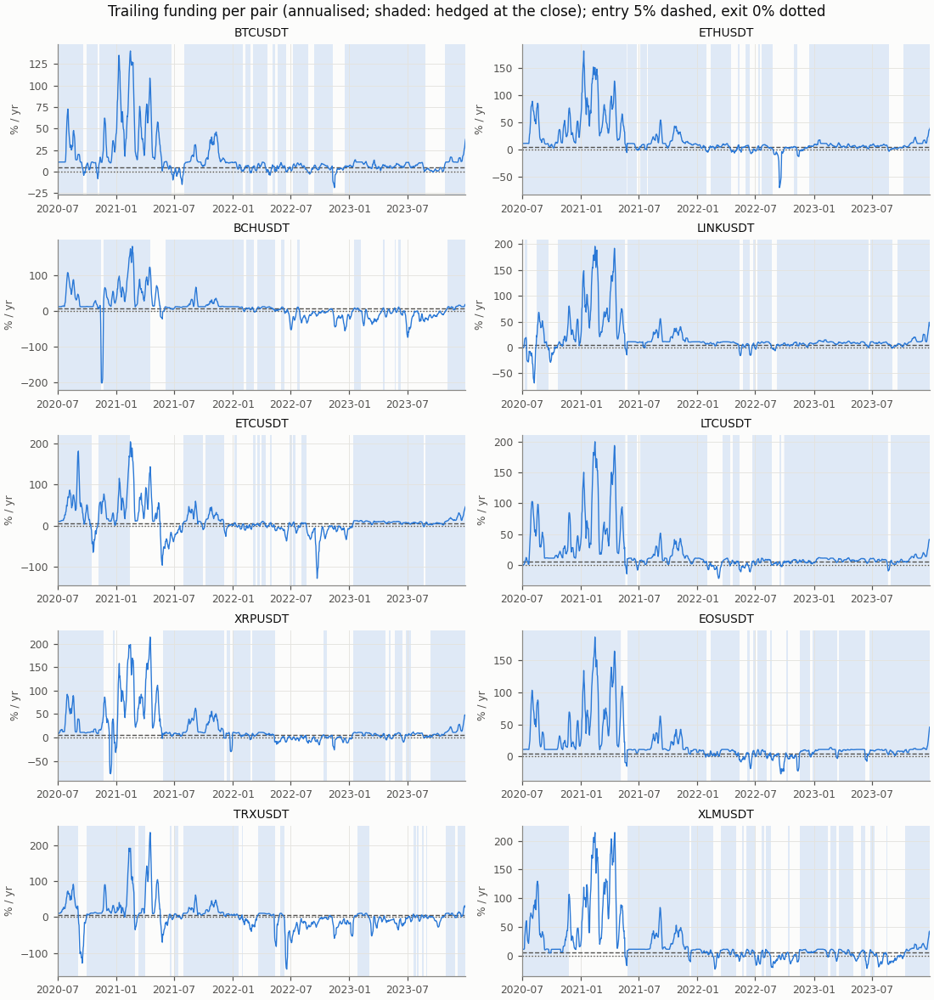
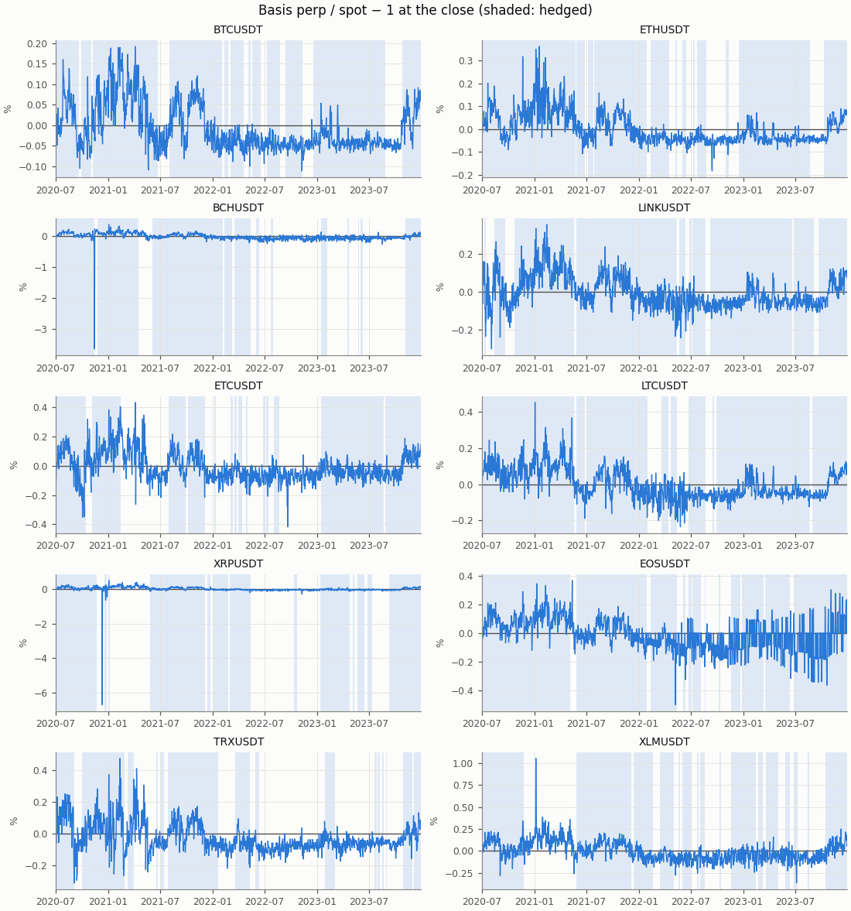

# Funding carry — exploratory row entry_5, in-sample

- Row: `entry_5` (exploratory: reported, no say in the verdict (a DSR trial))
- Signal: 7-day trailing funding (annualised); on above 5%/yr, off below 0%/yr, otherwise the previous state
- Sleeve: perp leverage 2 (equal sleeves, spot notional L / (L + 1) of a sleeve)
- Pairs: BTCUSDT, ETHUSDT, BCHUSDT, LINKUSDT, ETCUSDT, LTCUSDT, XRPUSDT, EOSUSDT, TRXUSDT, XLMUSDT
- Period: 2020-07-01 to 2023-12-31 (1279 return days)
- Variant id: `000210a66b6275f7a82fcb9340a6031c2466316fd51194ee742f0677701586f1`
- Pre-registration hash: `a44eee47990843ff13c81da0dd0db23d82a0811fdb4896366482818a6e14b242`
- Code version: `7ce43816563f41f4f2aa7318d46e382e027e7a547652ac4d6b748454fa80f240` (git `229ce16df98c4e2d359c7d8ac468ca00d644431e`)

## Headline

**Descriptive (in-sample; exploratory row `entry_5`, no say in the verdict): it would read edge.** V1 (net Sharpe above 0) passes, p = 0.0001; V2 (annualised net return above the 5%/yr hurdle) passes, p = 0.0427. Annualised net return 8.20% (95% CI 4.41% to 12.26%); excess over the hurdle 3.32% (95% CI -0.47% to 7.38%): proven above the hurdle (V2 passes).

In-sample: the period the pre-registration and the simplified screen were set on; the rule was frozen before any executor return was computed.

| Headline | Value |
|---|---|
| V1: net Sharpe (annualised) | 4.16 |
| V1: 95% CI | 2.50 to 6.62 |
| V1: p (one-sided) | 0.0001 |
| V1 passes | yes |
| V2: annualised net return | 8.20% |
| V2: annualised net return, 95% CI | 4.41% to 12.26% |
| V2: hurdle | 5.0% |
| V2: excess over the hurdle | 3.32% |
| V2: excess, 95% CI | -0.47% to 7.38% |
| V2: p (one-sided) | 0.0427 |
| V2 passes | yes |
| V2 reading | proven above the hurdle (V2 passes) |
| Reading | edge |
| Return days | 1279 |

## Rule

Edge iff V1 and V2 both pass, each one-sided at α = 0.05, unadjusted (overview CD8). V1: the portfolio's net daily Sharpe above 0; V2: the annualised net return (365 × mean daily return) above the 5%/yr hurdle (CD9), on the daily excess over its daily rate. Both by moving-block bootstrap, B = 10000, blocks of 30 days; 95% percentile CIs. V2 reads three ways (overview §3): proven above the hurdle (passes), not proven (the CI contains 0), proven below (the CI lies below 0).

Costs on every fill: perp taker 0.05%, spot taker 0.10%, slippage per leg (default 0.05%, BTCUSDT 0.02%, ETHUSDT 0.02%); funding from the data on the perp leg; liquidation fee 1.0%.

## Equity

The row against `always_on` (no filter: sleeves at perp leverage 2 held on every live day) over the same days, both from their own `stats.json`.

| Statistic | entry_5 | always_on |
|---|---|---|
| annualised return (365 × mean) | 8.20% | 5.36% |
| CAGR | 8.52% | 5.49% |
| annualised vol | 1.97% | 1.78% |
| Sharpe (annualised) | 4.16 | 3.01 |
| Sharpe, 95% CI | 2.50 to 6.62 | 1.39 to 5.57 |
| max drawdown | 2.26% | 2.29% |
| worst day | -1.34% | -1.37% |
| worst day: date | 2020-09-03 | 2020-09-03 |
| worst month | -1.63% | -1.66% |
| worst month: month | 2020-09 | 2020-09 |

## Hurdles

V2 against other hurdles, descriptive (overview §10.2): the same bootstrap draws as the verdict's V2, so the 5.0% row is the verdict's.

| Hurdle | Excess | 95% CI | p (one-sided) | Passes | Reading |
|---|---|---|---|---|---|
| 0.0% | 8.20% | 4.41% to 12.26% | 0.0001 | yes | proven above the hurdle (V2 passes) |
| 3.0% | 5.24% | 1.45% to 9.31% | 0.0017 | yes | proven above the hurdle (V2 passes) |
| 5.0% | 3.32% | -0.47% to 7.38% | 0.0427 | yes | proven above the hurdle (V2 passes) |
| 8.0% | 0.50% | -3.29% to 4.57% | 0.433 | no | not proven: the CI contains 0 |

## Filter value and random timing

Computed for the portfolio primary only (Phase 5 §5.9).

## Return decomposition

Fractions of equity summed over days (each day's money over the previous day's equity), so funding + basis − fees − slippage is the net. Basis is the two legs' price P&L (a liquidation's loss to its price included); the rebalance and liquidation costs are a part of fees and slippage, not added to them (Phase 4 §4.7).

| Total | Value |
|---|---|
| funding | 32.25% |
| basis | 1.36% |
| fees | 3.41% |
| slippage | 1.46% |
| of which rebalances | 0.42% |
| of which liquidations | 1.04% |
| net (sum of daily returns) | 28.73% |
| compounded | 33.19% |
| share of live pair-days on | 70.6% |
| pair-days on | 9026 |
| pair-days live | 12790 |
| entries | 127 |

| Year | Days | Funding | Basis | Fees | Slippage | of which rebalances | of which liquidations | Net | Compounded | Share on | Entries |
|---|---|---|---|---|---|---|---|---|---|---|---|
| 2020 | 184 | 8.54% | 1.05% | 0.64% | 0.19% | 0.11% | 0.35% | 8.76% | 9.11% | 88.3% | 18 |
| 2021 | 365 | 17.56% | -1.23% | 0.99% | 0.27% | 0.17% | 0.58% | 15.07% | 16.24% | 78.8% | 21 |
| 2022 | 365 | 1.49% | 0.06% | 1.06% | 0.61% | 0.06% | 0.00% | -0.12% | -0.12% | 49.9% | 56 |
| 2023 | 365 | 4.66% | 1.49% | 0.72% | 0.39% | 0.08% | 0.12% | 5.03% | 5.15% | 74.1% | 32 |

| Pair | Funding | Basis | Fees | Slippage | Net | Days on | Days live | Entries |
|---|---|---|---|---|---|---|---|---|
| BCHUSDT | 2.89% | -0.33% | 0.33% | 0.15% | 2.08% | 719 | 1279 | 12 |
| BTCUSDT | 3.05% | 0.00% | 0.24% | 0.06% | 2.75% | 1047 | 1279 | 12 |
| EOSUSDT | 3.85% | 0.51% | 0.33% | 0.15% | 3.88% | 1086 | 1279 | 12 |
| ETCUSDT | 2.92% | -0.75% | 0.37% | 0.18% | 1.61% | 746 | 1279 | 14 |
| ETHUSDT | 4.45% | -0.05% | 0.25% | 0.07% | 4.08% | 1027 | 1279 | 12 |
| LINKUSDT | 4.24% | 0.00% | 0.22% | 0.15% | 3.87% | 1138 | 1279 | 11 |
| LTCUSDT | 4.51% | -0.04% | 0.18% | 0.12% | 4.17% | 1122 | 1279 | 9 |
| TRXUSDT | 2.19% | -2.57% | 0.52% | 0.21% | -1.11% | 611 | 1279 | 16 |
| XLMUSDT | 2.13% | 2.59% | 0.41% | 0.20% | 4.11% | 779 | 1279 | 16 |
| XRPUSDT | 2.03% | 2.00% | 0.55% | 0.16% | 3.32% | 751 | 1279 | 13 |

## Funding and basis per pair

From the run folder's `signals.parquet`: the trailing funding the rule decides on and the basis at the close, per pair, with the days the pair was hedged at the close shaded.

## Margin events

Rebalance: at the close the perp wallet held less than half the margin at the target leverage; both legs were cut back at the next fill. Liquidation: the day high reached the liquidation price; the short was bought back there with the liquidation fee and the spot leg sold at the next fill (CD7).

| Event | Count | Cost (USDT) | Cost (% of equity) |
|---|---|---|---|
| rebalances | 111 | 49.11 | 0.420% |
| liquidations | 9 | 118.70 | 1.044% |

| Event | Date | Pair | Liquidation price / qty cut | Cost (USDT) | Cost (% of equity) |
|---|---|---|---|---|---|
| liquidation | 2020-09-03 | TRXUSDT | 0.046131 | 11.56 | 0.111% |
| liquidation | 2020-11-21 | XRPUSDT | 0.459134 | 12.30 | 0.118% |
| liquidation | 2020-11-24 | XLMUSDT | 0.167515 | 12.88 | 0.122% |
| liquidation | 2021-01-07 | XRPUSDT | 0.349566 | 12.52 | 0.114% |
| liquidation | 2021-02-13 | ETCUSDT | 17.549713 | 12.84 | 0.112% |
| liquidation | 2021-03-31 | TRXUSDT | 0.094552 | 13.26 | 0.113% |
| liquidation | 2021-04-16 | BCHUSDT | 1166.637874 | 13.78 | 0.115% |
| liquidation | 2021-05-06 | EOSUSDT | 11.671745 | 14.64 | 0.122% |
| liquidation | 2023-07-13 | XRPUSDT | 0.712099 | 14.91 | 0.116% |
| rebalance | 2020-07-09 | XLMUSDT | 2218.660170 | 0.48 | 0.005% |
| rebalance | 2020-07-15 | LINKUSDT | 20.286801 | 0.41 | 0.004% |
| rebalance | 2020-07-18 | XLMUSDT | 1312.052776 | 0.34 | 0.003% |
| rebalance | 2020-07-24 | ETHUSDT | 0.524942 | 0.27 | 0.003% |
| rebalance | 2020-07-26 | XRPUSDT | 685.096240 | 0.37 | 0.004% |
| rebalance | 2020-07-28 | BCHUSDT | 0.520284 | 0.35 | 0.003% |
| rebalance | 2020-07-28 | BTCUSDT | 0.013087 | 0.28 | 0.003% |
| rebalance | 2020-07-28 | ETCUSDT | 23.040362 | 0.41 | 0.004% |
| rebalance | 2020-07-28 | LTCUSDT | 3.794403 | 0.51 | 0.005% |
| rebalance | 2020-07-29 | EOSUSDT | 57.646066 | 0.43 | 0.004% |
| rebalance | 2020-07-31 | ETHUSDT | 0.419379 | 0.27 | 0.003% |
| rebalance | 2020-08-02 | TRXUSDT | 8091.534038 | 0.42 | 0.004% |
| rebalance | 2020-08-02 | XRPUSDT | 830.116377 | 0.61 | 0.006% |
| rebalance | 2020-08-14 | ETHUSDT | 0.411535 | 0.33 | 0.003% |
| rebalance | 2020-08-16 | EOSUSDT | 38.330024 | 0.36 | 0.003% |
| rebalance | 2020-08-16 | TRXUSDT | 5373.016190 | 0.34 | 0.003% |
| rebalance | 2020-08-18 | LTCUSDT | 2.219849 | 0.38 | 0.004% |
| rebalance | 2020-08-18 | TRXUSDT | 4967.225818 | 0.38 | 0.004% |
| rebalance | 2020-10-23 | BTCUSDT | 0.010609 | 0.26 | 0.003% |
| rebalance | 2020-11-18 | LINKUSDT | 14.133103 | 0.49 | 0.005% |
| rebalance | 2020-11-19 | BTCUSDT | 0.006209 | 0.21 | 0.002% |
| rebalance | 2020-11-22 | ETCUSDT | 30.431049 | 0.51 | 0.005% |
| rebalance | 2020-11-22 | ETHUSDT | 0.323887 | 0.34 | 0.003% |
| rebalance | 2020-11-22 | LTCUSDT | 2.060669 | 0.45 | 0.004% |
| rebalance | 2020-11-25 | TRXUSDT | 6787.595502 | 0.61 | 0.006% |
| rebalance | 2020-12-18 | BTCUSDT | 0.006583 | 0.28 | 0.003% |
| rebalance | 2020-12-19 | LTCUSDT | 1.465255 | 0.40 | 0.004% |
| rebalance | 2020-12-29 | BCHUSDT | 0.448771 | 0.41 | 0.004% |
| rebalance | 2020-12-29 | ETHUSDT | 0.289182 | 0.41 | 0.004% |
| rebalance | 2020-12-31 | BTCUSDT | 0.005426 | 0.30 | 0.003% |
| rebalance | 2021-01-03 | LTCUSDT | 1.318244 | 0.45 | 0.004% |

The first 40 of 120 events (liquidations first); all are in `stats.json` and `events.parquet`.

## Cost re-pricing

The row re-run at other costs, descriptive (overview §10.4); the verdict uses VIP 0. **No cell equals the verdict's costs**: the pre-registered slippage is per pair (default 0.05%, BTCUSDT 0.02%, ETHUSDT 0.02%), while a cell's slippage applies to every pair.

| Slippage | Spot taker | Perp taker | Annualised net return | Sharpe | Excess over the hurdle | 95% CI | p (V2) | V2 reading | Fees | Slippage cost | Entries |
|---|---|---|---|---|---|---|---|---|---|---|---|
| 0.00% | 0.075% | 0.050% | 8.74% | 4.43 | 3.86% | 0.22% to 7.87% | 0.0176 | proven above the hurdle (V2 passes) | 2.99% | 0.00% | 127 |
| 0.00% | 0.100% | 0.050% | 8.61% | 4.37 | 3.73% | 0.09% to 7.76% | 0.0215 | proven above the hurdle (V2 passes) | 3.41% | 0.00% | 127 |
| 0.02% | 0.075% | 0.050% | 8.55% | 4.34 | 3.67% | 0.01% to 7.70% | 0.0246 | proven above the hurdle (V2 passes) | 2.99% | 0.66% | 127 |
| 0.02% | 0.100% | 0.050% | 8.43% | 4.27 | 3.55% | -0.11% to 7.58% | 0.0308 | proven above the hurdle (V2 passes) | 3.41% | 0.66% | 127 |
| 0.05% | 0.075% | 0.050% | 8.26% | 4.19 | 3.38% | -0.29% to 7.44% | 0.0376 | proven above the hurdle (V2 passes) | 2.99% | 1.66% | 127 |
| 0.05% | 0.100% | 0.050% | 8.14% | 4.12 | 3.26% | -0.40% to 7.34% | 0.0427 | proven above the hurdle (V2 passes) | 3.41% | 1.66% | 127 |
| 0.10% | 0.075% | 0.050% | 7.79% | 3.94 | 2.91% | -0.78% to 7.00% | 0.0693 | not proven: the CI contains 0 | 2.99% | 3.31% | 127 |
| 0.10% | 0.100% | 0.050% | 7.67% | 3.87 | 2.79% | -0.90% to 6.88% | 0.0787 | not proven: the CI contains 0 | 3.41% | 3.31% | 127 |

## Per-pair rows

Each pair alone as a one-pair portfolio under the `entry_5` row, from its own folder's `stats.json`; descriptive, no say in the verdict. A pair whose data ends before the period end (a delisting) is not run alone; the portfolio closes it by the delisting rule.

| Pair | Annualised net return | Excess over the hurdle | 95% CI (excess) | p (V2) | V2 reading | Sharpe | p (V1) | Reading | Share on |
|---|---|---|---|---|---|---|---|---|---|
| BTCUSDT | 8.89% | 4.01% | 0.36% to 8.25% | 0.0145 | proven above the hurdle (V2 passes) | 8.60 | 0.0001 | edge | 81.9% |
| ETHUSDT | 11.24% | 6.36% | 1.66% to 11.93% | 0.0024 | proven above the hurdle (V2 passes) | 8.14 | 0.0001 | edge | 80.3% |
| BCHUSDT | 5.97% | 1.09% | -3.38% to 5.85% | 0.341 | not proven: the CI contains 0 | 1.66 | 0.0036 | positive below the hurdle | 56.2% |
| LINKUSDT | 10.91% | 6.03% | 1.20% to 12.08% | 0.0043 | proven above the hurdle (V2 passes) | 7.19 | 0.0001 | edge | 89.0% |
| ETCUSDT | 4.54% | -0.33% | -5.45% to 4.11% | 0.576 | not proven: the CI contains 0 | 1.34 | 0.044 | positive below the hurdle | 58.3% |
| LTCUSDT | 11.53% | 6.66% | 1.77% to 12.34% | 0.0014 | proven above the hurdle (V2 passes) | 7.82 | 0.0001 | edge | 87.7% |
| XRPUSDT | 9.47% | 4.59% | -2.82% to 14.40% | 0.167 | not proven: the CI contains 0 | 1.01 | 0.0031 | positive below the hurdle | 58.7% |
| EOSUSDT | 10.93% | 6.05% | 1.22% to 11.80% | 0.0051 | proven above the hurdle (V2 passes) | 2.61 | 0.0001 | edge | 84.9% |
| TRXUSDT | -3.52% | -8.40% | -24.97% to 1.68% | 0.922 | not proven: the CI contains 0 | -0.36 | 0.651 | no edge | 47.8% |
| XLMUSDT | 11.12% | 6.24% | -2.86% to 21.31% | 0.242 | not proven: the CI contains 0 | 1.17 | 0.0002 | positive below the hurdle | 60.9% |

## Deflated Sharpe ratio

Computed for the portfolio primary only, with the seven pre-registered rows as trials.

## Unmodelled risks

A backtest cannot show the main risk of a carry trade: **exchange and counterparty risk** (an exchange failure, a frozen withdrawal), which is not modelled (overview §5 item 5). Also not modelled: auto-deleveraging, rule changes such as funding caps, and the yield idle USDT could earn (an off sleeve earns 0; the hurdle stands for it). Funding-interval changes are in the data. Costs are Binance VIP 0 without the BNB discount; the re-pricing table shows the sensitivity.

## Notes

- The V2 bootstrap figure redraws the verdict's replicates at report time with its own seed (`insample/entry_5/v2`); their p and CI equal `stats.json`'s.
- Numbers in the tables are `stats.json` values; the figures read the run folder's tables.
