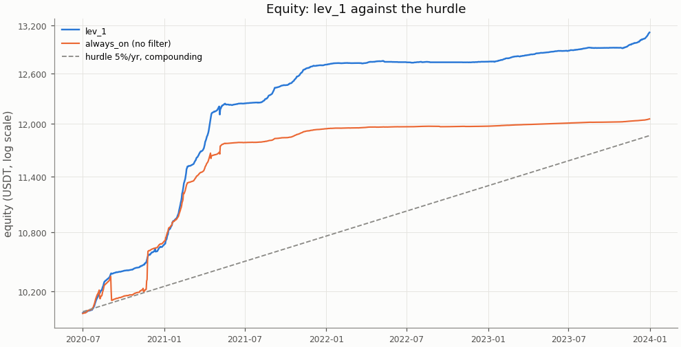
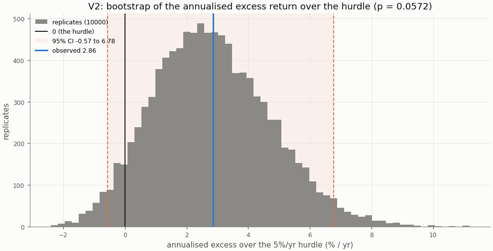
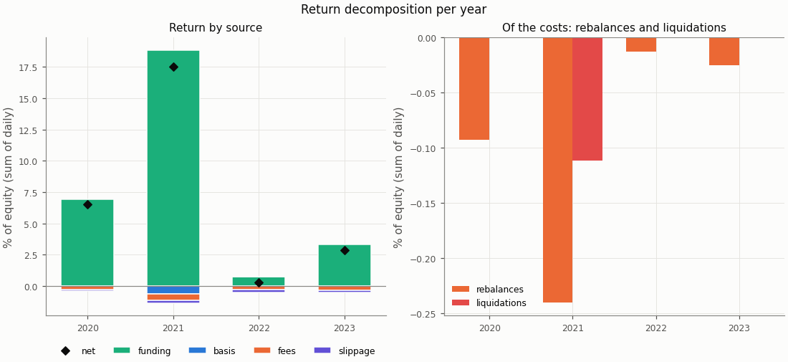
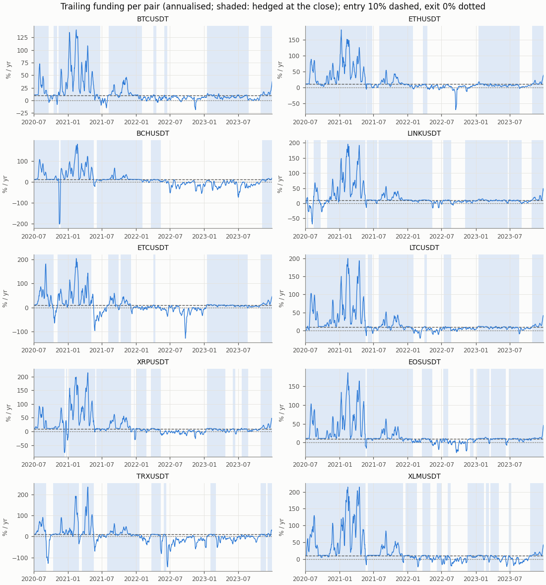
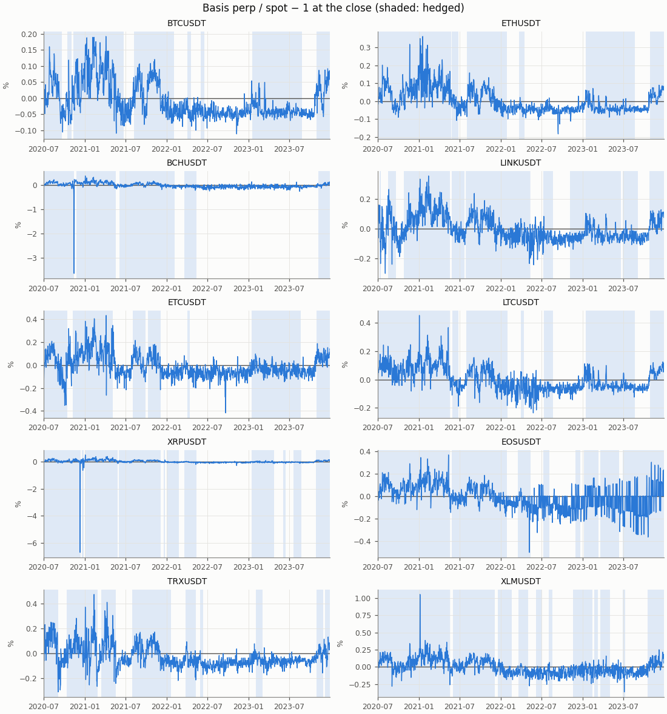

# Funding carry — exploratory row lev_1, in-sample

- Row: `lev_1` (exploratory: reported, no say in the verdict (a DSR trial))
- Signal: 7-day trailing funding (annualised); on above 10%/yr, off below 0%/yr, otherwise the previous state
- Sleeve: perp leverage 1 (equal sleeves, spot notional L / (L + 1) of a sleeve)
- Pairs: BTCUSDT, ETHUSDT, BCHUSDT, LINKUSDT, ETCUSDT, LTCUSDT, XRPUSDT, EOSUSDT, TRXUSDT, XLMUSDT
- Period: 2020-07-01 to 2023-12-31 (1279 return days)
- Variant id: `0c86ff24e59b56257aec91ff68b96badfe6e012cdfc72f57c9d747c2191e0bb3`
- Pre-registration hash: `a44eee47990843ff13c81da0dd0db23d82a0811fdb4896366482818a6e14b242`
- Code version: `7ce43816563f41f4f2aa7318d46e382e027e7a547652ac4d6b748454fa80f240` (git `229ce16df98c4e2d359c7d8ac468ca00d644431e`)

## Headline

**Descriptive (in-sample; exploratory row `lev_1`, no say in the verdict): it would read positive below the hurdle.** V1 (net Sharpe above 0) passes, p = 0.0001; V2 (annualised net return above the 5%/yr hurdle) fails, p = 0.0572. Annualised net return 7.74% (95% CI 4.31% to 11.66%); excess over the hurdle 2.86% (95% CI -0.57% to 6.78%): not proven: the CI contains 0.

In-sample: the period the pre-registration and the simplified screen were set on; the rule was frozen before any executor return was computed.

| Headline | Value |
|---|---|
| V1: net Sharpe (annualised) | 7.20 |
| V1: 95% CI | 4.86 to 9.48 |
| V1: p (one-sided) | 0.0001 |
| V1 passes | yes |
| V2: annualised net return | 7.74% |
| V2: annualised net return, 95% CI | 4.31% to 11.66% |
| V2: hurdle | 5.0% |
| V2: excess over the hurdle | 2.86% |
| V2: excess, 95% CI | -0.57% to 6.78% |
| V2: p (one-sided) | 0.0572 |
| V2 passes | no |
| V2 reading | not proven: the CI contains 0 |
| Reading | positive below the hurdle |
| Return days | 1279 |

## Rule

Edge iff V1 and V2 both pass, each one-sided at α = 0.05, unadjusted (overview CD8). V1: the portfolio's net daily Sharpe above 0; V2: the annualised net return (365 × mean daily return) above the 5%/yr hurdle (CD9), on the daily excess over its daily rate. Both by moving-block bootstrap, B = 10000, blocks of 30 days; 95% percentile CIs. V2 reads three ways (overview §3): proven above the hurdle (passes), not proven (the CI contains 0), proven below (the CI lies below 0).

Costs on every fill: perp taker 0.05%, spot taker 0.10%, slippage per leg (default 0.05%, BTCUSDT 0.02%, ETHUSDT 0.02%); funding from the data on the perp leg; liquidation fee 1.0%.

## Equity

The row against `always_on` (no filter: sleeves at perp leverage 2 held on every live day) over the same days, both from their own `stats.json`.

| Statistic | lev_1 | always_on |
|---|---|---|
| annualised return (365 × mean) | 7.74% | 5.36% |
| CAGR | 8.04% | 5.49% |
| annualised vol | 1.08% | 1.78% |
| Sharpe (annualised) | 7.20 | 3.01 |
| Sharpe, 95% CI | 4.86 to 9.48 | 1.39 to 5.57 |
| max drawdown | 0.78% | 2.29% |
| worst day | -0.78% | -1.37% |
| worst day: date | 2021-05-06 | 2020-09-03 |
| worst month | -0.08% | -1.66% |
| worst month: month | 2022-05 | 2020-09 |

## Hurdles

V2 against other hurdles, descriptive (overview §10.2): the same bootstrap draws as the verdict's V2, so the 5.0% row is the verdict's.

| Hurdle | Excess | 95% CI | p (one-sided) | Passes | Reading |
|---|---|---|---|---|---|
| 0.0% | 7.74% | 4.31% to 11.66% | 0.0001 | yes | proven above the hurdle (V2 passes) |
| 3.0% | 4.79% | 1.36% to 8.70% | 0.0013 | yes | proven above the hurdle (V2 passes) |
| 5.0% | 2.86% | -0.57% to 6.78% | 0.0572 | no | not proven: the CI contains 0 |
| 8.0% | 0.05% | -3.38% to 3.96% | 0.522 | no | not proven: the CI contains 0 |

## Filter value and random timing

Computed for the portfolio primary only (Phase 5 §5.9).

## Return decomposition

Fractions of equity summed over days (each day's money over the previous day's equity), so funding + basis − fees − slippage is the net. Basis is the two legs' price P&L (a liquidation's loss to its price included); the rebalance and liquidation costs are a part of fees and slippage, not added to them (Phase 4 §4.7).

| Total | Value |
|---|---|
| funding | 29.85% |
| basis | -0.63% |
| fees | 1.35% |
| slippage | 0.74% |
| of which rebalances | 0.37% |
| of which liquidations | 0.11% |
| net (sum of daily returns) | 27.13% |
| compounded | 31.14% |
| share of live pair-days on | 64.1% |
| pair-days on | 8194 |
| pair-days live | 12790 |
| entries | 81 |

| Year | Days | Funding | Basis | Fees | Slippage | of which rebalances | of which liquidations | Net | Compounded | Share on | Entries |
|---|---|---|---|---|---|---|---|---|---|---|---|
| 2020 | 184 | 6.91% | -0.01% | 0.25% | 0.14% | 0.09% | 0.00% | 6.50% | 6.71% | 89.7% | 18 |
| 2021 | 365 | 18.86% | -0.65% | 0.48% | 0.23% | 0.24% | 0.11% | 17.50% | 19.10% | 88.0% | 18 |
| 2022 | 365 | 0.75% | 0.02% | 0.30% | 0.18% | 0.01% | 0.00% | 0.29% | 0.29% | 28.0% | 20 |
| 2023 | 365 | 3.34% | 0.00% | 0.31% | 0.19% | 0.03% | 0.00% | 2.84% | 2.88% | 63.3% | 25 |

| Pair | Funding | Basis | Fees | Slippage | Net | Days on | Days live | Entries |
|---|---|---|---|---|---|---|---|---|
| BCHUSDT | 2.40% | 0.04% | 0.07% | 0.05% | 2.32% | 667 | 1279 | 5 |
| BTCUSDT | 2.43% | 0.00% | 0.12% | 0.03% | 2.27% | 818 | 1279 | 8 |
| EOSUSDT | 2.99% | -0.04% | 0.12% | 0.08% | 2.76% | 1008 | 1279 | 8 |
| ETCUSDT | 2.82% | -0.49% | 0.21% | 0.08% | 2.05% | 693 | 1279 | 7 |
| ETHUSDT | 3.31% | -0.03% | 0.10% | 0.03% | 3.15% | 844 | 1279 | 6 |
| LINKUSDT | 3.13% | -0.02% | 0.13% | 0.09% | 2.89% | 999 | 1279 | 9 |
| LTCUSDT | 3.29% | -0.01% | 0.11% | 0.07% | 3.09% | 870 | 1279 | 7 |
| TRXUSDT | 2.36% | -0.01% | 0.15% | 0.10% | 2.10% | 589 | 1279 | 9 |
| XLMUSDT | 3.71% | -0.06% | 0.17% | 0.11% | 3.37% | 889 | 1279 | 11 |
| XRPUSDT | 3.43% | -0.03% | 0.17% | 0.12% | 3.11% | 817 | 1279 | 11 |

## Funding and basis per pair

From the run folder's `signals.parquet`: the trailing funding the rule decides on and the basis at the close, per pair, with the days the pair was hedged at the close shaded.

## Margin events

Rebalance: at the close the perp wallet held less than half the margin at the target leverage; both legs were cut back at the next fill. Liquidation: the day high reached the liquidation price; the short was bought back there with the liquidation fee and the spot leg sold at the next fill (CD7).

| Event | Count | Cost (USDT) | Cost (% of equity) |
|---|---|---|---|
| rebalances | 73 | 42.41 | 0.371% |
| liquidations | 1 | 13.58 | 0.111% |

| Event | Date | Pair | Liquidation price / qty cut | Cost (USDT) | Cost (% of equity) |
|---|---|---|---|---|---|
| liquidation | 2021-05-06 | ETCUSDT | 147.060624 | 13.58 | 0.111% |
| rebalance | 2020-07-10 | XLMUSDT | 1877.839928 | 0.42 | 0.004% |
| rebalance | 2020-07-26 | ETHUSDT | 0.569189 | 0.33 | 0.003% |
| rebalance | 2020-07-29 | LTCUSDT | 3.157233 | 0.44 | 0.004% |
| rebalance | 2020-07-30 | XRPUSDT | 760.825434 | 0.46 | 0.005% |
| rebalance | 2020-08-01 | BCHUSDT | 0.564849 | 0.42 | 0.004% |
| rebalance | 2020-08-02 | EOSUSDT | 58.915496 | 0.49 | 0.005% |
| rebalance | 2020-08-02 | ETCUSDT | 23.208407 | 0.46 | 0.005% |
| rebalance | 2020-08-14 | ETHUSDT | 0.457393 | 0.37 | 0.004% |
| rebalance | 2020-08-14 | TRXUSDT | 7877.925707 | 0.44 | 0.004% |
| rebalance | 2020-08-18 | TRXUSDT | 6081.981034 | 0.47 | 0.005% |
| rebalance | 2020-11-20 | LTCUSDT | 2.580484 | 0.53 | 0.005% |
| rebalance | 2020-11-22 | XRPUSDT | 1031.488330 | 1.27 | 0.012% |
| rebalance | 2020-11-24 | ETHUSDT | 0.321455 | 0.37 | 0.004% |
| rebalance | 2020-11-24 | XLMUSDT | 1700.509420 | 0.58 | 0.006% |
| rebalance | 2020-11-25 | XLMUSDT | 1355.751215 | 0.71 | 0.007% |
| rebalance | 2020-11-25 | XRPUSDT | 314.604765 | 0.55 | 0.005% |
| rebalance | 2020-12-17 | BTCUSDT | 0.008905 | 0.36 | 0.003% |
| rebalance | 2020-12-20 | LTCUSDT | 1.933192 | 0.58 | 0.005% |
| rebalance | 2020-12-31 | BTCUSDT | 0.006315 | 0.35 | 0.003% |
| rebalance | 2021-01-04 | BCHUSDT | 0.533051 | 0.56 | 0.005% |
| rebalance | 2021-01-04 | ETHUSDT | 0.318935 | 0.59 | 0.006% |
| rebalance | 2021-01-04 | LTCUSDT | 1.119009 | 0.45 | 0.004% |
| rebalance | 2021-01-07 | ETCUSDT | 24.665105 | 0.46 | 0.004% |
| rebalance | 2021-01-07 | LINKUSDT | 11.647761 | 0.49 | 0.005% |
| rebalance | 2021-01-07 | XLMUSDT | 910.787455 | 0.74 | 0.007% |
| rebalance | 2021-01-08 | XRPUSDT | 712.173236 | 0.61 | 0.006% |
| rebalance | 2021-01-09 | BTCUSDT | 0.004704 | 0.36 | 0.003% |
| rebalance | 2021-01-10 | BCHUSDT | 0.326453 | 0.46 | 0.004% |
| rebalance | 2021-01-18 | LINKUSDT | 8.044365 | 0.46 | 0.004% |
| rebalance | 2021-01-20 | ETHUSDT | 0.153363 | 0.40 | 0.004% |
| rebalance | 2021-02-01 | XRPUSDT | 417.777890 | 0.50 | 0.005% |
| rebalance | 2021-02-09 | TRXUSDT | 6206.713248 | 0.64 | 0.006% |
| rebalance | 2021-02-12 | ETCUSDT | 23.696363 | 0.69 | 0.006% |
| rebalance | 2021-02-12 | TRXUSDT | 3466.364342 | 0.48 | 0.004% |
| rebalance | 2021-02-13 | XLMUSDT | 630.963671 | 0.89 | 0.008% |
| rebalance | 2021-02-14 | EOSUSDT | 50.128770 | 0.69 | 0.006% |
| rebalance | 2021-02-14 | ETCUSDT | 13.371019 | 0.54 | 0.005% |
| rebalance | 2021-02-14 | LINKUSDT | 6.906836 | 0.59 | 0.005% |
| rebalance | 2021-02-18 | LTCUSDT | 0.925746 | 0.55 | 0.005% |

The first 40 of 74 events (liquidations first); all are in `stats.json` and `events.parquet`.

## Cost re-pricing

The row re-run at other costs, descriptive (overview §10.4); the verdict uses VIP 0. **No cell equals the verdict's costs**: the pre-registered slippage is per pair (default 0.05%, BTCUSDT 0.02%, ETHUSDT 0.02%), while a cell's slippage applies to every pair.

| Slippage | Spot taker | Perp taker | Annualised net return | Sharpe | Excess over the hurdle | 95% CI | p (V2) | V2 reading | Fees | Slippage cost | Entries |
|---|---|---|---|---|---|---|---|---|---|---|---|
| 0.00% | 0.075% | 0.050% | 8.01% | 7.45 | 3.13% | -0.36% to 7.17% | 0.0419 | proven above the hurdle (V2 passes) | 1.14% | 0.00% | 81 |
| 0.00% | 0.100% | 0.050% | 7.95% | 7.40 | 3.07% | -0.41% to 7.11% | 0.0447 | proven above the hurdle (V2 passes) | 1.35% | 0.00% | 81 |
| 0.02% | 0.075% | 0.050% | 7.92% | 7.37 | 3.04% | -0.45% to 7.07% | 0.0471 | proven above the hurdle (V2 passes) | 1.14% | 0.33% | 81 |
| 0.02% | 0.100% | 0.050% | 7.86% | 7.31 | 2.98% | -0.50% to 7.01% | 0.0508 | not proven: the CI contains 0 | 1.35% | 0.33% | 81 |
| 0.05% | 0.075% | 0.050% | 7.78% | 7.23 | 2.90% | -0.58% to 6.93% | 0.0583 | not proven: the CI contains 0 | 1.14% | 0.83% | 81 |
| 0.05% | 0.100% | 0.050% | 7.72% | 7.17 | 2.84% | -0.65% to 6.88% | 0.0635 | not proven: the CI contains 0 | 1.35% | 0.83% | 81 |
| 0.10% | 0.075% | 0.050% | 7.54% | 7.00 | 2.66% | -0.81% to 6.70% | 0.0767 | not proven: the CI contains 0 | 1.14% | 1.66% | 81 |
| 0.10% | 0.100% | 0.050% | 7.48% | 6.94 | 2.60% | -0.87% to 6.65% | 0.0813 | not proven: the CI contains 0 | 1.35% | 1.66% | 81 |

## Per-pair rows

Each pair alone as a one-pair portfolio under the `lev_1` row, from its own folder's `stats.json`; descriptive, no say in the verdict. A pair whose data ends before the period end (a delisting) is not run alone; the portfolio closes it by the delisting rule.

| Pair | Annualised net return | Excess over the hurdle | 95% CI (excess) | p (V2) | V2 reading | Sharpe | p (V1) | Reading | Share on |
|---|---|---|---|---|---|---|---|---|---|
| BTCUSDT | 6.72% | 1.84% | -1.08% to 5.05% | 0.127 | not proven: the CI contains 0 | 8.25 | 0.0001 | positive below the hurdle | 64.0% |
| ETHUSDT | 8.85% | 3.97% | 0.05% to 8.26% | 0.0226 | proven above the hurdle (V2 passes) | 8.08 | 0.0001 | edge | 66.0% |
| BCHUSDT | 6.65% | 1.77% | -1.31% to 5.43% | 0.153 | not proven: the CI contains 0 | 6.97 | 0.0001 | positive below the hurdle | 52.2% |
| LINKUSDT | 8.20% | 3.32% | -0.21% to 7.76% | 0.0345 | proven above the hurdle (V2 passes) | 7.28 | 0.0001 | edge | 78.1% |
| ETCUSDT | 5.94% | 1.06% | -4.12% to 5.65% | 0.346 | not proven: the CI contains 0 | 1.01 | 0.0118 | positive below the hurdle | 54.2% |
| LTCUSDT | 8.74% | 3.86% | 0.12% to 8.18% | 0.0197 | proven above the hurdle (V2 passes) | 7.82 | 0.0001 | edge | 68.0% |
| XRPUSDT | 8.86% | 3.98% | -0.36% to 9.00% | 0.041 | proven above the hurdle (V2 passes) | 3.86 | 0.0001 | edge | 63.9% |
| EOSUSDT | 7.90% | 3.02% | -0.25% to 6.91% | 0.0393 | proven above the hurdle (V2 passes) | 6.61 | 0.0001 | edge | 78.8% |
| TRXUSDT | 6.07% | 1.19% | -2.09% to 5.14% | 0.272 | not proven: the CI contains 0 | 4.88 | 0.0001 | positive below the hurdle | 46.1% |
| XLMUSDT | 9.41% | 4.53% | -0.01% to 9.63% | 0.0255 | proven above the hurdle (V2 passes) | 6.57 | 0.0001 | edge | 69.5% |

## Deflated Sharpe ratio

Computed for the portfolio primary only, with the seven pre-registered rows as trials.

## Unmodelled risks

A backtest cannot show the main risk of a carry trade: **exchange and counterparty risk** (an exchange failure, a frozen withdrawal), which is not modelled (overview §5 item 5). Also not modelled: auto-deleveraging, rule changes such as funding caps, and the yield idle USDT could earn (an off sleeve earns 0; the hurdle stands for it). Funding-interval changes are in the data. Costs are Binance VIP 0 without the BNB discount; the re-pricing table shows the sensitivity.

## Notes

- The V2 bootstrap figure redraws the verdict's replicates at report time with its own seed (`insample/lev_1/v2`); their p and CI equal `stats.json`'s.
- Numbers in the tables are `stats.json` values; the figures read the run folder's tables.
