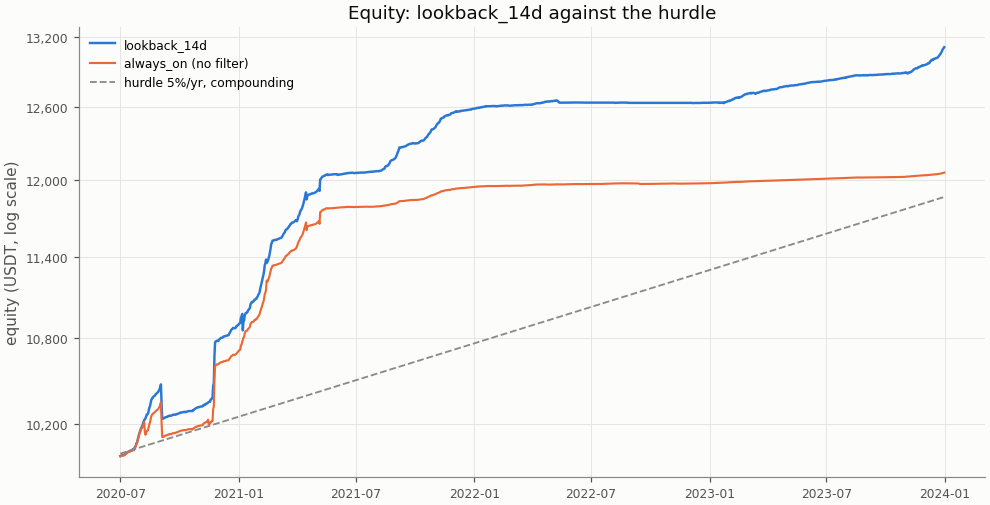
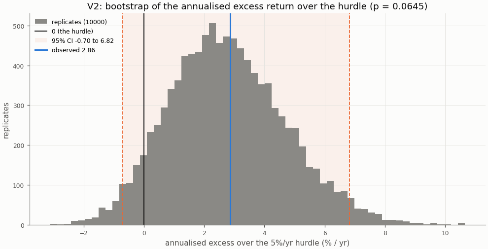
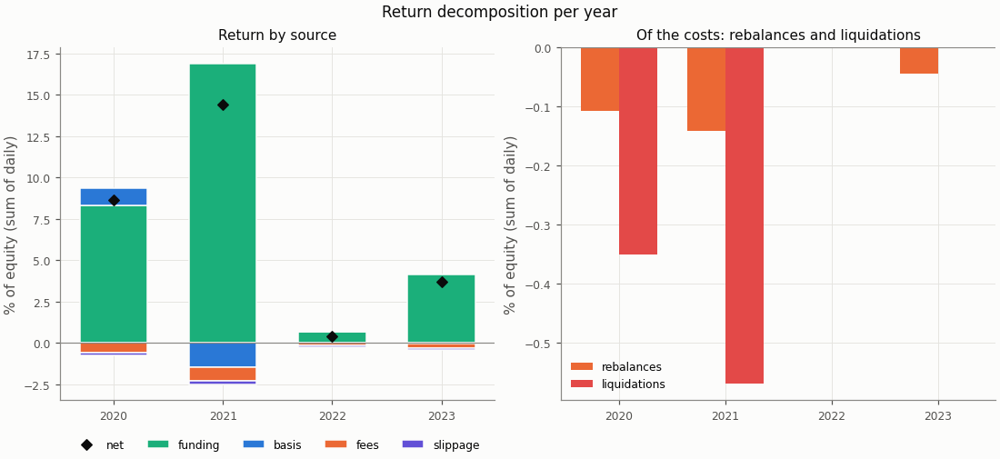
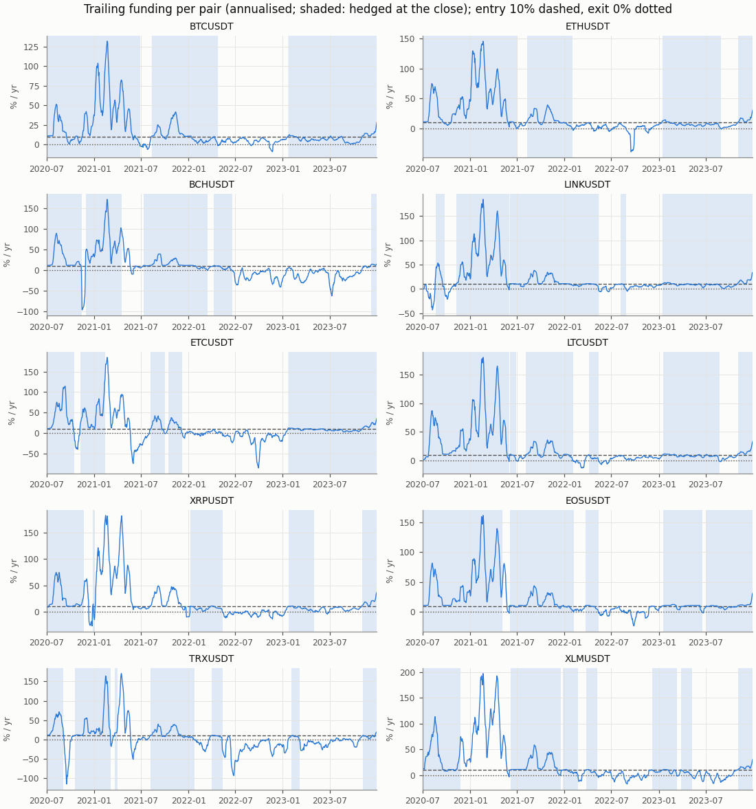
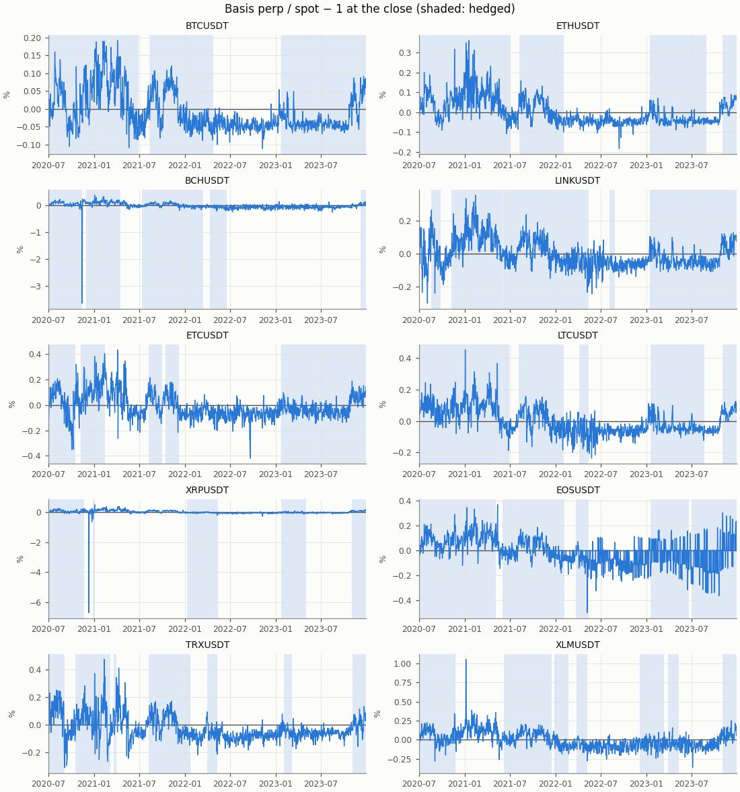

# Funding carry — exploratory row lookback_14d, in-sample

- Row: `lookback_14d` (exploratory: reported, no say in the verdict (a DSR trial))
- Signal: 14-day trailing funding (annualised); on above 10%/yr, off below 0%/yr, otherwise the previous state
- Sleeve: perp leverage 2 (equal sleeves, spot notional L / (L + 1) of a sleeve)
- Pairs: BTCUSDT, ETHUSDT, BCHUSDT, LINKUSDT, ETCUSDT, LTCUSDT, XRPUSDT, EOSUSDT, TRXUSDT, XLMUSDT
- Period: 2020-07-01 to 2023-12-31 (1279 return days)
- Variant id: `596af74623742cc809dbb4e4dbe2cb21f300c9e5052fa89548bf2d1663a82bd9`
- Pre-registration hash: `a44eee47990843ff13c81da0dd0db23d82a0811fdb4896366482818a6e14b242`
- Code version: `7ce43816563f41f4f2aa7318d46e382e027e7a547652ac4d6b748454fa80f240` (git `229ce16df98c4e2d359c7d8ac468ca00d644431e`)

## Headline

**Descriptive (in-sample; exploratory row `lookback_14d`, no say in the verdict): it would read positive below the hurdle.** V1 (net Sharpe above 0) passes, p = 0.0001; V2 (annualised net return above the 5%/yr hurdle) fails, p = 0.0645. Annualised net return 7.74% (95% CI 4.18% to 11.70%); excess over the hurdle 2.86% (95% CI -0.70% to 6.82%): not proven: the CI contains 0.

In-sample: the period the pre-registration and the simplified screen were set on; the rule was frozen before any executor return was computed.

| Headline | Value |
|---|---|
| V1: net Sharpe (annualised) | 4.10 |
| V1: 95% CI | 2.42 to 7.03 |
| V1: p (one-sided) | 0.0001 |
| V1 passes | yes |
| V2: annualised net return | 7.74% |
| V2: annualised net return, 95% CI | 4.18% to 11.70% |
| V2: hurdle | 5.0% |
| V2: excess over the hurdle | 2.86% |
| V2: excess, 95% CI | -0.70% to 6.82% |
| V2: p (one-sided) | 0.0645 |
| V2 passes | no |
| V2 reading | not proven: the CI contains 0 |
| Reading | positive below the hurdle |
| Return days | 1279 |

## Rule

Edge iff V1 and V2 both pass, each one-sided at α = 0.05, unadjusted (overview CD8). V1: the portfolio's net daily Sharpe above 0; V2: the annualised net return (365 × mean daily return) above the 5%/yr hurdle (CD9), on the daily excess over its daily rate. Both by moving-block bootstrap, B = 10000, blocks of 30 days; 95% percentile CIs. V2 reads three ways (overview §3): proven above the hurdle (passes), not proven (the CI contains 0), proven below (the CI lies below 0).

Costs on every fill: perp taker 0.05%, spot taker 0.10%, slippage per leg (default 0.05%, BTCUSDT 0.02%, ETHUSDT 0.02%); funding from the data on the perp leg; liquidation fee 1.0%.

## Equity

The row against `always_on` (no filter: sleeves at perp leverage 2 held on every live day) over the same days, both from their own `stats.json`.

| Statistic | lookback_14d | always_on |
|---|---|---|
| annualised return (365 × mean) | 7.74% | 5.36% |
| CAGR | 8.03% | 5.49% |
| annualised vol | 1.89% | 1.78% |
| Sharpe (annualised) | 4.10 | 3.01 |
| Sharpe, 95% CI | 2.42 to 7.03 | 1.39 to 5.57 |
| max drawdown | 2.26% | 2.29% |
| worst day | -1.34% | -1.37% |
| worst day: date | 2020-09-03 | 2020-09-03 |
| worst month | -1.61% | -1.66% |
| worst month: month | 2020-09 | 2020-09 |

## Hurdles

V2 against other hurdles, descriptive (overview §10.2): the same bootstrap draws as the verdict's V2, so the 5.0% row is the verdict's.

| Hurdle | Excess | 95% CI | p (one-sided) | Passes | Reading |
|---|---|---|---|---|---|
| 0.0% | 7.74% | 4.18% to 11.70% | 0.0001 | yes | proven above the hurdle (V2 passes) |
| 3.0% | 4.79% | 1.23% to 8.74% | 0.003 | yes | proven above the hurdle (V2 passes) |
| 5.0% | 2.86% | -0.70% to 6.82% | 0.0645 | no | not proven: the CI contains 0 |
| 8.0% | 0.05% | -3.51% to 4.00% | 0.531 | no | not proven: the CI contains 0 |

## Filter value and random timing

Computed for the portfolio primary only (Phase 5 §5.9).

## Return decomposition

Fractions of equity summed over days (each day's money over the previous day's equity), so funding + basis − fees − slippage is the net. Basis is the two legs' price P&L (a liquidation's loss to its price included); the rebalance and liquidation costs are a part of fees and slippage, not added to them (Phase 4 §4.7).

| Total | Value |
|---|---|
| funding | 30.02% |
| basis | -0.45% |
| fees | 1.83% |
| slippage | 0.60% |
| of which rebalances | 0.29% |
| of which liquidations | 0.92% |
| net (sum of daily returns) | 27.13% |
| compounded | 31.08% |
| share of live pair-days on | 57.8% |
| pair-days on | 7398 |
| pair-days live | 12790 |
| entries | 53 |

| Year | Days | Funding | Basis | Fees | Slippage | of which rebalances | of which liquidations | Net | Compounded | Share on | Entries |
|---|---|---|---|---|---|---|---|---|---|---|---|
| 2020 | 184 | 8.31% | 1.06% | 0.58% | 0.16% | 0.11% | 0.35% | 8.63% | 8.96% | 86.3% | 15 |
| 2021 | 365 | 16.90% | -1.47% | 0.84% | 0.19% | 0.14% | 0.57% | 14.41% | 15.47% | 69.2% | 14 |
| 2022 | 365 | 0.66% | 0.00% | 0.16% | 0.10% | 0.00% | 0.00% | 0.40% | 0.40% | 25.0% | 8 |
| 2023 | 365 | 4.14% | -0.05% | 0.25% | 0.14% | 0.05% | 0.00% | 3.70% | 3.77% | 65.1% | 16 |

| Pair | Funding | Basis | Fees | Slippage | Net | Days on | Days live | Entries |
|---|---|---|---|---|---|---|---|---|
| BCHUSDT | 2.74% | -0.37% | 0.20% | 0.06% | 2.11% | 613 | 1279 | 5 |
| BTCUSDT | 3.29% | -0.02% | 0.07% | 0.02% | 3.18% | 962 | 1279 | 3 |
| EOSUSDT | 3.71% | 0.49% | 0.19% | 0.06% | 3.95% | 939 | 1279 | 5 |
| ETCUSDT | 2.65% | -0.66% | 0.18% | 0.06% | 1.75% | 658 | 1279 | 5 |
| ETHUSDT | 4.22% | -0.03% | 0.10% | 0.03% | 4.06% | 829 | 1279 | 4 |
| LINKUSDT | 3.74% | -0.01% | 0.09% | 0.06% | 3.58% | 958 | 1279 | 5 |
| LTCUSDT | 4.23% | -0.02% | 0.12% | 0.08% | 4.01% | 859 | 1279 | 6 |
| TRXUSDT | 2.15% | -2.43% | 0.34% | 0.09% | -0.71% | 512 | 1279 | 7 |
| XLMUSDT | 2.06% | 2.56% | 0.23% | 0.08% | 4.31% | 639 | 1279 | 7 |
| XRPUSDT | 1.23% | 0.03% | 0.31% | 0.07% | 0.88% | 429 | 1279 | 6 |

## Funding and basis per pair

From the run folder's `signals.parquet`: the trailing funding the rule decides on and the basis at the close, per pair, with the days the pair was hedged at the close shaded.

## Margin events

Rebalance: at the close the perp wallet held less than half the margin at the target leverage; both legs were cut back at the next fill. Liquidation: the day high reached the liquidation price; the short was bought back there with the liquidation fee and the spot leg sold at the next fill (CD7).

| Event | Count | Cost (USDT) | Cost (% of equity) |
|---|---|---|---|
| rebalances | 79 | 33.34 | 0.295% |
| liquidations | 8 | 102.68 | 0.921% |

| Event | Date | Pair | Liquidation price / qty cut | Cost (USDT) | Cost (% of equity) |
|---|---|---|---|---|---|
| liquidation | 2020-09-03 | TRXUSDT | 0.046131 | 11.56 | 0.111% |
| liquidation | 2020-11-21 | XRPUSDT | 0.459134 | 12.30 | 0.119% |
| liquidation | 2020-11-24 | XLMUSDT | 0.167515 | 12.88 | 0.123% |
| liquidation | 2021-01-07 | XRPUSDT | 0.368771 | 12.42 | 0.113% |
| liquidation | 2021-02-13 | ETCUSDT | 17.549713 | 11.51 | 0.101% |
| liquidation | 2021-03-31 | TRXUSDT | 0.093282 | 13.29 | 0.114% |
| liquidation | 2021-04-16 | BCHUSDT | 1166.637874 | 14.08 | 0.118% |
| liquidation | 2021-05-06 | EOSUSDT | 11.671745 | 14.64 | 0.123% |
| rebalance | 2020-07-09 | XLMUSDT | 2218.660170 | 0.48 | 0.005% |
| rebalance | 2020-07-18 | XLMUSDT | 1312.052776 | 0.34 | 0.003% |
| rebalance | 2020-07-24 | ETHUSDT | 0.524942 | 0.27 | 0.003% |
| rebalance | 2020-07-26 | XRPUSDT | 685.096240 | 0.37 | 0.004% |
| rebalance | 2020-07-28 | BCHUSDT | 0.520284 | 0.35 | 0.003% |
| rebalance | 2020-07-28 | BTCUSDT | 0.013087 | 0.28 | 0.003% |
| rebalance | 2020-07-28 | ETCUSDT | 23.040362 | 0.41 | 0.004% |
| rebalance | 2020-07-28 | LTCUSDT | 3.794403 | 0.51 | 0.005% |
| rebalance | 2020-07-29 | EOSUSDT | 57.646066 | 0.43 | 0.004% |
| rebalance | 2020-07-31 | ETHUSDT | 0.419379 | 0.27 | 0.003% |
| rebalance | 2020-08-02 | TRXUSDT | 8091.534038 | 0.42 | 0.004% |
| rebalance | 2020-08-02 | XRPUSDT | 830.116377 | 0.61 | 0.006% |
| rebalance | 2020-08-14 | ETHUSDT | 0.411535 | 0.33 | 0.003% |
| rebalance | 2020-08-16 | EOSUSDT | 38.330024 | 0.36 | 0.003% |
| rebalance | 2020-08-16 | TRXUSDT | 5373.016190 | 0.34 | 0.003% |
| rebalance | 2020-08-18 | LTCUSDT | 2.219849 | 0.38 | 0.004% |
| rebalance | 2020-08-18 | TRXUSDT | 4967.225818 | 0.38 | 0.004% |
| rebalance | 2020-11-04 | BTCUSDT | 0.010631 | 0.28 | 0.003% |
| rebalance | 2020-11-18 | BTCUSDT | 0.010330 | 0.35 | 0.003% |
| rebalance | 2020-11-21 | LINKUSDT | 9.880201 | 0.35 | 0.003% |
| rebalance | 2020-11-22 | ETCUSDT | 28.742995 | 0.48 | 0.005% |
| rebalance | 2020-11-22 | ETHUSDT | 0.323887 | 0.34 | 0.003% |
| rebalance | 2020-11-22 | LTCUSDT | 2.060669 | 0.45 | 0.004% |
| rebalance | 2020-11-24 | TRXUSDT | 4716.047115 | 0.37 | 0.004% |
| rebalance | 2020-12-18 | BTCUSDT | 0.008047 | 0.35 | 0.003% |
| rebalance | 2020-12-19 | LTCUSDT | 1.465255 | 0.40 | 0.004% |
| rebalance | 2020-12-29 | BCHUSDT | 0.482984 | 0.44 | 0.004% |
| rebalance | 2020-12-29 | ETHUSDT | 0.289182 | 0.41 | 0.004% |
| rebalance | 2020-12-31 | BTCUSDT | 0.006747 | 0.38 | 0.003% |
| rebalance | 2021-01-03 | LTCUSDT | 1.318244 | 0.45 | 0.004% |
| rebalance | 2021-01-04 | ETHUSDT | 0.233971 | 0.43 | 0.004% |
| rebalance | 2021-01-07 | BCHUSDT | 0.359607 | 0.41 | 0.004% |

The first 40 of 87 events (liquidations first); all are in `stats.json` and `events.parquet`.

## Cost re-pricing

The row re-run at other costs, descriptive (overview §10.4); the verdict uses VIP 0. **No cell equals the verdict's costs**: the pre-registered slippage is per pair (default 0.05%, BTCUSDT 0.02%, ETHUSDT 0.02%), while a cell's slippage applies to every pair.

| Slippage | Spot taker | Perp taker | Annualised net return | Sharpe | Excess over the hurdle | 95% CI | p (V2) | V2 reading | Fees | Slippage cost | Entries |
|---|---|---|---|---|---|---|---|---|---|---|---|
| 0.00% | 0.075% | 0.050% | 7.96% | 4.22 | 3.08% | -0.54% to 7.07% | 0.0521 | not proven: the CI contains 0 | 1.65% | 0.00% | 53 |
| 0.00% | 0.100% | 0.050% | 7.91% | 4.19 | 3.03% | -0.59% to 7.02% | 0.0553 | not proven: the CI contains 0 | 1.83% | 0.00% | 53 |
| 0.02% | 0.075% | 0.050% | 7.89% | 4.18 | 3.01% | -0.61% to 7.00% | 0.0568 | not proven: the CI contains 0 | 1.65% | 0.27% | 53 |
| 0.02% | 0.100% | 0.050% | 7.84% | 4.15 | 2.96% | -0.65% to 6.95% | 0.0605 | not proven: the CI contains 0 | 1.83% | 0.27% | 53 |
| 0.05% | 0.075% | 0.050% | 7.77% | 4.12 | 2.89% | -0.70% to 6.89% | 0.064 | not proven: the CI contains 0 | 1.65% | 0.67% | 53 |
| 0.05% | 0.100% | 0.050% | 7.72% | 4.09 | 2.84% | -0.74% to 6.83% | 0.0686 | not proven: the CI contains 0 | 1.83% | 0.67% | 53 |
| 0.10% | 0.075% | 0.050% | 7.58% | 4.01 | 2.70% | -0.87% to 6.69% | 0.0791 | not proven: the CI contains 0 | 1.65% | 1.35% | 53 |
| 0.10% | 0.100% | 0.050% | 7.53% | 3.99 | 2.65% | -0.91% to 6.64% | 0.0832 | not proven: the CI contains 0 | 1.83% | 1.35% | 53 |

## Per-pair rows

Each pair alone as a one-pair portfolio under the `lookback_14d` row, from its own folder's `stats.json`; descriptive, no say in the verdict. A pair whose data ends before the period end (a delisting) is not run alone; the portfolio closes it by the delisting rule.

| Pair | Annualised net return | Excess over the hurdle | 95% CI (excess) | p (V2) | V2 reading | Sharpe | p (V1) | Reading | Share on |
|---|---|---|---|---|---|---|---|---|---|
| BTCUSDT | 9.06% | 4.18% | 0.66% to 8.35% | 0.0082 | proven above the hurdle (V2 passes) | 9.07 | 0.0001 | edge | 75.2% |
| ETHUSDT | 11.16% | 6.28% | 1.41% to 11.83% | 0.0037 | proven above the hurdle (V2 passes) | 8.30 | 0.0001 | edge | 64.8% |
| BCHUSDT | 6.02% | 1.14% | -3.19% to 5.78% | 0.331 | not proven: the CI contains 0 | 1.69 | 0.0029 | positive below the hurdle | 47.9% |
| LINKUSDT | 10.73% | 5.85% | 0.95% to 11.84% | 0.0073 | proven above the hurdle (V2 passes) | 7.37 | 0.0001 | edge | 74.9% |
| ETCUSDT | 4.97% | 0.09% | -4.89% to 4.32% | 0.496 | not proven: the CI contains 0 | 1.48 | 0.0299 | positive below the hurdle | 51.4% |
| LTCUSDT | 11.05% | 6.18% | 1.31% to 11.93% | 0.0051 | proven above the hurdle (V2 passes) | 7.59 | 0.0001 | edge | 67.2% |
| XRPUSDT | 2.62% | -2.26% | -9.27% to 3.91% | 0.78 | not proven: the CI contains 0 | 0.32 | 0.225 | no edge | 33.5% |
| EOSUSDT | 11.10% | 6.22% | 1.46% to 11.85% | 0.0036 | proven above the hurdle (V2 passes) | 2.68 | 0.0001 | edge | 73.4% |
| TRXUSDT | -2.36% | -7.24% | -23.62% to 2.61% | 0.862 | not proven: the CI contains 0 | -0.24 | 0.603 | no edge | 40.0% |
| XLMUSDT | 11.68% | 6.81% | -2.34% to 21.79% | 0.205 | not proven: the CI contains 0 | 1.24 | 0.0001 | positive below the hurdle | 50.0% |

## Deflated Sharpe ratio

Computed for the portfolio primary only, with the seven pre-registered rows as trials.

## Unmodelled risks

A backtest cannot show the main risk of a carry trade: **exchange and counterparty risk** (an exchange failure, a frozen withdrawal), which is not modelled (overview §5 item 5). Also not modelled: auto-deleveraging, rule changes such as funding caps, and the yield idle USDT could earn (an off sleeve earns 0; the hurdle stands for it). Funding-interval changes are in the data. Costs are Binance VIP 0 without the BNB discount; the re-pricing table shows the sensitivity.

## Notes

- The V2 bootstrap figure redraws the verdict's replicates at report time with its own seed (`insample/lookback_14d/v2`); their p and CI equal `stats.json`'s.
- Numbers in the tables are `stats.json` values; the figures read the run folder's tables.
