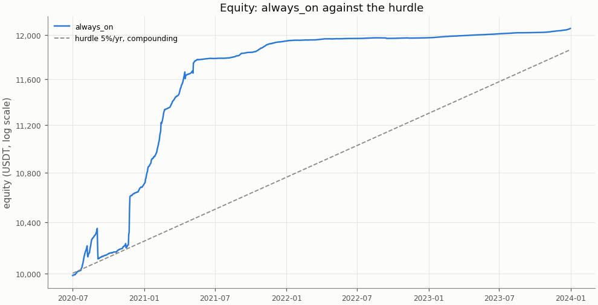
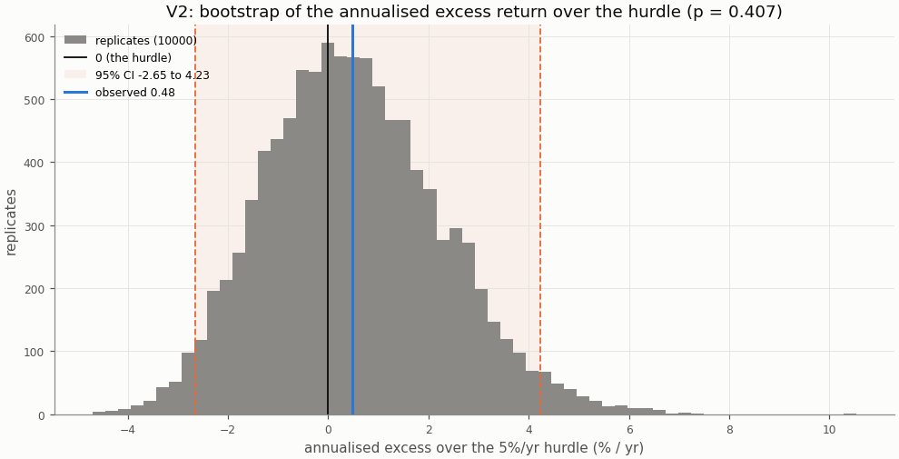
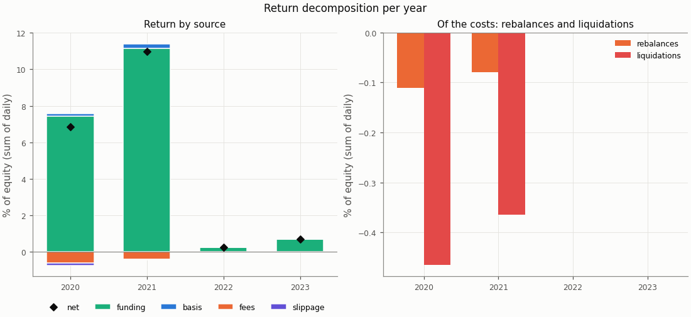
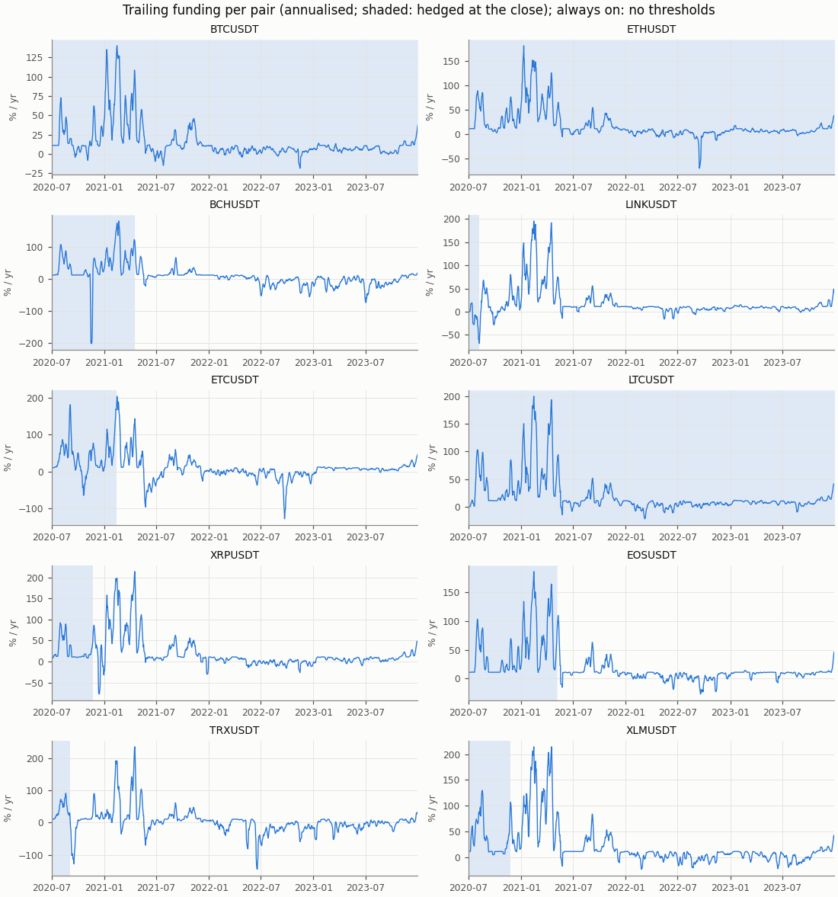
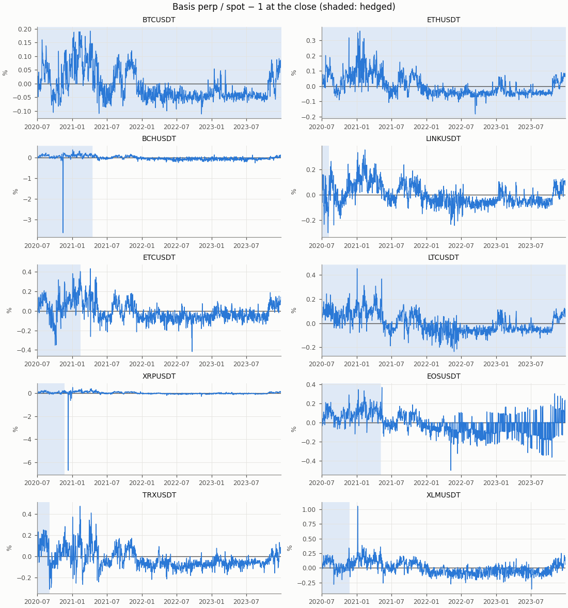

# Funding carry — exploratory row always_on, in-sample

- Row: `always_on` (exploratory: reported, no say in the verdict (a DSR trial))
- Signal: always on (no filter); 7-day trailing funding reported
- Sleeve: perp leverage 2 (equal sleeves, spot notional L / (L + 1) of a sleeve)
- Pairs: BTCUSDT, ETHUSDT, BCHUSDT, LINKUSDT, ETCUSDT, LTCUSDT, XRPUSDT, EOSUSDT, TRXUSDT, XLMUSDT
- Period: 2020-07-01 to 2023-12-31 (1279 return days)
- Variant id: `a276d3c88a9bd82f9555693bb266b10b233707b1542ba96faa26541be61bfeb1`
- Pre-registration hash: `a44eee47990843ff13c81da0dd0db23d82a0811fdb4896366482818a6e14b242`
- Code version: `7ce43816563f41f4f2aa7318d46e382e027e7a547652ac4d6b748454fa80f240` (git `229ce16df98c4e2d359c7d8ac468ca00d644431e`)

## Headline

**Descriptive (in-sample; exploratory row `always_on`, no say in the verdict): it would read positive below the hurdle.** V1 (net Sharpe above 0) passes, p = 0.0004; V2 (annualised net return above the 5%/yr hurdle) fails, p = 0.407. Annualised net return 5.36% (95% CI 2.23% to 9.11%); excess over the hurdle 0.48% (95% CI -2.65% to 4.23%): not proven: the CI contains 0.

In-sample: the period the pre-registration and the simplified screen were set on; the rule was frozen before any executor return was computed.

| Headline | Value |
|---|---|
| V1: net Sharpe (annualised) | 3.01 |
| V1: 95% CI | 1.39 to 5.57 |
| V1: p (one-sided) | 0.0004 |
| V1 passes | yes |
| V2: annualised net return | 5.36% |
| V2: annualised net return, 95% CI | 2.23% to 9.11% |
| V2: hurdle | 5.0% |
| V2: excess over the hurdle | 0.48% |
| V2: excess, 95% CI | -2.65% to 4.23% |
| V2: p (one-sided) | 0.407 |
| V2 passes | no |
| V2 reading | not proven: the CI contains 0 |
| Reading | positive below the hurdle |
| Return days | 1279 |

## Rule

Edge iff V1 and V2 both pass, each one-sided at α = 0.05, unadjusted (overview CD8). V1: the portfolio's net daily Sharpe above 0; V2: the annualised net return (365 × mean daily return) above the 5%/yr hurdle (CD9), on the daily excess over its daily rate. Both by moving-block bootstrap, B = 10000, blocks of 30 days; 95% percentile CIs. V2 reads three ways (overview §3): proven above the hurdle (passes), not proven (the CI contains 0), proven below (the CI lies below 0).

Costs on every fill: perp taker 0.05%, spot taker 0.10%, slippage per leg (default 0.05%, BTCUSDT 0.02%, ETHUSDT 0.02%); funding from the data on the perp leg; liquidation fee 1.0%.

## Equity

| Statistic | always_on |
|---|---|
| annualised return (365 × mean) | 5.36% |
| CAGR | 5.49% |
| annualised vol | 1.78% |
| Sharpe (annualised) | 3.01 |
| Sharpe, 95% CI | 1.39 to 5.57 |
| max drawdown | 2.29% |
| worst day | -1.37% |
| worst day: date | 2020-09-03 |
| worst month | -1.66% |
| worst month: month | 2020-09 |

## Hurdles

V2 against other hurdles, descriptive (overview §10.2): the same bootstrap draws as the verdict's V2, so the 5.0% row is the verdict's.

| Hurdle | Excess | 95% CI | p (one-sided) | Passes | Reading |
|---|---|---|---|---|---|
| 0.0% | 5.36% | 2.23% to 9.11% | 0.0001 | yes | proven above the hurdle (V2 passes) |
| 3.0% | 2.40% | -0.73% to 6.15% | 0.0753 | no | not proven: the CI contains 0 |
| 5.0% | 0.48% | -2.65% to 4.23% | 0.407 | no | not proven: the CI contains 0 |
| 8.0% | -2.34% | -5.47% to 1.41% | 0.898 | no | not proven: the CI contains 0 |

## Filter value and random timing

Computed for the portfolio primary only (Phase 5 §5.9).

## Return decomposition

Fractions of equity summed over days (each day's money over the previous day's equity), so funding + basis − fees − slippage is the net. Basis is the two legs' price P&L (a liquidation's loss to its price included); the rebalance and liquidation costs are a part of fees and slippage, not added to them (Phase 4 §4.7).

| Total | Value |
|---|---|
| funding | 19.54% |
| basis | 0.41% |
| fees | 1.02% |
| slippage | 0.16% |
| of which rebalances | 0.19% |
| of which liquidations | 0.83% |
| net (sum of daily returns) | 18.77% |
| compounded | 20.58% |
| share of live pair-days on | 39.5% |
| pair-days on | 5053 |
| pair-days live | 12790 |
| entries | 10 |

| Year | Days | Funding | Basis | Fees | Slippage | of which rebalances | of which liquidations | Net | Compounded | Share on | Entries |
|---|---|---|---|---|---|---|---|---|---|---|---|
| 2020 | 184 | 7.43% | 0.16% | 0.62% | 0.12% | 0.11% | 0.47% | 6.85% | 7.05% | 81.2% | 10 |
| 2021 | 365 | 11.14% | 0.27% | 0.40% | 0.04% | 0.08% | 0.36% | 10.96% | 11.57% | 37.5% | 0 |
| 2022 | 365 | 0.25% | 0.00% | 0.00% | 0.00% | 0.00% | 0.00% | 0.25% | 0.25% | 30.0% | 0 |
| 2023 | 365 | 0.71% | -0.01% | 0.00% | 0.00% | 0.00% | 0.00% | 0.71% | 0.71% | 30.0% | 0 |

| Pair | Funding | Basis | Fees | Slippage | Net | Days on | Days live | Entries |
|---|---|---|---|---|---|---|---|---|
| BCHUSDT | 2.07% | -0.46% | 0.14% | 0.02% | 1.45% | 289 | 1279 | 1 |
| BTCUSDT | 3.09% | -0.02% | 0.03% | 0.01% | 3.03% | 1279 | 1279 | 1 |
| EOSUSDT | 2.59% | 0.53% | 0.14% | 0.02% | 2.97% | 309 | 1279 | 1 |
| ETCUSDT | 1.72% | 0.18% | 0.13% | 0.02% | 1.75% | 227 | 1279 | 1 |
| ETHUSDT | 4.17% | -0.05% | 0.04% | 0.01% | 4.08% | 1279 | 1279 | 1 |
| LINKUSDT | -0.14% | -0.81% | 0.12% | 0.02% | -1.09% | 38 | 1279 | 1 |
| LTCUSDT | 3.85% | -0.04% | 0.03% | 0.02% | 3.76% | 1279 | 1279 | 1 |
| TRXUSDT | 0.50% | -2.28% | 0.12% | 0.02% | -1.92% | 64 | 1279 | 1 |
| XLMUSDT | 0.97% | 2.60% | 0.13% | 0.02% | 3.41% | 146 | 1279 | 1 |
| XRPUSDT | 0.72% | 0.75% | 0.13% | 0.02% | 1.33% | 143 | 1279 | 1 |

## Funding and basis per pair

From the run folder's `signals.parquet`: the trailing funding the rule decides on and the basis at the close, per pair, with the days the pair was hedged at the close shaded.

## Margin events

Rebalance: at the close the perp wallet held less than half the margin at the target leverage; both legs were cut back at the next fill. Liquidation: the day high reached the liquidation price; the short was bought back there with the liquidation fee and the spot leg sold at the next fill (CD7).

| Event | Count | Cost (USDT) | Cost (% of equity) |
|---|---|---|---|
| rebalances | 49 | 20.05 | 0.189% |
| liquidations | 7 | 89.69 | 0.829% |

| Event | Date | Pair | Liquidation price / qty cut | Cost (USDT) | Cost (% of equity) |
|---|---|---|---|---|---|
| liquidation | 2020-08-08 | LINKUSDT | 13.524590 | 11.07 | 0.108% |
| liquidation | 2020-09-03 | TRXUSDT | 0.046131 | 11.56 | 0.112% |
| liquidation | 2020-11-21 | XRPUSDT | 0.459134 | 12.30 | 0.120% |
| liquidation | 2020-11-24 | XLMUSDT | 0.167515 | 12.88 | 0.124% |
| liquidation | 2021-02-13 | ETCUSDT | 15.968215 | 13.44 | 0.120% |
| liquidation | 2021-04-16 | BCHUSDT | 1166.637874 | 13.80 | 0.118% |
| liquidation | 2021-05-06 | EOSUSDT | 11.671745 | 14.64 | 0.125% |
| rebalance | 2020-07-08 | LINKUSDT | 30.115887 | 0.43 | 0.004% |
| rebalance | 2020-07-09 | XLMUSDT | 2218.660170 | 0.48 | 0.005% |
| rebalance | 2020-07-13 | LINKUSDT | 25.165007 | 0.46 | 0.005% |
| rebalance | 2020-07-18 | XLMUSDT | 1312.052776 | 0.34 | 0.003% |
| rebalance | 2020-07-24 | ETHUSDT | 0.524942 | 0.27 | 0.003% |
| rebalance | 2020-07-26 | XRPUSDT | 685.096240 | 0.37 | 0.004% |
| rebalance | 2020-07-28 | BCHUSDT | 0.520284 | 0.35 | 0.003% |
| rebalance | 2020-07-28 | BTCUSDT | 0.013087 | 0.28 | 0.003% |
| rebalance | 2020-07-28 | ETCUSDT | 23.040362 | 0.41 | 0.004% |
| rebalance | 2020-07-28 | LTCUSDT | 3.794403 | 0.51 | 0.005% |
| rebalance | 2020-07-29 | EOSUSDT | 57.646066 | 0.43 | 0.004% |
| rebalance | 2020-07-31 | ETHUSDT | 0.419379 | 0.27 | 0.003% |
| rebalance | 2020-08-02 | TRXUSDT | 8091.534038 | 0.42 | 0.004% |
| rebalance | 2020-08-02 | XRPUSDT | 830.116377 | 0.61 | 0.006% |
| rebalance | 2020-08-04 | LINKUSDT | 19.581689 | 0.45 | 0.004% |
| rebalance | 2020-08-14 | ETHUSDT | 0.411535 | 0.33 | 0.003% |
| rebalance | 2020-08-16 | EOSUSDT | 38.330024 | 0.36 | 0.003% |
| rebalance | 2020-08-16 | TRXUSDT | 5373.016190 | 0.34 | 0.003% |
| rebalance | 2020-08-18 | LTCUSDT | 2.219849 | 0.38 | 0.004% |
| rebalance | 2020-08-18 | TRXUSDT | 4967.225818 | 0.38 | 0.004% |
| rebalance | 2020-11-04 | BTCUSDT | 0.010631 | 0.28 | 0.003% |
| rebalance | 2020-11-18 | BTCUSDT | 0.010330 | 0.35 | 0.003% |
| rebalance | 2020-11-22 | ETHUSDT | 0.323887 | 0.34 | 0.003% |
| rebalance | 2020-11-22 | LTCUSDT | 2.060669 | 0.45 | 0.004% |
| rebalance | 2020-11-25 | BCHUSDT | 0.490771 | 0.43 | 0.004% |
| rebalance | 2020-12-18 | BTCUSDT | 0.008047 | 0.35 | 0.003% |
| rebalance | 2020-12-19 | LTCUSDT | 1.465255 | 0.40 | 0.004% |
| rebalance | 2020-12-29 | ETHUSDT | 0.289182 | 0.41 | 0.004% |
| rebalance | 2020-12-31 | BTCUSDT | 0.006747 | 0.38 | 0.004% |
| rebalance | 2021-01-03 | LTCUSDT | 1.318244 | 0.45 | 0.004% |
| rebalance | 2021-01-04 | ETHUSDT | 0.233971 | 0.43 | 0.004% |
| rebalance | 2021-01-07 | BCHUSDT | 0.389809 | 0.44 | 0.004% |
| rebalance | 2021-01-07 | BTCUSDT | 0.004618 | 0.32 | 0.003% |

The first 40 of 56 events (liquidations first); all are in `stats.json` and `events.parquet`.

## Cost re-pricing

The row re-run at other costs, descriptive (overview §10.4); the verdict uses VIP 0. **No cell equals the verdict's costs**: the pre-registered slippage is per pair (default 0.05%, BTCUSDT 0.02%, ETHUSDT 0.02%), while a cell's slippage applies to every pair.

| Slippage | Spot taker | Perp taker | Annualised net return | Sharpe | Excess over the hurdle | 95% CI | p (V2) | V2 reading | Fees | Slippage cost | Entries |
|---|---|---|---|---|---|---|---|---|---|---|---|
| 0.00% | 0.075% | 0.050% | 5.42% | 3.04 | 0.54% | -2.62% to 4.28% | 0.397 | not proven: the CI contains 0 | 0.96% | 0.00% | 10 |
| 0.00% | 0.100% | 0.050% | 5.40% | 3.03 | 0.52% | -2.62% to 4.26% | 0.399 | not proven: the CI contains 0 | 1.02% | 0.00% | 10 |
| 0.02% | 0.075% | 0.050% | 5.40% | 3.03 | 0.52% | -2.62% to 4.26% | 0.4 | not proven: the CI contains 0 | 0.96% | 0.07% | 10 |
| 0.02% | 0.100% | 0.050% | 5.38% | 3.02 | 0.50% | -2.63% to 4.24% | 0.402 | not proven: the CI contains 0 | 1.02% | 0.07% | 10 |
| 0.05% | 0.075% | 0.050% | 5.36% | 3.01 | 0.48% | -2.63% to 4.23% | 0.404 | not proven: the CI contains 0 | 0.96% | 0.19% | 10 |
| 0.05% | 0.100% | 0.050% | 5.35% | 3.01 | 0.47% | -2.64% to 4.22% | 0.406 | not proven: the CI contains 0 | 1.02% | 0.19% | 10 |
| 0.10% | 0.075% | 0.050% | 5.31% | 2.98 | 0.43% | -2.65% to 4.18% | 0.41 | not proven: the CI contains 0 | 0.96% | 0.37% | 10 |
| 0.10% | 0.100% | 0.050% | 5.30% | 2.98 | 0.42% | -2.66% to 4.16% | 0.413 | not proven: the CI contains 0 | 1.02% | 0.37% | 10 |

## Per-pair rows

Each pair alone as a one-pair portfolio under the `always_on` row, from its own folder's `stats.json`; descriptive, no say in the verdict. A pair whose data ends before the period end (a delisting) is not run alone; the portfolio closes it by the delisting rule.

| Pair | Annualised net return | Excess over the hurdle | 95% CI (excess) | p (V2) | V2 reading | Sharpe | p (V1) | Reading | Share on |
|---|---|---|---|---|---|---|---|---|---|
| BTCUSDT | 8.37% | 3.50% | -0.03% to 7.71% | 0.0259 | proven above the hurdle (V2 passes) | 8.59 | 0.0001 | edge | 100.0% |
| ETHUSDT | 10.69% | 5.81% | 1.05% to 11.53% | 0.0061 | proven above the hurdle (V2 passes) | 8.04 | 0.0001 | edge | 100.0% |
| BCHUSDT | 4.16% | -0.72% | -5.13% to 4.04% | 0.631 | not proven: the CI contains 0 | 1.05 | 0.0303 | positive below the hurdle | 22.6% |
| LINKUSDT | -3.28% | -8.16% | -14.65% to -4.88% | 1 | proven below the hurdle: the CI lies entirely below 0 | -0.79 | 1 | no edge | 3.0% |
| ETCUSDT | 4.89% | 0.01% | -3.57% to 4.63% | 0.517 | not proven: the CI contains 0 | 1.76 | 0.0008 | positive below the hurdle | 17.7% |
| LTCUSDT | 9.99% | 5.11% | 0.48% to 11.14% | 0.0144 | proven above the hurdle (V2 passes) | 7.14 | 0.0001 | edge | 100.0% |
| XRPUSDT | 3.68% | -1.19% | -4.61% to 3.84% | 0.729 | not proven: the CI contains 0 | 1.07 | 0.0001 | positive below the hurdle | 11.2% |
| EOSUSDT | 8.18% | 3.30% | -1.54% to 9.31% | 0.103 | not proven: the CI contains 0 | 2.02 | 0.0001 | positive below the hurdle | 24.2% |
| TRXUSDT | -5.81% | -10.69% | -25.55% to -2.42% | 1 | proven below the hurdle: the CI lies entirely below 0 | -0.61 | 0.726 | no edge | 5.0% |
| XLMUSDT | 9.02% | 4.14% | -4.60% to 19.35% | 0.342 | not proven: the CI contains 0 | 0.96 | 0.0001 | positive below the hurdle | 11.4% |

## Deflated Sharpe ratio

Computed for the portfolio primary only, with the seven pre-registered rows as trials.

## Unmodelled risks

A backtest cannot show the main risk of a carry trade: **exchange and counterparty risk** (an exchange failure, a frozen withdrawal), which is not modelled (overview §5 item 5). Also not modelled: auto-deleveraging, rule changes such as funding caps, and the yield idle USDT could earn (an off sleeve earns 0; the hurdle stands for it). Funding-interval changes are in the data. Costs are Binance VIP 0 without the BNB discount; the re-pricing table shows the sensitivity.

## Notes

- The V2 bootstrap figure redraws the verdict's replicates at report time with its own seed (`insample/always_on/v2`); their p and CI equal `stats.json`'s.
- Numbers in the tables are `stats.json` values; the figures read the run folder's tables.
