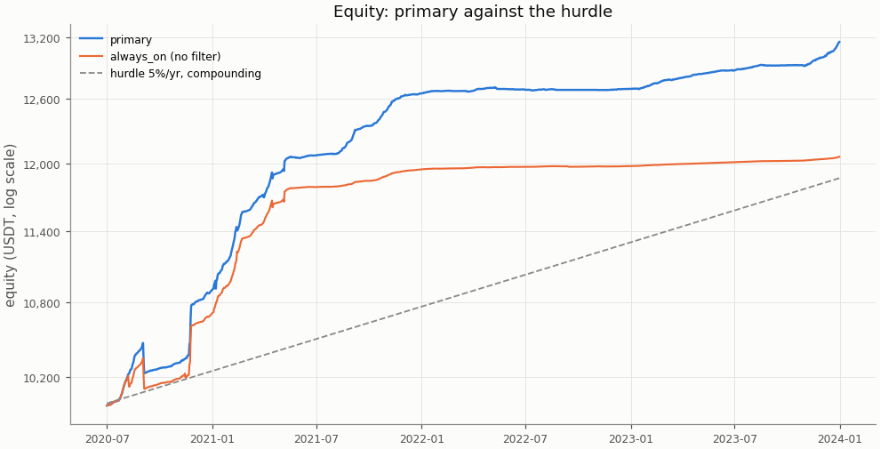
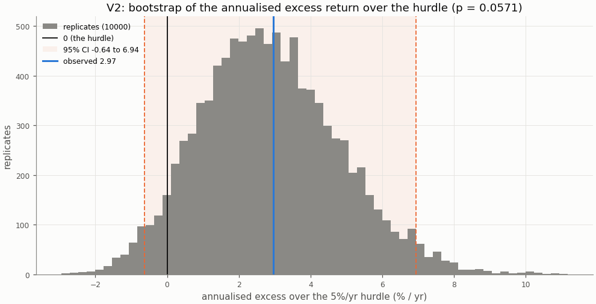
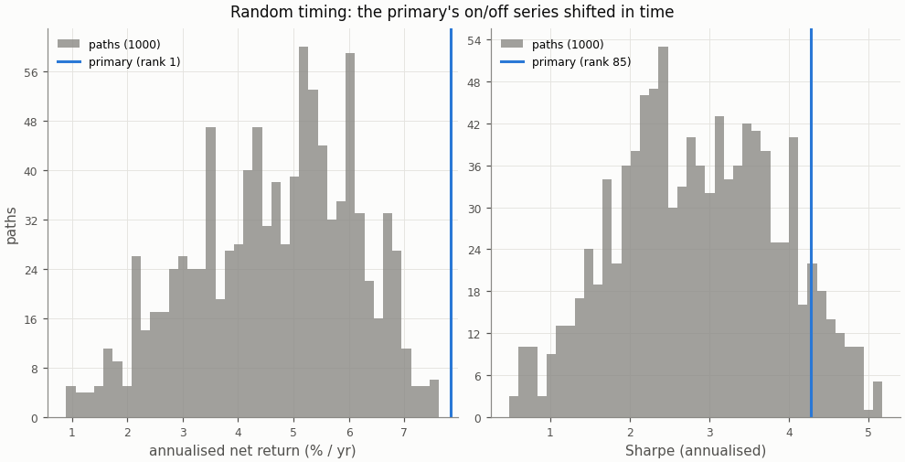
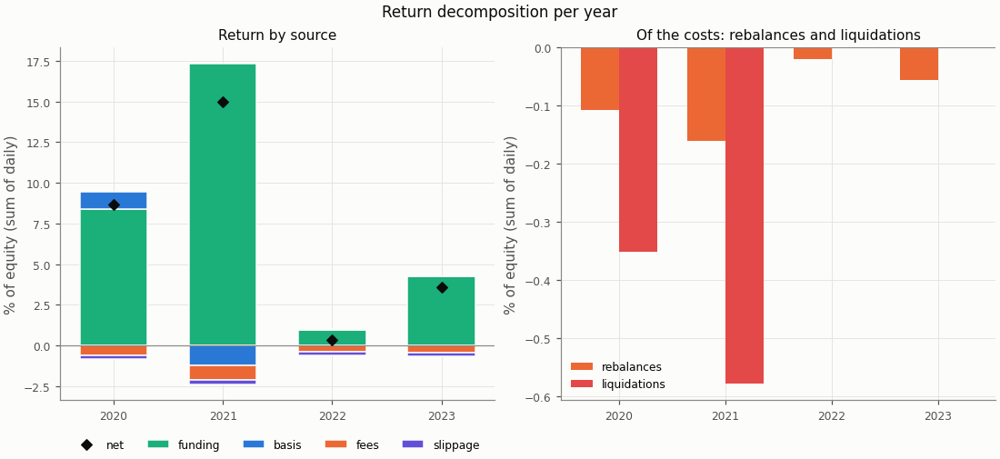
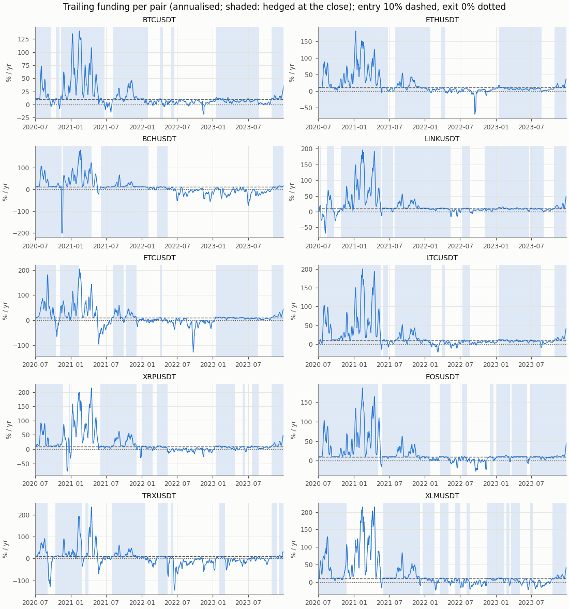
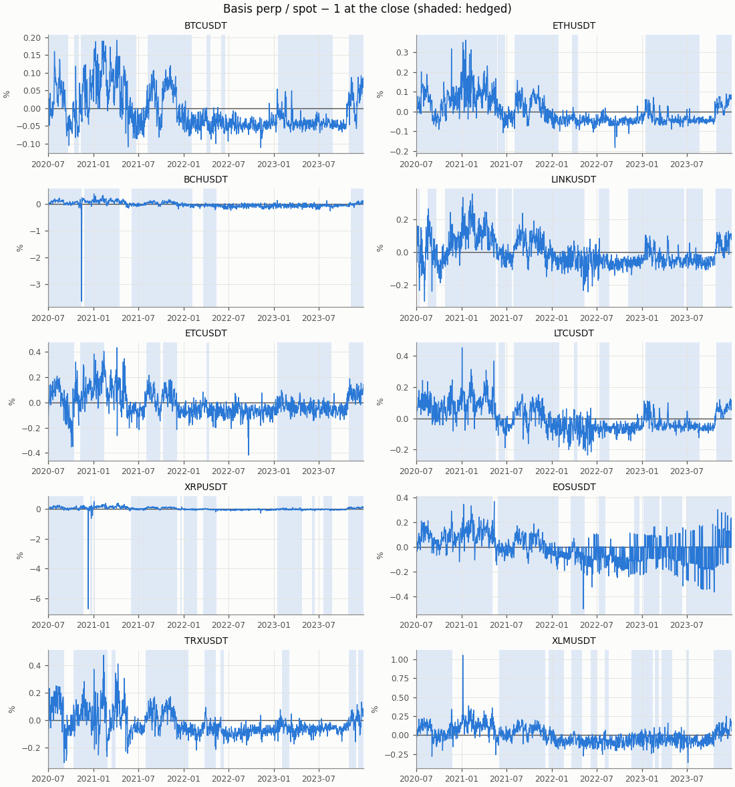

# Funding carry — primary, in-sample

- Row: `primary` (pre-registered primary: its V1 and V2 are the verdict)
- Signal: 7-day trailing funding (annualised); on above 10%/yr, off below 0%/yr, otherwise the previous state
- Sleeve: perp leverage 2 (equal sleeves, spot notional L / (L + 1) of a sleeve)
- Pairs: BTCUSDT, ETHUSDT, BCHUSDT, LINKUSDT, ETCUSDT, LTCUSDT, XRPUSDT, EOSUSDT, TRXUSDT, XLMUSDT
- Period: 2020-07-01 to 2023-12-31 (1279 return days)
- Variant id: `b3116cf36f604d135e7bea2ecc11ba600ba293f4ae750987a932ce8e7b1af9b6`
- Pre-registration hash: `a44eee47990843ff13c81da0dd0db23d82a0811fdb4896366482818a6e14b242`
- Code version: `7ce43816563f41f4f2aa7318d46e382e027e7a547652ac4d6b748454fa80f240` (git `229ce16df98c4e2d359c7d8ac468ca00d644431e`)

## Headline

**Verdict (in-sample): positive below the hurdle.** V1 (net Sharpe above 0) passes, p = 0.0001; V2 (annualised net return above the 5%/yr hurdle) fails, p = 0.0571. Annualised net return 7.85% (95% CI 4.24% to 11.82%); excess over the hurdle 2.97% (95% CI -0.64% to 6.94%): not proven: the CI contains 0.

In-sample: the period the pre-registration and the simplified screen were set on; the rule was frozen before any executor return was computed.

| Headline | Value |
|---|---|
| V1: net Sharpe (annualised) | 4.27 |
| V1: 95% CI | 2.49 to 7.27 |
| V1: p (one-sided) | 0.0001 |
| V1 passes | yes |
| V2: annualised net return | 7.85% |
| V2: annualised net return, 95% CI | 4.24% to 11.82% |
| V2: hurdle | 5.0% |
| V2: excess over the hurdle | 2.97% |
| V2: excess, 95% CI | -0.64% to 6.94% |
| V2: p (one-sided) | 0.0571 |
| V2 passes | no |
| V2 reading | not proven: the CI contains 0 |
| Reading | positive below the hurdle |
| Return days | 1279 |

## Rule

Edge iff V1 and V2 both pass, each one-sided at α = 0.05, unadjusted (overview CD8). V1: the portfolio's net daily Sharpe above 0; V2: the annualised net return (365 × mean daily return) above the 5%/yr hurdle (CD9), on the daily excess over its daily rate. Both by moving-block bootstrap, B = 10000, blocks of 30 days; 95% percentile CIs. V2 reads three ways (overview §3): proven above the hurdle (passes), not proven (the CI contains 0), proven below (the CI lies below 0).

Costs on every fill: perp taker 0.05%, spot taker 0.10%, slippage per leg (default 0.05%, BTCUSDT 0.02%, ETHUSDT 0.02%); funding from the data on the perp leg; liquidation fee 1.0%.

## Equity

The row against `always_on` (no filter: sleeves at perp leverage 2 held on every live day) over the same days, both from their own `stats.json`.

| Statistic | primary | always_on |
|---|---|---|
| annualised return (365 × mean) | 7.85% | 5.36% |
| CAGR | 8.14% | 5.49% |
| annualised vol | 1.84% | 1.78% |
| Sharpe (annualised) | 4.27 | 3.01 |
| Sharpe, 95% CI | 2.49 to 7.27 | 1.39 to 5.57 |
| max drawdown | 2.27% | 2.29% |
| worst day | -1.34% | -1.37% |
| worst day: date | 2020-09-03 | 2020-09-03 |
| worst month | -1.62% | -1.66% |
| worst month: month | 2020-09 | 2020-09 |

## Hurdles

V2 against other hurdles, descriptive (overview §10.2): the same bootstrap draws as the verdict's V2, so the 5.0% row is the verdict's.

| Hurdle | Excess | 95% CI | p (one-sided) | Passes | Reading |
|---|---|---|---|---|---|
| 0.0% | 7.85% | 4.24% to 11.82% | 0.0001 | yes | proven above the hurdle (V2 passes) |
| 3.0% | 4.89% | 1.29% to 8.86% | 0.002 | yes | proven above the hurdle (V2 passes) |
| 5.0% | 2.97% | -0.64% to 6.94% | 0.0571 | no | not proven: the CI contains 0 |
| 8.0% | 0.15% | -3.46% to 4.12% | 0.514 | no | not proven: the CI contains 0 |

## Filter value and random timing

**Filter value:** the paired Sharpe difference primary − always_on (the same blocks for both), descriptive.

| Filter value | Value |
|---|---|
| Sharpe, primary | 4.27 |
| Sharpe, always_on | 3.01 |
| difference | 1.26 |
| difference, 95% CI | 0.39 to 2.61 |
| p (one-sided) | 0.0062 |

**Random timing:** the primary's on/off series shifted in time (1000 paths, one offset per path shared by the pairs, at least 60 days from either end of the 1279 days; Phase 4 §4.4). Rank 1 means no path did better; the share counts the paths at least as good, plus one. Descriptive.

| Random timing | Annualised net return | Sharpe |
|---|---|---|
| primary | 7.85% | 4.27 |
| paths: mean | 4.65% | 2.85 |
| paths: std | 1.45% | 1.00 |
| paths: 5th pct | 2.12% | 1.20 |
| paths: median | 4.82% | 2.83 |
| paths: 95th pct | 6.83% | 4.50 |
| rank of the primary | 1 | 85 |
| share of paths at least as good | 0.001 | 0.085 |
| finite paths | 1000 | 1000 |

## Return decomposition

Fractions of equity summed over days (each day's money over the previous day's equity), so funding + basis − fees − slippage is the net. Basis is the two legs' price P&L (a liquidation's loss to its price included); the rebalance and liquidation costs are a part of fees and slippage, not added to them (Phase 4 §4.7).

| Total | Value |
|---|---|
| funding | 30.95% |
| basis | -0.13% |
| fees | 2.39% |
| slippage | 0.93% |
| of which rebalances | 0.35% |
| of which liquidations | 0.93% |
| net (sum of daily returns) | 27.49% |
| compounded | 31.56% |
| share of live pair-days on | 60.0% |
| pair-days on | 7675 |
| pair-days live | 12790 |
| entries | 81 |

| Year | Days | Funding | Basis | Fees | Slippage | of which rebalances | of which liquidations | Net | Compounded | Share on | Entries |
|---|---|---|---|---|---|---|---|---|---|---|---|
| 2020 | 184 | 8.40% | 1.06% | 0.64% | 0.19% | 0.11% | 0.35% | 8.64% | 8.97% | 86.4% | 18 |
| 2021 | 365 | 17.35% | -1.23% | 0.93% | 0.24% | 0.16% | 0.58% | 14.96% | 16.11% | 75.4% | 18 |
| 2022 | 365 | 0.94% | 0.03% | 0.40% | 0.24% | 0.02% | 0.00% | 0.34% | 0.34% | 28.0% | 20 |
| 2023 | 365 | 4.24% | 0.00% | 0.43% | 0.26% | 0.06% | 0.00% | 3.56% | 3.63% | 63.3% | 25 |

| Pair | Funding | Basis | Fees | Slippage | Net | Days on | Days live | Entries |
|---|---|---|---|---|---|---|---|---|
| BCHUSDT | 2.86% | -0.35% | 0.19% | 0.06% | 2.25% | 633 | 1279 | 5 |
| BTCUSDT | 2.80% | 0.00% | 0.16% | 0.04% | 2.60% | 818 | 1279 | 8 |
| EOSUSDT | 3.78% | 0.52% | 0.26% | 0.10% | 3.94% | 994 | 1279 | 8 |
| ETCUSDT | 2.79% | -0.72% | 0.23% | 0.09% | 1.75% | 611 | 1279 | 7 |
| ETHUSDT | 4.27% | -0.04% | 0.14% | 0.04% | 4.05% | 844 | 1279 | 6 |
| LINKUSDT | 3.94% | -0.02% | 0.17% | 0.11% | 3.63% | 999 | 1279 | 9 |
| LTCUSDT | 4.29% | -0.02% | 0.14% | 0.10% | 4.04% | 870 | 1279 | 7 |
| TRXUSDT | 2.18% | -2.58% | 0.38% | 0.12% | -0.90% | 537 | 1279 | 9 |
| XLMUSDT | 2.14% | 2.55% | 0.31% | 0.14% | 4.25% | 712 | 1279 | 11 |
| XRPUSDT | 1.89% | 0.53% | 0.41% | 0.13% | 1.89% | 657 | 1279 | 11 |

## Funding and basis per pair

From the run folder's `signals.parquet`: the trailing funding the rule decides on and the basis at the close, per pair, with the days the pair was hedged at the close shaded.

## Margin events

Rebalance: at the close the perp wallet held less than half the margin at the target leverage; both legs were cut back at the next fill. Liquidation: the day high reached the liquidation price; the short was bought back there with the liquidation fee and the spot leg sold at the next fill (CD7).

| Event | Count | Cost (USDT) | Cost (% of equity) |
|---|---|---|---|
| rebalances | 91 | 39.76 | 0.346% |
| liquidations | 8 | 103.73 | 0.929% |

| Event | Date | Pair | Liquidation price / qty cut | Cost (USDT) | Cost (% of equity) |
|---|---|---|---|---|---|
| liquidation | 2020-09-03 | TRXUSDT | 0.046131 | 11.56 | 0.111% |
| liquidation | 2020-11-21 | XRPUSDT | 0.459134 | 12.30 | 0.119% |
| liquidation | 2020-11-24 | XLMUSDT | 0.167515 | 12.88 | 0.123% |
| liquidation | 2021-01-07 | XRPUSDT | 0.349566 | 12.50 | 0.114% |
| liquidation | 2021-02-13 | ETCUSDT | 17.549713 | 12.81 | 0.112% |
| liquidation | 2021-03-31 | TRXUSDT | 0.094552 | 13.27 | 0.113% |
| liquidation | 2021-04-16 | BCHUSDT | 1166.637874 | 13.77 | 0.116% |
| liquidation | 2021-05-06 | EOSUSDT | 11.671745 | 14.64 | 0.123% |
| rebalance | 2020-07-09 | XLMUSDT | 2218.660170 | 0.48 | 0.005% |
| rebalance | 2020-07-15 | LINKUSDT | 20.286801 | 0.41 | 0.004% |
| rebalance | 2020-07-18 | XLMUSDT | 1312.052776 | 0.34 | 0.003% |
| rebalance | 2020-07-24 | ETHUSDT | 0.524942 | 0.27 | 0.003% |
| rebalance | 2020-07-26 | XRPUSDT | 685.096240 | 0.37 | 0.004% |
| rebalance | 2020-07-28 | BCHUSDT | 0.520284 | 0.35 | 0.003% |
| rebalance | 2020-07-28 | BTCUSDT | 0.013087 | 0.28 | 0.003% |
| rebalance | 2020-07-28 | ETCUSDT | 23.040362 | 0.41 | 0.004% |
| rebalance | 2020-07-28 | LTCUSDT | 3.794403 | 0.51 | 0.005% |
| rebalance | 2020-07-29 | EOSUSDT | 57.646066 | 0.43 | 0.004% |
| rebalance | 2020-07-31 | ETHUSDT | 0.419379 | 0.27 | 0.003% |
| rebalance | 2020-08-02 | TRXUSDT | 8091.534038 | 0.42 | 0.004% |
| rebalance | 2020-08-02 | XRPUSDT | 830.116377 | 0.61 | 0.006% |
| rebalance | 2020-08-14 | ETHUSDT | 0.411535 | 0.33 | 0.003% |
| rebalance | 2020-08-16 | EOSUSDT | 38.330024 | 0.36 | 0.003% |
| rebalance | 2020-08-16 | TRXUSDT | 5373.016190 | 0.34 | 0.003% |
| rebalance | 2020-08-18 | LTCUSDT | 2.219849 | 0.38 | 0.004% |
| rebalance | 2020-08-18 | TRXUSDT | 4967.225818 | 0.38 | 0.004% |
| rebalance | 2020-11-21 | BTCUSDT | 0.006456 | 0.23 | 0.002% |
| rebalance | 2020-11-22 | ETCUSDT | 22.634919 | 0.38 | 0.004% |
| rebalance | 2020-11-22 | ETHUSDT | 0.323887 | 0.34 | 0.003% |
| rebalance | 2020-11-22 | LINKUSDT | 13.037144 | 0.51 | 0.005% |
| rebalance | 2020-11-22 | LTCUSDT | 2.060669 | 0.45 | 0.004% |
| rebalance | 2020-11-25 | TRXUSDT | 6495.749535 | 0.59 | 0.005% |
| rebalance | 2020-12-18 | BTCUSDT | 0.004996 | 0.22 | 0.002% |
| rebalance | 2020-12-19 | LTCUSDT | 1.465255 | 0.40 | 0.004% |
| rebalance | 2020-12-29 | BCHUSDT | 0.448330 | 0.41 | 0.004% |
| rebalance | 2020-12-29 | ETHUSDT | 0.289182 | 0.41 | 0.004% |
| rebalance | 2020-12-31 | BTCUSDT | 0.005376 | 0.30 | 0.003% |
| rebalance | 2021-01-03 | LTCUSDT | 1.318244 | 0.45 | 0.004% |
| rebalance | 2021-01-04 | ETHUSDT | 0.233971 | 0.43 | 0.004% |
| rebalance | 2021-01-07 | BCHUSDT | 0.351540 | 0.40 | 0.004% |

The first 40 of 99 events (liquidations first); all are in `stats.json` and `events.parquet`.

## Cost re-pricing

The row re-run at other costs, descriptive (overview §10.4); the verdict uses VIP 0. **No cell equals the verdict's costs**: the pre-registered slippage is per pair (default 0.05%, BTCUSDT 0.02%, ETHUSDT 0.02%), while a cell's slippage applies to every pair.

| Slippage | Spot taker | Perp taker | Annualised net return | Sharpe | Excess over the hurdle | 95% CI | p (V2) | V2 reading | Fees | Slippage cost | Entries |
|---|---|---|---|---|---|---|---|---|---|---|---|
| 0.00% | 0.075% | 0.050% | 8.19% | 4.45 | 3.31% | -0.40% to 7.38% | 0.0411 | proven above the hurdle (V2 passes) | 2.12% | 0.00% | 81 |
| 0.00% | 0.100% | 0.050% | 8.11% | 4.41 | 3.23% | -0.47% to 7.31% | 0.0446 | proven above the hurdle (V2 passes) | 2.40% | 0.00% | 81 |
| 0.02% | 0.075% | 0.050% | 8.07% | 4.39 | 3.19% | -0.51% to 7.27% | 0.0461 | proven above the hurdle (V2 passes) | 2.12% | 0.42% | 81 |
| 0.02% | 0.100% | 0.050% | 7.99% | 4.35 | 3.11% | -0.58% to 7.19% | 0.0502 | not proven: the CI contains 0 | 2.40% | 0.42% | 81 |
| 0.05% | 0.075% | 0.050% | 7.89% | 4.29 | 3.01% | -0.69% to 7.09% | 0.0555 | not proven: the CI contains 0 | 2.12% | 1.04% | 81 |
| 0.05% | 0.100% | 0.050% | 7.81% | 4.25 | 2.93% | -0.76% to 7.01% | 0.0606 | not proven: the CI contains 0 | 2.40% | 1.04% | 81 |
| 0.10% | 0.075% | 0.050% | 7.59% | 4.12 | 2.71% | -0.97% to 6.78% | 0.0769 | not proven: the CI contains 0 | 2.12% | 2.09% | 81 |
| 0.10% | 0.100% | 0.050% | 7.52% | 4.08 | 2.64% | -1.05% to 6.71% | 0.0836 | not proven: the CI contains 0 | 2.39% | 2.09% | 81 |

## Per-pair rows

Each pair alone as a one-pair portfolio under the `primary` row, from its own folder's `stats.json`; descriptive, no say in the verdict. A pair whose data ends before the period end (a delisting) is not run alone; the portfolio closes it by the delisting rule.

| Pair | Annualised net return | Excess over the hurdle | 95% CI (excess) | p (V2) | V2 reading | Sharpe | p (V1) | Reading | Share on |
|---|---|---|---|---|---|---|---|---|---|
| BTCUSDT | 8.46% | 3.58% | -0.14% to 7.73% | 0.0323 | proven above the hurdle (V2 passes) | 8.29 | 0.0001 | edge | 64.0% |
| ETHUSDT | 11.16% | 6.28% | 1.45% to 11.77% | 0.004 | proven above the hurdle (V2 passes) | 8.25 | 0.0001 | edge | 66.0% |
| BCHUSDT | 6.48% | 1.60% | -2.78% to 6.28% | 0.251 | not proven: the CI contains 0 | 1.82 | 0.0012 | positive below the hurdle | 49.5% |
| LINKUSDT | 10.25% | 5.37% | 0.69% to 11.34% | 0.0093 | proven above the hurdle (V2 passes) | 7.12 | 0.0001 | edge | 78.1% |
| ETCUSDT | 4.96% | 0.08% | -5.00% to 4.37% | 0.515 | not proven: the CI contains 0 | 1.47 | 0.0283 | positive below the hurdle | 47.8% |
| LTCUSDT | 11.17% | 6.29% | 1.43% to 11.92% | 0.0034 | proven above the hurdle (V2 passes) | 7.68 | 0.0001 | edge | 68.0% |
| XRPUSDT | 5.41% | 0.53% | -3.96% to 5.58% | 0.475 | not proven: the CI contains 0 | 0.89 | 0.0087 | positive below the hurdle | 51.4% |
| EOSUSDT | 11.08% | 6.20% | 1.42% to 12.01% | 0.0027 | proven above the hurdle (V2 passes) | 2.66 | 0.0001 | edge | 77.7% |
| TRXUSDT | -2.91% | -7.79% | -24.37% to 2.16% | 0.892 | not proven: the CI contains 0 | -0.30 | 0.62 | no edge | 42.0% |
| XLMUSDT | 11.51% | 6.63% | -2.41% to 22.18% | 0.219 | not proven: the CI contains 0 | 1.22 | 0.0001 | positive below the hurdle | 55.7% |

## Deflated Sharpe ratio

The primary's deflated Sharpe with the seven pre-registered rows (the primary among them) as trials; daily Sharpe ratios, not annualised. Descriptive.

| Trial | Daily Sharpe |
|---|---|
| primary | 0.2234 |
| always_on | 0.1576 |
| entry_5 | 0.2175 |
| entry_20 | 0.1875 |
| lookback_3d | 0.1677 |
| lookback_14d | 0.2147 |
| lev_1 | 0.3768 |

| DSR | Value |
|---|---|
| daily Sharpe | 0.2234 |
| days T | 1279 |
| skew | 4.057 |
| kurtosis (non-excess) | 158.793 |
| trials N | 7 |
| V (variance of the trials' Sharpe) | 0.00538602 |
| SR* (expected maximum under the null) | 0.1018 |
| DSR | 0.999 |

## Unmodelled risks

A backtest cannot show the main risk of a carry trade: **exchange and counterparty risk** (an exchange failure, a frozen withdrawal), which is not modelled (overview §5 item 5). Also not modelled: auto-deleveraging, rule changes such as funding caps, and the yield idle USDT could earn (an off sleeve earns 0; the hurdle stands for it). Funding-interval changes are in the data. Costs are Binance VIP 0 without the BNB discount; the re-pricing table shows the sensitivity.

## Notes

- The V2 bootstrap figure redraws the verdict's replicates at report time with its own seed (`insample/primary/v2`); their p and CI equal `stats.json`'s.
- Numbers in the tables are `stats.json` values; the figures read the run folder's tables.
