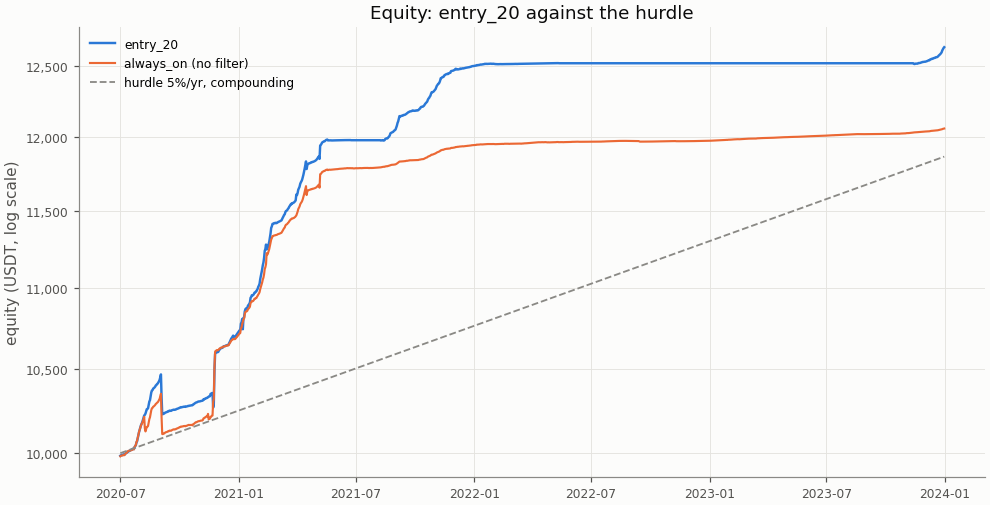
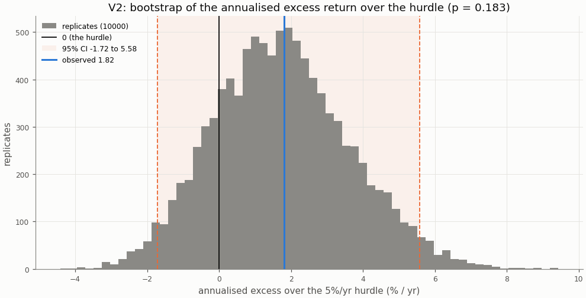
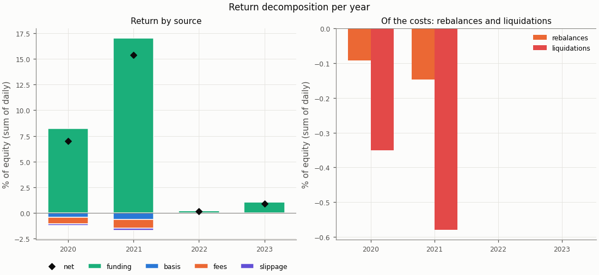
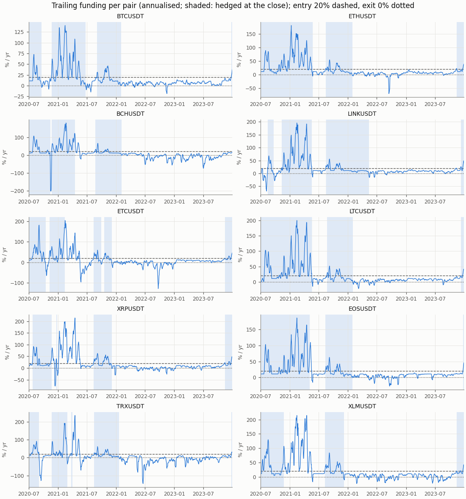
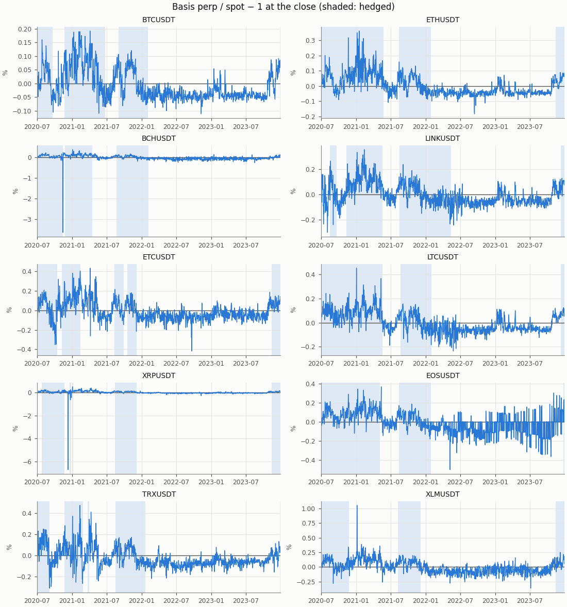

# Funding carry — exploratory row entry_20, in-sample

- Row: `entry_20` (exploratory: reported, no say in the verdict (a DSR trial))
- Signal: 7-day trailing funding (annualised); on above 20%/yr, off below 0%/yr, otherwise the previous state
- Sleeve: perp leverage 2 (equal sleeves, spot notional L / (L + 1) of a sleeve)
- Pairs: BTCUSDT, ETHUSDT, BCHUSDT, LINKUSDT, ETCUSDT, LTCUSDT, XRPUSDT, EOSUSDT, TRXUSDT, XLMUSDT
- Period: 2020-07-01 to 2023-12-31 (1279 return days)
- Variant id: `db43d752fd03b2a8cdeaf09eae85957718e2999ea62f26575c11cd3447adc50e`
- Pre-registration hash: `a44eee47990843ff13c81da0dd0db23d82a0811fdb4896366482818a6e14b242`
- Code version: `7ce43816563f41f4f2aa7318d46e382e027e7a547652ac4d6b748454fa80f240` (git `229ce16df98c4e2d359c7d8ac468ca00d644431e`)

## Headline

**Descriptive (in-sample; exploratory row `entry_20`, no say in the verdict): it would read positive below the hurdle.** V1 (net Sharpe above 0) passes, p = 0.0001; V2 (annualised net return above the 5%/yr hurdle) fails, p = 0.183. Annualised net return 6.70% (95% CI 3.16% to 10.46%); excess over the hurdle 1.82% (95% CI -1.72% to 5.58%): not proven: the CI contains 0.

In-sample: the period the pre-registration and the simplified screen were set on; the rule was frozen before any executor return was computed.

| Headline | Value |
|---|---|
| V1: net Sharpe (annualised) | 3.58 |
| V1: 95% CI | 1.90 to 6.50 |
| V1: p (one-sided) | 0.0001 |
| V1 passes | yes |
| V2: annualised net return | 6.70% |
| V2: annualised net return, 95% CI | 3.16% to 10.46% |
| V2: hurdle | 5.0% |
| V2: excess over the hurdle | 1.82% |
| V2: excess, 95% CI | -1.72% to 5.58% |
| V2: p (one-sided) | 0.183 |
| V2 passes | no |
| V2 reading | not proven: the CI contains 0 |
| Reading | positive below the hurdle |
| Return days | 1279 |

## Rule

Edge iff V1 and V2 both pass, each one-sided at α = 0.05, unadjusted (overview CD8). V1: the portfolio's net daily Sharpe above 0; V2: the annualised net return (365 × mean daily return) above the 5%/yr hurdle (CD9), on the daily excess over its daily rate. Both by moving-block bootstrap, B = 10000, blocks of 30 days; 95% percentile CIs. V2 reads three ways (overview §3): proven above the hurdle (passes), not proven (the CI contains 0), proven below (the CI lies below 0).

Costs on every fill: perp taker 0.05%, spot taker 0.10%, slippage per leg (default 0.05%, BTCUSDT 0.02%, ETHUSDT 0.02%); funding from the data on the perp leg; liquidation fee 1.0%.

## Equity

The row against `always_on` (no filter: sleeves at perp leverage 2 held on every live day) over the same days, both from their own `stats.json`.

| Statistic | entry_20 | always_on |
|---|---|---|
| annualised return (365 × mean) | 6.70% | 5.36% |
| CAGR | 6.91% | 5.49% |
| annualised vol | 1.87% | 1.78% |
| Sharpe (annualised) | 3.58 | 3.01 |
| Sharpe, 95% CI | 1.90 to 6.50 | 1.39 to 5.57 |
| max drawdown | 2.27% | 2.29% |
| worst day | -1.34% | -1.37% |
| worst day: date | 2020-09-03 | 2020-09-03 |
| worst month | -1.63% | -1.66% |
| worst month: month | 2020-09 | 2020-09 |

## Hurdles

V2 against other hurdles, descriptive (overview §10.2): the same bootstrap draws as the verdict's V2, so the 5.0% row is the verdict's.

| Hurdle | Excess | 95% CI | p (one-sided) | Passes | Reading |
|---|---|---|---|---|---|
| 0.0% | 6.70% | 3.16% to 10.46% | 0.0001 | yes | proven above the hurdle (V2 passes) |
| 3.0% | 3.74% | 0.21% to 7.51% | 0.0179 | yes | proven above the hurdle (V2 passes) |
| 5.0% | 1.82% | -1.72% to 5.58% | 0.183 | no | not proven: the CI contains 0 |
| 8.0% | -1.00% | -4.54% to 2.76% | 0.727 | no | not proven: the CI contains 0 |

## Filter value and random timing

Computed for the portfolio primary only (Phase 5 §5.9).

## Return decomposition

Fractions of equity summed over days (each day's money over the previous day's equity), so funding + basis − fees − slippage is the net. Basis is the two legs' price P&L (a liquidation's loss to its price included); the rebalance and liquidation costs are a part of fees and slippage, not added to them (Phase 4 §4.7).

| Total | Value |
|---|---|
| funding | 26.54% |
| basis | -1.10% |
| fees | 1.55% |
| slippage | 0.42% |
| of which rebalances | 0.24% |
| of which liquidations | 0.93% |
| net (sum of daily returns) | 23.47% |
| compounded | 26.37% |
| share of live pair-days on | 33.1% |
| pair-days on | 4237 |
| pair-days live | 12790 |
| entries | 38 |

| Year | Days | Funding | Basis | Fees | Slippage | of which rebalances | of which liquidations | Net | Compounded | Share on | Entries |
|---|---|---|---|---|---|---|---|---|---|---|---|
| 2020 | 184 | 8.23% | -0.45% | 0.59% | 0.16% | 0.09% | 0.35% | 7.02% | 7.23% | 80.1% | 16 |
| 2021 | 365 | 17.04% | -0.66% | 0.84% | 0.19% | 0.15% | 0.58% | 15.36% | 16.58% | 60.5% | 13 |
| 2022 | 365 | 0.21% | 0.00% | 0.03% | 0.02% | 0.00% | 0.00% | 0.16% | 0.16% | 8.3% | 0 |
| 2023 | 365 | 1.06% | 0.00% | 0.09% | 0.05% | 0.00% | 0.00% | 0.92% | 0.93% | 6.9% | 9 |

| Pair | Funding | Basis | Fees | Slippage | Net | Days on | Days live | Entries |
|---|---|---|---|---|---|---|---|---|
| BCHUSDT | 2.57% | -0.34% | 0.16% | 0.04% | 2.03% | 447 | 1279 | 3 |
| BTCUSDT | 2.58% | 0.00% | 0.08% | 0.02% | 2.48% | 455 | 1279 | 4 |
| EOSUSDT | 3.07% | 0.54% | 0.17% | 0.04% | 3.41% | 484 | 1279 | 3 |
| ETCUSDT | 2.36% | -0.73% | 0.19% | 0.06% | 1.38% | 348 | 1279 | 5 |
| ETHUSDT | 3.91% | -0.04% | 0.08% | 0.02% | 3.77% | 542 | 1279 | 3 |
| LINKUSDT | 3.31% | -0.01% | 0.07% | 0.04% | 3.19% | 519 | 1279 | 4 |
| LTCUSDT | 3.72% | -0.03% | 0.06% | 0.04% | 3.58% | 506 | 1279 | 3 |
| TRXUSDT | 1.89% | -2.03% | 0.29% | 0.06% | -0.50% | 333 | 1279 | 5 |
| XLMUSDT | 1.74% | 2.60% | 0.16% | 0.04% | 4.14% | 313 | 1279 | 3 |
| XRPUSDT | 1.40% | -1.07% | 0.29% | 0.06% | -0.02% | 290 | 1279 | 5 |

## Funding and basis per pair

From the run folder's `signals.parquet`: the trailing funding the rule decides on and the basis at the close, per pair, with the days the pair was hedged at the close shaded.

## Margin events

Rebalance: at the close the perp wallet held less than half the margin at the target leverage; both legs were cut back at the next fill. Liquidation: the day high reached the liquidation price; the short was bought back there with the liquidation fee and the spot leg sold at the next fill (CD7).

| Event | Count | Cost (USDT) | Cost (% of equity) |
|---|---|---|---|
| rebalances | 62 | 26.44 | 0.241% |
| liquidations | 8 | 102.91 | 0.931% |

| Event | Date | Pair | Liquidation price / qty cut | Cost (USDT) | Cost (% of equity) |
|---|---|---|---|---|---|
| liquidation | 2020-09-03 | TRXUSDT | 0.046131 | 11.56 | 0.111% |
| liquidation | 2020-11-22 | XRPUSDT | 0.491438 | 12.01 | 0.116% |
| liquidation | 2020-11-24 | XLMUSDT | 0.167515 | 12.88 | 0.125% |
| liquidation | 2021-01-07 | XRPUSDT | 0.349566 | 12.31 | 0.114% |
| liquidation | 2021-02-13 | ETCUSDT | 17.549713 | 12.78 | 0.113% |
| liquidation | 2021-03-31 | TRXUSDT | 0.089863 | 13.22 | 0.114% |
| liquidation | 2021-04-16 | BCHUSDT | 1166.637874 | 13.51 | 0.114% |
| liquidation | 2021-05-06 | EOSUSDT | 11.671745 | 14.64 | 0.123% |
| rebalance | 2020-07-09 | XLMUSDT | 2218.660170 | 0.48 | 0.005% |
| rebalance | 2020-07-18 | XLMUSDT | 1312.052776 | 0.34 | 0.003% |
| rebalance | 2020-07-24 | ETHUSDT | 0.524942 | 0.27 | 0.003% |
| rebalance | 2020-07-28 | BCHUSDT | 0.520284 | 0.35 | 0.003% |
| rebalance | 2020-07-28 | BTCUSDT | 0.013087 | 0.28 | 0.003% |
| rebalance | 2020-07-28 | ETCUSDT | 23.040362 | 0.41 | 0.004% |
| rebalance | 2020-07-28 | LTCUSDT | 3.794403 | 0.51 | 0.005% |
| rebalance | 2020-07-29 | EOSUSDT | 57.646066 | 0.43 | 0.004% |
| rebalance | 2020-07-31 | ETHUSDT | 0.419379 | 0.27 | 0.003% |
| rebalance | 2020-08-01 | XRPUSDT | 641.989407 | 0.41 | 0.004% |
| rebalance | 2020-08-02 | TRXUSDT | 8091.534038 | 0.42 | 0.004% |
| rebalance | 2020-08-04 | XRPUSDT | 483.303131 | 0.38 | 0.004% |
| rebalance | 2020-08-14 | ETHUSDT | 0.411535 | 0.33 | 0.003% |
| rebalance | 2020-08-16 | EOSUSDT | 38.330024 | 0.36 | 0.003% |
| rebalance | 2020-08-16 | TRXUSDT | 5373.016190 | 0.34 | 0.003% |
| rebalance | 2020-08-18 | LTCUSDT | 2.219849 | 0.38 | 0.004% |
| rebalance | 2020-08-18 | TRXUSDT | 4967.225818 | 0.38 | 0.004% |
| rebalance | 2020-11-22 | ETCUSDT | 31.908251 | 0.53 | 0.005% |
| rebalance | 2020-11-22 | ETHUSDT | 0.323887 | 0.34 | 0.003% |
| rebalance | 2020-11-22 | LTCUSDT | 2.060669 | 0.45 | 0.004% |
| rebalance | 2020-12-18 | BTCUSDT | 0.006229 | 0.27 | 0.003% |
| rebalance | 2020-12-19 | LTCUSDT | 1.465255 | 0.40 | 0.004% |
| rebalance | 2020-12-29 | BCHUSDT | 0.440082 | 0.40 | 0.004% |
| rebalance | 2020-12-29 | ETHUSDT | 0.289182 | 0.41 | 0.004% |
| rebalance | 2020-12-31 | BTCUSDT | 0.006696 | 0.37 | 0.003% |
| rebalance | 2021-01-03 | LTCUSDT | 1.318244 | 0.45 | 0.004% |
| rebalance | 2021-01-04 | ETHUSDT | 0.233971 | 0.43 | 0.004% |
| rebalance | 2021-01-07 | BCHUSDT | 0.345073 | 0.39 | 0.004% |
| rebalance | 2021-01-07 | BTCUSDT | 0.004583 | 0.32 | 0.003% |
| rebalance | 2021-01-07 | ETHUSDT | 0.134753 | 0.31 | 0.003% |
| rebalance | 2021-01-07 | LINKUSDT | 10.301939 | 0.44 | 0.004% |
| rebalance | 2021-01-07 | LTCUSDT | 0.915001 | 0.38 | 0.004% |

The first 40 of 70 events (liquidations first); all are in `stats.json` and `events.parquet`.

## Cost re-pricing

The row re-run at other costs, descriptive (overview §10.4); the verdict uses VIP 0. **No cell equals the verdict's costs**: the pre-registered slippage is per pair (default 0.05%, BTCUSDT 0.02%, ETHUSDT 0.02%), while a cell's slippage applies to every pair.

| Slippage | Spot taker | Perp taker | Annualised net return | Sharpe | Excess over the hurdle | 95% CI | p (V2) | V2 reading | Fees | Slippage cost | Entries |
|---|---|---|---|---|---|---|---|---|---|---|---|
| 0.00% | 0.075% | 0.050% | 6.85% | 3.66 | 1.97% | -1.59% to 5.74% | 0.152 | not proven: the CI contains 0 | 1.42% | 0.00% | 38 |
| 0.00% | 0.100% | 0.050% | 6.81% | 3.65 | 1.94% | -1.61% to 5.69% | 0.155 | not proven: the CI contains 0 | 1.55% | 0.00% | 38 |
| 0.02% | 0.075% | 0.050% | 6.80% | 3.64 | 1.92% | -1.63% to 5.67% | 0.157 | not proven: the CI contains 0 | 1.42% | 0.19% | 38 |
| 0.02% | 0.100% | 0.050% | 6.76% | 3.62 | 1.88% | -1.65% to 5.63% | 0.161 | not proven: the CI contains 0 | 1.55% | 0.19% | 38 |
| 0.05% | 0.075% | 0.050% | 6.72% | 3.59 | 1.84% | -1.68% to 5.58% | 0.168 | not proven: the CI contains 0 | 1.42% | 0.48% | 38 |
| 0.05% | 0.100% | 0.050% | 6.68% | 3.57 | 1.80% | -1.71% to 5.54% | 0.171 | not proven: the CI contains 0 | 1.55% | 0.48% | 38 |
| 0.10% | 0.075% | 0.050% | 6.58% | 3.52 | 1.70% | -1.77% to 5.43% | 0.185 | not proven: the CI contains 0 | 1.42% | 0.96% | 38 |
| 0.10% | 0.100% | 0.050% | 6.54% | 3.50 | 1.66% | -1.79% to 5.39% | 0.189 | not proven: the CI contains 0 | 1.55% | 0.96% | 38 |

## Per-pair rows

Each pair alone as a one-pair portfolio under the `entry_20` row, from its own folder's `stats.json`; descriptive, no say in the verdict. A pair whose data ends before the period end (a delisting) is not run alone; the portfolio closes it by the delisting rule.

| Pair | Annualised net return | Excess over the hurdle | 95% CI (excess) | p (V2) | V2 reading | Sharpe | p (V1) | Reading | Share on |
|---|---|---|---|---|---|---|---|---|---|
| BTCUSDT | 7.07% | 2.19% | -1.55% to 6.55% | 0.141 | not proven: the CI contains 0 | 7.16 | 0.0001 | positive below the hurdle | 35.6% |
| ETHUSDT | 10.27% | 5.39% | 0.52% to 11.24% | 0.0148 | proven above the hurdle (V2 passes) | 7.61 | 0.0001 | edge | 42.4% |
| BCHUSDT | 5.85% | 0.97% | -3.34% to 5.90% | 0.339 | not proven: the CI contains 0 | 1.64 | 0.0054 | positive below the hurdle | 34.9% |
| LINKUSDT | 8.90% | 4.02% | -0.83% to 9.88% | 0.0614 | not proven: the CI contains 0 | 6.42 | 0.0001 | positive below the hurdle | 40.6% |
| ETCUSDT | 3.88% | -1.00% | -6.06% to 3.26% | 0.696 | not proven: the CI contains 0 | 1.16 | 0.0661 | no edge | 27.2% |
| LTCUSDT | 9.78% | 4.90% | -0.05% to 10.84% | 0.0266 | proven above the hurdle (V2 passes) | 6.86 | 0.0001 | edge | 39.6% |
| XRPUSDT | 0.12% | -4.76% | -11.29% to -0.26% | 0.983 | proven below the hurdle: the CI lies entirely below 0 | 0.02 | 0.474 | no edge | 22.7% |
| EOSUSDT | 9.50% | 4.62% | -0.41% to 10.54% | 0.0382 | proven above the hurdle (V2 passes) | 2.34 | 0.0001 | edge | 37.8% |
| TRXUSDT | -1.76% | -6.64% | -22.62% to 3.06% | 0.82 | not proven: the CI contains 0 | -0.18 | 0.582 | no edge | 26.0% |
| XLMUSDT | 11.07% | 6.19% | -2.95% to 21.35% | 0.255 | not proven: the CI contains 0 | 1.17 | 0.0001 | positive below the hurdle | 24.5% |

## Deflated Sharpe ratio

Computed for the portfolio primary only, with the seven pre-registered rows as trials.

## Unmodelled risks

A backtest cannot show the main risk of a carry trade: **exchange and counterparty risk** (an exchange failure, a frozen withdrawal), which is not modelled (overview §5 item 5). Also not modelled: auto-deleveraging, rule changes such as funding caps, and the yield idle USDT could earn (an off sleeve earns 0; the hurdle stands for it). Funding-interval changes are in the data. Costs are Binance VIP 0 without the BNB discount; the re-pricing table shows the sensitivity.

## Notes

- The V2 bootstrap figure redraws the verdict's replicates at report time with its own seed (`insample/entry_20/v2`); their p and CI equal `stats.json`'s.
- Numbers in the tables are `stats.json` values; the figures read the run folder's tables.
