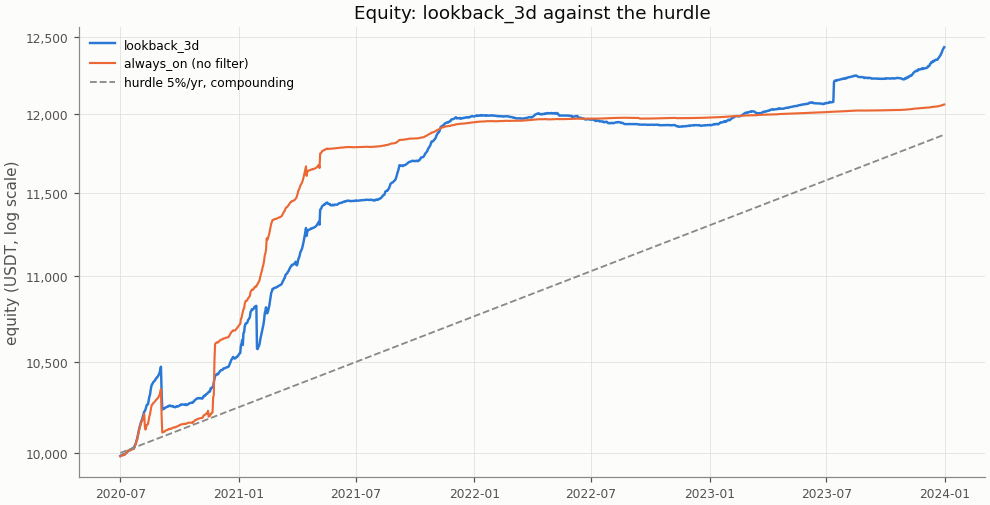
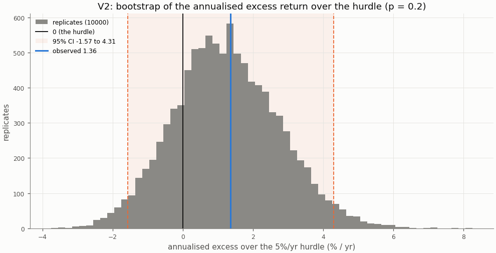
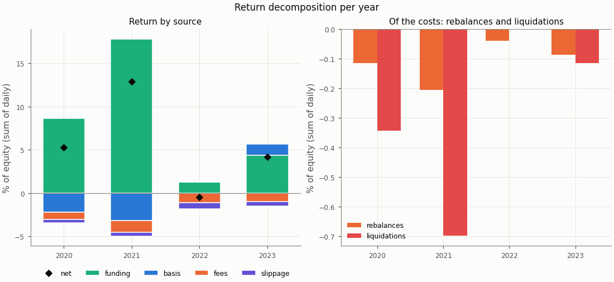
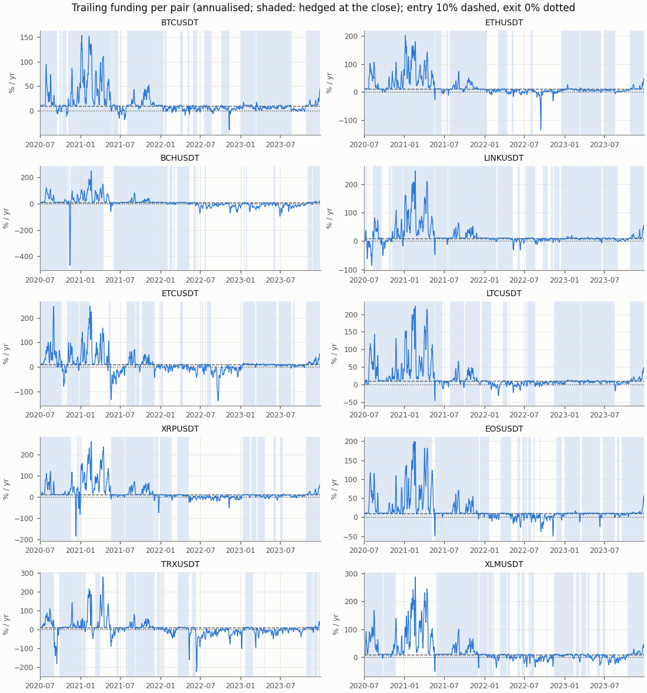
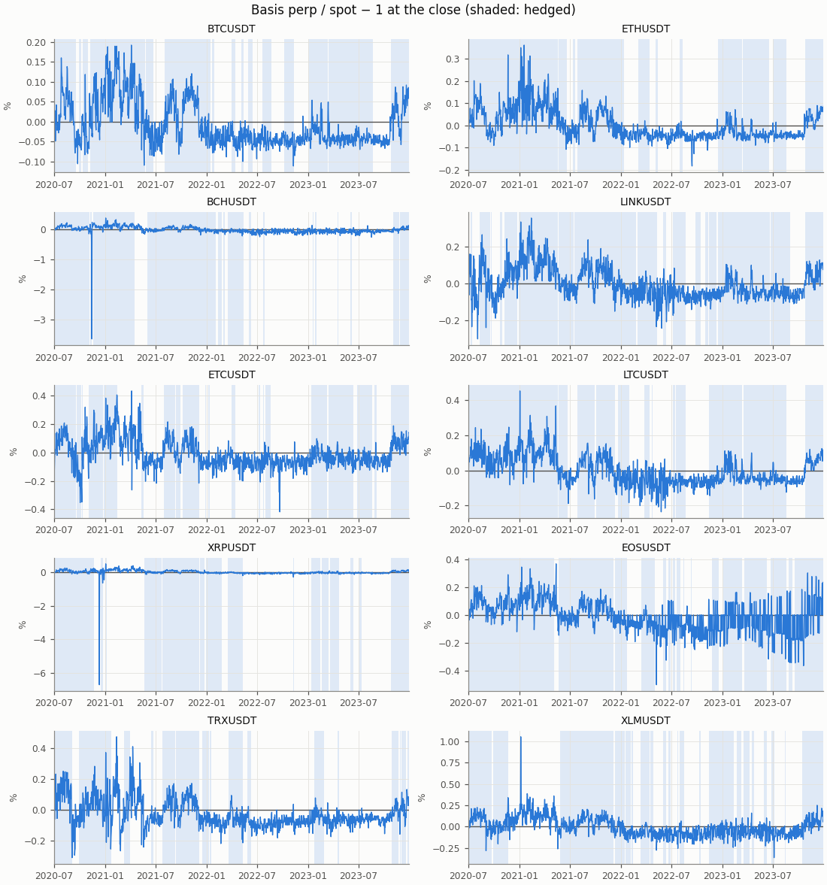

# Funding carry — exploratory row lookback_3d, in-sample

- Row: `lookback_3d` (exploratory: reported, no say in the verdict (a DSR trial))
- Signal: 3-day trailing funding (annualised); on above 10%/yr, off below 0%/yr, otherwise the previous state
- Sleeve: perp leverage 2 (equal sleeves, spot notional L / (L + 1) of a sleeve)
- Pairs: BTCUSDT, ETHUSDT, BCHUSDT, LINKUSDT, ETCUSDT, LTCUSDT, XRPUSDT, EOSUSDT, TRXUSDT, XLMUSDT
- Period: 2020-07-01 to 2023-12-31 (1279 return days)
- Variant id: `f71895edacf6943afa4fafcf926aab765bc9e187ce822e9dcd0a3dfcc065ad8d`
- Pre-registration hash: `a44eee47990843ff13c81da0dd0db23d82a0811fdb4896366482818a6e14b242`
- Code version: `7ce43816563f41f4f2aa7318d46e382e027e7a547652ac4d6b748454fa80f240` (git `229ce16df98c4e2d359c7d8ac468ca00d644431e`)

## Headline

**Descriptive (in-sample; exploratory row `lookback_3d`, no say in the verdict): it would read positive below the hurdle.** V1 (net Sharpe above 0) passes, p = 0.0001; V2 (annualised net return above the 5%/yr hurdle) fails, p = 0.2. Annualised net return 6.24% (95% CI 3.31% to 9.19%); excess over the hurdle 1.36% (95% CI -1.57% to 4.31%): not proven: the CI contains 0.

In-sample: the period the pre-registration and the simplified screen were set on; the rule was frozen before any executor return was computed.

| Headline | Value |
|---|---|
| V1: net Sharpe (annualised) | 3.20 |
| V1: 95% CI | 1.57 to 6.48 |
| V1: p (one-sided) | 0.0001 |
| V1 passes | yes |
| V2: annualised net return | 6.24% |
| V2: annualised net return, 95% CI | 3.31% to 9.19% |
| V2: hurdle | 5.0% |
| V2: excess over the hurdle | 1.36% |
| V2: excess, 95% CI | -1.57% to 4.31% |
| V2: p (one-sided) | 0.2 |
| V2 passes | no |
| V2 reading | not proven: the CI contains 0 |
| Reading | positive below the hurdle |
| Return days | 1279 |

## Rule

Edge iff V1 and V2 both pass, each one-sided at α = 0.05, unadjusted (overview CD8). V1: the portfolio's net daily Sharpe above 0; V2: the annualised net return (365 × mean daily return) above the 5%/yr hurdle (CD9), on the daily excess over its daily rate. Both by moving-block bootstrap, B = 10000, blocks of 30 days; 95% percentile CIs. V2 reads three ways (overview §3): proven above the hurdle (passes), not proven (the CI contains 0), proven below (the CI lies below 0).

Costs on every fill: perp taker 0.05%, spot taker 0.10%, slippage per leg (default 0.05%, BTCUSDT 0.02%, ETHUSDT 0.02%); funding from the data on the perp leg; liquidation fee 1.0%.

## Equity

The row against `always_on` (no filter: sleeves at perp leverage 2 held on every live day) over the same days, both from their own `stats.json`.

| Statistic | lookback_3d | always_on |
|---|---|---|
| annualised return (365 × mean) | 6.24% | 5.36% |
| CAGR | 6.42% | 5.49% |
| annualised vol | 1.95% | 1.78% |
| Sharpe (annualised) | 3.20 | 3.01 |
| Sharpe, 95% CI | 1.57 to 6.48 | 1.39 to 5.57 |
| max drawdown | 2.30% | 2.29% |
| worst day | -2.27% | -1.37% |
| worst day: date | 2021-01-29 | 2020-09-03 |
| worst month | -1.78% | -1.66% |
| worst month: month | 2020-09 | 2020-09 |

## Hurdles

V2 against other hurdles, descriptive (overview §10.2): the same bootstrap draws as the verdict's V2, so the 5.0% row is the verdict's.

| Hurdle | Excess | 95% CI | p (one-sided) | Passes | Reading |
|---|---|---|---|---|---|
| 0.0% | 6.24% | 3.31% to 9.19% | 0.0001 | yes | proven above the hurdle (V2 passes) |
| 3.0% | 3.28% | 0.35% to 6.23% | 0.0129 | yes | proven above the hurdle (V2 passes) |
| 5.0% | 1.36% | -1.57% to 4.31% | 0.2 | no | not proven: the CI contains 0 |
| 8.0% | -1.46% | -4.39% to 1.49% | 0.851 | no | not proven: the CI contains 0 |

## Filter value and random timing

Computed for the portfolio primary only (Phase 5 §5.9).

## Return decomposition

Fractions of equity summed over days (each day's money over the previous day's equity), so funding + basis − fees − slippage is the net. Basis is the two legs' price P&L (a liquidation's loss to its price included); the rebalance and liquidation costs are a part of fees and slippage, not added to them (Phase 4 §4.7).

| Total | Value |
|---|---|
| funding | 32.22% |
| basis | -4.08% |
| fees | 4.32% |
| slippage | 1.96% |
| of which rebalances | 0.45% |
| of which liquidations | 1.16% |
| net (sum of daily returns) | 21.86% |
| compounded | 24.35% |
| share of live pair-days on | 62.2% |
| pair-days on | 7955 |
| pair-days live | 12790 |
| entries | 167 |

| Year | Days | Funding | Basis | Fees | Slippage | of which rebalances | of which liquidations | Net | Compounded | Share on | Entries |
|---|---|---|---|---|---|---|---|---|---|---|---|
| 2020 | 184 | 8.66% | -2.19% | 0.87% | 0.34% | 0.12% | 0.34% | 5.27% | 5.39% | 86.9% | 30 |
| 2021 | 365 | 17.83% | -3.18% | 1.35% | 0.43% | 0.21% | 0.70% | 12.87% | 13.68% | 76.1% | 34 |
| 2022 | 365 | 1.31% | 0.03% | 1.14% | 0.68% | 0.04% | 0.00% | -0.47% | -0.47% | 34.8% | 58 |
| 2023 | 365 | 4.41% | 1.26% | 0.95% | 0.52% | 0.09% | 0.12% | 4.19% | 4.27% | 63.2% | 45 |

| Pair | Funding | Basis | Fees | Slippage | Net | Days on | Days live | Entries |
|---|---|---|---|---|---|---|---|---|
| BCHUSDT | 2.93% | -0.42% | 0.41% | 0.20% | 1.90% | 692 | 1279 | 16 |
| BTCUSDT | 3.24% | 0.00% | 0.32% | 0.09% | 2.84% | 907 | 1279 | 16 |
| EOSUSDT | 3.94% | 0.51% | 0.45% | 0.22% | 3.79% | 991 | 1279 | 17 |
| ETCUSDT | 2.95% | -0.74% | 0.49% | 0.25% | 1.47% | 648 | 1279 | 20 |
| ETHUSDT | 4.47% | -0.03% | 0.24% | 0.07% | 4.12% | 882 | 1279 | 11 |
| LINKUSDT | 4.28% | 0.01% | 0.36% | 0.24% | 3.69% | 1020 | 1279 | 18 |
| LTCUSDT | 4.56% | -0.04% | 0.24% | 0.16% | 4.11% | 930 | 1279 | 12 |
| TRXUSDT | 1.67% | -4.90% | 0.69% | 0.26% | -4.18% | 515 | 1279 | 20 |
| XLMUSDT | 2.18% | -0.59% | 0.50% | 0.27% | 0.83% | 719 | 1279 | 21 |
| XRPUSDT | 1.99% | 2.13% | 0.61% | 0.20% | 3.30% | 651 | 1279 | 16 |

## Funding and basis per pair

From the run folder's `signals.parquet`: the trailing funding the rule decides on and the basis at the close, per pair, with the days the pair was hedged at the close shaded.

## Margin events

Rebalance: at the close the perp wallet held less than half the margin at the target leverage; both legs were cut back at the next fill. Liquidation: the day high reached the liquidation price; the short was bought back there with the liquidation fee and the spot leg sold at the next fill (CD7).

| Event | Count | Cost (USDT) | Cost (% of equity) |
|---|---|---|---|
| rebalances | 115 | 50.12 | 0.448% |
| liquidations | 10 | 126.30 | 1.156% |

| Event | Date | Pair | Liquidation price / qty cut | Cost (USDT) | Cost (% of equity) |
|---|---|---|---|---|---|
| liquidation | 2020-09-03 | TRXUSDT | 0.046131 | 11.56 | 0.111% |
| liquidation | 2020-11-21 | XRPUSDT | 0.459134 | 12.30 | 0.119% |
| liquidation | 2020-11-22 | XLMUSDT | 0.112646 | 11.83 | 0.114% |
| liquidation | 2021-01-07 | XRPUSDT | 0.337799 | 12.19 | 0.115% |
| liquidation | 2021-01-29 | TRXUSDT | 0.043283 | 11.93 | 0.111% |
| liquidation | 2021-02-13 | ETCUSDT | 17.549713 | 12.70 | 0.117% |
| liquidation | 2021-03-31 | TRXUSDT | 0.094552 | 12.51 | 0.113% |
| liquidation | 2021-04-16 | BCHUSDT | 1166.637874 | 12.68 | 0.112% |
| liquidation | 2021-05-06 | EOSUSDT | 11.671745 | 14.64 | 0.129% |
| liquidation | 2023-07-13 | XRPUSDT | 0.728021 | 13.95 | 0.115% |
| rebalance | 2020-07-09 | XLMUSDT | 2218.660170 | 0.48 | 0.005% |
| rebalance | 2020-07-18 | XLMUSDT | 1312.052776 | 0.34 | 0.003% |
| rebalance | 2020-07-24 | ETHUSDT | 0.524942 | 0.27 | 0.003% |
| rebalance | 2020-07-26 | XRPUSDT | 685.096240 | 0.37 | 0.004% |
| rebalance | 2020-07-28 | BCHUSDT | 0.520284 | 0.35 | 0.003% |
| rebalance | 2020-07-28 | BTCUSDT | 0.013087 | 0.28 | 0.003% |
| rebalance | 2020-07-28 | ETCUSDT | 23.040362 | 0.41 | 0.004% |
| rebalance | 2020-07-28 | LTCUSDT | 3.794403 | 0.51 | 0.005% |
| rebalance | 2020-07-29 | EOSUSDT | 57.646066 | 0.43 | 0.004% |
| rebalance | 2020-07-31 | ETHUSDT | 0.419379 | 0.27 | 0.003% |
| rebalance | 2020-08-02 | TRXUSDT | 8091.534038 | 0.42 | 0.004% |
| rebalance | 2020-08-02 | XRPUSDT | 830.116377 | 0.61 | 0.006% |
| rebalance | 2020-08-13 | LINKUSDT | 12.114922 | 0.51 | 0.005% |
| rebalance | 2020-08-14 | ETHUSDT | 0.411535 | 0.33 | 0.003% |
| rebalance | 2020-08-16 | EOSUSDT | 38.330024 | 0.36 | 0.003% |
| rebalance | 2020-08-16 | TRXUSDT | 5373.016190 | 0.34 | 0.003% |
| rebalance | 2020-08-18 | LTCUSDT | 2.219849 | 0.38 | 0.004% |
| rebalance | 2020-08-18 | TRXUSDT | 4967.225818 | 0.38 | 0.004% |
| rebalance | 2020-11-19 | BTCUSDT | 0.007174 | 0.24 | 0.002% |
| rebalance | 2020-11-22 | BCHUSDT | 0.543620 | 0.42 | 0.004% |
| rebalance | 2020-11-22 | ETCUSDT | 26.048138 | 0.44 | 0.004% |
| rebalance | 2020-11-22 | ETHUSDT | 0.323887 | 0.34 | 0.003% |
| rebalance | 2020-11-22 | LINKUSDT | 11.117894 | 0.44 | 0.004% |
| rebalance | 2020-11-22 | LTCUSDT | 2.060669 | 0.45 | 0.004% |
| rebalance | 2020-11-25 | TRXUSDT | 6284.117615 | 0.57 | 0.005% |
| rebalance | 2020-12-17 | XRPUSDT | 288.514003 | 0.41 | 0.004% |
| rebalance | 2020-12-18 | BTCUSDT | 0.007606 | 0.33 | 0.003% |
| rebalance | 2020-12-19 | LTCUSDT | 1.465255 | 0.40 | 0.004% |
| rebalance | 2020-12-29 | ETHUSDT | 0.289182 | 0.41 | 0.004% |
| rebalance | 2020-12-31 | BTCUSDT | 0.006269 | 0.35 | 0.003% |

The first 40 of 125 events (liquidations first); all are in `stats.json` and `events.parquet`.

## Cost re-pricing

The row re-run at other costs, descriptive (overview §10.4); the verdict uses VIP 0. **No cell equals the verdict's costs**: the pre-registered slippage is per pair (default 0.05%, BTCUSDT 0.02%, ETHUSDT 0.02%), while a cell's slippage applies to every pair.

| Slippage | Spot taker | Perp taker | Annualised net return | Sharpe | Excess over the hurdle | 95% CI | p (V2) | V2 reading | Fees | Slippage cost | Entries |
|---|---|---|---|---|---|---|---|---|---|---|---|
| 0.00% | 0.075% | 0.050% | 6.95% | 3.58 | 2.07% | -0.87% to 5.05% | 0.0942 | not proven: the CI contains 0 | 3.76% | 0.00% | 167 |
| 0.00% | 0.100% | 0.050% | 6.79% | 3.50 | 1.92% | -1.04% to 4.91% | 0.115 | not proven: the CI contains 0 | 4.32% | 0.00% | 167 |
| 0.02% | 0.075% | 0.050% | 6.70% | 3.45 | 1.83% | -1.14% to 4.83% | 0.128 | not proven: the CI contains 0 | 3.76% | 0.88% | 167 |
| 0.02% | 0.100% | 0.050% | 6.55% | 3.37 | 1.67% | -1.31% to 4.67% | 0.153 | not proven: the CI contains 0 | 4.32% | 0.88% | 167 |
| 0.05% | 0.075% | 0.050% | 6.33% | 3.25 | 1.45% | -1.52% to 4.47% | 0.194 | not proven: the CI contains 0 | 3.76% | 2.19% | 167 |
| 0.05% | 0.100% | 0.050% | 6.17% | 3.17 | 1.29% | -1.69% to 4.33% | 0.225 | not proven: the CI contains 0 | 4.32% | 2.19% | 167 |
| 0.10% | 0.075% | 0.050% | 5.71% | 2.92 | 0.83% | -2.19% to 3.89% | 0.331 | not proven: the CI contains 0 | 3.76% | 4.37% | 167 |
| 0.10% | 0.100% | 0.050% | 5.55% | 2.84 | 0.67% | -2.34% to 3.74% | 0.37 | not proven: the CI contains 0 | 4.31% | 4.37% | 167 |

## Per-pair rows

Each pair alone as a one-pair portfolio under the `lookback_3d` row, from its own folder's `stats.json`; descriptive, no say in the verdict. A pair whose data ends before the period end (a delisting) is not run alone; the portfolio closes it by the delisting rule.

| Pair | Annualised net return | Excess over the hurdle | 95% CI (excess) | p (V2) | V2 reading | Sharpe | p (V1) | Reading | Share on |
|---|---|---|---|---|---|---|---|---|---|
| BTCUSDT | 8.25% | 3.38% | -0.47% to 7.60% | 0.0487 | proven above the hurdle (V2 passes) | 7.75 | 0.0001 | edge | 70.9% |
| ETHUSDT | 11.04% | 6.16% | 1.27% to 11.79% | 0.0036 | proven above the hurdle (V2 passes) | 8.06 | 0.0001 | edge | 69.0% |
| BCHUSDT | 5.57% | 0.69% | -3.96% to 5.57% | 0.417 | not proven: the CI contains 0 | 1.55 | 0.0078 | positive below the hurdle | 54.1% |
| LINKUSDT | 10.13% | 5.25% | 0.54% to 11.05% | 0.0127 | proven above the hurdle (V2 passes) | 6.68 | 0.0001 | edge | 79.7% |
| ETCUSDT | 4.18% | -0.69% | -5.81% to 3.58% | 0.638 | not proven: the CI contains 0 | 1.23 | 0.0504 | no edge | 50.7% |
| LTCUSDT | 11.05% | 6.17% | 1.18% to 11.86% | 0.0046 | proven above the hurdle (V2 passes) | 7.39 | 0.0001 | edge | 72.7% |
| XRPUSDT | 9.40% | 4.52% | -1.78% to 12.84% | 0.114 | not proven: the CI contains 0 | 1.23 | 0.0001 | positive below the hurdle | 50.9% |
| EOSUSDT | 10.32% | 5.44% | 0.41% to 11.28% | 0.017 | proven above the hurdle (V2 passes) | 2.46 | 0.0001 | edge | 77.5% |
| TRXUSDT | -12.42% | -17.30% | -39.38% to -2.00% | 0.998 | proven below the hurdle: the CI lies entirely below 0 | -0.78 | 0.902 | no edge | 40.3% |
| XLMUSDT | 2.35% | -2.53% | -7.83% to 1.53% | 0.894 | not proven: the CI contains 0 | 0.54 | 0.201 | no edge | 56.2% |

## Deflated Sharpe ratio

Computed for the portfolio primary only, with the seven pre-registered rows as trials.

## Unmodelled risks

A backtest cannot show the main risk of a carry trade: **exchange and counterparty risk** (an exchange failure, a frozen withdrawal), which is not modelled (overview §5 item 5). Also not modelled: auto-deleveraging, rule changes such as funding caps, and the yield idle USDT could earn (an off sleeve earns 0; the hurdle stands for it). Funding-interval changes are in the data. Costs are Binance VIP 0 without the BNB discount; the re-pricing table shows the sensitivity.

## Notes

- The V2 bootstrap figure redraws the verdict's replicates at report time with its own seed (`insample/lookback_3d/v2`); their p and CI equal `stats.json`'s.
- Numbers in the tables are `stats.json` values; the figures read the run folder's tables.
