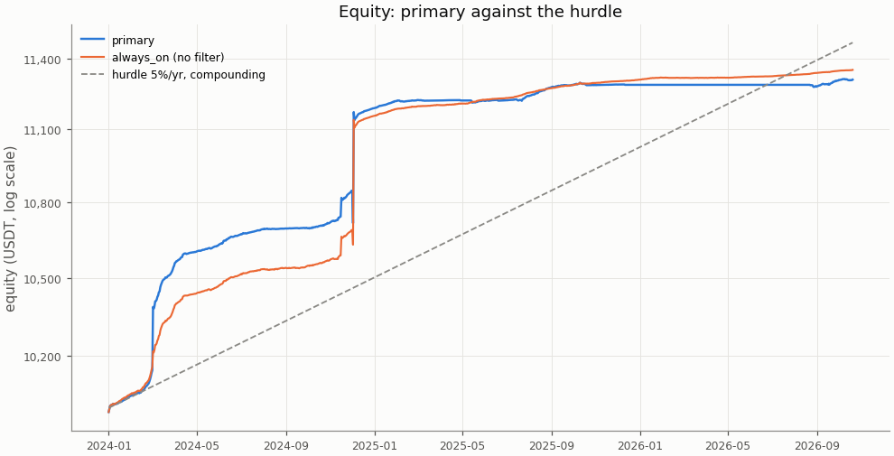
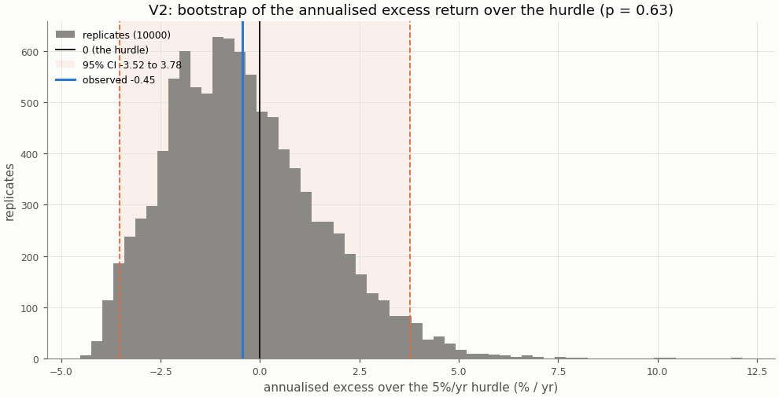
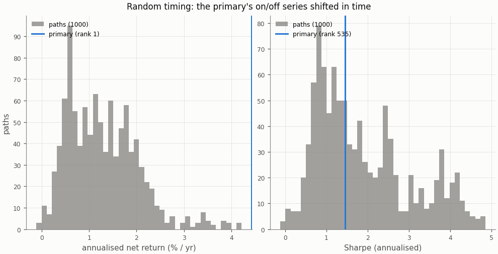
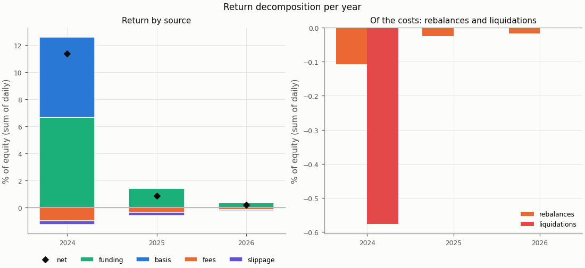
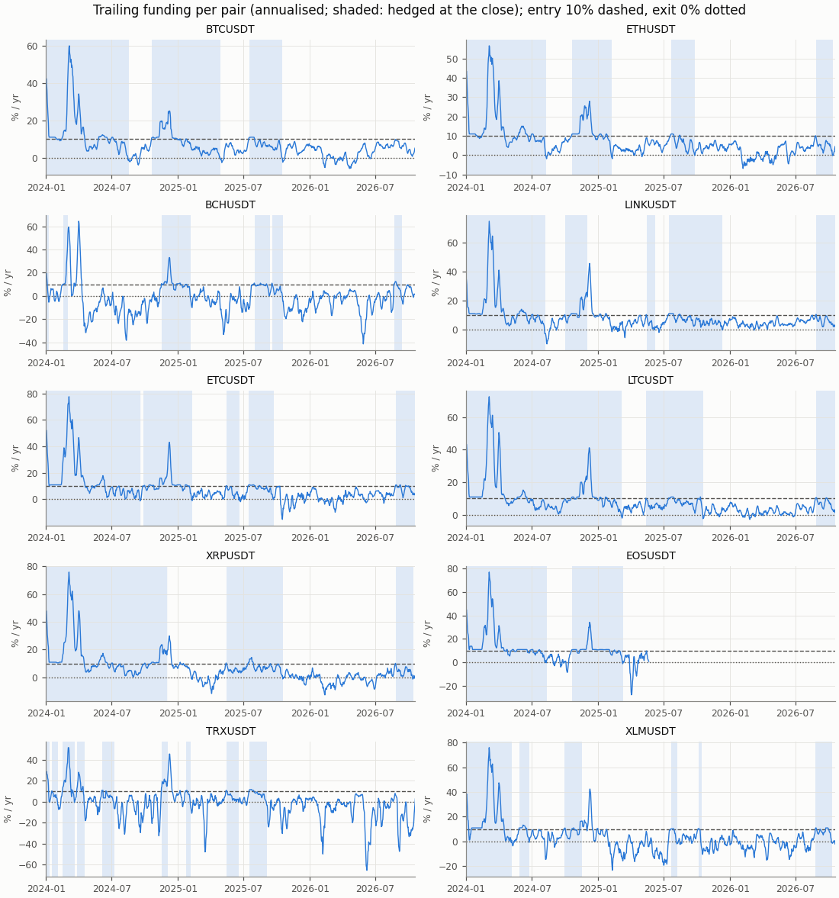
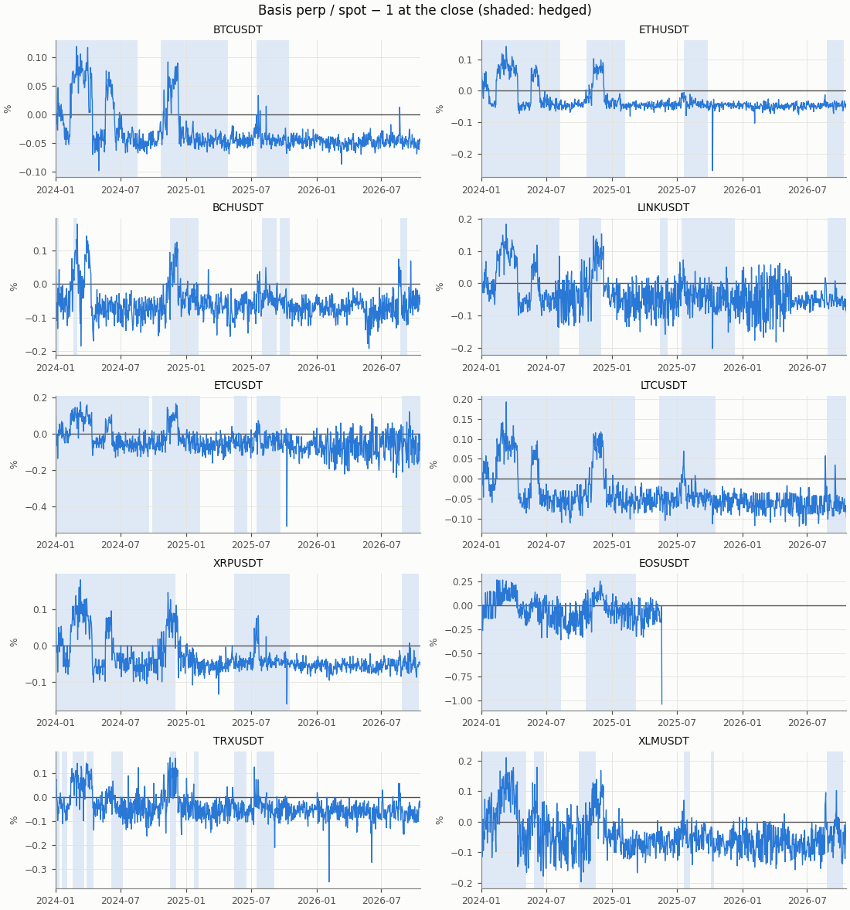

# Funding carry — primary, holdout

- Row: `primary` (pre-registered primary: its V1 and V2 are the verdict)
- Signal: 7-day trailing funding (annualised); on above 10%/yr, off below 0%/yr, otherwise the previous state
- Sleeve: perp leverage 2 (equal sleeves, spot notional L / (L + 1) of a sleeve)
- Pairs: BTCUSDT, ETHUSDT, BCHUSDT, LINKUSDT, ETCUSDT, LTCUSDT, XRPUSDT, EOSUSDT, TRXUSDT, XLMUSDT
- Period: 2024-01-01 to 2026-10-20 (1024 return days)
- Variant id: `129507f6aa1867c6fa9b12a665588dabc95b4bea28a17f8cc703bc018283b9f3`
- Pre-registration hash: `a44eee47990843ff13c81da0dd0db23d82a0811fdb4896366482818a6e14b242`
- Code version: `7ce43816563f41f4f2aa7318d46e382e027e7a547652ac4d6b748454fa80f240` (git `e079ff023e2615af99dcc3efc96dbc5c3433d803`)

## Headline

**Verdict (holdout): positive below the hurdle.** V1 (net Sharpe above 0) passes, p = 0.0001; V2 (annualised net return above the 5%/yr hurdle) fails, p = 0.63. Annualised net return 4.43% (95% CI 1.36% to 8.66%); excess over the hurdle -0.45% (95% CI -3.52% to 3.78%): not proven: the CI contains 0.

**Caveat: this holdout is not fully unseen** (overview §4). No carry return, basis series or per-pair funding statistic had been computed on it in this repo, but the trend screen loaded these perp prices, the first strategy charged BTCUSDT and ETHUSDT funding over the whole window (its reports show mean funding per trade), and general market knowledge covers it. The 36-month forward test is the only fully unseen one.

| Headline | Value |
|---|---|
| V1: net Sharpe (annualised) | 1.45 |
| V1: 95% CI | 0.94 to 6.55 |
| V1: p (one-sided) | 0.0001 |
| V1 passes | yes |
| V2: annualised net return | 4.43% |
| V2: annualised net return, 95% CI | 1.36% to 8.66% |
| V2: hurdle | 5.0% |
| V2: excess over the hurdle | -0.45% |
| V2: excess, 95% CI | -3.52% to 3.78% |
| V2: p (one-sided) | 0.63 |
| V2 passes | no |
| V2 reading | not proven: the CI contains 0 |
| Reading | positive below the hurdle |
| Return days | 1024 |

## Rule

Edge iff V1 and V2 both pass, each one-sided at α = 0.05, unadjusted (overview CD8). V1: the portfolio's net daily Sharpe above 0; V2: the annualised net return (365 × mean daily return) above the 5%/yr hurdle (CD9), on the daily excess over its daily rate. Both by moving-block bootstrap, B = 10000, blocks of 30 days; 95% percentile CIs. V2 reads three ways (overview §3): proven above the hurdle (passes), not proven (the CI contains 0), proven below (the CI lies below 0).

Costs on every fill: perp taker 0.05%, spot taker 0.10%, slippage per leg (default 0.05%, BTCUSDT 0.02%, ETHUSDT 0.02%); funding from the data on the perp leg; liquidation fee 1.0%.

## Equity

The row against `always_on` (no filter: sleeves at perp leverage 2 held on every live day) over the same days, both from their own `stats.json`.

| Statistic | primary | always_on |
|---|---|---|
| annualised return (365 × mean) | 4.43% | 4.56% |
| CAGR | 4.48% | 4.62% |
| annualised vol | 3.05% | 2.95% |
| Sharpe (annualised) | 1.45 | 1.55 |
| Sharpe, 95% CI | 0.94 to 6.55 | 1.12 to 8.74 |
| max drawdown | 1.21% | 0.55% |
| worst day | -1.21% | -0.55% |
| worst day: date | 2024-12-02 | 2024-12-02 |
| worst month | -0.07% | -0.01% |
| worst month: month | 2026-08 | 2026-02 |

## Hurdles

V2 against other hurdles, descriptive (overview §10.2): the same bootstrap draws as the verdict's V2, so the 5.0% row is the verdict's.

| Hurdle | Excess | 95% CI | p (one-sided) | Passes | Reading |
|---|---|---|---|---|---|
| 0.0% | 4.43% | 1.36% to 8.66% | 0.0001 | yes | proven above the hurdle (V2 passes) |
| 3.0% | 1.47% | -1.60% to 5.70% | 0.233 | no | not proven: the CI contains 0 |
| 5.0% | -0.45% | -3.52% to 3.78% | 0.63 | no | not proven: the CI contains 0 |
| 8.0% | -3.27% | -6.34% to 0.96% | 0.941 | no | not proven: the CI contains 0 |

## Filter value and random timing

**Filter value:** the paired Sharpe difference primary − always_on (the same blocks for both), descriptive.

| Filter value | Value |
|---|---|
| Sharpe, primary | 1.45 |
| Sharpe, always_on | 1.55 |
| difference | -0.09 |
| difference, 95% CI | -3.89 to 0.01 |
| p (one-sided) | 0.964 |

**Random timing:** the primary's on/off series shifted in time (1000 paths, one offset per path shared by the pairs, at least 60 days from either end of the 1024 days; Phase 4 §4.4). Rank 1 means no path did better; the share counts the paths at least as good, plus one. Descriptive.

| Random timing | Annualised net return | Sharpe |
|---|---|---|
| primary | 4.43% | 1.45 |
| paths: mean | 1.29% | 1.89 |
| paths: std | 0.75% | 1.15 |
| paths: 5th pct | 0.33% | 0.54 |
| paths: median | 1.18% | 1.56 |
| paths: 95th pct | 2.57% | 4.12 |
| rank of the primary | 1 | 535 |
| share of paths at least as good | 0.001 | 0.534 |
| finite paths | 1000 | 1000 |

## Return decomposition

Fractions of equity summed over days (each day's money over the previous day's equity), so funding + basis − fees − slippage is the net. Basis is the two legs' price P&L (a liquidation's loss to its price included); the rebalance and liquidation costs are a part of fees and slippage, not added to them (Phase 4 §4.7).

| Total | Value |
|---|---|
| funding | 8.45% |
| basis | 5.99% |
| fees | 1.44% |
| slippage | 0.56% |
| of which rebalances | 0.15% |
| of which liquidations | 0.58% |
| net (sum of daily returns) | 12.43% |
| compounded | 13.09% |
| share of live pair-days on | 43.8% |
| pair-days on | 4256 |
| pair-days live | 9723 |
| entries | 46 |

| Year | Days | Funding | Basis | Fees | Slippage | of which rebalances | of which liquidations | Net | Compounded | Share on | Entries |
|---|---|---|---|---|---|---|---|---|---|---|---|
| 2024 | 366 | 6.68% | 5.92% | 0.96% | 0.27% | 0.11% | 0.58% | 11.36% | 11.89% | 71.8% | 24 |
| 2025 | 365 | 1.41% | 0.03% | 0.35% | 0.21% | 0.03% | 0.00% | 0.87% | 0.88% | 38.1% | 15 |
| 2026 | 293 | 0.36% | 0.04% | 0.13% | 0.08% | 0.02% | 0.00% | 0.19% | 0.19% | 12.3% | 7 |

| Pair | Funding | Basis | Fees | Slippage | Net | Days on | Days live | Entries |
|---|---|---|---|---|---|---|---|---|
| BCHUSDT | 0.33% | 2.18% | 0.22% | 0.08% | 2.22% | 191 | 1024 | 6 |
| BTCUSDT | 1.02% | 0.01% | 0.07% | 0.02% | 0.94% | 511 | 1024 | 3 |
| EOSUSDT | 0.78% | 0.01% | 0.04% | 0.03% | 0.72% | 364 | 507 | 2 |
| ETCUSDT | 1.13% | 0.02% | 0.10% | 0.06% | 0.99% | 558 | 1024 | 5 |
| ETHUSDT | 0.98% | 0.01% | 0.09% | 0.02% | 0.88% | 446 | 1024 | 4 |
| LINKUSDT | 0.95% | -0.71% | 0.20% | 0.06% | -0.01% | 506 | 1024 | 5 |
| LTCUSDT | 1.20% | 0.01% | 0.06% | 0.04% | 1.12% | 644 | 1024 | 3 |
| TRXUSDT | 0.38% | 4.16% | 0.28% | 0.12% | 4.14% | 225 | 1024 | 9 |
| XLMUSDT | 0.65% | 0.75% | 0.22% | 0.08% | 1.10% | 270 | 1024 | 6 |
| XRPUSDT | 1.01% | -0.45% | 0.17% | 0.05% | 0.33% | 541 | 1024 | 3 |

## Funding and basis per pair

From the run folder's `signals.parquet`: the trailing funding the rule decides on and the basis at the close, per pair, with the days the pair was hedged at the close shaded.

## Margin events

Rebalance: at the close the perp wallet held less than half the margin at the target leverage; both legs were cut back at the next fill. Liquidation: the day high reached the liquidation price; the short was bought back there with the liquidation fee and the spot leg sold at the next fill (CD7).

| Event | Count | Cost (USDT) | Cost (% of equity) |
|---|---|---|---|
| rebalances | 36 | 16.28 | 0.150% |
| liquidations | 5 | 61.51 | 0.576% |

| Event | Date | Pair | Liquidation price / qty cut | Cost (USDT) | Cost (% of equity) |
|---|---|---|---|---|---|
| liquidation | 2024-03-02 | BCHUSDT | 404.915978 | 11.68 | 0.115% |
| liquidation | 2024-11-16 | XLMUSDT | 0.204175 | 12.35 | 0.115% |
| liquidation | 2024-12-02 | LINKUSDT | 26.802496 | 12.23 | 0.113% |
| liquidation | 2024-12-02 | XRPUSDT | 2.868206 | 12.22 | 0.113% |
| liquidation | 2024-12-03 | TRXUSDT | 0.300987 | 13.04 | 0.121% |
| rebalance | 2024-01-12 | ETCUSDT | 7.183983 | 0.52 | 0.005% |
| rebalance | 2024-02-06 | LINKUSDT | 9.163918 | 0.44 | 0.004% |
| rebalance | 2024-02-15 | BTCUSDT | 0.002705 | 0.27 | 0.003% |
| rebalance | 2024-02-16 | ETHUSDT | 0.051964 | 0.28 | 0.003% |
| rebalance | 2024-03-02 | ETHUSDT | 0.040596 | 0.26 | 0.003% |
| rebalance | 2024-03-03 | EOSUSDT | 155.310896 | 0.42 | 0.004% |
| rebalance | 2024-03-03 | LTCUSDT | 1.769263 | 0.41 | 0.004% |
| rebalance | 2024-03-04 | BTCUSDT | 0.002240 | 0.27 | 0.003% |
| rebalance | 2024-03-05 | ETCUSDT | 4.091891 | 0.37 | 0.004% |
| rebalance | 2024-11-12 | BTCUSDT | 0.002152 | 0.36 | 0.003% |
| rebalance | 2024-11-12 | ETHUSDT | 0.045006 | 0.29 | 0.003% |
| rebalance | 2024-11-12 | LINKUSDT | 10.993614 | 0.40 | 0.004% |
| rebalance | 2024-11-13 | XLMUSDT | 1787.086268 | 0.61 | 0.006% |
| rebalance | 2024-11-16 | XRPUSDT | 270.142059 | 0.60 | 0.006% |
| rebalance | 2024-11-17 | EOSUSDT | 390.671937 | 0.66 | 0.006% |
| rebalance | 2024-11-17 | ETCUSDT | 8.448530 | 0.57 | 0.005% |
| rebalance | 2024-11-17 | XRPUSDT | 185.756013 | 0.53 | 0.005% |
| rebalance | 2024-11-23 | XRPUSDT | 153.526673 | 0.59 | 0.005% |
| rebalance | 2024-11-25 | EOSUSDT | 202.181225 | 0.42 | 0.004% |
| rebalance | 2024-11-25 | LINKUSDT | 8.892871 | 0.40 | 0.004% |
| rebalance | 2024-11-28 | ETCUSDT | 4.178654 | 0.34 | 0.003% |
| rebalance | 2024-12-01 | XRPUSDT | 97.458053 | 0.47 | 0.004% |
| rebalance | 2024-12-02 | EOSUSDT | 218.145889 | 0.61 | 0.006% |
| rebalance | 2024-12-02 | LTCUSDT | 1.471835 | 0.45 | 0.004% |
| rebalance | 2024-12-04 | BCHUSDT | 0.336259 | 0.50 | 0.004% |
| rebalance | 2024-12-06 | EOSUSDT | 108.692289 | 0.37 | 0.003% |
| rebalance | 2025-07-18 | XRPUSDT | 76.191190 | 0.66 | 0.006% |
| rebalance | 2025-07-19 | ETCUSDT | 8.318954 | 0.49 | 0.004% |
| rebalance | 2025-07-21 | LINKUSDT | 8.655580 | 0.41 | 0.004% |
| rebalance | 2025-08-13 | ETHUSDT | 0.041647 | 0.36 | 0.003% |
| rebalance | 2025-08-13 | LINKUSDT | 7.879017 | 0.46 | 0.004% |
| rebalance | 2025-08-13 | LTCUSDT | 1.491089 | 0.49 | 0.004% |
| rebalance | 2026-09-22 | LTCUSDT | 3.125217 | 0.49 | 0.004% |
| rebalance | 2026-09-26 | ETCUSDT | 17.810406 | 0.42 | 0.004% |
| rebalance | 2026-09-26 | XLMUSDT | 789.851825 | 0.43 | 0.004% |

The first 40 of 41 events (liquidations first); all are in `stats.json` and `events.parquet`.

## Cost re-pricing

The row re-run at other costs, descriptive (overview §10.4); the verdict uses VIP 0. **No cell equals the verdict's costs**: the pre-registered slippage is per pair (default 0.05%, BTCUSDT 0.02%, ETHUSDT 0.02%), while a cell's slippage applies to every pair.

| Slippage | Spot taker | Perp taker | Annualised net return | Sharpe | Excess over the hurdle | 95% CI | p (V2) | V2 reading | Fees | Slippage cost | Entries |
|---|---|---|---|---|---|---|---|---|---|---|---|
| 0.00% | 0.075% | 0.050% | 4.69% | 1.53 | -0.19% | -3.31% to 4.10% | 0.57 | not proven: the CI contains 0 | 1.28% | 0.00% | 46 |
| 0.00% | 0.100% | 0.050% | 4.63% | 1.52 | -0.25% | -3.36% to 4.03% | 0.579 | not proven: the CI contains 0 | 1.44% | 0.00% | 46 |
| 0.02% | 0.075% | 0.050% | 4.60% | 1.51 | -0.28% | -3.38% to 3.99% | 0.584 | not proven: the CI contains 0 | 1.28% | 0.25% | 46 |
| 0.02% | 0.100% | 0.050% | 4.54% | 1.49 | -0.34% | -3.41% to 3.93% | 0.594 | not proven: the CI contains 0 | 1.44% | 0.25% | 46 |
| 0.05% | 0.075% | 0.050% | 4.47% | 1.46 | -0.41% | -3.47% to 3.85% | 0.605 | not proven: the CI contains 0 | 1.28% | 0.62% | 46 |
| 0.05% | 0.100% | 0.050% | 4.41% | 1.44 | -0.47% | -3.51% to 3.78% | 0.616 | not proven: the CI contains 0 | 1.44% | 0.62% | 46 |
| 0.10% | 0.075% | 0.050% | 4.24% | 1.39 | -0.64% | -3.64% to 3.61% | 0.642 | not proven: the CI contains 0 | 1.28% | 1.24% | 46 |
| 0.10% | 0.100% | 0.050% | 4.19% | 1.37 | -0.69% | -3.68% to 3.54% | 0.651 | not proven: the CI contains 0 | 1.44% | 1.24% | 46 |

## Per-pair rows

Each pair alone as a one-pair portfolio under the `primary` row, from its own folder's `stats.json`; descriptive, no say in the verdict. A pair whose data ends before the period end (a delisting) is not run alone; the portfolio closes it by the delisting rule.

| Pair | Annualised net return | Excess over the hurdle | 95% CI (excess) | p (V2) | V2 reading | Sharpe | p (V1) | Reading | Share on |
|---|---|---|---|---|---|---|---|---|---|
| BTCUSDT | 3.36% | -1.52% | -3.21% to 0.45% | 0.941 | not proven: the CI contains 0 | 7.62 | 0.0001 | positive below the hurdle | 49.9% |
| ETHUSDT | 3.16% | -1.72% | -3.41% to 0.28% | 0.956 | not proven: the CI contains 0 | 7.13 | 0.0001 | positive below the hurdle | 43.6% |
| BCHUSDT | 8.19% | 3.31% | -4.94% to 19.52% | 0.346 | not proven: the CI contains 0 | 0.60 | 0.038 | positive below the hurdle | 18.7% |
| LINKUSDT | -0.13% | -5.01% | -11.92% to -0.71% | 0.992 | proven below the hurdle: the CI lies entirely below 0 | -0.03 | 0.49 | no edge | 49.4% |
| ETCUSDT | 3.51% | -1.37% | -3.29% to 0.96% | 0.898 | not proven: the CI contains 0 | 5.18 | 0.0001 | positive below the hurdle | 54.5% |
| LTCUSDT | 3.99% | -0.89% | -2.72% to 1.31% | 0.822 | not proven: the CI contains 0 | 7.56 | 0.0001 | positive below the hurdle | 62.9% |
| XRPUSDT | 1.20% | -3.68% | -8.56% to -0.14% | 0.979 | proven below the hurdle: the CI lies entirely below 0 | 0.34 | 0.274 | no edge | 52.8% |
| EOSUSDT | n/a | n/a | n/a | n/a | not run alone in this period (no stats.json) | n/a | n/a | n/a | n/a |
| TRXUSDT | 14.89% | 10.01% | -5.08% to 39.72% | 0.353 | not proven: the CI contains 0 | 0.58 | 0.0624 | no edge | 22.0% |
| XLMUSDT | 3.96% | -0.92% | -4.60% to 4.89% | 0.664 | not proven: the CI contains 0 | 0.91 | 0.0076 | positive below the hurdle | 26.4% |

## Deflated Sharpe ratio

The primary's deflated Sharpe with the seven pre-registered rows (the primary among them) as trials; daily Sharpe ratios, not annualised. Descriptive.

| Trial | Daily Sharpe |
|---|---|
| primary | 0.0760 |
| always_on | 0.0809 |
| entry_5 | 0.0829 |
| entry_20 | 0.0801 |
| lookback_3d | 0.0719 |
| lookback_14d | 0.0746 |
| lev_1 | 0.2186 |

| DSR | Value |
|---|---|
| daily Sharpe | 0.0760 |
| days T | 1024 |
| skew | 21.109 |
| kurtosis (non-excess) | 535.163 |
| trials N | 7 |
| V (variance of the trials' Sharpe) | 0.00285041 |
| SR* (expected maximum under the null) | 0.0740 |
| DSR | 0.560 |

## Unmodelled risks

A backtest cannot show the main risk of a carry trade: **exchange and counterparty risk** (an exchange failure, a frozen withdrawal), which is not modelled (overview §5 item 5). Also not modelled: auto-deleveraging, rule changes such as funding caps, and the yield idle USDT could earn (an off sleeve earns 0; the hurdle stands for it). Funding-interval changes are in the data. Costs are Binance VIP 0 without the BNB discount; the re-pricing table shows the sensitivity.

## Notes

- The V2 bootstrap figure redraws the verdict's replicates at report time with its own seed (`holdout/primary/v2`); their p and CI equal `stats.json`'s.
- Holdout `DONE`: status ok; failed 0, skipped 7 variants; output-neutral code change no.
- Numbers in the tables are `stats.json` values; the figures read the run folder's tables.
