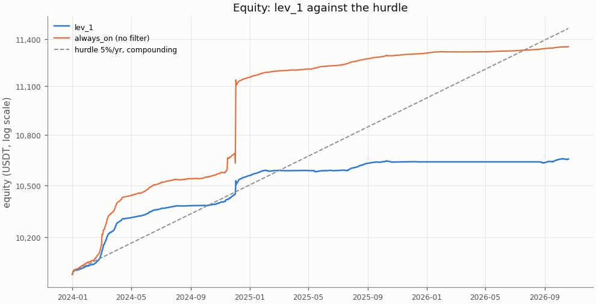
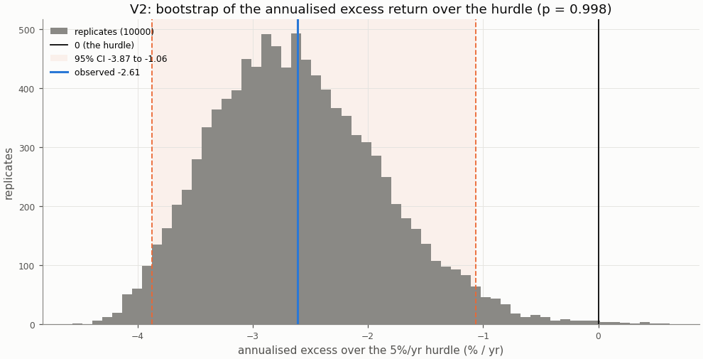
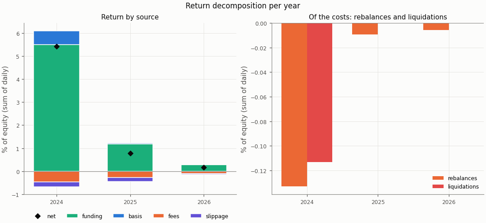
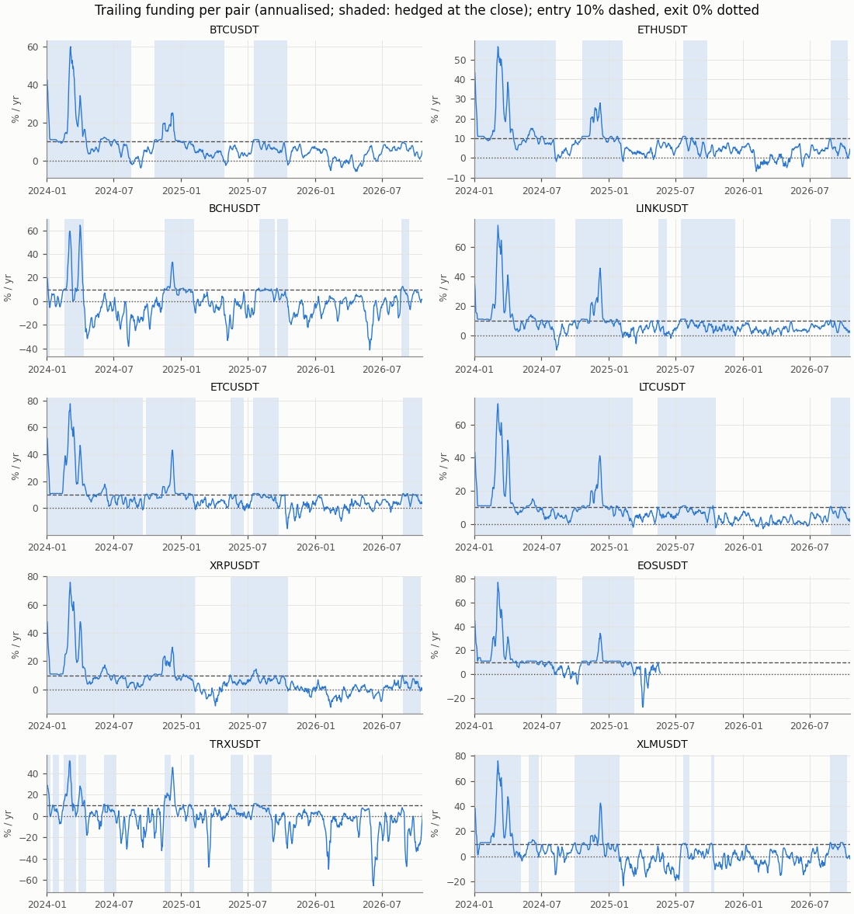
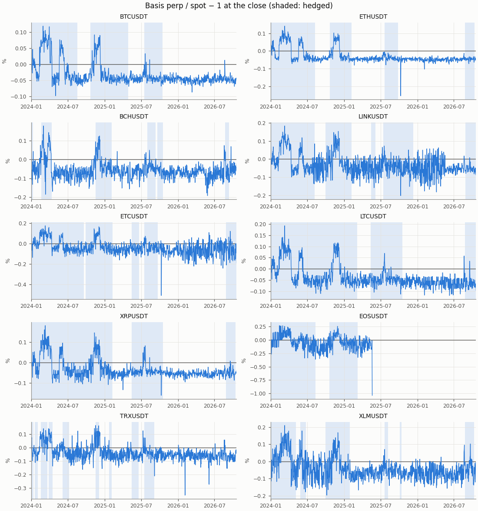

# Funding carry — exploratory row lev_1, holdout

- Row: `lev_1` (exploratory: reported, no say in the verdict (a DSR trial))
- Signal: 7-day trailing funding (annualised); on above 10%/yr, off below 0%/yr, otherwise the previous state
- Sleeve: perp leverage 1 (equal sleeves, spot notional L / (L + 1) of a sleeve)
- Pairs: BTCUSDT, ETHUSDT, BCHUSDT, LINKUSDT, ETCUSDT, LTCUSDT, XRPUSDT, EOSUSDT, TRXUSDT, XLMUSDT
- Period: 2024-01-01 to 2026-10-20 (1024 return days)
- Variant id: `8dfcc0dd8786fd2512a9c4b0c41feb6144286df2d18cddc3efb5e3e30c201f04`
- Pre-registration hash: `a44eee47990843ff13c81da0dd0db23d82a0811fdb4896366482818a6e14b242`
- Code version: `7ce43816563f41f4f2aa7318d46e382e027e7a547652ac4d6b748454fa80f240` (git `e079ff023e2615af99dcc3efc96dbc5c3433d803`)

## Headline

**Descriptive (holdout; exploratory row `lev_1`, no say in the verdict): it would read positive below the hurdle.** V1 (net Sharpe above 0) passes, p = 0.0001; V2 (annualised net return above the 5%/yr hurdle) fails, p = 0.998. Annualised net return 2.27% (95% CI 1.01% to 3.82%); excess over the hurdle -2.61% (95% CI -3.87% to -1.06%): proven below the hurdle: the CI lies entirely below 0.

**Caveat: this holdout is not fully unseen** (overview §4). No carry return, basis series or per-pair funding statistic had been computed on it in this repo, but the trend screen loaded these perp prices, the first strategy charged BTCUSDT and ETHUSDT funding over the whole window (its reports show mean funding per trade), and general market knowledge covers it. The 36-month forward test is the only fully unseen one.

| Headline | Value |
|---|---|
| V1: net Sharpe (annualised) | 4.18 |
| V1: 95% CI | 2.54 to 8.07 |
| V1: p (one-sided) | 0.0001 |
| V1 passes | yes |
| V2: annualised net return | 2.27% |
| V2: annualised net return, 95% CI | 1.01% to 3.82% |
| V2: hurdle | 5.0% |
| V2: excess over the hurdle | -2.61% |
| V2: excess, 95% CI | -3.87% to -1.06% |
| V2: p (one-sided) | 0.998 |
| V2 passes | no |
| V2 reading | proven below the hurdle: the CI lies entirely below 0 |
| Reading | positive below the hurdle |
| Return days | 1024 |

## Rule

Edge iff V1 and V2 both pass, each one-sided at α = 0.05, unadjusted (overview CD8). V1: the portfolio's net daily Sharpe above 0; V2: the annualised net return (365 × mean daily return) above the 5%/yr hurdle (CD9), on the daily excess over its daily rate. Both by moving-block bootstrap, B = 10000, blocks of 30 days; 95% percentile CIs. V2 reads three ways (overview §3): proven above the hurdle (passes), not proven (the CI contains 0), proven below (the CI lies below 0).

Costs on every fill: perp taker 0.05%, spot taker 0.10%, slippage per leg (default 0.05%, BTCUSDT 0.02%, ETHUSDT 0.02%); funding from the data on the perp leg; liquidation fee 1.0%.

## Equity

The row against `always_on` (no filter: sleeves at perp leverage 2 held on every live day) over the same days, both from their own `stats.json`.

| Statistic | lev_1 | always_on |
|---|---|---|
| annualised return (365 × mean) | 2.27% | 4.56% |
| CAGR | 2.29% | 4.62% |
| annualised vol | 0.54% | 2.95% |
| Sharpe (annualised) | 4.18 | 1.55 |
| Sharpe, 95% CI | 2.54 to 8.07 | 1.12 to 8.74 |
| max drawdown | 0.20% | 0.55% |
| worst day | -0.20% | -0.55% |
| worst day: date | 2024-12-04 | 2024-12-02 |
| worst month | -0.05% | -0.01% |
| worst month: month | 2026-08 | 2026-02 |

## Hurdles

V2 against other hurdles, descriptive (overview §10.2): the same bootstrap draws as the verdict's V2, so the 5.0% row is the verdict's.

| Hurdle | Excess | 95% CI | p (one-sided) | Passes | Reading |
|---|---|---|---|---|---|
| 0.0% | 2.27% | 1.01% to 3.82% | 0.0001 | yes | proven above the hurdle (V2 passes) |
| 3.0% | -0.69% | -1.95% to 0.86% | 0.83 | no | not proven: the CI contains 0 |
| 5.0% | -2.61% | -3.87% to -1.06% | 0.998 | no | proven below the hurdle: the CI lies entirely below 0 |
| 8.0% | -5.43% | -6.69% to -3.88% | 1 | no | proven below the hurdle: the CI lies entirely below 0 |

## Filter value and random timing

Computed for the portfolio primary only (Phase 5 §5.9).

## Return decomposition

Fractions of equity summed over days (each day's money over the previous day's equity), so funding + basis − fees − slippage is the net. Basis is the two legs' price P&L (a liquidation's loss to its price included); the rebalance and liquidation costs are a part of fees and slippage, not added to them (Phase 4 §4.7).

| Total | Value |
|---|---|
| funding | 6.96% |
| basis | 0.67% |
| fees | 0.83% |
| slippage | 0.44% |
| of which rebalances | 0.15% |
| of which liquidations | 0.11% |
| net (sum of daily returns) | 6.36% |
| compounded | 6.56% |
| share of live pair-days on | 46.4% |
| pair-days on | 4508 |
| pair-days live | 9723 |
| entries | 46 |

| Year | Days | Funding | Basis | Fees | Slippage | of which rebalances | of which liquidations | Net | Compounded | Share on | Entries |
|---|---|---|---|---|---|---|---|---|---|---|---|
| 2024 | 366 | 5.49% | 0.61% | 0.46% | 0.22% | 0.13% | 0.11% | 5.43% | 5.57% | 75.8% | 24 |
| 2025 | 365 | 1.19% | 0.03% | 0.28% | 0.17% | 0.01% | 0.00% | 0.77% | 0.78% | 41.2% | 15 |
| 2026 | 293 | 0.28% | 0.03% | 0.09% | 0.06% | 0.01% | 0.00% | 0.16% | 0.16% | 12.3% | 7 |

| Pair | Funding | Basis | Fees | Slippage | Net | Days on | Days live | Entries |
|---|---|---|---|---|---|---|---|---|
| BCHUSDT | 0.37% | 0.01% | 0.10% | 0.07% | 0.22% | 232 | 1024 | 6 |
| BTCUSDT | 0.78% | 0.01% | 0.05% | 0.01% | 0.72% | 511 | 1024 | 3 |
| EOSUSDT | 0.58% | 0.00% | 0.03% | 0.02% | 0.53% | 364 | 507 | 2 |
| ETCUSDT | 0.94% | 0.02% | 0.07% | 0.05% | 0.84% | 558 | 1024 | 5 |
| ETHUSDT | 0.79% | 0.01% | 0.06% | 0.02% | 0.72% | 446 | 1024 | 4 |
| LINKUSDT | 0.83% | 0.00% | 0.07% | 0.05% | 0.71% | 574 | 1024 | 5 |
| LTCUSDT | 0.93% | 0.01% | 0.04% | 0.03% | 0.86% | 644 | 1024 | 3 |
| TRXUSDT | 0.29% | 0.60% | 0.24% | 0.09% | 0.56% | 225 | 1024 | 9 |
| XLMUSDT | 0.60% | 0.01% | 0.10% | 0.07% | 0.44% | 345 | 1024 | 6 |
| XRPUSDT | 0.85% | 0.00% | 0.06% | 0.04% | 0.76% | 609 | 1024 | 3 |

## Funding and basis per pair

From the run folder's `signals.parquet`: the trailing funding the rule decides on and the basis at the close, per pair, with the days the pair was hedged at the close shaded.

## Margin events

Rebalance: at the close the perp wallet held less than half the margin at the target leverage; both legs were cut back at the next fill. Liquidation: the day high reached the liquidation price; the short was bought back there with the liquidation fee and the spot leg sold at the next fill (CD7).

| Event | Count | Cost (USDT) | Cost (% of equity) |
|---|---|---|---|
| rebalances | 29 | 15.37 | 0.148% |
| liquidations | 1 | 11.82 | 0.113% |

| Event | Date | Pair | Liquidation price / qty cut | Cost (USDT) | Cost (% of equity) |
|---|---|---|---|---|---|
| liquidation | 2024-12-03 | TRXUSDT | 0.400591 | 11.82 | 0.113% |
| rebalance | 2024-01-12 | ETCUSDT | 5.405936 | 0.39 | 0.004% |
| rebalance | 2024-02-13 | LINKUSDT | 8.645080 | 0.44 | 0.004% |
| rebalance | 2024-02-26 | ETHUSDT | 0.055050 | 0.32 | 0.003% |
| rebalance | 2024-02-29 | BTCUSDT | 0.003574 | 0.42 | 0.004% |
| rebalance | 2024-03-03 | BCHUSDT | 0.828020 | 1.02 | 0.010% |
| rebalance | 2024-03-08 | EOSUSDT | 178.038002 | 0.55 | 0.005% |
| rebalance | 2024-03-12 | LTCUSDT | 1.896155 | 0.49 | 0.005% |
| rebalance | 2024-04-01 | BCHUSDT | 0.265157 | 0.45 | 0.004% |
| rebalance | 2024-11-16 | XLMUSDT | 1518.142982 | 0.55 | 0.005% |
| rebalance | 2024-11-16 | XRPUSDT | 213.569987 | 0.47 | 0.005% |
| rebalance | 2024-11-17 | EOSUSDT | 285.212945 | 0.48 | 0.005% |
| rebalance | 2024-11-17 | XLMUSDT | 1203.112660 | 0.66 | 0.006% |
| rebalance | 2024-11-21 | BTCUSDT | 0.001975 | 0.35 | 0.003% |
| rebalance | 2024-11-22 | XRPUSDT | 185.098191 | 0.59 | 0.006% |
| rebalance | 2024-11-23 | ETCUSDT | 7.114271 | 0.51 | 0.005% |
| rebalance | 2024-11-23 | LINKUSDT | 11.691415 | 0.48 | 0.005% |
| rebalance | 2024-11-23 | XLMUSDT | 977.724906 | 0.91 | 0.009% |
| rebalance | 2024-11-24 | XLMUSDT | 373.014689 | 0.48 | 0.005% |
| rebalance | 2024-11-30 | EOSUSDT | 237.511683 | 0.58 | 0.006% |
| rebalance | 2024-11-30 | XRPUSDT | 125.343817 | 0.58 | 0.006% |
| rebalance | 2024-12-01 | ETHUSDT | 0.048181 | 0.34 | 0.003% |
| rebalance | 2024-12-03 | LINKUSDT | 10.901563 | 0.68 | 0.006% |
| rebalance | 2024-12-03 | XRPUSDT | 92.513567 | 0.63 | 0.006% |
| rebalance | 2024-12-05 | EOSUSDT | 142.058590 | 0.47 | 0.004% |
| rebalance | 2024-12-07 | ETCUSDT | 4.651467 | 0.45 | 0.004% |
| rebalance | 2024-12-09 | BCHUSDT | 0.276068 | 0.43 | 0.004% |
| rebalance | 2025-07-18 | XRPUSDT | 54.149998 | 0.47 | 0.004% |
| rebalance | 2025-08-10 | LINKUSDT | 9.788559 | 0.53 | 0.005% |
| rebalance | 2026-09-25 | LTCUSDT | 3.469119 | 0.62 | 0.006% |

## Cost re-pricing

The row re-run at other costs, descriptive (overview §10.4); the verdict uses VIP 0. **No cell equals the verdict's costs**: the pre-registered slippage is per pair (default 0.05%, BTCUSDT 0.02%, ETHUSDT 0.02%), while a cell's slippage applies to every pair.

| Slippage | Spot taker | Perp taker | Annualised net return | Sharpe | Excess over the hurdle | 95% CI | p (V2) | V2 reading | Fees | Slippage cost | Entries |
|---|---|---|---|---|---|---|---|---|---|---|---|
| 0.00% | 0.075% | 0.050% | 2.47% | 4.57 | -2.41% | -3.69% to -0.83% | 0.997 | proven below the hurdle: the CI lies entirely below 0 | 0.71% | 0.00% | 46 |
| 0.00% | 0.100% | 0.050% | 2.42% | 4.49 | -2.46% | -3.73% to -0.87% | 0.998 | proven below the hurdle: the CI lies entirely below 0 | 0.83% | 0.00% | 46 |
| 0.02% | 0.075% | 0.050% | 2.40% | 4.44 | -2.48% | -3.75% to -0.89% | 0.998 | proven below the hurdle: the CI lies entirely below 0 | 0.71% | 0.19% | 46 |
| 0.02% | 0.100% | 0.050% | 2.35% | 4.35 | -2.53% | -3.78% to -0.94% | 0.999 | proven below the hurdle: the CI lies entirely below 0 | 0.83% | 0.19% | 46 |
| 0.05% | 0.075% | 0.050% | 2.29% | 4.23 | -2.59% | -3.83% to -1.00% | 0.999 | proven below the hurdle: the CI lies entirely below 0 | 0.71% | 0.49% | 46 |
| 0.05% | 0.100% | 0.050% | 2.25% | 4.14 | -2.63% | -3.86% to -1.05% | 0.999 | proven below the hurdle: the CI lies entirely below 0 | 0.83% | 0.49% | 46 |
| 0.10% | 0.075% | 0.050% | 2.12% | 3.87 | -2.76% | -3.96% to -1.17% | 0.999 | proven below the hurdle: the CI lies entirely below 0 | 0.71% | 0.97% | 46 |
| 0.10% | 0.100% | 0.050% | 2.08% | 3.78 | -2.80% | -4.00% to -1.21% | 0.999 | proven below the hurdle: the CI lies entirely below 0 | 0.83% | 0.97% | 46 |

## Per-pair rows

Each pair alone as a one-pair portfolio under the `lev_1` row, from its own folder's `stats.json`; descriptive, no say in the verdict. A pair whose data ends before the period end (a delisting) is not run alone; the portfolio closes it by the delisting rule.

| Pair | Annualised net return | Excess over the hurdle | 95% CI (excess) | p (V2) | V2 reading | Sharpe | p (V1) | Reading | Share on |
|---|---|---|---|---|---|---|---|---|---|
| BTCUSDT | 2.54% | -2.34% | -3.62% to -0.86% | 0.998 | proven below the hurdle: the CI lies entirely below 0 | 7.58 | 0.0001 | positive below the hurdle | 49.9% |
| ETHUSDT | 2.53% | -2.35% | -3.71% to -0.65% | 0.996 | proven below the hurdle: the CI lies entirely below 0 | 7.17 | 0.0001 | positive below the hurdle | 43.6% |
| BCHUSDT | 0.80% | -4.08% | -4.80% to -3.02% | 1 | proven below the hurdle: the CI lies entirely below 0 | 2.14 | 0.0137 | positive below the hurdle | 22.7% |
| LINKUSDT | 2.48% | -2.40% | -3.73% to -0.79% | 0.998 | proven below the hurdle: the CI lies entirely below 0 | 5.29 | 0.0001 | positive below the hurdle | 56.1% |
| ETCUSDT | 2.93% | -1.95% | -3.55% to -0.05% | 0.978 | proven below the hurdle: the CI lies entirely below 0 | 5.21 | 0.0001 | positive below the hurdle | 54.5% |
| LTCUSDT | 3.05% | -1.83% | -3.24% to -0.18% | 0.983 | proven below the hurdle: the CI lies entirely below 0 | 7.42 | 0.0001 | positive below the hurdle | 62.9% |
| XRPUSDT | 2.68% | -2.20% | -3.46% to -0.50% | 0.993 | proven below the hurdle: the CI lies entirely below 0 | 6.12 | 0.0001 | positive below the hurdle | 59.5% |
| EOSUSDT | n/a | n/a | n/a | n/a | not run alone in this period (no stats.json) | n/a | n/a | n/a | n/a |
| TRXUSDT | 2.08% | -2.80% | -5.04% to 1.43% | 0.911 | not proven: the CI contains 0 | 0.45 | 0.0628 | no edge | 22.0% |
| XLMUSDT | 1.57% | -3.31% | -4.60% to -1.60% | 1 | proven below the hurdle: the CI lies entirely below 0 | 2.88 | 0.0036 | positive below the hurdle | 33.7% |

## Deflated Sharpe ratio

Computed for the portfolio primary only, with the seven pre-registered rows as trials.

## Unmodelled risks

A backtest cannot show the main risk of a carry trade: **exchange and counterparty risk** (an exchange failure, a frozen withdrawal), which is not modelled (overview §5 item 5). Also not modelled: auto-deleveraging, rule changes such as funding caps, and the yield idle USDT could earn (an off sleeve earns 0; the hurdle stands for it). Funding-interval changes are in the data. Costs are Binance VIP 0 without the BNB discount; the re-pricing table shows the sensitivity.

## Notes

- The V2 bootstrap figure redraws the verdict's replicates at report time with its own seed (`holdout/lev_1/v2`); their p and CI equal `stats.json`'s.
- Holdout `DONE`: status ok; failed 0, skipped 7 variants; output-neutral code change no.
- Numbers in the tables are `stats.json` values; the figures read the run folder's tables.
