# SOLUSDT / UTC, holdout primary

- Pair: SOLUSDT
- Session: UTC (00:00–24:00 UTC, weekdays [0, 1, 2, 3, 4, 5, 6], Mon = 0)
- Period: 2026-01-01 to 2026-10-20 (holdout)
- Variant id: `edcdacbb9b873cb2e8ac4ead29e03a141fb252de7fe760979ab58adef53bd5a6`
- Code version: `c3c05e53c0f38a9e57d65b716a78ddfb198004a84dd66fde28cf145808135dc5`
- Seed: 20260926 (generators per purpose: trade_bootstrap, day_bootstrap, sharpe_bootstrap, bh_sharpe_bootstrap, bh_diff_bootstrap, baseline_a, baseline_b)
- Role: primary; member of heatmap_1, heatmap_2, heatmap_3
- Costs: maker 0.02%, taker 0.05%, slippage 0.05%; risk 1.0% per trade; 1m resolution on

## Funnel

Every impulse that did not become a trade is counted by the first reason that stopped it (spec overview §6). Orders exclude intents skipped by the leverage cap.

| Stage | Count |
|---|---|
| impulses | 1659 |
| blocks seen | 1278 |
| skipped: no_candidate | 381 |
| skipped: ineligible | 44 |
| skipped: degenerate | 0 |
| skipped: no_displacement | 54 |
| skipped: mitigated | 161 |
| skipped: entry_above_price | 0 |
| skipped: trend | 0 |
| skipped: session_used | 732 |
| intents | 287 |
| skipped: leverage cap | 0 |
| orders placed | 287 |
| orders filled | 252 |
| fill rate | 87.8% |
| trades | 252 |
| trades in the R subset | 252 |
| trades open at the data end | 0 |

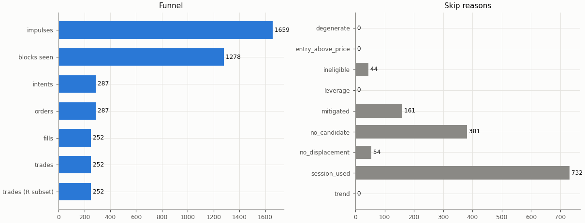

## Headline

Trade statistics use the R subset: trades closed by a stop, target or time exit (`exit_reason != data_end`); trades still open at the end of the data are left out.

| Headline | Value |
|---|---|
| trades (R subset) | 252 |
| win rate | 32.5% |
| mean gross R | -0.024 |
| mean net R | -0.335 |
| mean net R, 95% CI (trade bootstrap) | -0.525 to -0.143 |
| mean net R, 95% CI (day-block bootstrap) | -0.528 to -0.145 |
| median net R | -1.241 |
| std of net R | 1.543 |
| profit factor | 0.64 |
| mean cost (R) | 0.312 |
| mean funding (R) | 0.000 |
| mean hold (minutes) | 91.5 |
| Sharpe (annualised, daily) | -3.76 |
| Sharpe, 95% CI (10-day block bootstrap) | -6.12 to -1.89 |
| max drawdown | 60.2% |
| total return | -58.4% |
| exposure (share of candles in a trade) | 6.3% |
| mean notional / equity at the daily marks | 0.060 |
| max concurrent positions | 2 |

## Baselines

| Baseline | Observed mean net R | Runs: mean | Runs: std | p (one-sided) | z | p (Holm) | Runs |
|---|---|---|---|---|---|---|---|
| A: random entry time in the strategy's own sessions | -0.335 | -0.342 | 0.092 | 0.466 | 0.07 | 1 | 5000 |
| B: random sessions and entry times | -0.335 | -0.323 | 0.097 | 0.553 | -0.12 | 1 | 5000 |

| Table A | Value |
|---|---|
| trades covered | 252 |
| trades left out | 0 |
| baseline B: mean trades per run | 251.9 |

Holm adjustment over the holdout family of 9 primary cells (tested: A 9, B 9, buy-and-hold 9) at α = 0.05.

Baseline design (judgment calls, overview risk 13): a baseline trade enters at the open of a uniformly drawn in-session candle with the maker fee, keeps the real trade's stop distance in ATR and the variant's target and hold rule, and pays actual funding; baseline trades that reach the data end are left out of their run's mean.

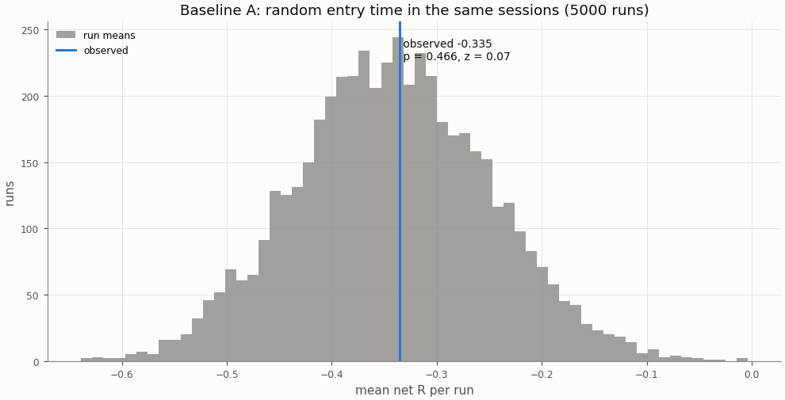

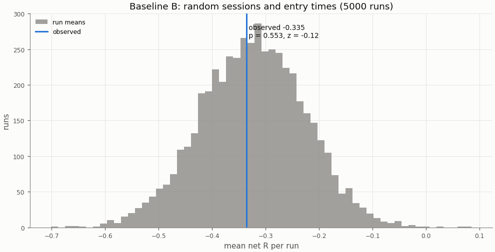

## Buy-and-hold

A constant 1× long in the perpetual with funding, scaled to the strategy's in-sample daily volatility; Sharpe is scale-invariant, the scaling matters for return and drawdown.

| Buy-and-hold | Value |
|---|---|
| days | 293 |
| buy-and-hold Sharpe | 0.02 |
| buy-and-hold Sharpe, 95% CI | -2.42 to 2.21 |
| strategy Sharpe | -3.76 |
| Sharpe difference (strategy − buy-and-hold) | -3.78 |
| Sharpe difference, 95% CI (paired block bootstrap) | -6.29 to -1.47 |
| p_BH (one-sided) | 0.999 |
| p_BH (Holm) | 1 |
| buy-and-hold total return (1×) | -13.9% |
| vol scale (σ strategy / σ buy-and-hold) | 0.218 |
| σ strategy (daily, in-sample) | 0.01373 |
| σ buy-and-hold (daily, in-sample) | 0.06286 |
| vol-scaled buy-and-hold total return | -0.6% |
| vol-scaled buy-and-hold max drawdown | 15.4% |

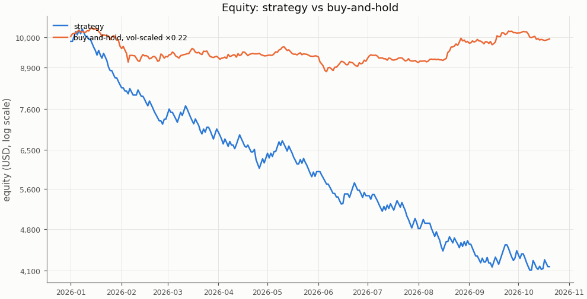

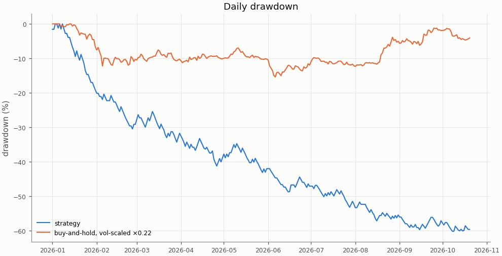

## Costs

Cost in R is fees, slippage and funding divided by the stop distance; a trade whose cost exceeds 1 R loses even when it reaches a 1 R target.

| Cost | Value |
|---|---|
| share of trades with cost above 1 R | 2.4% |

| Cost distribution | min | p05 | p25 | p50 | p75 | p95 | max | mean |
|---|---|---|---|---|---|---|---|---|
| cost per trade (R) | -0.003 | 0.070 | 0.159 | 0.253 | 0.416 | 0.718 | 1.454 | 0.312 |
| stop distance (% of entry) | 0.082 | 0.154 | 0.239 | 0.339 | 0.495 | 0.848 | 1.711 | 0.397 |
| stop distance (ATR14) | 0.382 | 0.517 | 0.698 | 0.882 | 1.112 | 1.567 | 1.912 | 0.938 |
| implied leverage (×) | 0.58 | 1.18 | 2.02 | 2.95 | 4.19 | 6.50 | 12.13 | 3.33 |
| funding (R) | -0.1138 | -0.0003 | 0.0000 | 0.0000 | 0.0000 | 0.0062 | 0.0405 | 0.0000 |

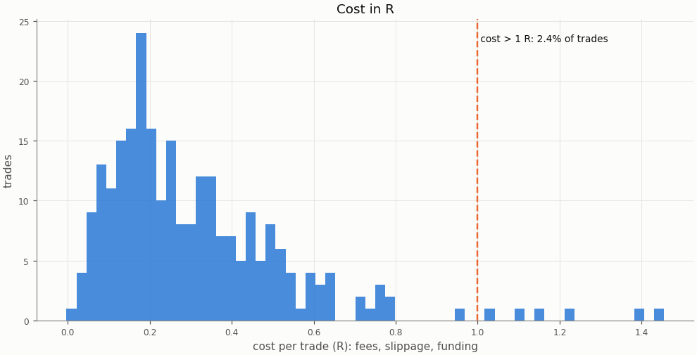

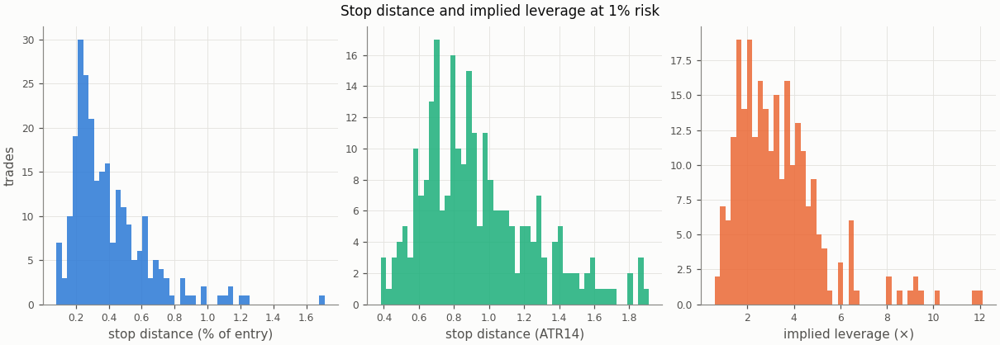

### Re-pricing (D13)

The same trades and baseline runs re-priced at other costs, without re-simulation; descriptive only, the verdict uses the registered costs.

| Slippage | Maker fee | Taker fee | n | Mean net R | 95% CI | Win rate | p_A | p_B | Costs |
|---|---|---|---|---|---|---|---|---|---|
| 0.00% | 0.00% | 0.05% | 252 | -0.135 | -0.317 to 0.049 | 32.5% | 0.417 | 0.494 |  |
| 0.00% | 0.02% | 0.05% | 252 | -0.224 | -0.402 to -0.044 | 32.5% | 0.435 | 0.521 |  |
| 0.02% | 0.00% | 0.05% | 252 | -0.180 | -0.366 to 0.009 | 32.5% | 0.428 | 0.511 |  |
| 0.02% | 0.02% | 0.05% | 252 | -0.268 | -0.451 to -0.083 | 32.5% | 0.452 | 0.533 |  |
| 0.05% | 0.00% | 0.05% | 252 | -0.247 | -0.439 to -0.052 | 32.5% | 0.445 | 0.527 |  |
| 0.05% | 0.02% | 0.05% | 252 | -0.335 | -0.525 to -0.143 | 32.5% | 0.466 | 0.553 | registered |
| 0.10% | 0.00% | 0.05% | 252 | -0.358 | -0.562 to -0.152 | 32.5% | 0.471 | 0.56 |  |
| 0.10% | 0.02% | 0.05% | 252 | -0.447 | -0.649 to -0.244 | 32.5% | 0.492 | 0.582 |  |

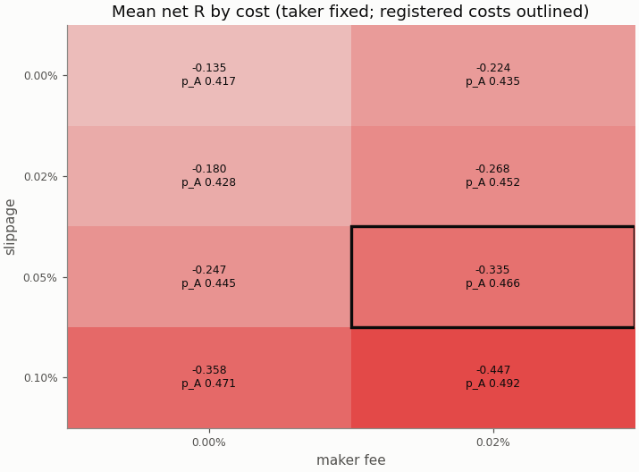

## Robustness

The grid is in-sample only; the heatmaps are in the in-sample primary report.

## Alpha decay

Per calendar year (max drawdown starts from the previous year-end equity; fill rate is filled / placed entry orders by placement year).

| Year | n | Win rate | Mean net R | Sharpe | Max DD | Fill rate |
|---|---|---|---|---|---|---|
| 2026 | 252 | 32.5% | -0.335 | -3.76 | 60.2% | 87.8% |

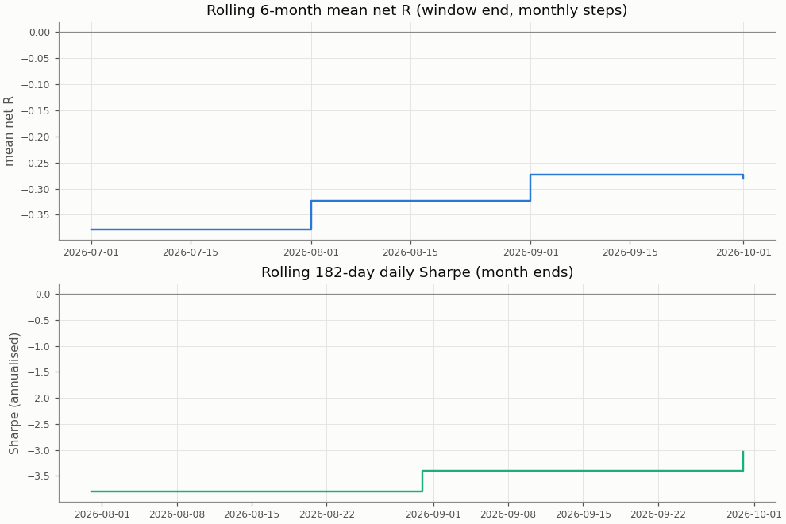

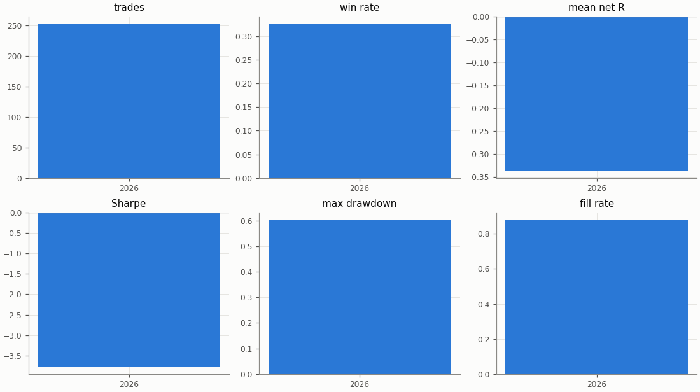

## Regimes and calendar

Trend: daily ADX(14) above 25 as of the day before entry. Volatility: 30-day realised vol of daily log returns as of the day before entry, above (`high`) or below (`low`) the in-sample median 0.04944; trades before the indicators are defined are unlabelled.

| Regime | n | Win rate | Mean net R |
|---|---|---|---|
| trend: no_trend | 134 | 35.1% | -0.284 |
| trend: trend | 118 | 29.7% | -0.393 |
| vol: high | 23 | 21.7% | -0.549 |
| vol: low | 229 | 33.6% | -0.314 |

| Day of week (UTC) | n | Win rate | Mean net R |
|---|---|---|---|
| Monday | 37 | 35.1% | -0.184 |
| Tuesday | 38 | 31.6% | -0.307 |
| Wednesday | 32 | 50.0% | 0.235 |
| Thursday | 35 | 28.6% | -0.435 |
| Friday | 36 | 19.4% | -0.709 |
| Saturday | 38 | 26.3% | -0.700 |
| Sunday | 36 | 38.9% | -0.171 |

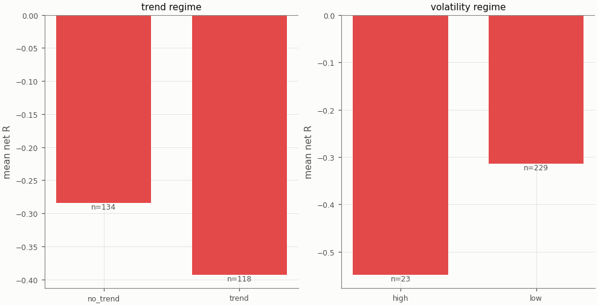

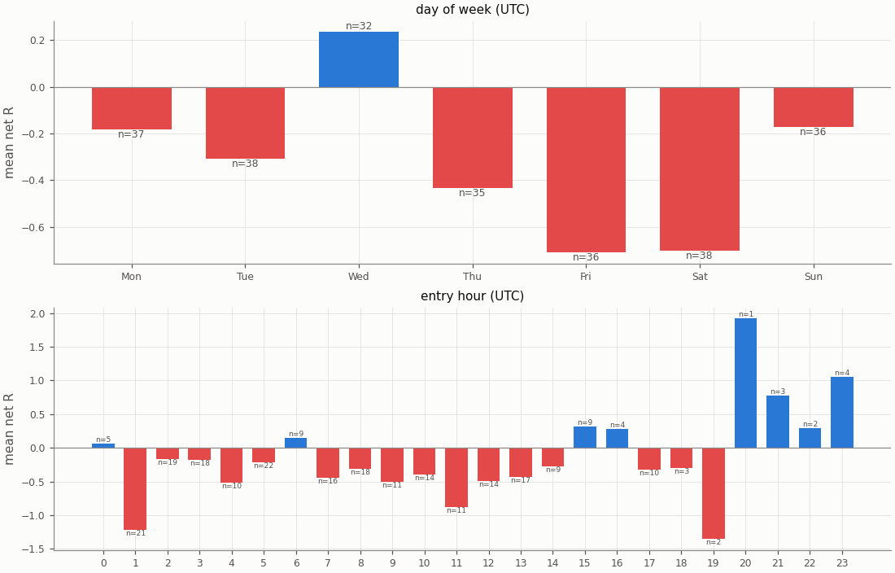

## Diagnostics

| Count | Value |
|---|---|
| trades open at the data end (left out of the R subset) | 0 |
| ambiguous candles resolved without full 1m data | 0 |
| max concurrent positions | 2 |
| funding paid in total (USD) | -4.45 |

| Fill resolution | Fills |
|---|---|
| 15m_unambiguous | 410 |
| 1m | 79 |
| 1m_pessimistic | 14 |
| open_gap | 1 |

| Exit reason | n | Win rate | Mean net R |
|---|---|---|---|
| stop | 170 | 0.0% | -1.397 |
| target | 82 | 100.0% | 1.865 |

| Trade distribution | min | p05 | p25 | p50 | p75 | p95 | max | mean |
|---|---|---|---|---|---|---|---|---|
| hold (minutes) | 0.0 | 4.0 | 15.0 | 45.0 | 90.0 | 360.0 | 1275.0 | 91.5 |
| MAE (R) | -8.809 | -2.655 | -1.487 | -1.160 | -0.717 | -0.175 | 0.000 | -1.256 |
| MFE (R) | 0.076 | 0.255 | 0.656 | 1.295 | 2.243 | 3.362 | 8.363 | 1.540 |

Share of this variant's trades whose candidate candle is also traded by the other session variants (computed at report time from their trade tables): London 18.7%, NY 4.4%; any of them 21.4%. The session variants are not independent tests.

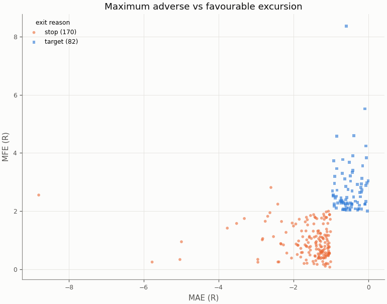

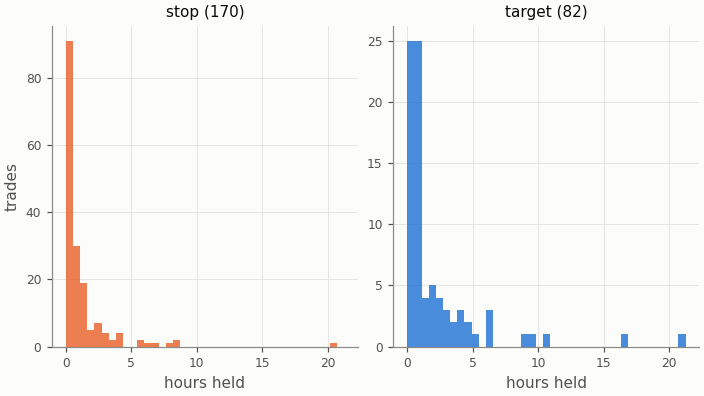

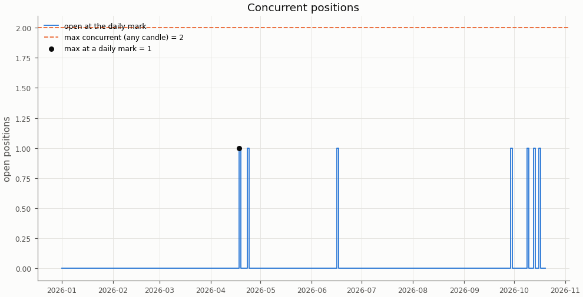

## Deflated Sharpe ratio

| Daily returns | Value |
|---|---|
| daily Sharpe (not annualised) | -0.1969 |
| days T | 293 |
| skew | 0.698 |
| kurtosis (non-excess) | 2.151 |

| Trials | N | V (variance of daily Sharpe) | SR* | DSR |
|---|---|---|---|---|
| this pair × session's grid | n/a | n/a | n/a | n/a |
| all grid variants | n/a | n/a | n/a | n/a |

The DSR is computed for the in-sample grid only; the holdout tests one pre-registered configuration per cell.

Caveat: the grid cells share most of their trades, so the effective number of independent trials is far below N and the DSR is conservative.

## Notes

- `15m_pessimistic_missing_1m`: 0 fills and 0 ambiguous (candle, order) pairs were resolved by the pessimistic 15m rule because 1m data was incomplete.
- Data gaps overlapping a trade (computed at report time from the candle manifests): 15m: 0 trades over 0 gaps; 1m: 0 trades over 0 gaps.
